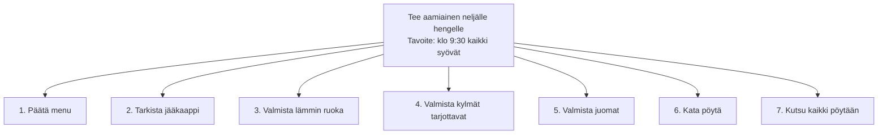
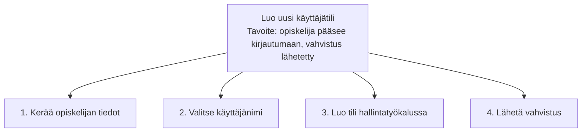

# Oppitunti 4 — Ongelman pilkkominen (päätehtävä, osatehtävät ja tavoite)

### Mitä ositus on?

**Ositus** on liike, jossa otetaan tehtävä, joka on liian iso yhdelle tasaiselle vaihelistalle, ja pilkotaan se **päätehtäväksi**, jolla on **tavoite**, ja pieneksi joukoksi **osatehtäviä**, joilla kullakin on oma osatavoite. Siinä on tämän viikon koko määritelmä. Liike on sellainen, jonka teet jo päässäsi aina kun suunnittelet viikonloppua tai järjestät iltaa kavereiden kanssa; uutta tällä viikolla on tehdä se paperilla, tarkoituksella, niin että jokaiselle osalle on nimi.

Viime viikolla ohjeesi olivat tarpeeksi pieniä eläkseen yhtenä tasaisena listana. Tällä viikolla ne käyvät liian isoiksi siihen. Huomaat sen, kun yksi vaihe osoittautuu vaativan oman listansa alle. *"Valmista lämmin ruoka"* ei ole yksi vaihe; se on kolme tai neljä. *"Aseta kollegan sähköposti"* on kuusi tai seitsemän, järjestyksessä, jolla on väliä. Sillä hetkellä, kun näet sen, ositus on liike, joka saa sinut taas käyntiin.

Pidä mielessä kaksi asiaa. Ensiksi, ositus on **suunnitteluliike** — vaiheiden täytyy yhä olla olemassa pintaa syvemmällä, vain hallittavan kokoisina. Toiseksi, ositus **ei ole sama asia kuin pitkän listan tekeminen**. Pitkä lista on tasainen: vaihe 1, vaihe 2, … vaihe 30. Osituksella on muoto: yksi päätehtävä ylimpänä, kourallinen osatehtäviä alla, kullakin oma tavoite.

### Päätehtävä, osatehtävät ja tavoite

Kolme sanaa kantavat suurimman osan viikosta.

**Päätehtävä.** Se, mitä yrität oikeasti suorittaa, kirjoitettuna yhdellä lyhyellä lauseella. *"Tee aamiainen neljälle hengelle sunnuntaiaamuna."* Ei *"aamiainen"* — täysi lyhyt lause, joka nimeää, mitä olet tekemässä.

**Tavoite.** Mikä on totta lopussa. Yksi lyhyt lause, joka kuvaa maailmaa päätehtävän valmistuttua. Päätehtävä on *tekeminen*; tavoite on *lopputila*. Vertaa:

- Päätehtävä: *Tee aamiainen neljälle hengelle sunnuntaiaamuna.*
- Tavoite: *Klo 9:30 kaikki istuvat pöydässä syömässä; kahvi, kaakao, tee, munat, paahtoleipä ja hedelmät ovat kaikki pöydässä.*

Jos et pysty kirjoittamaan tavoitetta yhdellä lyhyellä lauseella, päätehtävä on edelleen liian iso tai liian epämääräinen. Palaa takaisin ja nimeä päätehtävä täsmällisemmin, kunnes tavoite mahtuu yhteen lauseeseen.

**Osatehtävä.** Pienempi tehtävä, joka asuu päätehtävän alla. Osatehtävä on riittävän pieni, että pystyt kirjoittamaan sille puhtaan pikku algoritmin (yhden lyhyen sananmukaisen vaihesekvenssin), ja sillä on oma **osatavoite** — kapeampi ja tarkempi kuin päätehtävän tavoite. Osatehtävän *"valmista lämmin ruoka"* osatavoite ei ole *"aamiainen on valmis"*; se on *"munakokkeli ja paahtoleipä ovat lämpiminä tarjoiluvadilla."*

Käydään yksi arkielämän ositus läpi kokonaan.

**Esimerkki — aamiaisen tekeminen neljälle hengelle.**

- **Päätehtävä:** *Tee aamiainen neljälle hengelle sunnuntaiaamuna.*
- **Tavoite:** *Klo 9:30 kaikki istuvat pöydässä syömässä; kahvi, kaakao, tee, munat, paahtoleipä ja hedelmät ovat kaikki pöydässä.*
- **Osatehtävät** (osatavoitteineen):
  1. *Päätä menu.* Osatavoite: *Kuusi asiaa on nimetty — kaksi kahvia, yksi kaakao, yksi tee, munat, paahtoleipä, hedelmät — ja tarkat määrät on päätetty.*
  2. *Tarkista, mitä jääkaapissa ja hyllyillä on.* Osatavoite: *Jokaisen menun ainesosan olemassaolo keittiössä on varmistettu, tai se on lyhyellä ostoslistalla.*
  3. *Valmista lämmin ruoka.* Osatavoite: *Munakokkeli ja paahtoleipä ovat lämpiminä tarjoiluvadilla.*
  4. *Valmista kylmät tarjottavat.* Osatavoite: *Hedelmät on pesty, paloiteltu ja lautasella; hillo ja voi ovat jääkaapista ulkona.*
  5. *Valmista juomat.* Osatavoite: *Kaksi kahvia, yksi kaakao, yksi tee ovat mukeissa ja kuumina.*
  6. *Kata pöytä.* Osatavoite: *Neljä lautasta, neljä mukia, neljät ruokailuvälineet ja servietit ovat pöydässä.*
  7. *Kutsu kaikki pöytään.* Osatavoite: *Kaikki neljä ihmistä ovat pöydässä klo 9:30 mennessä.*

Puuna piirrettynä sama ositus näyttää tältä:

Huomaa, mitä tapahtui. Lause päässäsi oli *"tee aamiainen neljälle hengelle"* — yksi rivi. Paperilla siitä tuli päätehtävä, tavoite ja seitsemän osatehtävää. Jokainen osatehtävä on nyt riittävän pieni, että voisit kirjoittaa sille viiden vaiheen algoritmin niin kuin teit viikolla 1. Tehtävä ei pienentynyt; siitä tuli muoto, jonka pystyt pitämään päässäsi.

### Miksi ylipäätään pilkkoa?

Kolme syytä, selkokielellä.

**Yksi — voit kirjoittaa kunkin osatehtävän puhtaana pikku algoritmina.** Kun *"valmista lämmin ruoka"* on oma osatehtävänsä omine osatavoitteineen, viikon 1 taito herää eloon. Voit kirjoittaa sille viisi sananmukaista vaihetta. Et pystyisi tekemään samaa koko aamiaiselle viidellä vaiheella; pystyt yhdelle osatehtävälle.

**Kaksi — voit antaa eri osatehtäviä eri ihmisille.** Jos siskosi on keittiössä kanssasi, hän voi ottaa osatehtävän 6 (*kata pöytä*), kun sinä otat osatehtävän 3 (*valmista lämmin ruoka*). Ilman ositusta et voi sanoa *"sinä teet tuon palan, minä teen tämän palan"* — paloja ei ole, vain "aamiainen".

**Kolme — voit tarkistaa työtäsi osatehtävä kerrallaan, sen sijaan että tekisit sen kaiken kerralla.** Kun pöytä on katettu, osatehtävä 6 on valmis. Kun munat ovat lautasella, osatehtävä 3 on valmis. Sinun ei tarvitse odottaa klo 9:30 saakka huomataksesi unohtaneesi haarukat. Ositus antaa sinulle **tarkistuspisteitä**.

### Ensimmäinen ICT-esimerkki

Vaihdetaan ICT-tehtävään. Pidä se täällä kevyenä; syvempi versio asuu oppitunnissa 6.

**Esimerkki — käyttäjätilin luominen.**

- **Päätehtävä:** *Luo uusi käyttäjätili koulun oppimisalustalle uudelle opiskelijalle.*
- **Tavoite:** *Uusi opiskelija pystyy kirjautumaan toimivalla käyttäjänimellä ja salasanalla, ja tilin luonnista on lähetetty vahvistus.*
- **Osatehtävät** (osatavoitteineen):
  1. *Kerää opiskelijan tiedot.* Osatavoite: *Koko nimi, syntymäaika, kouluverkkosähköposti ja opiskelijanumero ovat kirjoitettuna ylös, oikein kirjoitettuna.*
  2. *Valitse käyttäjänimi.* Osatavoite: *Koulun mallin mukainen käyttäjänimi on päätetty, eikä se törmää olemassa olevan tilin kanssa.*
  3. *Luo tili alustan hallintatyökalussa.* Osatavoite: *Tili on olemassa valitulla käyttäjänimellä; ensimmäisen kirjautumisen salasana on asetettu.*
  4. *Lähetä vahvistus.* Osatavoite: *Opiskelija on saanut käyttäjänimensä ja ensimmäisen kirjautumisen salasanansa ja tietää, missä kirjautua.*

Sama muoto, ICT-versiona:

Sama muoto: päätehtävä, tavoite, neljä pientä osatehtävää, kullakin oma osatavoite. Oppitunti 6 venyttää tämänkaltaisen tehtävän 5–8 osatehtäväksi, joilla on nimetyt riippuvuudet.

> **Pysähdy hetkeksi:** Katso yllä olevaa aamiaisesimerkkiä. Valitse yksi seitsemästä osatehtävästä ja kirjoita sen osatavoite uudelleen *omin sanoin*. Kysy sitten itseltäsi: jos kämppis lukisi vain sinun osatavoitteesi eikä muuta sivun sisältöä, osaisiko hän kertoa milloin hän on valmis kyseisen osatehtävän kanssa? Jos ei, kirjoita osatavoite uudelleen, kunnes hän osaisi.

---
