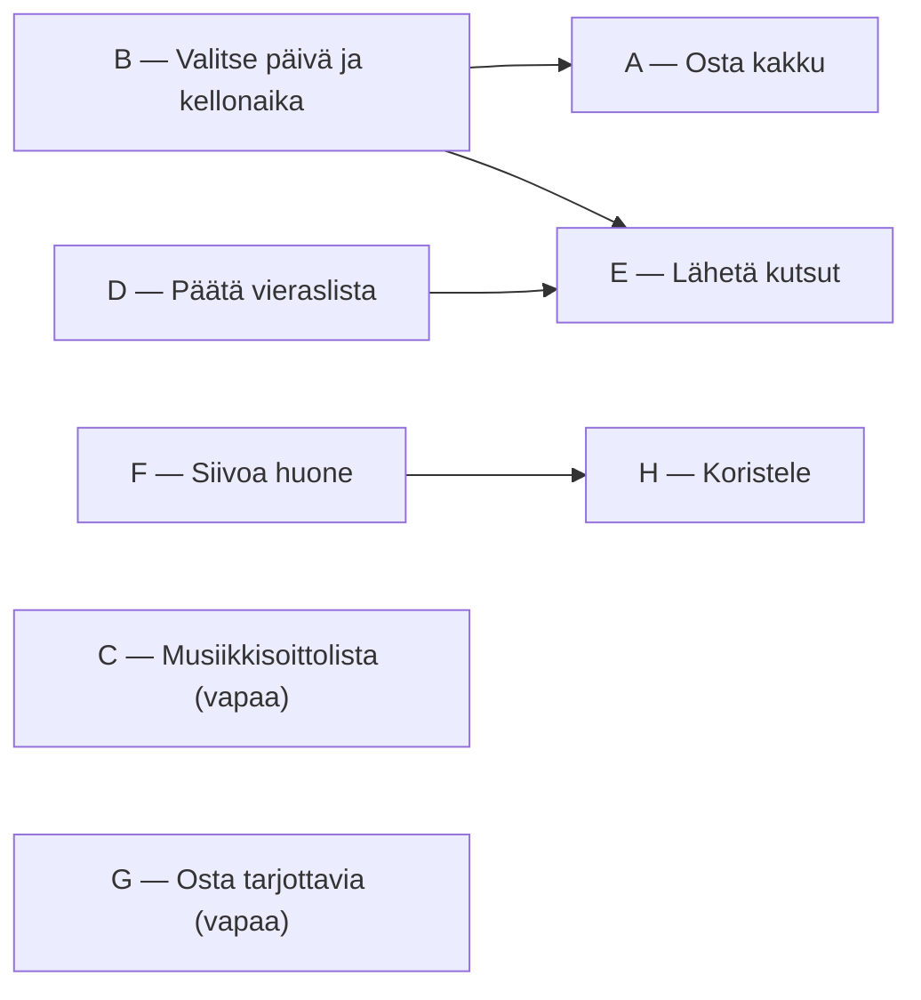

# Oppitunti 5 — Vaiheiden järjestys ja riippuvuudet

### Jotkut osatehtävät riippuvat toisista

Ositus ei ole valmis, kun sinulla on päätehtävä, osatehtävät ja osatavoitteet. Sinun täytyy myös miettiä **järjestystä**. Jotkut osatehtävät tulee tehdä toisten jälkeen; jotkut ovat vapaita.

**Riippuvuus** on yhteys kahden osatehtävän välillä, jossa toinen tarvitsee toisen **tulosteen** ennen kuin se voi alkaa. Käytä aamiaista paperilla. *"Syö paahtoleipä"* riippuu osatehtävästä *"paahda leipä"*: paahtamisen tuloste (paahdettu siivu) on syömisen syöte. Jos vaihdat järjestyksen, sananmukaisella tulkitsijalla on kylmää leipää lautasella eikä paahtoleipää.

Toinen pikku esimerkki: *"kaada kahvi mukiin"* riippuu osatehtävästä *"keitä kahvi"*, koska keittämisen tuloste (kuuma kahvi) on kaatamisen syöte. Kaataminen ensin ei ole mahdollista.

Huomaa sana *tuloste*. Riippuvuus ei ole "tuntuu siltä, että sen pitäisi tulla ensin" — se on täsmällinen tosiasia siitä, että yksi osatehtävä tarvitsee jotain, jota vain toinen osatehtävä tuottaa. Kun bongaat riippuvuuden, kirjoita se yhdellä lyhyellä lauseella: *"Osatehtävä 5 (kaada kahvi) riippuu osatehtävästä 4 (keitä kahvi), koska kaataminen tarvitsee kuumaa kahvia, jota keittäminen tuottaa."*

### Jotkut osatehtävät ovat riippumattomia

Jokaisella parilla ei ole riippuvuutta. Jotkut voivat tapahtua kummassa järjestyksessä tahansa — tai "samaan aikaan", jos keittiössä on kaksi ihmistä.

*Kata pöytä* (osatehtävä 6) ei riipu *valmista lämmin ruoka* (osatehtävä 3) -osatehtävästä. Kumman tahansa tuloste ei ole toisen syöte. Voit kattaa pöydän ennen kuin munat ovat lautasella; voit kattaa sen jälkeen. Jos siskosi kattaa pöydän samalla kun sinä teet munat, ne tapahtuvat "samaan aikaan" — epämuodollisesti **rinnakkain**. (Emme esittele samanaikaisuuden teknistä ideaa tällä viikolla; *rinnakkain* tarkoittaa täällä "voisi tapahtua kummassa järjestyksessä tahansa, mukaan lukien samaan aikaan, jos käsipareja on kaksi".)

Tämä on huomionarvoista. Ensiksi, vapaan järjestyksen osatehtävät ovat siellä, missä sinulla on joustovaraa. Toiseksi, ne ovat siellä, missä kaksi ihmistä voi auttaa toisiaan sen sijaan että astuisivat toistensa varpaille.

### Osatehtävien asettaminen perusteltuun järjestykseen

**Esimerkki — syntymäpäivän järjestäminen.** Kuvittele, että sinun täytyy suunnitella pieni syntymäpäiväjuhla kotona ensi lauantaiksi. Tässä on kahdeksan osatehtävää, kirjoitettuna tarkoituksella **väärään järjestykseen**:

- A. *Osta kakku.*
- B. *Valitse päivä ja kellonaika.*
- C. *Aseta musiikkisoittolista.*
- D. *Päätä vieraslista.*
- E. *Lähetä kutsut.*
- F. *Siivoa huone.*
- G. *Osta tarjottavia.*
- H. *Koristele.*

Etsi nyt riippuvuudet. *Lähetä kutsut* (E) riippuu vieraslistasta (D) — et voi lähettää listalle, jota sinulla ei ole. E riippuu myös päivästä ja kellonajasta (B) — kutsujen täytyy kertoa *milloin*. *Koristele* (H) riippuu osatehtävästä *siivoa huone* (F): et voi ripustaa banneria pyykkikasan yli. *Osta kakku* (A) riippuu siitä, että päivä on lyöty lukkoon (B).

Mikä on **vapaata**? *Aseta musiikki* (C) ei riipu useimmista muista. *Tarjottavien ostaminen* (G) on vapaa suhteessa siivoamiseen ja koristelemiseen. Perusteltu järjestys siis: **B → D → E**, ja **A, G, F, H, C** mahtuvat sinne minne sopivat. Perusteltu järjestys ei ole ainoa järjestys; se on järjestys, jonka voit perustella muistiin kirjoittamillasi riippuvuuksilla.

Piirrettynä riippuvuusgraafina (nuoli = "täytyy olla valmis ennen"):

C:llä ja G:llä ei ole sisään- tai ulosmeneviä nuolia — ne ovat *vapaita* osatehtäviä. Ne sopivat minne tahansa.

### ICT-peilikuva — tiedoston jakaminen

Sama liike pienelle ICT-tehtävälle. Opettajasi pyytää sinua jakamaan dokumentin luokkaryhmän kanssa.

- **Päätehtävä:** *Jaa projektin monistepaperi luokkaryhmän kanssa koulun pilvitallennuksessa.*
- **Tavoite:** *Jokainen luokkaryhmän opiskelija voi avata monisteen 24 tunnin sisällä, ja opettaja on vahvistanut vastaanottaneensa sen.*
- **Osatehtävät:**
  1. *Etsi dokumentti koulun pilvitallennuksesta.* Osatavoite: *Moniste on löytynyt ja sen polku on tiedossa.*
  2. *Tunnista luokkaryhmä.* Osatavoite: *Oikea ryhmänimi on löytynyt henkilövalitsimesta.*
  3. *Aseta jakamisoikeudet.* Osatavoite: *Luokkaryhmällä on lukuoikeus.*
  4. *Kopioi jakolinkki.* Osatavoite: *Toimiva linkki on leikepöydällä.*
  5. *Kirjoita sähköpostin runko.* Osatavoite: *Lyhyt sähköposti kertoo, mikä dokumentti on ja sisältää linkin.*
  6. *Lähetä sähköposti.* Osatavoite: *Sähköposti on lähtenyt ja on lähetetyt-kansiossasi.*
  7. *Vahvista vastaanotto opettajan kanssa.* Osatavoite: *Opettaja on vastannut "sai".*

Riippuvuudet. Osatehtävä 4 (*kopioi jakolinkki*) riippuu osatehtävästä 3 (ilman oikeuksia ei jaettavaa linkkiä). Osatehtävä 6 riippuu osatehtävistä 4 (linkki) ja 5 (runko). Osatehtävä 7 riippuu osatehtävästä 6.

Mikä on vapaata? Sähköpostin rungon kirjoittaminen (5) ei riipu linkistä (4). Jos kaksi ihmistä tekisi tämän, toinen voisi luonnostella runkoa, kun toinen asettaa oikeuksia.

> **Pysähdy hetkeksi:** Ota syntymäpäiväesimerkki ja valitse yksi osatehtäväpari, jonka mielestäsi on *vapaa* (ei riippuvuutta välillä). Kysy nyt: kohtelisiko sananmukainen tulkitsija niitä oikeasti vapaina, vai onko siellä piilevä riippuvuus, jota olet olettanut kirjoittamatta sitä muistiin? Jos sellainen on, kirjoita se muistiin.

> **Pysähdy hetkeksi:** Kuvittele jakavasi tiedoston luokkaryhmälle oman koulusi järjestelmässä tänä iltapäivänä. Mikä yllä olevan ICT-esimerkin osatehtävä muuttuisi eniten *sinun* koulusi tietyn ohjelmiston vuoksi? Kirjoita yksi lause.

---
