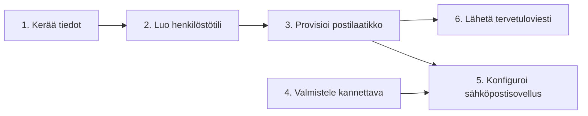

# Oppitunti 6 — ICT-tehtävän pilkkominen

### Astutaan realistiseen ICT-tehtävään

Aika panna koko liike töihin realistisessa ICT-tehtävässä — sellaisessa, jonka ensimmäisen linjan help desk -kollega saattaisi hoitaa ensimmäisellä viikollaan. Tämän oppitunnin skenaario on:

> *"On maanantaiaamu. Uusi kollega aloittaa koulussasi kahden tunnin kuluttua. Hänellä täytyy olla toimiva sähköpostitili uudella kannettavallaan, kun hän istuu työpöytänsä ääreen."*

Tämänkaltainen lause kuulostaa pieneltä, kunnes alat kirjoittaa vaiheita. Sitten se kasvaa. Yhtä painettavaa nappia ei ole. Mukana on useita järjestelmiä (kannettava, sähköpostipalvelin, henkilöstötilien hakemisto), useita tietoja, jotka sinun täytyy ensin kerätä, ja monilla osatehtävillä on kovat riippuvuudet toisiinsa.

Liike on sama kuin aamiaisessa ja syntymäpäivissä. Aloita päätehtävästä ja tavoitteesta. Kirjoita sitten osatehtävät osatavoitteineen. Mieti sitten järjestys ja riippuvuudet.

- **Päätehtävä:** *Aseta uuden kollegan sähköpostitili hänen uudelle kannettavalleen ajoissa hänen klo 10:00 aloittaessaan.*
- **Tavoite:** *Klo 10:00 uusi kollega istahtaa kannettavansa ääreen, avaa sähköpostisovelluksen, kirjautuu sisään kerran ja lukee odottavan tervetuloviestin.*

### Skenaariosta osatehtäviksi

Kuusi osatehtävää, osatavoitteineen:

1. *Kerää uuden kollegan tiedot.* Osatavoite: *Koko nimi, rooli, lähiesimies, aloituspäivä ja väliaikainen salasana ovat kirjoitettuina ylös ja HR:n vahvistamia.*
2. *Luo henkilöstötili hakemistoon.* Osatavoite: *Tili on olemassa henkilöstöhakemistossa sovitulla käyttäjänimellä; väliaikainen salasana toimii; tili on oikeassa henkilöstöryhmässä.*
3. *Provisioi postilaatikko.* Osatavoite: *Tilille on olemassa toimiva postilaatikko; testiviestin lähettäminen ja vastaanottaminen itsellesi onnistuu.*
4. *Valmistele kannettava.* Osatavoite: *Kannettava on päällä, päivitetty, kirjautunut koulun verkkoon, ja sähköpostisovellus on asennettu.*
5. *Konfiguroi sähköpostisovellus uudelle tilille.* Osatavoite: *Kannettavan sähköpostisovellus on kirjautunut uuteen postilaatikkoon; saapuneet-kansio latautuu.*
6. *Lähetä tervetuloviesti.* Osatavoite: *Lähiesimiehen lyhyt tervetulosähköposti on saapuneet-kansiossa, näkyvissä sillä hetkellä, kun kollega avaa kannettavan.*

Jokainen osatehtävä on riittävän pieni, että voisit viikon 1 tyyliin kirjoittaa sen alle viidestä kahdeksaan sananmukaista vaihetta help desk -kollegan seurattavaksi. *Emme kirjoita näitä vaiheita kurssilla tällä viikolla.* Ositus pysähtyy osatehtävätasolle — viikon 1 sananmukaisten vaiheiden kirjoittaminen tapahtuu *osatehtävän sisällä*, sinä päivänä kun oikea help desk -kollega niitä tarvitsee.

### Järjestys ja riippuvuudet oikeassa tehtävässä

Nyt riippuvuudet. Merkitse ne eksplisiittisesti.

- Osatehtävä 2 (*luo henkilöstötili*) riippuu osatehtävästä 1 (*kerää tiedot*). Et voi luoda tiliä ilman nimeä, roolia ja käyttäjänimeä.
- Osatehtävä 3 (*provisioi postilaatikko*) riippuu osatehtävästä 2 (*luo tili*). Postilaatikko on kytketty tiliin; ei tiliä, ei postilaatikkoa.
- Osatehtävä 5 (*konfiguroi sähköpostisovellus*) riippuu sekä osatehtävästä 3 (toimiva postilaatikko) että osatehtävästä 4 (valmisteltu kannettava). Se tarvitsee postilaatikon, johon kirjautua, *ja* kannettavan, jolta kirjautua.
- Osatehtävä 6 (*lähetä tervetuloviesti*) riippuu osatehtävästä 3 (toimiva postilaatikko sen vastaanottamiseksi).

Mikä on **vapaata**? Osatehtävä 4 (*valmistele kannettava*) on riippumaton osatehtävistä 1, 2 ja 3. Voit antaa kannettavan jollekulle toiselle valmisteltavaksi samalla kun itse asetat tilin hakemistoon. Nämä kaksi raidetta kohtaavat osatehtävässä 5. Perusteltu järjestys yhdellä vapaalla haaralla:

- Raide A: 1 → 2 → 3 → 6
- Raide B: 4 (milloin tahansa ennen osatehtävää 5)
- Yhtymä: 5 tapahtuu, kun molemmat raiteet, A (osatehtävän 3 läpi) ja B, ovat valmiit.

Raide A kulkee yläosassa (1 → 2 → 3 → 6). Raide B on vain osatehtävä 4 yksinään. Ne kohtaavat osatehtävässä 5.

Tämä on useimpien viikkojen oikean ICT-tehtävän muoto. Jotkut osatehtävät muodostavat kovan ketjun; yksi tai kaksi haaraa kulkee rinnakkain; kaikki kohtaa yhtymäkohdassa.

### Kaksi pätevää ositusta samasta tehtävästä

Pieni mutta tärkeä huomio ennen AT1:tä. Yllä oleva ositus on yksi pätevä tapa pilkkoa kollegan sähköposti -tehtävä. Toinen kollega voisi pilkkoa sen toisin — esimerkiksi yhdistämällä "luo tili" ja "provisioi postilaatikko" yhdeksi osatehtäväksi (koska heidän työkalunsa tekee molemmat yhdellä klikkauksella) ja pilkkomalla "valmistele kannettava" "päivitä kannettava" ja "asenna sähköpostisovellus" kahdeksi osatehtäväksi (koska heidän koulussaan ne ovat kaksi eri työtä, joita kaksi eri ihmistä tekee).

Molemmat ositukset voivat olla päteviä. Kumpikaan ei ole väärin. Saat lisää harjoitusta tähän ideaan viikolla 4, jossa kurssi opettaa sinut vertaamaan kahta pätevää ratkaisua ja valitsemaan niiden välillä. Viikolle 2 viesti on lempeämpi: huomaa, että oikea ositus riippuu **työn muodosta siellä, missä sinä olet**, ei yleismaailmallisesta parhaasta vastauksesta. Sinun tehtäväsi AT1:ssä on kirjoittaa ositus, jonka voit perustella — ei ainoaa mahdollista.

### Valmistautuminen AT1:een

Oppitunnin 6 lopussa palautat **AT1**:n, kurssin ensimmäisen arvioitavan tehtävän. AT1 pyytää sinua tekemään juuri sen, mitä tämä viikko on harjoitellut:

- Valitse yksi tehtävä — arkielämästä tai ICT:hen liittyvä, oma valinta.
- Kirjoita päätehtävä ja sen tavoite kumpikin yhdellä lauseella.
- Listaa 4–8 osatehtävää, kullakin oma osatavoite yhdellä lauseella.
- Aseta osatehtävät perusteltuun järjestykseen ja **nosta esiin vähintään yksi riippuvuus** selkokielellä.
- Lisää 3–5 lauseen reflektio: minkä osatehtävän osatavoitetta oli vaikein nimetä ja miksi?

Muistiinpanot, joita olet pitänyt tämän viikon tehtävistä — arkielämän ositus tehtävästä 2.1, parin kanssa testattu tehtävästä 2.2, riippuvuuskartta tehtävästä 2.3, koulun ICT-ositus tehtävästä 2.4, sparrauskumppanin avulla uudelleen kirjoitettu tehtävästä 2.5 — ovat AT1:n raaka-aine. Jos olet tehnyt tehtävän 2.4 siististi, suurin osa AT1:stä on jo muistikirjassasi. Jos olet tehnyt vain pakolliset tehtävät, sinulla on silti kaikki mitä tarvitset.

Muistutus viikon keskeisestä viestistä, koska se on myös AT1:n keskeinen viesti:

> *"Iso ongelma muuttuu hallittavaksi ongelmaksi, kun nimeät päätehtävän, sen osatehtävät ja järjestyksen, jossa ne on tehtävä."*

Tämä on lause, joka kannattaa pitää päässä, kun kirjoitat AT1:n. Jos osaat nimetä päätehtävän, nimetä osatehtävät osatavoitteineen ja asettaa ne järjestykseen, jossa on vähintään yksi riippuvuus, olet tehnyt sen liikkeen, jota tämä viikko harjoitti.

> **Pysähdy hetkeksi:** Kuvittele, että palautat AT1:n huomenna. Mikä tämän viikon tehtävistä antoi sinulle tuotoksen, jonka palauttaisit? Jos vastauksesi on "Minulla ei vielä ole sellaista", minkä tehtävän teet tänä iltana saadaksesi sellaisen?

---

## Yhteenveto ja mitä seuraavaksi

Viikko 2 lisäsi yhden liikkeen viikon 1 sananmukaisen tulkitsijan ajatusmallin päälle. Kun tehtävä on liian iso yhdelle vaihelistalle, pilkot sen. Nimeät päätehtävän ja sen tavoitteen. Nimeät osatehtävät osatavoitteineen. Asetat osatehtävät järjestykseen ja nostat esiin, mitkä riippuvat mistäkin. Viikon 1 sananmukainen tulkitsija on yhä huoneessa — jokainen osatehtävä, yksinään, täytyy olla riittävän pieni, että sananmukainen tulkitsija voisi suorittaa sen arvailematta.

Koko viikko mahtuu yhteen lauseeseen:

> *"Iso ongelma muuttuu hallittavaksi ongelmaksi, kun nimeät päätehtävän, sen osatehtävät ja järjestyksen, jossa ne on tehtävä."*

**Viikolla 3** lisäämme kolmannen ohjelmallisen ajattelun neljästä pilarista: **abstraktion**. Ositus antoi sinulle pienten tehtävien puun; abstraktio on liike, jossa *piilotetaan yksityiskohdat, joita et tarvitse*. Kun sanoit *"valmista lämmin ruoka"* tällä viikolla, abstrahoit jo — et vielä sanonut, mikä pannu, mikä lämpötila, missä järjestyksessä munat pannulle laitetaan. Viikko 3 tekee tämän liikkeen eksplisiittiseksi, antaa sille nimen ja esittelee ensimmäisen prosessin kuvan: yksinkertaisen **vuokaavion** (alku, loppu, nuolet). Ei vielä koodia — se on viikko 7.

Pidä AT1-tuotoksesi ja muistiinpanosi tallessa. Viikko 3 käyttää uudelleen osituksen muotoa, ja viikolla 3 piirtämäsi vuokaavio asuu tason ylempänä kuin ositus, ei sen alapuolella.
