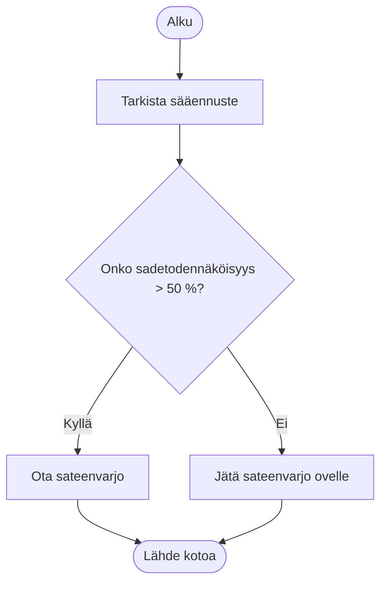
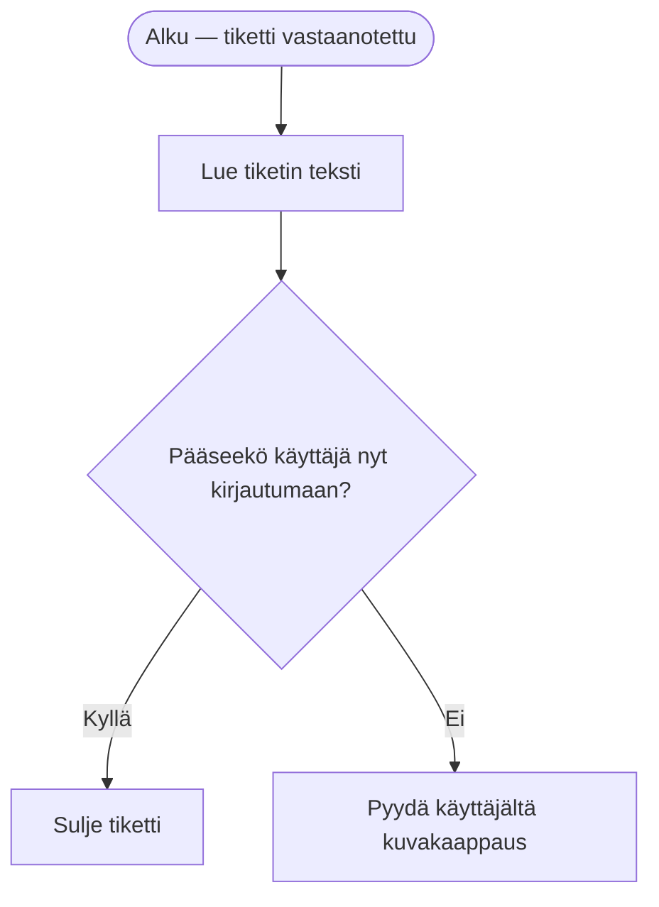

# Oppitunti 7 — Prosessin kuvaaminen ja yksinkertainen vuokaavio

### Kun lista ei riitä

Kuvittele aamurutiinisi normaalina koulupäivänä. Herätyskello, ylösnousu, peseytyminen, pukeutuminen, syöminen, laukku, ulos ovesta. Seitsemän vaihetta tasaisella listalla. Sananmukainen tulkitsija voisi suorittaa tämän tekemättä yhtäkään päätöstä. Lista toimii.

Kuvittele nyt sama aamu, kun jokin on pielessä. *Soiko herätyskello oikeasti?* Jos soi, sinulla on aikaa aamupalalle. Jos ei, kello on jo 8:10 ja joudut jättämään aamupalan väliin. *Sataako?* Jos sataa, ota sateenvarjo mukaan. *Onko jääkaapissa maitoa?* Jos on, muroja; jos ei, paahtoleipää.

Tasainen lista ei pysty pitelemään tätä. *Vaihe 5 — syö aamupala* on nyt useita eri asioita riippuen useiden eri kysymysten vastauksista. Kun prosessissa on kolme tai neljä kysymystä, lista muuttuu lukukelvottomaksi.

Vuokaavio on se, miksi lista muuttuu, kun prosessissa on haaroja. Lista sanoo *tee tämä, sitten tämä*. Vuokaavio sanoo *tee tämä, sitten kysy tämä kysymys, ja vastauksesta riippuen mene tätä tai tuota kautta*. Sillä hetkellä kun prosessissa on kyllä/ei-kysymys, tasainen lista ei enää riitä.

Sama muutos tapahtuu help deskillä. *"Lähettikö käyttäjä kuvakaappauksen?"* Jos kyllä, liitä se ja jatka. Jos ei, pyydä se ensin. Tasainen lista ei voi piirtää tuota kysymystä. Vuokaavio voi.

### Neljä muotoa

Tämän kurssin vuokaavio käyttää täsmälleen neljää muotoa. Jokaisella on yksi tehtävä.

- **Alku / Loppu (soikio).** Soikio, joka aloittaa tai päättää vuokaavion. Jokaisessa vuokaaviossa on täsmälleen yksi **Alku**-soikio ja vähintään yksi **Loppu**-soikio. Alku-soikio kertoo, mistä prosessi alkaa; Loppu-soikio kertoo, mihin yksi polku päättyy.
- **Vaihe (suorakulmio).** Suorakulmio sisältää yhden toiminnon — *"Tarkista sääennuste"*, *"Tallenna tiedosto"*, *"Lähetä tiketti käyttäjälle"*. Yksi suorakulmio, yksi toiminto. Jos suorakulmio osoittautuu tarkoittavan kolmea eri asiaa, joko jaat sen kolmeksi suorakulmioksi tai piilotat ne nimetyn lohkon sisään (oppitunti 9).
- **Päätös (vinoneliö).** Vinoneliö sisältää yhden kyllä/ei-kysymyksen — *"Onko sadetodennäköisyys yli 50 %?"*, *"Vastaako tiedostonimi käytäntöä?"*, *"Pääseekö käyttäjä kirjautumaan?"*. Päätösvinoneliöstä lähtee täsmälleen kaksi nuolta, yksi kummallekin vastaukselle, ja jokaisella nuolella on oma merkintänsä (yleensä *Kyllä / Ei*).
- **Nuoli / virtaus.** Nuolet osoittavat järjestyksen, jossa tulkitsija liikkuu vuokaaviossa. Jokaisesta muodosta lähtee vähintään yksi nuoli paitsi Loppu-soikiosta. Päätösvinoneliöistä lähtee täsmälleen kaksi.

Neljä muotoa. Siinä on kuvan koko sanasto. Tämän oppitunnin taito ei ole muistaa lisää muotoja; se on käyttää näitä neljää hyvin.

Tässä on hyvin pieni vuokaavio, joka käyttää kaikkia neljää. Se on aamun sateenvarjopäätös prosessina piirrettynä:



Lue se ylhäältä. Alku. Tarkista ennuste. Kysy vinoneliössä oleva kysymys. Jos vastaus on kyllä, ota sateenvarjo. Jos ei, jätä se ovelle. Joka tapauksessa lähde kotoa. Vuokaaviossa on yksi Alku-soikio, yksi Loppu-soikio, kaksi suorakulmiota ennen vinoneliötä ja yksi sen jälkeen kummallakin polulla. Kahdeksan muotoa. Haara on koko syy, miksi tämä on vuokaavio eikä lista.

### Vuokaavion lukeminen

Vuokaavion lukeminen on nuolten seuraamista. Aloitat Alku-soikiosta. Jokaisen suorakulmion kohdalla teet, mitä siinä sanotaan. Jokaisen vinoneliön kohdalla kysyt kysymyksen ja otat sen nuolen, jonka merkintä vastaa vastausta. Pysähdyt, kun saavut Loppu-soikioon.

Kokeile sateenvarjovuokaaviota läpikäydyllä vastauksella. Ennuste sanoo 70 %:n sadetodennäköisyyttä. *Alku.* Tarkista ennuste. Osu vinoneliöön ja kysy *"onko sadetodennäköisyys > 50 %?"* — kyllä, 70 % on yli 50 %. Ota Kyllä-nuoli. Ota sateenvarjo. Lähde kotoa. Yksi läpiajo prosessista.

Kuvittele nyt, että ennuste sanoo 20 %. Sama vuokaavio, tällä kertaa Ei-nuoli, sateenvarjo jää ovelle. Kaksi pätevää läpiajoa, molemmat päättyvät samaan Loppu-soikioon. Sitä haara antaa sinulle.

Vuokaavio on oikein, kun **jokainen polku** sen läpi päätyy Loppu-soikioon. Nuoli, joka karkaa paperin laidan yli, jättää tulkitsijan jumiin.

### Ensimmäisen vuokaavion piirtäminen

Valitse yksi tuttu prosessi omasta elämästäsi, jossa on vähintään yksi kyllä/ei-kysymys: *"otanko sateenvarjon?"*, *"meneekö bussilla vai kävellen?"*, *"mikä laturi sopii tähän laitteeseen?"*, *"tallennanko tämän tiedoston päivämäärällä nimessä?"*. Valitse sellainen, jossa vastaus muuttuu päivästä toiseen.

Paperilla tai tabletilla piirrä neljä muotoa lyijykynällä. Alku-soikio ylös. Suorakulmiot toiminnoille, jotka teet aina. Vinoneliö siihen, missä joudut tekemään kyllä/ei-päätöksen. Kaksi nuolta vinoneliöstä, kumpikin merkitty. Suorakulmiot kummallekin haaralle. Loppu-soikio (tai kaksi, jos haarat päätyvät eri paikkoihin). Enintään kahdeksan muotoa — jos tarvitset enemmän, tarkkuustaso on liian matala ja oppitunti 8 auttaa.

Kun kaavio on piirretty, seuraa sitä silmilläsi Alusta Loppuun kummallakin haaralla. Teitkö oikeasti, mitä vuokaavio sanoo, tänä aamuna? Jos teit, vuokaavio on rehellinen. Jos et, korjaa vuokaavio — älä aamua.

Tämä on **Tehtävän 3.1** työ. Piirrä vuokaavio, allekirjoita ja päivää se, ja säilytä siitä valokuva AT2-muistiinpanoihisi.

> **Pysähdy hetkeksi:** Katso tähänastista aamuasi tänään. Oliko siinä hetki, jolloin teit kyllä/ei-päätöksen sitä ajattelematta (sateenvarjo, bussi tai kävely, kuuma vai kylmä juoma)? Voisitko kuvata sen päätöksen yhtenä vinoneliönä, josta lähtee kaksi nuolta? Mitä ne kaksi nuolta oikeasti tekivät tänään?

### ICT-esimerkit

Kaksi lyhyttä ICT-prosessia vuokaavioina piirrettynä.

**Help desk -triage.** Käyttäjä avaa tiketin sanoen *"En pääse kirjautumaan"*. Ensimmäisen tason agentin täytyy päättää, mitä seuraavaksi.



Yksi päätösvinoneliö, kaksi polkua, kaksi eri Loppu-soikiota. *"Pääseekö käyttäjä nyt kirjautumaan?"* johtaa rehellisesti kahteen lopputulokseen.

**Tiedostonimien tarkistus.** Ennen kuin tallennat dokumentin jaetulle asemalle, koulun käytäntö sanoo, että tiedosto on nimettävä muotoon `2026-05-20_lasku-001.pdf`.

```
   ( Alku )
       |
       v
[ Katso tiedostonimi ]
       |
       v
< Vastaako tiedostonimi käytäntöä? >
   /                              \
  Vastaa                       Ei vastaa
   |                                |
   v                                v
[ Tallenna jaetulle asemalle ]   [ Nimeä tiedosto ensin uudelleen ]
   |                                |
   v                                v
( Tallennettu )            [ Tallenna jaetulle asemalle ]
                                    |
                                    v
                              ( Tallennettu )
```

Huomaa kaksi asiaa. Haarojen merkinnät ovat *Vastaa / Ei vastaa* — sääntö on *jokaisella haaralla on lyhyt merkintä*, ja *Vastaa* lukee selvemmin kuin *Kyllä* tässä yhteydessä. Molemmat haarat päätyvät lopulta *Tallennettu*-Loppu-soikioon, mutta Ei vastaa -polulla on ylimääräinen vaihe.

> **Pysähdy hetkeksi:** Valitse yksi ICT-tehtävä, jonka olet oikeasti tehnyt — sovelluksen asennus, tiedoston jakaminen, videopuheluun liittyminen. Onko siinä piilossa kyllä/ei-kysymys, jonka teet sitä ajattelematta? Miltä vinoneliö näyttäisi?

---
