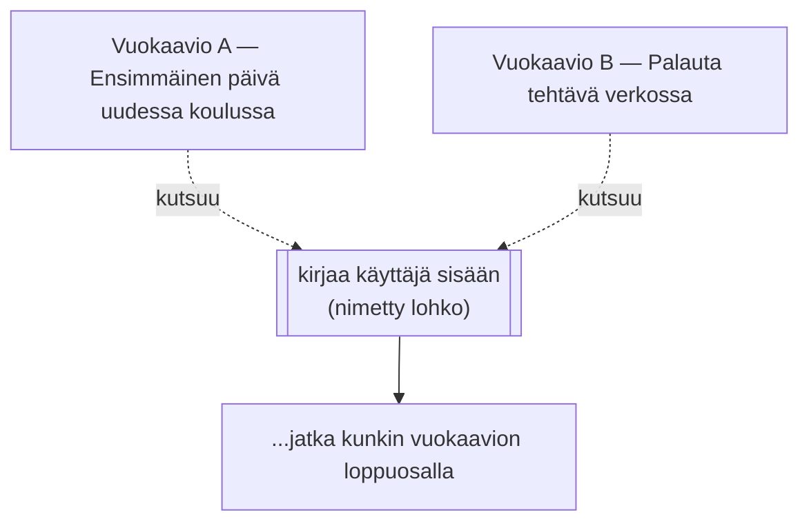

# Oppitunti 9 — Uudelleenkäytettävät ohjeet — funktion idea ilman koodia

### Kun sama osa toistuu

Katso kahta vuokaaviota rinnakkain.

Ensimmäinen on *"ensimmäinen päivä uudessa koulussa"*. Jossakin keskivaiheilla on osa: *Avaa koulun portaali → kirjoita käyttäjätunnus → kirjoita salasana → paina Kirjaudu sisään → odota aloitussivua*. Viisi suorakulmiota.

Toinen on *"palauta tehtävä verkossa"*. Alkupuolella sama osa esiintyy: *Avaa koulun portaali → kirjoita käyttäjätunnus → kirjoita salasana → paina Kirjaudu sisään → odota aloitussivua*.

Voisit piirtää sen joka kerta uudelleen. Kolmannen vuokaavion kohdalla käsi on väsynyt ja sivu on täynnä, ennen kuin pääset kiinnostavaan kohtaan. Parempi liike on olemassa. **Anna osalle nimi.**

### Anna osalle nimi



Kaksi vuokaaviota. Yksi nimetty lohko. Samat viisi suorakulmiota, piirrettynä kerran.


Nimi on lyhyt verbi-ilmaisu, joka sanoo, *mitä osa tekee*, ei *miten se sen tekee*. Yllä olevan osan nimi on *"kirjaa käyttäjä sisään"*. Kolme sanaa. Koko osa verbi-ilmaisuna.

Hyvä nimi läpäisee yksinkertaisen testin. Joku, joka ei ole ikinä nähnyt alkuperäistä viittä suorakulmiota, voi lukea *"kirjaa käyttäjä sisään"* ja tietää, mitä odottaa: tämän laatikon lopussa käyttäjä on kirjautunut sisään. Hän ei tiedä, *miten* — se on piilotettu. Mutta hän tietää, *mitä*, ja hän tietää, *milloin laatikko on valmis*.

Lisää nimiä arjen ja ICT:n maailmoista: *"nimeä tiedosto uudelleen"*, *"varmuuskopioi laite"*, *"nollaa salasana"*, *"rekisteröi uusi laite"*, *"lähetä ilmoitus vanhemmalle"*. Jokainen on verbi-ilmaisu, joka kertoo, mitä tapahtuu.

Huono nimi epäonnistuu testissä. *"Tee se juttu"* ei kerro kenellekään mitään. *"Vaihe 7"* on vain numero. Sääntö on *verbi-ilmaisu, joka sanoo, mitä se tekee*.

Nyt toinen vuokaavio, jossa nimetty lohko on viiden suorakulmion paikalla:

```
   ( Alku — opiskelija haluaa palauttaa tehtävän )
        |
        v
[ kirjaa käyttäjä sisään ]   <-- yksi nimetty lohko, ei viisi suorakulmiota
        |
        v
[ Etsi tehtävä kurssilistasta ]
        |
        v
[ Lataa tiedosto ]
        |
        v
[ Klikkaa palauta ]
        |
        v
( Palautettu )
```

Yhteensä viisi vuokaaviomuotoa. Alkuperäisessä olisi ollut yhdeksän. Vuokaavio mahtuu sivulle, lukija näkee kiinnostavan kohdan selvästi, ja *"kirjaa käyttäjä sisään"* sisältää edelleen kaikki viisi alkuperäistä vaihetta — ne vain elävät erillisessä kuvauksessa vuokaavion alla.

### Mitä "funktio" tarkoittaa tämän viikon merkityksessä

Viikolla 3 **funktio** määritellään epävirallisesti **nimetyksi, uudelleenkäytettäväksi prosessin osaksi, joka kuvataan selkeällä suomella ja jolla on selkeä syöte ja selkeä tuloste**. Viisi asiaa pidettäväksi mielessä:

- **Nimetty** — lyhyt verbi-ilmaisu nimenä.
- **Uudelleenkäytettävä** — esiintyy useammassa kuin yhdessä isommassa prosessissa.
- **Prosessin osa** — joukko vaiheita ryhmiteltynä, yleensä 3–8.
- **Selkeällä suomella oleva kuvaus** — lyhyt kappale siitä, mitä osa tekee.
- **Syöte ja tuloste** — mitä se tarvitsee alkuun ja mitä se tuottaa valmiina.

*"Kirjaa käyttäjä sisään"* -kuvaus:

> **kirjaa käyttäjä sisään** — Vie käyttäjän ei-kirjautuneesta tilasta kirjautuneeseen tilaan. Käyttäjä avaa portaalin, kirjoittaa käyttäjätunnuksensa ja salasanansa, painaa Kirjaudu sisään ja odottaa aloitussivua.
> **Syöte:** käyttäjällä on voimassa oleva käyttäjätunnus ja salasana.
> **Tuloste:** käyttäjä on kirjautunut sisään ja portaalin aloitussivu on näytöllä.

Tuo on koko "funktio" viikon 3 merkityksessä. **Ei koodia, ei sulkeita, ei paluuarvoja.** Se kaikki tulee viikolla 7. Tällä viikolla funktio on nimetty laatikko vuokaaviossa ja kappale sen alla.

Toinen esimerkki:

> **nimeä tiedosto uudelleen koulun käytäntöön** — Ottaa tiedoston, jolla on jokin nimi, ja tuottaa tiedoston, jonka nimi noudattaa koulun päivämäärä-ja-aihe-käytäntöä.
> **Syöte:** tiedosto on olemassa; käyttäjä tietää päivämäärän ja yksisanaisen aiheen.
> **Tuloste:** tiedoston nimi on muotoa `VVVV-KK-PP_aihe.lopppää`.

Jokaisella nimetyllä lohkolla on selkeä syöte, selkeä tuloste ja yhden kappaleen kuvaus. AT2 pyytää sinua kirjoittamaan tämän muodon — joten kannattaa harjoitella sitä nyt.

### Ammatillinen esimerkki — "rekisteröi uusi laite"

Tämän viikon ICT-esimerkki, johon nojataan, on **"rekisteröi uusi laite"**. Aina kun uusi läppäri, projektori tai kokoushuoneen näyttö saapuu kouluun, joku ajaa saman osan: tarra sarjanumerolla, merkintä laitehakemistoon, asenna vakio-ohjelmistopaketti, tarkista verkko. Noin kahdeksan vaihetta, joka kerta, jokaiselle uudelle laitteelle.

Vuokaavio *"perusta uusi kokoushuone"* -prosessille ilman nimettyä lohkoa:

```
( Alku ) → [ Tilaa näyttö ] → [ Vastaanota näyttö ] → [ Tarra sarjanumerolla ]
   → [ Lisää merkintä laitehakemistoon ] → [ Asenna vakio-ohjelmistot ] → [ Tarkista verkko ]
   → [ Asenna seinälle ] → [ Vedä kaapeli läppäritelakkaan ] → [ Testaa testiläppärillä ]
   → ( Valmis )
```

Kymmenen laatikkoa. Puolet on "rekisteröi laite" -vaiheita. ICT-päällikkö, joka välittää kokoushuoneesta, joutuu silmäilemään viisi rekisteröi-laite-laatikkoa ennen kuin saavuttaa kiinnostavan kohdan.

Sama vuokaavio nimetyn lohkon kanssa:

```
( Alku ) → [ Tilaa näyttö ] → [ Vastaanota näyttö ] → [ rekisteröi uusi laite ]
   → [ Asenna seinälle ] → [ Vedä kaapeli läppäritelakkaan ] → [ Testaa testiläppärillä ]
   → ( Valmis )
```

Seitsemän laatikkoa. Nimetty lohko kantaa viisi piilotettua vaihetta. Piilotetut vaiheet ovat edelleen olemassa — ne elävät "rekisteröi uusi laite" -kuvauksessa, joka on arkistoitu koulun ICT-käsikirjaan harjoittelijalle, joka oikeasti joutuu ajamaan tuon lohkon.

### Vaihtokauppa yhdessä lauseessa

Nimetty lohko **piilottaa yksityiskohdan**, jotta tämän tason lukijat eivät huku, **mutta yksityiskohtaa tarvitsevan lukijan täytyy tietää, mistä katsoa**. Oppitunnin 8 abstraktio koski sitä, *mitkä laatikot ansaitsevat tulla piirretyiksi*; oppitunnin 9 nimetyt lohkot ovat sama liike korkeammalla zoomaustasolla — yksi laatikko, joka edustaa kokonaista alivuokaaviota.

Silta viikkoon 7. Siellä *"kirjaa käyttäjä sisään"* muuttuu oikeaksi JavaScript-funktioksi. Verbi-ilmaisusta tulee funktion nimi; selkeällä suomella oleva syöte ja tuloste muuttuvat parametreiksi ja paluuarvoiksi; osasta tulee koodia. Mutta *muoto* — nimetty, uudelleenkäytettävä osa, jolla on syöte ja tuloste — on se, jonka rakennat tällä viikolla, suomeksi, lyijykynällä.

> **Pysähdy hetkeksi:** Katso Tehtävän 3.1 vuokaaviotasi ja kaikkia muita tällä viikolla piirtämiäsi vuokaavioita. Onko niissä kolmen tai neljän laatikon osa, jonka epäilet esiintyvän myös jossakin toisessa tekemässäsi prosessissa? Kirjoita sille verbi-ilmaisu nimeksi nyt, ennen kuin luet eteenpäin.


---

## Yhteenveto ja mitä seuraavaksi

Viikko 3 lisäsi yhden liikkeen viikon 2 osituksen päälle. Opit kuvaamaan tehtävän vuokaaviona neljällä muodolla, valitsemaan oikean tarkkuustason yleisölle ja tunnistamaan toistuvia prosessin osia ja antamaan niille uudelleenkäytettäviä nimiä. Viikon 1 sananmukaisen tulkitsijan ajattelutapa pätee yhä jokaisessa laatikossa: jokainen suorakulmio sanoo yhden asian, jokainen vinoneliö kysyy yhden kysymyksen, jokainen nuoli menee yhteen paikkaan.

Viikon keskeinen viesti vielä kerran, sanasta sanaan:

> *"Kun osaat pilkkoa ongelman, seuraava taito on kuvata prosessi niin, että joku muu voi suorittaa sen — ja päättää, mitkä yksityiskohdat ovat tärkeitä ja mitkä voidaan turvallisesti piilottaa."*

Jos osaat piirtää pienen vuokaavion, valita tarkkuustason yleisölle ja nimetä yhden uudelleenkäytettävän osan, olet tehnyt sen liikkeen, jonka viikko 3 harjoitti.

**Viikolla 4** kysymys muuttuu. Tähän asti olet kirjoittanut *yhden* hyvän kuvauksen prosessista. Viikko 4 kysyy: *mitä jos samalle tavoitteelle on useampi kuin yksi pätevä vuokaavio?* Piirrät kaksi pätevää vuokaaviota samalle tehtävälle, vertailet niitä yksinkertaisilla kriteereillä ja harjoittelet vertaispalautetta.

Säilytä Tehtävän 3.1 vuokaaviosi, nimetyt lohkot -muistiinpanosi ja abstraktiopohdintasi. Tämän viikon sanasto — *vuokaavio*, *päätös*, *abstraktio*, *tarkkuustaso*, *uudelleenkäytettävä lohko*, *nimetty lohko / funktio* — on juuri sitä, mitä **AT2 — prosessikuvaus** odottaa viikon 5 lopussa / viikon 6 aikana.
