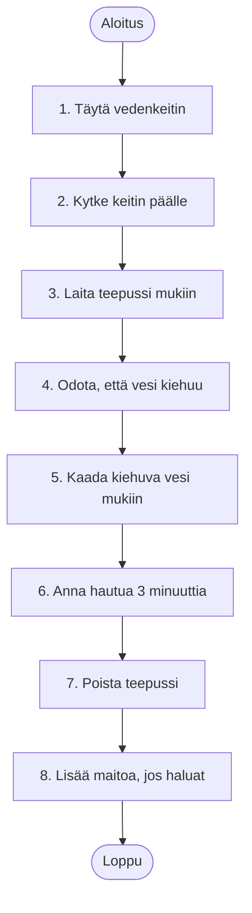

# Oppitunti 13 — Sekvenssi: ohjelma etenee vaihe vaiheelta

### Mitä sekvenssi tarkoittaa

**Sekvenssi** on yksinkertaisin kolmesta rakennuspalikasta: *yhden vaiheen tekeminen toisensa perään, kiinteässä järjestyksessä, ellei ohje toisin sano.* Tuo viimeinen kohta on tärkeä. Sekvenssi on **oletusarvo**. Kun mitään ehtoa ei ole kirjoitettu eikä mitään toistoa ole kirjoitettu, sananmukainen tulkitsija vain käy vaiheet läpi ylhäältä alas ja tekee jokaisen täsmälleen kerran.

Jos sekvenssi kuulostaa liian itsestäänselvältä ollakseen "rakennuspalikka", se on hyödyllinen varoitusmerkki. Suurin osa todellisista kuvattujen prosessien virheistä — epäonnistuvat reseptit, vialliset käyttöönotot, aamurutiinit, jotka jättävät sinut juoksemaan bussille — johtuu yhdestä vaihdetusta tai yhdestä puuttuvasta vaiheesta. Sekvenssi on oletusarvo, ja oletusarvossa asiat menevät rikki.

### Sekvenssi arkisissa prosesseissa

Tässä on pieni algoritmi, jonka osaat jo: teemukin valmistus.

1. Täytä vedenkeitin vedellä.
2. Kytke keitin päälle.
3. Laita teepussi mukiin.
4. Odota, että vesi kiehuu.
5. Kaada kiehuva vesi mukiin.
6. Anna teepussin hautua kolme minuuttia.
7. Poista teepussi.
8. Lisää maitoa, jos haluat.

Tämä on sekvenssi: kahdeksan numeroitua vaihetta, kukin selkeä toiminta, kiinteässä järjestyksessä. Sananmukainen tulkitsija, jolla ei ole kokemusta teen valmistuksesta, voisi silti päätyä juotavaan kuppiin, jos hän seuraisi tätä täsmälleen.

Sama sekvenssi vuokaaviona — vain yksi muoto (suorakulmio) ja yksi nuolen suunta:

Kokeile nyt ajatuskoetta. Vaihda vaiheet 4 ja 5 — *kaada kiehuva vesi mukiin*, sitten *odota, että vesi kiehuu*. Mitä tapahtuu? Tulkitsija kaataa kylmää vettä mukiin ja jää katsomaan jo tyhjää keitintä, jossa ei ole mitään kiehutettavaa. Ohje ei ole enää teeresepti; se on sekava liikkeiden joukko. Pointti: **se järjestys, jonka kirjoitit, on se järjestys, jonka tulkitsija saa**. Sekvenssi ei takaa, että prosessi toimii — se takaa sen, että tulkitsija ei hiljaa järjestele vaiheitasi uudelleen.

Jotkin sekvenssin vaiheet voidaan vaihtaa rikkomatta mitään. Voit harjata hampaat ennen pukeutumista tai sen jälkeen — kummassakin järjestyksessä päädyt samaan aamukuntoiseen sinuun. Toisia vaiheita ei voi vaihtaa. Et voi kaataa teetä ennen kuin keität veden; et voi syödä kakkua ennen kuin paistat sen. Sanomme, että niillä vaiheilla, joita ei voi vaihtaa, on **riippuvuus**: myöhempi vaihe tarvitsee aiemman vaiheen tuloksen voidakseen suorittua.

Sinun ei tarvitse tällä viikolla analysoida riippuvuuksia muodollisesti. Riittää, että *huomaat* ne ja kirjoitat sekvenssisi järjestyksessä, joka kunnioittaa tunnistamiasi riippuvuuksia.

### Sekvenssi ICT-kontekstissa — käyttöönottolista

Tässä sekvenssi ammatillisen ICT:n maailmasta: yksinkertaistettu *käyttöönottolista* — vaiheet, joita pieni tiimi voisi seurata viedäkseen uuden version verkkosivustaan käyttäjille.

1. Yhdistä uusi haara pääkehitysharaan.
2. Aja build.
3. Aja smoke-testit.
4. Vie staging-ympäristöön.
5. Ilmoita tiimille chatissa.
6. Odota toisen henkilön hyväksyntä.
7. Vie tuotantoon.
8. Tarkkaile dashboardia kymmenen minuuttia.

Tämä on samaa muotoa kuin teeresepti: numeroitu lista selkeitä toimintoja kiinteässä järjestyksessä. Useita vaiheita ei voi järjestää uudelleen rikkomatta prosessia. Et voi ajaa buildia ennen mergeä — ei ole mitään uutta rakennettavaa. Et voi viedä tuotantoon ennen hyväksyntää — sehän on hyväksynnän *tarkoitus*. Käyttöönottolista on sekvenssi, jota pitävät koossa sen riippuvuudet.

Huomaa, miten arkinen ja ICT elävät tässä rinnakkain. *Keitä vesi → kaada vesi* on samaa muotoa kuin *aja build → aja smoke-testit*. Arkinen versio tuli ensin, koska se oli tutumpi; ICT-versio on sama idea eri ympäristössä. Näin loppuviikko etenee: arkinen esimerkki ensin, sitten ammatillinen peilikuva.

### Riippumattomuus vs. riippuvuus — pehmeä johdatus

Vielä kaksi pientä esimerkkiä eron tuntemiseen.

- **Kaksi vaihetta, jotka eivät riipu toisistaan.** "Harjaa hampaat" ja "pue kengät" voivat tapahtua kummassakin järjestyksessä aamurutiinissa. Niiden välillä ei ole riippuvuutta.
- **Kaksi vaihetta, jotka riippuvat.** "Avaa tiedosto" ja "tallenna tiedosto" riippuvat toisistaan. Et voi tallentaa sitä, mitä et ole avannut.

Sinun ei tarvitse piirtää riippuvuuskaaviota. Tällä viikolla harjoituksena on vain *kirjoittaa se järjestys, jonka tarkoitat*, ja olla itsesi kanssa rehellinen silloin, kun vaiheen on tultava ennen toista, koska se valmistelee jotain, mitä myöhempi vaihe tarvitsee.

> **Pysähdy hetkeksi:** Kirjoita ylös kolmen vaiheen arkiprosessi, jossa järjestys voidaan vaihtaa, ja toinen kolmen vaiheen prosessi, jossa sitä ei voi vaihtaa. Millä yhdellä sanalla kuvailisit eron näiden kahden välillä?

---
