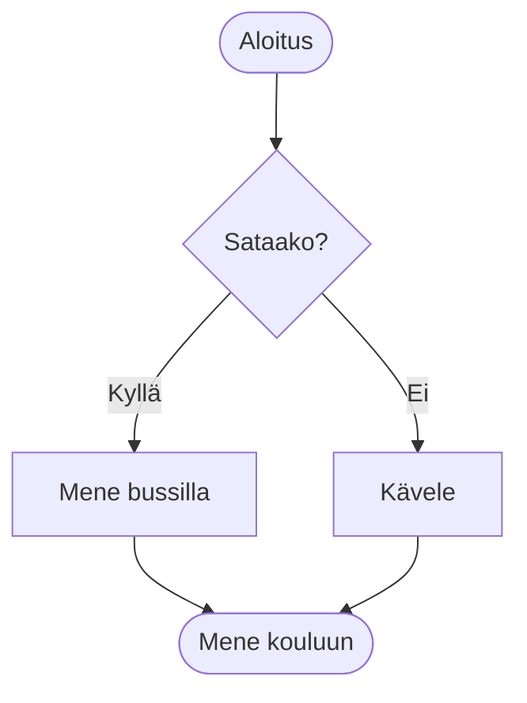

# Oppitunti 14 — Ehdot: if-then-else -ajattelu ja päätöspuut

### Mikä ehto on

**Ehto** on testi, joka päättää, mikä vaihe tapahtuu seuraavaksi. Se on se prosessin hetki, jolloin polku jakautuu.

Sekvenssi itsessään on suora viiva: tee A, sitten B, sitten C. Ehto lisää haaran: tee A, sitten **jos X on tosi** tee B, **muuten** tee C. Tulkitsijan näkökulmasta ehto on se hetki, jolloin hän pysähtyy, tarkistaa testin ja valitsee haaran.

### Arkiset ehdot, joita käytät jo

Käytät ehtoja joka päivä, yleensä nimeämättä niitä.

- *"Jos sataa, mene bussilla; muuten kävele."* — kaksihaarainen ehto (`if … then … else …`).
- *"Jos saat läksyt valmiiksi ennen päivällistä, voit pelata."* — yksihaarainen ehto (`if … then …`). Jos läksyt eivät ole valmiina ennen päivällistä, sääntö ei sano mitään ylimääräistä; tulkitsija ei tee mitään ylimääräistä.
- *"Jos maito haisee, heitä se pois."* — toinen yksihaarainen ehto. Jos maito haisee hyvältä, et tee asialle mitään; jätät sen rauhaan.

Ero *if … then …* (ei `else`) ja *if … then … else …* (jossa on `else`) välillä on pieni mutta todellinen. Ilman `else`-haaraa tulkitsijalla on vain yksi ylimääräinen asia, jonka hän saattaa tehdä — "then" — ja jos testi epäonnistuu, hän vain jatkaa eteenpäin. `else`-haaran kanssa tulkitsija tekee aina jommankumman; `else` nimeää vaihtoehdon.

### Ehdon kirjoittaminen luonnollisella kielellä

Voit kirjoittaa ehdot samassa rennossa muodossa läpi loppuviikon. Muodot näyttävät englannilta vähäisellä asettelulla:

> **if** *sataa*, **then** *mene bussilla*, **else** *kävele*.

Sama ehto päätöspuuna — yksi vinoneliö, kaksi nuolta ulos:




> **if** *maito haisee*, **then** *heitä se pois*.

Nämä eivät ole koodia. Ne ovat englanninkielistä lyhennemerkintää. Sanat *if*, *then* ja *else* tekevät samaa työtä kuin välimerkit — ne helpottavat näkemään, missä testi loppuu ja toiminta alkaa. Pidä ne pienikirjaimisina tai kursivoituna; älä vielä muuta niitä ohjelmointikieleksi tiukkoine sääntöineen (se on viikon 6 asia).

Hyvällä ehdolla on kolme rehellistä osaa:

1. **Testi, jonka tulkitsija pystyy oikeasti tarkistamaan.** *"Sataako nyt?"* — kyllä tai ei. *"Onko salasana lyhyempi kuin 8 merkkiä?"* — kyllä tai ei.
2. **then-haara** — mitä tehdä, kun testi on tosi.
3. **else-haara** *(valinnainen)* — mitä tehdä, kun testi on epätosi. Jos et kirjoita else-haaraa, sanot "ei mitään ylimääräistä muutoin"; varmista, että se oli juuri se, mitä tarkoitit.

### Päätöspuut — jakautumisen piirtäminen

**Päätöspuu** on yksinkertaisesti kuva ehdosta. Se laittaa testin huipulle ja piirtää haarat alaspäin.

Säännölle "jos sataa, bussi; muuten kävele":

```
        Sataako?
        /        \
      kyllä       ei
      /            \
mene bussilla   kävele
```

Tämä on kaksihaarainen puu. Voit myös tehdä kolmihaaraisen lisäämällä `else if`:

```
                 Sataako?
                 /        \
               kyllä        ei
               /              \
       mene bussilla     Oletko myöhässä?
                                /        \
                              kyllä        ei
                              /              \
                           juokse          kävele
```

Et tarvitse mitään erityisohjelmistoa päätöspuun piirtämiseen. Kynä ja muistivihon kulma riittää. Päätöspuun hyöty ei ole piirtämisessä — se on siinä keskustelussa, johon se sinut pakottaa itsesi kanssa. Kun joudut laittamaan testin jokaiseen haaraan, huomaat ne haarat, joissa et ole ollut rehellinen sen suhteen, mikä testi oikeasti on.

### Ehdot ICT-kontekstissa — salasanan tarkistus

Kuvittele rekisteröitymislomake verkkosivulla. Kun klikkaat *luo tili*, järjestelmä tarkistaa salasanasi sääntöjoukkoa vasten. Tässä yksinkertaistettu versio säännöistä selkokielellä:

- **if** salasana on lyhyempi kuin 8 merkkiä, **then** hylkää se.
- **if** salasanassa ei ole numeroa, **then** hylkää se.
- **if** salasanassa ei ole isoa kirjainta, **then** hylkää se.
- **muutoin** hyväksy se.

Tämä on ketju kolmesta ehdosta ja yksi else-haara — yhteensä neljä haaraa, jotka päättyvät kahteen mahdolliseen lopputulokseen (hylkää, hyväksy). Voit piirtää sen päätöspuuna, jossa kukin testi vuorollaan on uuden solmun huipulla:

```
                Onko se lyhyempi kuin 8 merkkiä?
                 /                       \
               kyllä                       ei
               /                            \
            hylkää             Puuttuuko numero?
                                   /                  \
                                 kyllä                  ei
                                  /                     \
                               hylkää       Puuttuuko iso kirjain?
                                                  /                  \
                                                kyllä                  ei
                                                 /                     \
                                              hylkää                hyväksy
```

Huomaa, että tämä on samaa muotoa kuin "jos sataa, bussi; muuten jos olet myöhässä, juokse; muuten kävele." Ympäristö on eri — salasanat säätilan sijaan — mutta *muoto* on sama: testien ketju, jossa jokainen reitittää joko lopulliseen vaiheeseen tai uuteen testiin. **Sama muoto, eri ympäristö.** Tämä on oppi.

### Yhdistetyt ehdot — AND, OR *(syventävää lukemistoa, valinnainen)*

Joskus yhdessä ehdossa on enemmän kuin yksi testi sisällään. Käytät näitä joka päivä, selkokielellä:

- *"Jos sinulla on bussikortti **ja** siinä on rahaa, voit mennä bussilla."* — kaksi testiä yhdistetty AND-sanalla. Kummankin on oltava tosi.
- *"Jos sataa **tai** tuulee kovaa, mene bussilla."* — kaksi testiä yhdistetty OR-sanalla. Joko toisen olla tosi riittää.

Yhdistettyjä ehtoja on aivan hyvä käyttää selkokielellä. Et tarvitse mitään symboleja (et näe `∧` tai `||` missään tämän kurssin aikana tänä vuonna). Sanat *ja* ja *tai* tekevät täsmälleen sen työn, jonka ne tekevät tavallisissa lauseissa. Jos yhdistetty ehto alkaa tuntua ahtaalta — sano vaikka *"jos A ja B tai C ja ei D"* — se on merkki siitä, että se kannattaa kirjoittaa uudelleen pieneksi puuksi useilla lyhyemmillä testeillä, yksi per haara.

> **Pysähdy hetkeksi:** Kirjoita ylös yksi sääntö, jota joku perheessäsi käyttää kanssasi ja joka on muotoa *if … then … else …*. Mikä on testi? Voisiko testi epäonnistua rehellisyydessä — voisivatko kaksi sen lukijaa olla eri mieltä siitä, onko se tosi?

> **Pysähdy hetkeksi:** Katso jonkin verkkosivun rekisteröitymislomaketta (mikä tahansa — suoratoistopalvelu, koulun portaali, peli). Pystytkö nimeämään kolme eri ehtoa, joita lomake tarkistaa ennen kuin sallii lähetyksen? Et tarvitse koodia näkyviin; voit lukea ne virheilmoituksista.

---
