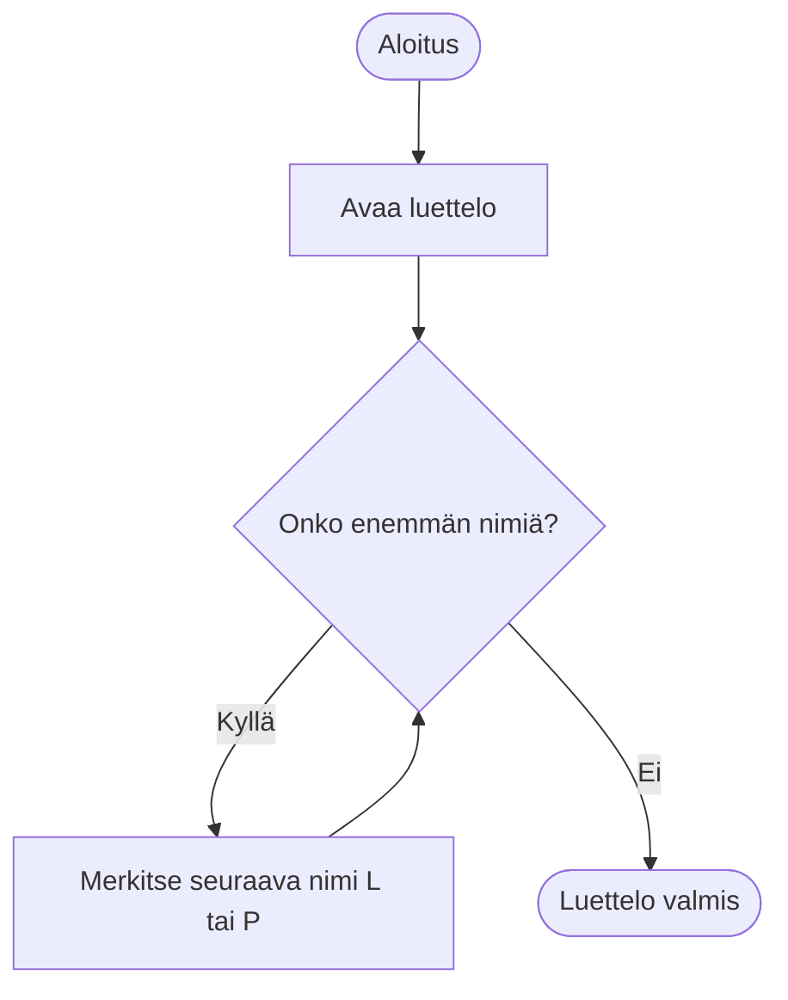

# Oppitunti 15 — Toisto: saman asian tekeminen monta kertaa

### Mitä toisto tarkoittaa

**Toisto** on saman vaiheen tai saman vaihejoukon tekemistä useammin kuin kerran, lopetusehdon kanssa, joka kertoo tulkitsijalle, milloin pysähtyä. Toistoa kutsutaan arkisessa tekniikkapuheessa myös *silmukaksi* — molemmat sanat tarkoittavat samaa asiaa tällä kurssilla; käytämme enimmäkseen sanaa *toisto*.

Sekvenssi on suora viiva. Ehto on haara. Toisto on ympyrä, jossa *on myös* rehellinen ulospääsy. Jos ulospääsy puuttuu, tulkitsija kiertää ikuisesti — *karannut toisto*. Tästä lisää alla.

### Arkiset toistot, joita käytät jo

Teet näitä koko ajan, aivan kuten ehtoja, antamatta niille nimeä.

- *"Merkitse jokainen nimi luettelosta läsnä tai poissa."* Teet saman pienen toiminnon — kirjoitat L tai P nimen viereen — kerran jokaista listalla olevaa nimeä kohti, ja pysähdyt, kun lista loppuu.
- *"Lisää sokeria ja sekoita, kunnes maistuu hyvältä."* Teet saman toiminnon — lisää hyppysellinen, sekoita, maista — ja pysähdyt, kun testi "maistuu hyvältä" lopulta palauttaa toden.
- *"Niin kauan kuin keitin on vielä kuuma, älä keitä uudelleen."* Tarkistat ehdon *ennen* kuin toimit; niin kauan kuin se on tosi, jatkat (tai tässä tapauksessa jatkat *olemista* keittämättä).

### Toiston kolme muotoa

On kolme pientä, rentoa muotoa, jotka kattavat melkein jokaisen toiston, jonka koskaan kirjoitat selkokielellä:

- **For each** — *jokaiselle listan kohteelle tee …*. Käytä, kun lista on **tiedossa etukäteen**. Lista on lopetusehto: pysähdyt, kun lista loppuu. Esimerkki: *jokaiselle nimelle luettelossa, merkitse läsnä tai poissa*.
- **Repeat until** — *tee … kunnes lopetusehto on tosi*. Käytä, kun lopetus riippuu **siitä mitä tapahtuu** toiston aikana. Esimerkki: *jatka sekoittamista, kunnes sokeri liukenee*.
- **While** — *niin kauan kuin ehto on tosi, jatka tekemistä …*. Käytä, kun testi **tarkistetaan ennen jokaista toistokierrosta**. Esimerkki: *niin kauan kuin keitin on vielä kuuma, älä keitä sitä uudelleen*.

Sinun ei tarvitse opetella näiden muotojen eroa ulkoa kuten sanaston sanaa. Ne ovat kolme rytmiä, ja sinä valitset tilanteeseen sopivan. Kaikissa kolmessa olennaista on: **lopetus on todellinen, ja tulkitsija näkee sen.**

Vuokaaviona piirrettynä jokaisella toistolla on sama muoto: tarkistus, runko ja nuoli, joka palaa takaisin. Takaisin palaava nuoli on se, mikä tekee siitä silmukan. Vinoneliön tarkistus on **lopetusehto**.

### Toisto ICT-kontekstissa — sähköpostien läpikäynti

Tässä sama idea ammatillisessa ympäristössä. Avaat sähköpostilaatikkosi päivän alussa. Näet 47 lukematonta viestiä. Käyt ne läpi:

> **for each** lukematon viesti sähköpostissa:
> &nbsp;&nbsp;&nbsp;&nbsp;**if** se on henkilöltä, **then** merkitse vastattavaksi;
> &nbsp;&nbsp;&nbsp;&nbsp;**else if** se on uutiskirje, **then** arkistoi;
> &nbsp;&nbsp;&nbsp;&nbsp;**else if** se on roskapostia, **then** poista.
> Toista, kunnes sähköposti on tyhjä.

Pysähdy ja huomaa jotain: tuo yksi prosessi käyttää **kaikkia kolmea rakennuspalikkaa**.

- 1–2 vaihetta, jotka teet viestiä kohti (merkitse / arkistoi / poista) ovat pieni **sekvenssi**.
- "Onko se henkilöltä / uutiskirje / roskapostia" -valinta on **ehto** (kolmella haaralla).
- "Jokaiselle lukemattomalle viestille … kunnes sähköposti on tyhjä" -kehys on **toisto**.

Useimmat todelliset prosessit näyttävät tällaisilta — sekvenssi käärittynä ehtoon, käärittynä toistoon, tai toisto, joka sisältää ehdon, joka sisältää pienen sekvenssin. Kolmen palikan nimeäminen erikseen on se, mikä tekee kuvauksesta luettavan. Ilman nimiä sähköpostien läpikäynti on vain kappale, joka sanoo "käy sähköpostit läpi." Nimien kanssa se on prosessi, jonka sananmukainen tulkitsija voisi suorittaa.

### Lopetusehto on turvavyö

Vertaa näitä kahta lausetta:

- *"Jokaiselle viikonloppuvalokuvalle puhelimellani, päätä säilytätkö sen."* — Rehellinen lopetus: viikonloppuvalokuvien lista on äärellinen, joten tulkitsija lopulta loppuu valokuvat.
- *"Jatka työskentelyä, kunnes ymmärrät."* — Ei rehellinen lopetus. Ei ole havaittavissa olevaa testiä "ymmärtämiselle". Tulkitsija (sinä) saatat pyöriä ikuisesti tai — todennäköisemmin — luovutat sattumanvaraisesti ja tunnet syyllisyyttä siitä.

Jokainen toisto tarvitsee lopetuksen, jonka tulkitsija näkee. *"Kunnes sähköposti on tyhjä"* on havaittavissa. *"Kunnes paikka on vapaa"* on havaittavissa. *"Kunnes tuntuu valmiilta"* ei ole — ellei sitä muunneta tarkistettavaksi (*"kunnes pystyt selittämään sen luokkatoverille yhdellä lauseella"*, *"kunnes olet vastannut kolmeen harjoituskysymykseen oikein peräkkäin"*).

Kun toistossa ei ole rehellistä lopetusta, sinulla on **karannut toisto**. Korjaus on lähes aina sama: lisää turvalopetus selkokielellä. *"Toista, kunnes sivu latautuu — tai pysähdy 30 sekunnin jälkeen ja yritä myöhemmin uudelleen."* Turvalopetus on turvavyö.

> **Pysähdy hetkeksi:** Nimeä yksi asia, jonka teit tänään ja joka oli toisto. Mikä oli lopetusehto? Oliko lopetusehto jotain, jonka pystyit oikeasti havaitsemaan, vai pysähdyitkö, koska "tuntui valmiilta"?

> **Pysähdy hetkeksi:** Kuvittele *"toista, kunnes …"* ilman lopetusta, jonka pystyt oikeasti havaitsemaan. Kirjoita se ylös. Kirjoita sitten turvalopetus, joka sen pelastaisi. Mitä jouduit muuttamaan?

### Laskurit — kun lopetus on luku

Joskus lopetus on vain luku. *"Tee kaksikymmentä punnerrusta."* *"Toista kertosäe kolme kertaa."* Teet sisävaiheen, pidät kirjaa siitä, montako kertaa olet sen tehnyt, ja pysähdyt, kun saavutat luvun.

Laskuri on eräänlainen `for each` numeroista 1:stä N:ään. *"Tee kaksikymmentä punnerrusta"* on samaa muotoa kuin *"jokaiselle numerolle 1:stä 20:een, tee yksi punnerrus."* Et tarvitse mitään erityissyntaksia tähän; tarvitset vain rehellisen luvun. *"Toista, kunnes olet tehnyt tarpeeksi"* ei ole laskuri; *"toista 20 kertaa"* on.

---

## Yhteenveto ja mitä seuraavaksi

Tämä viikko nimesi ne kolme rakenteellista liikettä, joista lähes jokainen kuvattu prosessi koostuu:

- **Sekvenssi** — tee A, sitten B, sitten C, järjestyksessä, oletuksena.
- **Ehto** — tässä kohdassa, testaa jotain, ja valitse haara.
- **Toisto** — tee tämä uudelleen, lopetuksella, jonka tulkitsija näkee.

> **Lähes mikä tahansa prosessi voidaan kuvata kolmella rakennuspalikalla: sekvenssi, ehto ja toisto.** Kun osaat nimetä nämä arkisissa tehtävissä, sinulla on jokaisen ohjelman luuranko.

Kohtasit jokaisen palikan ensin arkisessa ympäristössä — teeresepti, "jos sataa, mene bussilla", luettelon merkitseminen — ja sitten ammatillisessa peilikuvassa — käyttöönottolista, salasanasääntö, sähköpostien läpikäynti. Arkinen versio tuli ensin tarkoituksella. ICT-versio on sama idea eri vaatteissa.

**AT2-yhteys — uudelleen.** AT2 palautetaan viikon 5 lopussa / viikon 6 aikana. Se pyytää sinua kuvaamaan valitsemasi prosessin luonnollisella kielellä siten, että kaikki kolme rakennuspalikkaa näkyvät. Tämän viikon must-do minimum -tehtävä on sama tuotos pienemmässä mittakaavassa: valitse prosessi, jota oikeasti teet, kirjoita 3–6 vaiheen sekvenssirunko, lisää vähintään yksi ehto (puun kanssa), lisää vähintään yksi toisto (oikealla lopetuksella). Säilytä muistiinpanosi — se työ, jonka teet tällä viikolla, on AT2-tuotos miniatyyrissä.

**Mitä seuraavaksi: viikko 6 — pseudokoodi ja käsiajo.** Ensi viikolla tiivistämme nämä luonnollisen kielen kuvaukset hieman lähemmäs koodia — mutta vielä paperilla. Sitä kutsutaan **pseudokoodiksi**: muutama lisäkonventio (pienet muuttujat, yksinkertainen sisennys, käsiajotaulukko), jotka muuttavat tällä viikolla kirjoittamasi löyhän selkokielen sellaiseksi, että aloitteleva ohjelmoija voisi lukea sen rivi riviltä. Se ajattelu, jota harjoittelit tällä viikolla — kolmen rakennuspalikan nimeäminen — on juuri sitä, mikä tekee pseudokoodista luettavaa. Itse koodi tulee vasta viikolla 7.
