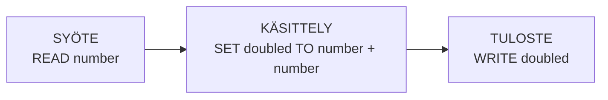
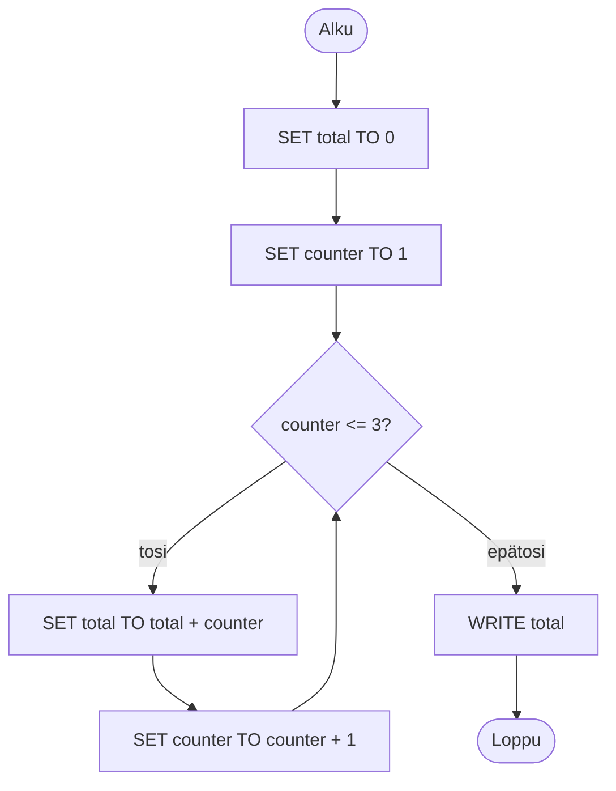

# Ajattelusta koodiin — tutustu pseudokoodiin

## Johdanto

Kävelet pyykinpesutupaan. Korissa on tänään tummia, joten aloitat tummien pesun; jos siinä olisi ollut enimmäkseen valkoisia, olisit aloittanut valkoisten pesun sen sijaan. Kun kone käy, selailet puhelinta; sillä hetkellä, kun se piippaa, lopetat selailun ja ripustat vaatteet. Mikään tuossa kappaleessa ei ole epätavallista — mutta jos kirjoittaisit sen ylös jonkun toisen noudatettavaksi täsmälleen, kirjoittaisit jotain hyvin lähellä pseudokoodia.

Tämä on viikko 6, tämän kurssin ajatteluosion synteesiviikko. Viikko 1 sanoi, että tietokone on sananmukainen tulkitsija, ei nokkela. Viikot 2 ja 3 sanoivat, että isot ongelmat voi pilkkoa ja kuvata prosesseina. Viikko 4 sanoi, että "oikein" voi tarkoittaa useampaa kuin yhtä asiaa. Viikko 5 nimesi kolme rakenteellista liikettä jokaisen kuvatun prosessin sisällä — sekvenssin, ehdon, toiston. Tällä viikolla kaikki tämä yhdistyy yhdeksi, hieman tiukempaan notaatioon nimeltä **pseudokoodi**. Kurssin keskeinen kysymys on edelleen sama, johon olet vastannut viikosta 1 lähtien:

> *How do I speak to a computer so that it understands what I want it to do?*

Tämän viikon ydinviesti, jonka sinun pitäisi pystyä toistamaan oppituntiin 18 mennessä, on tämä:

> **Pseudokoodi on silta arkikielen ja oikean koodin välillä: tarpeeksi täsmällistä, että tietokone osaisi tarvittaessa noudattaa sitä, mutta tarpeeksi luettavaa jaettavaksi henkilölle, joka ei osaa ohjelmoida.**

Tuo silta-metafora on koko viikon 6 idea. Seisot toisella rannalla arkikielessä, jossa viikot 1–5 ovat eläneet. Vastarannalla on oikea koodi, joka saapuu viikolla 7. Pseudokoodi on silta näiden kahden välillä. Rakennat sen sillan tällä viikolla kirjoittamalla muutamia lyhyitä pseudokoodipätkiä prosesseille, joita jo tunnet, ja lukemalla niitä rivi riviltä, paperilla, jollakin nimeltä *jäljityskaavio*, todistaaksesi, että ne tekevät sen, mitä odotat.

**AT2 osuu tälle viikolle.** Se palautetaan oppitunnin 18 tienoilla. Se pyytää sinua kirjoittamaan lyhyen pseudokoodin pienestä valitsemastasi tehtävästä, käsiajamaan sen jäljityskaaviolla yhdelle normaalille ja yhdelle hankalalle syötteelle, ja kirjoittamaan viiden lauseen reflektion siitä, mitä jäljityksesi löysi. Oppituntien 16, 17 ja 18 työ on täsmälleen se raaka-aine, jota AT2 pyytää — täältä AT2:een ei ole uusia työkaluja eikä uutta notaatiota. Säilytä jokainen paperinpala.

---

## Oppitunti 16 — Pseudokoodi: luonnollisesta kielestä täsmällisempään muotoon

### Englannista pseudokoodiin

Tässä on tuttu prosessi englanniksi. Olet keittämässä mukillista teetä, ja saatat ottaa tai olla ottamatta sokeria tänään.

> You fill the kettle and switch it on. You wait until it clicks. You put a tea bag in your mug and pour the hot water. You leave the bag in for three minutes. If you take sugar, you add one spoon and stir. Then the tea is ready.

Lue se kerran ääneen. Ihmiskaveri ymmärtää sen. Tietokone ei — *"wait until it clicks"* (kuinka kauan? miten tietokone huomaa naksahduksen?) ja *"if you take sugar"* (mistä se tietää?) ovat molemmat kohteliaita aukkoja, jotka riippuvat siitä, että lukija on ihminen.

Nyt sama prosessi pseudokoodina:

```text
READ takesSugar
SET kettleOn TO YES
WHILE kettleHasNotClicked DO
  wait
ENDWHILE
SET bagInMug TO YES
WRITE "pour hot water"
WRITE "wait three minutes"
IF takesSugar = YES THEN
  WRITE "add one spoon of sugar"
  WRITE "stir"
ENDIF
WRITE "tea is ready"
```

Vierekkäin: mikä on eri? Englanti on lyhyempää ja ystävällisempää. Pseudokoodi on pidempää, mutta jokainen rivi on yksi asia, joka seuraajan on tehtävä, ja jokainen aukko, jonka englanti jätti kohteliaaksi (naksahdus, sokeri), on nyt nimetty kysymys (`kettleHasNotClicked`, `takesSugar`) selvällä vastauksella. Pseudokoodi myös erottaa *mitä pyydämme käyttäjältä* (the `READ`) *siitä, mitä kerromme käyttäjälle* (the `WRITE`s) — englanti puristi nämä yhteen. Huomaa, että viikolta 5 tuttu `IF` ja `WHILE` arkikielisessä muodossa ovat edelleen siellä: ne on vain saatu yhtenäiseen muotoon, ja niihin on lisätty sulkeva sana (`ENDIF`, `ENDWHILE`), jotta lukija näkee yhdellä silmäyksellä, mistä mikäkin lohko alkaa ja minne se päättyy.

Pseudokoodi ei ole uusi kieli ulkoa opettelua varten. Se on niitä asioita, joita jo kirjoitat viikolla 5, muutamilla yhteisillä sanoilla ja kiinteällä muodolla, jotta tuntematon voi lukea sen samalla tavalla kuin sinä.

### Pieni avainsanojen joukko

Tämä kurssi käyttää pientä kiinteää pseudokoodin avainsanajoukkoa. Kaikki ne esiintyivät arkikielisessä muodossa viikolla 5. Avainsanat kirjoitetaan aina ISOILLA KIRJAIMILLA, jotta silmä löytää ne nopeasti. Kaikki muu (muuttujien nimet, arvot, viestit) on omaa englantiasi.

```text
SET passwordLength TO 7
```
*Sijoitus.* Laita arvo `7` nimettyyn säilöön `passwordLength`. Tämän rivin jälkeen `passwordLength` on `7`.

```text
READ password
```
*Syöte.* Ota mitä tahansa käyttäjä kirjoittaa ja laita se nimettyyn säilöön `password`.

```text
WRITE "your password is strong"
```
*Tuloste.* Näytä tämä viesti käyttäjälle.

```text
IF length >= 8 THEN
  WRITE "long enough"
ELSE
  WRITE "too short"
ENDIF
```
*Ehto.* Jos testi on tosi, tee ensimmäinen lohko; muuten tee toinen lohko. `ENDIF` kertoo, missä ehto loppuu.

```text
WHILE inboxIsNotEmpty DO
  WRITE "process one message"
ENDWHILE
```
*Toisto, jossa testi tehdään ennen jokaista toistoa.* Heti kun testi lakkaa olemasta tosi, silmukka pysähtyy.

```text
FOR each folder IN backupList DO
  WRITE "back up the folder"
ENDFOR
```
*Toisto etukäteen tunnetun listan yli.* Seuraaja tekee sisäosan kerran jokaiselle listan alkiolle.

Kuusi muotoa. Käsittele tämä osio referenssikorttina — palaat siihen vielä O17:n ja O18:n läpi.

### Sekvenssi, ehto, toisto — tervehdys uudestaan

Katso taaksepäin teen pseudokoodia. Rivit, jotka vain juoksevat ylhäältä alas (`SET kettleOn TO YES`, sitten `SET bagInMug TO YES`, sitten `WRITE`-rivit), ovat *sekvenssiä*. Lohko, joka avautuu `IF takesSugar = YES THEN` -rivillä, on *ehto*. Lohko, joka avautuu `WHILE kettleHasNotClicked DO` -rivillä, on *toistoa*. Sekvenssi, ehto, toisto — täsmälleen ne kolme rakennuspalikkaa viikolta 5. Pseudokoodi ei lisää neljättä liikettä; se antaa vain kullekin kolmesta liikkeestä jaetun muodon paperilla.

### Miksi pseudokoodi on luotettavampaa jaettavaa kuin englanninkielinen proosa

Jos sinä ja luokkakaveri molemmat kirjoittaisitte teenkeittoprosessin englanniksi, kaksi ystävällistä lukijaa voisivat lukea molemmat versiot ja saada hieman erilaiset käsitykset siitä, mitä sokerivaiheessa tapahtuu. Pseudokoodiversio sulkee ne aukot. *"If you take sugar"* muuttuu muotoon *"is the value of `takesSugar` equal to `YES` right now?"* On olemassa yksi ja vain yksi tapa lukea se. Pseudokoodin idea ei ole se, että sitä on helpompi kirjoittaa — sen kirjoittaminen on yleensä vaikeampaa kuin englannin. Idea on, että sitä on vaikeampi *lukea väärin*. Kun ojennat sen tuntemattomalle, tuntematon saa saman prosessin, jonka tarkoitit.

> **Pause for a moment:** Valitse yksi lyhyt prosessi, jonka teet joka aamu (puhelimen lataaminen, hampaiden harjaaminen, bussisovelluksen tarkistaminen). Missä kohtaa siinä prosessissa englantisi olisi kohteliasta — missä se jättäisi aukon, johon sananmukainen tulkitsija kompastuisi? Nimeä yksi tietty aukko, kirjallisesti, ennen kuin siirryt eteenpäin.

> **Pause for a moment:** Yllä oleva teen pseudokoodi on 12 riviä. Jos poistaisit `ENDIF`:n ja `ENDWHILE`:n, olisiko merkitys edelleen selvä? Miksi luulet, että kurssi käyttää niitä silti?

---

## Oppitunti 17 — Syöte, käsittely, tuloste ja muuttujan idea

### Syöte → käsittely → tuloste

Lähes jokaisella pseudokoodilla, jota koskaan kirjoitat, on sama kolmiosainen muoto. Jotain tulee *sisään* ulkopuolelta (käyttäjä kirjoittaa salasanan, anturi raportoi lämpötilan, annetaan tiedostolista). Jotain tapahtuu *keskellä* (testi suoritetaan, summa lasketaan, lista käydään läpi). Jotain menee takaisin *ulos* (viesti näytetään, tulos palautetaan, tiedosto kirjoitetaan).

Tässä on pienin mahdollinen esimerkki. Lue käyttäjältä luku, tuplaa se, kirjoita tulos takaisin.

```text
READ number
SET doubled TO number + number
WRITE doubled
```

Kolme riviä, yksi kullekin rungon osalle. *Syöte* on `READ`. *Käsittely* on `SET ... TO number + number`. *Tuloste* on `WRITE`. Lähes kaikki, mitä kirjoitat kurssin lopun aikana, on muunnelma tästä muodosta — yleensä keskellä on enemmän, joskus useita syötteitä tai useita tulosteita, mutta aina kolme osaa näkyvästi läsnä.

Piirrettynä kolmena laatikkona runko näyttää tältä:




### Mikä muuttuja on?

**Muuttuja** on nimetty säilö yhdelle arvolle, joka voi muuttua pseudokoodin suorituksen aikana.

Arkimetafora, joka tekee tässä eniten työtä, on etiketöity post-it-lappu purkin päällä. Purkki seisoo hyllyllä. Purkin etiketti sanoo `passwordLength` (tai `takesSugar`, tai `total`). Numero, joka on kirjoitettu post-it-lapulle purkin sisällä, on muuttujan nykyinen arvo. Voit pyyhkiä numeron pois ja kirjoittaa uuden — niin `SET passwordLength TO 8` tekee. Mutta purkin etiketti ei muutu; muuttujan *nimi* pysyy samana niin kauan kuin pseudokoodi pyörii.

Katso yhtä jo nähtyä pseudokoodiriviä:

```text
SET passwordLength TO 7
```

Tuo rivi luo purkin nimeltä `passwordLength` (tai avaa sen, jos se on jo olemassa) ja laittaa numeron `7` sisään. Seuraavasta rivistä alkaen aina kun pseudokoodi sanoo `passwordLength`, se tarkoittaa *"numeroa, joka on tällä hetkellä purkissa nimeltä `passwordLength`"* — joka on juuri nyt `7`. Jos myöhempi rivi sanoo `SET passwordLength TO 8`, `7` pyyhitään pois ja `8` kirjoitetaan tilalle. Purkki sanoo edelleen `passwordLength`. Sisällä oleva arvo on muuttunut.

Viikolla 6 muuttujasi pitävät yhtä kolmesta yksinkertaisesta asiasta: *luku* (`7`, `42`), *kyllä/ei* (jonka kirjoitamme `YES` ja `NO`) tai *lyhyt teksti* (`"hunter2"`). Et tarvitse listoja, olioita tai mitään monimutkaisempaa tällä viikolla.

### Muuttujan nimen tulisi kuvata, mitä se pitää sisällään

Vertaa näitä kahta riviä:

```text
SET x TO 7
```

```text
SET passwordLength TO 7
```

Tietokoneelle molemmat rivit tekevät täsmälleen saman asian: ne laittavat numeron `7` nimettyyn säilöön. Seuraavalle pseudokoodin lukijalle — luokkakaverille, opettajalle, sinulle itsellesi kolmen viikon päästä — ne ovat hyvin erilaisia. Ensimmäinen rivi on mysteeri: *mikä on `x`?* Toinen rivi kertoo, mitä varten `7` on. **Nimeä muuttujasi sen mukaan, mitä ne pitävät sisällään**, älä sen mukaan, mikä on sillä hetkellä helppoa. Hyvät nimet ovat halvin luettavuuden korjaus maailmassa; huonot nimet ovat kallein bugi, jonka voit jättää tulevalle itsellesi.

Yksinkertainen peukalosääntö: jos tuntematon voisi lukea rivin ääneen ja arvata, mitä siihen tallennetaan, nimi on tarpeeksi hyvä. `x`, `tmp`, `n`, `data2` epäonnistuvat tässä testissä. `passwordLength`, `isStrong`, `takesSugar`, `totalCost`, `unreadCount` läpäisevät sen.

### Ammatillinen esimerkki — salasanan vahvuuden tarkistus

Yleinen työnomainen tehtävä: käyttäjä kirjoittaa salasanan, ja pseudokoodisi päättää, onko se tarpeeksi vahva.

```text
READ password
SET length TO numberOfCharactersIn(password)
SET hasDigit TO doesPasswordContainADigit(password)
IF length >= 8 AND hasDigit = YES THEN
  SET isStrong TO YES
ELSE
  SET isStrong TO NO
ENDIF
IF isStrong = YES THEN
  WRITE "password is strong"
ELSE
  WRITE "password is too weak"
ENDIF
```

Jäljitä kolme osaa. *Syöte:* ensimmäinen rivi (`READ password`). *Käsittely:* rivit 2–8 (laske pituus, tarkista numero, päätä `isStrong`). *Tuloste:* toinen `IF`, joka kirjoittaa viestin käyttäjälle. Huomaa neljä muuttujaa, kullakin nimi, joka kuvaa mitä se pitää sisällään: `password`, `length`, `hasDigit`, `isStrong`. Mikään niistä ei ole `x`.

Huomaa myös, että `length` ja `hasDigit` ovat *apumuuttujia* — ne ovat olemassa tehdäkseen rivin 4 testin luettavaksi. Voisit puristaa kaiken yhteen jättimäiseen `IF`:ään, mutta yllä oleva versio on helpompi tuntemattomalle seurata. Pseudokoodi palkitsee siitä, että on ystävällinen seuraavalle lukijalle.

> **Pause for a moment:** Valitse yksi omista kolmesta parhaasta muuttujan nimestäsi tähän mennessä, ja yksi huonoimmista. Kirjoita yhdellä lauseella kustakin, *minkä arvon* kunkin muuttujan oli tarkoitus pitää sisällään. Jos huonon nimen lause on pidempi kuin hyvän, olet juuri näyttänyt itsellesi, miksi hyvä on parempi.

> **Pause for a moment:** Katso salasanan vahvuuden esimerkkiä. Jos käyttäjä kirjoittaa 9 merkin salasanan ilman numeroita, mitä jäljitys tuottaa? Kävele se paperilapulla ennen kuin luet eteenpäin.

---

## Oppitunti 18 — Pseudokoodin testaaminen: käsiajo ja virheiden etsiminen

### Mikä on käsiajo?

**Käsiajo** on pseudokoodipätkän läpikäyminen käsin, rivi riviltä, paperilla, esittäen tietokonetta.

Viikko 1 esitteli *sananmukaisen robotin*: seuraajan, jolla ei ole maalaisjärkeä, joka tekee vain täsmälleen sen, mitä paperilla olevat sanat sanovat. Käsiajo on sinä, joka näyttelet sitä sananmukaista robottia omalle pseudokoodillesi. Et saa hypätä eteenpäin, et saa olettaa, et saa "nähdä, mitä se tarkoittaa" — luet rivin yksi, teet täsmälleen sen, mitä rivi yksi sanoo, kirjoitat tuloksen ylös, ja vasta sitten luet rivin kaksi. Kuri on koko idea. Käsiajo paperilla löytää bugeja, joita uudelleenlukeminen ei, koska uudelleenlukeminen antaa silmän liukua virheen yli, jonka yli tietokone ei liukuisi.

### Jäljityskaavio

**Jäljityskaavio** on pieni ruudukko, jonka piirrät pseudokoodisi viereen sen aikana kun käsiajat sitä. Yksi sarake per muuttuja. Yksi sarake lopussa tulosteelle. Yksi rivi taulukosta per pseudokoodin rivi, jonka suoritat. Jokainen rivi näyttää, mitä muuttujat ovat *sen jälkeen* kun rivi suoritettiin.

Tässä on työstetty esimerkki. Oletetaan, että pseudokoodisi tarkoituksena on laskea yhteen luvut 1, 2 ja 3 ja kirjoittaa summa.

```text
SET total TO 0
SET counter TO 1
WHILE counter <= 3 DO
  SET total TO total + counter
  SET counter TO counter + 1
ENDWHILE
WRITE total
```

Odotettu tuloste (päätetty *ennen* jäljittämistä): `6`.

Sama pseudokoodi vuokaaviona — kätevä paikan löytämiseen, jossa silmukka palaa salmiakkiin:




Jäljityskaavio:

| Rivi | counter | total | Tuloste |
|------|---------|-------|---------|
| 1    | —       | 0     |         |
| 2    | 1       | 0     |         |
| 3    | 1       | 0     |         | *(testi: 1 <= 3, kyllä)*
| 4    | 1       | 1     |         |
| 5    | 2       | 1     |         |
| 3    | 2       | 1     |         | *(testi: 2 <= 3, kyllä)*
| 4    | 2       | 3     |         |
| 5    | 3       | 3     |         |
| 3    | 3       | 3     |         | *(testi: 3 <= 3, kyllä)*
| 4    | 3       | 6     |         |
| 5    | 4       | 6     |         |
| 3    | 4       | 6     |         | *(testi: 4 <= 3, ei — poistu silmukasta)*
| 7    | 4       | 6     | 6       |

Todellinen tuloste: `6`. Odotettu: `6`. Pseudokoodi on oikein tälle syötteelle.

Huomaa rytmi. Joka kerta kun muuttuja muuttuu, kirjoitat uuden arvon sen sarakkeeseen. Joka kerta kun `WHILE` tarkistaa testinsä, merkitset vastauksen marginaaliin. Joka kerta kun jotain kirjoitetaan tulosteeseen, se menee tuloste-sarakkeeseen. Kun saavut taulukon pohjalle, todellinen tuloste tuijottaa sinua, ja voit verrata sitä odotettuun tulosteeseen rivi riviltä.

### Bugin löytäminen

Katso nyt lähes samaa pseudokoodia, yhdellä pienellä muutoksella:

```text
SET total TO 0
SET counter TO 1
WHILE counter < 3 DO            <-- muutettu
  SET total TO total + counter
  SET counter TO counter + 1
ENDWHILE
WRITE total
```

Odotettu tuloste: edelleen `6` (yritämme edelleen laskea yhteen 1, 2 ja 3).

Jäljitä se:

| Rivi | counter | total | Tuloste |
|------|---------|-------|---------|
| 1    | —       | 0     |         |
| 2    | 1       | 0     |         |
| 3    | 1       | 0     |         | *(testi: 1 < 3, kyllä)*
| 4    | 1       | 1     |         |
| 5    | 2       | 1     |         |
| 3    | 2       | 1     |         | *(testi: 2 < 3, kyllä)*
| 4    | 2       | 3     |         |
| 5    | 3       | 3     |         |
| 3    | 3       | 3     |         | *(testi: 3 < 3, ei — poistu silmukasta)*
| 7    | 3       | 3     | 3       |

Todellinen tuloste: `3`. Odotettu: `6`. Ne ovat eri mieltä. Jäljityskaavio juuri löysi bugin.

Missä bugi on? Katso rivejä, joissa arvot lakkasivat tekemästä mitä odotit. Kolmas silmukan kierros ei koskaan tapahtunut — rivin 3 testi muuttui epätodeksi yhden toiston liian aikaisin. Bugi on rivillä 3: `counter < 3` pitäisi olla `counter <= 3`. Tämä on yksi yleisimmistä bugeista pseudokoodissa ja oikeassa koodissa, ja sillä on nimi arkikielellä: **off-by-one**. Ehto oli yhden vertailun verran pielessä. Korjaa rivi, jäljitä uudelleen alusta, ja todellinen tuloste täsmää nyt odotetun tulosteen kanssa. Bugi on poissa.

Bugi on pseudokoodissa pieni täsmällinen vika — väärä vertailu, puuttuva alustus, väärä haara, sekoittunut muuttujan nimi. Bugin nimeäminen on puolet sen korjaamisesta.

### Rajatapaukset paperilla

Jäljityskaavio löytää sen, minkä silmä jättää huomaamatta, ja *silmä jättää huomaamatta useimmiten rajalla*. Luvut, jotka haluat jäljittää, eivät ole mukavasti keskellä — ne ovat hankalia. **Rajatapaus** (termi, jonka kohtasit viikolla 1) on syöte, joka istuu sen rajalla, mitä pseudokoodisi odottaa.

Yllä olevalle summa 1–N -pseudokoodille: mitä se tekee, jos `N` on `0`? Mitä jos `N` on `1`? Mitä jos `N` on negatiivinen? O17:n salasanan vahvuuden tarkistukselle: mitä jos salasana on tyhjä? Mitä jos se on täsmälleen 8 merkkiä pitkä, kun sääntö sanoo "vähintään 8"? Mitä jos se on 8 merkkiä numeroita vain? Jokainen niistä on rajatapaus, ja jokainen niistä on paikka, jossa useimmat oikeat bugit piileskelevät. O18:n kuri on jäljittää vähintään yksi normaali syöte *ja* vähintään yksi rajatapaus, joka kerta.

### AT2:sta

Tässä myös AT2 elää. **AT2 palautetaan tämän viikon oppitunnin 18 tienoilla.** Se pyytää sinua kirjoittamaan lyhyen pseudokoodin pienestä valitsemastasi tehtävästä (tuttu arkiprosessi tai pieni ammatillinen tilanne kuten help-deskin vastauksen priorisointi, salasanan vahvuuden tarkistus tai päivittäinen varmuuskopiointirutiini), käsiajamaan sen jäljityskaaviolla yhdelle normaalille ja yhdelle hankalalle syötteelle, ja kirjoittamaan viiden lauseen reflektion siitä, mitä jäljityksesi löysi. Täältä AT2:een ei ole uusia työkaluja. Ei ole uutta notaatiota. Kaikki, mitä AT2 pyytää, on tässä itseopiskelussa ja `opiskelijatehtavat.md`:ssä. Säilytä pseudokoodisi ja jäljityskaaviosi — ne ovat täsmälleen sitä raaka-ainetta, jota AT2 pyytää.

> **Pause for a moment:** Katso yllä olevaa off-by-one-bugia. Jos vain lukisit pseudokoodin uudelleen, olisitko löytänyt sen toisella lukukerralla? Ole rehellinen. Kysy nyt: mikä oli eri, kun luit sen *jäljityskaavion kanssa*?

---

## Yhteenveto ja mitä tulee seuraavaksi

Viikko 6 otti kaiken viikoilta 1–5 ja antoi sille yhden jaetun muodon. Kohtasit *pseudokoodin* — pienen avainsanajoukon (`SET`, `READ`, `WRITE`, `IF/ELSE/ENDIF`, `WHILE/ENDWHILE`, `FOR/ENDFOR`), joka on käärittynä kolmen rakennuspalikan ympärille, jotka jo nimesit viikolla 5. Kohtasit *muuttujan* — nimetyn säilön yhdelle arvolle, joka voi muuttua pseudokoodin suorituksen aikana, istuen syöte → käsittely → tuloste -rungon sisällä, jota useimmat pseudokoodit noudattavat. Ja kohtasit *käsiajon* ja *jäljityskaavion* — kurin olla oma sananmukainen robottisi, paperilla, rivi riviltä, kunnes todellinen tuloste täsmää odotetun tulosteen kanssa sekä normaalilla syötteellä että hankalalla.

Silta-kuva kannattaa pitää mielessä. Pseudokoodi on silta arkikielen ja oikean koodin välillä. Englannin ranta on, missä viikot 1–5 elivät. Oikean koodin ranta on viikko 7. Ensi viikolla sama pseudokoodimuoto muuttuu pieneksi ohjelmaksi oikealla kielellä, jonka voit ajaa selaimessa: tämän viikon avainsanoilla on suorat parit siellä, `IF` on edelleen `IF`, `WHILE` on edelleen `WHILE`, ja jäljityskaavio on edelleen tapa tarkistaa, että teit sen oikein. Ajattelu ei muutu. Vain aakkoset.

Toistaiseksi: kirjoita pseudokoodisi, piirrä jäljityskaaviosi, löydä off-by-onesi, ja tuo kaikki kirjoittamasi oppituntiin 18. AT2 odottaa noiden taulukoiden toisella puolella.
