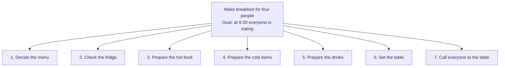
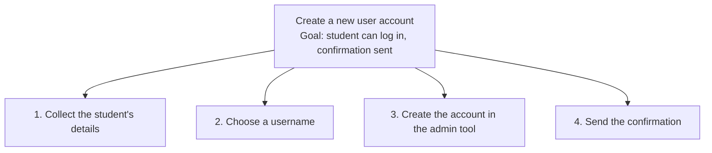

# Lesson 4 — Decomposing a problem (main task, subtasks, and goal)

### What is decomposition?

**Decomposition** is the move of taking a task that is too big for one flat list of steps and splitting it into a **main task** with a **goal** and a small set of **subtasks**, each with its own sub-goal. That is the whole definition for this week. The move is one you already do in your head whenever you plan a weekend or organise an evening with friends; what is new this week is doing it on the page, on purpose, with a name for each part.

Last week your instructions were small enough to live as one flat list. This week they get too big for that. You will notice it when a step turns out to need its own list under it. *"Prepare hot food"* is not one step; it is three or four. *"Set up a colleague's email"* is six or seven, in an order that matters. The moment you see that, decomposition is the move that gets you unstuck.

Two things to hold on to. First, decomposition is a **planning move** — the steps still have to exist underneath, just at a manageable size. Second, decomposition is **not the same as making a long list**. A long list is flat: step 1, step 2, … step 30. A decomposition has a shape: one main task at the top, a handful of subtasks underneath, each with its own goal.

### Main task, subtasks, and the goal

Three words carry most of the week.

**Main task.** The thing you are actually trying to carry out, written as one short sentence. *"Make breakfast for four people on Sunday morning."* Not *"breakfast"* — the full short sentence that names what you are doing.

**Goal.** What is true at the end. One short sentence describing the world after the main task has finished. The main task is the *doing*; the goal is the *end state*. Compare:

- Main task: *Make breakfast for four people on Sunday morning.*
- Goal: *At 9:30 everyone is sitting at the table eating; coffee, hot chocolate, tea, eggs, toast, fruit are all on the table.*

If you cannot write the goal in one short sentence, the main task is still too big or too vague. Go back and name the main task more precisely until the goal fits in a sentence.

**Subtask.** A smaller task that lives under the main task. A subtask is small enough that you can write a clean little algorithm for it (one short sequence of literal steps), and it has its own **sub-goal** — narrower and more specific than the main task's goal. The sub-goal of *"prepare hot food"* is not *"breakfast is ready"*; it is *"scrambled eggs and toast are warm and on a serving plate."*

Let us walk through one everyday decomposition fully.

**Example — making breakfast for four people.**

- **Main task:** *Make breakfast for four people on Sunday morning.*
- **Goal:** *At 9:30 everyone is sitting at the table eating; coffee, hot chocolate, tea, eggs, toast, fruit are all on the table.*
- **Subtasks** (with sub-goals):
  1. *Decide the menu.* Sub-goal: *Six items are named — two coffees, one hot chocolate, one tea, eggs, toast, fruit — and the exact quantities are decided.*
  2. *Check what is in the fridge and on the shelves.* Sub-goal: *Every ingredient on the menu is confirmed to exist in the kitchen, or it is on a short shopping list.*
  3. *Prepare the hot food.* Sub-goal: *Scrambled eggs and toast are warm and on a serving plate.*
  4. *Prepare the cold items.* Sub-goal: *Fruit is washed, cut, and on a plate; jam and butter are out of the fridge.*
  5. *Prepare the drinks.* Sub-goal: *Two coffees, one hot chocolate, one tea are in mugs and hot.*
  6. *Set the table.* Sub-goal: *Four plates, four mugs, four sets of cutlery and napkins are on the table.*
  7. *Call everyone to the table.* Sub-goal: *All four people are at the table by 9:30.*

Drawn as a tree, the same decomposition looks like this:

Notice what happened. The phrase in your head was *"make breakfast for four people"* — one line. On the page it became a main task, a goal, and seven subtasks. Each subtask is now small enough that you could write a five-step algorithm for it the way you did in Week 1. The task did not get smaller; it became a shape you can hold in your head.

### Why decompose at all?

Three reasons, in plain English.

**One — you can write each subtask as a clean small algorithm.** Once *"prepare the hot food"* is its own subtask with its own sub-goal, the Week 1 skill comes back to life. You can write five literal steps for it. You could not do the same for the whole breakfast in five steps; you can for one subtask.

**Two — you can give different subtasks to different people.** If your sister is in the kitchen with you, she can take subtask 6 (*set the table*) while you take subtask 3 (*prepare the hot food*). Without a decomposition you cannot say *"you do that bit, I'll do this bit"* — there are no bits, only "breakfast".

**Three — you can check your work subtask by subtask, instead of all at once.** When the table is set, subtask 6 is done. When the eggs are on the plate, subtask 3 is done. You do not have to wait until 9:30 to find out you forgot the forks. Decomposition gives you **checkpoints**.

### A first IT example

Switching to an IT-related task. Keep it light here; the deeper version lives in Lesson 6.

**Example — creating a user account.**

- **Main task:** *Create a new user account on the school's learning platform for a new student.*
- **Goal:** *The new student can log in with a working username and password, and an account-created confirmation has been sent.*
- **Subtasks** (with sub-goals):
  1. *Collect the student's details.* Sub-goal: *Full name, date of birth, school email and student number are written down, spelled correctly.*
  2. *Choose a username.* Sub-goal: *A username following the school's pattern is decided, and it does not collide with an existing account.*
  3. *Create the account in the platform's admin tool.* Sub-goal: *An account exists with the chosen username; first-login password is set.*
  4. *Send the confirmation.* Sub-goal: *The student has received their username and first-login password and knows where to log in.*

Same shape, IT version:

Same shape: main task, goal, four small subtasks, each with its own sub-goal. Lesson 6 will stretch this kind of task to 5–8 subtasks with named dependencies.

> **Pause for a moment:** Look at the breakfast example above. Pick one of the seven subtasks and write its sub-goal again *in your own words*. Then ask yourself: if a flatmate read only your sub-goal and not the rest of the page, could they tell when they were done with that subtask? If not, rewrite the sub-goal until they could.

---
