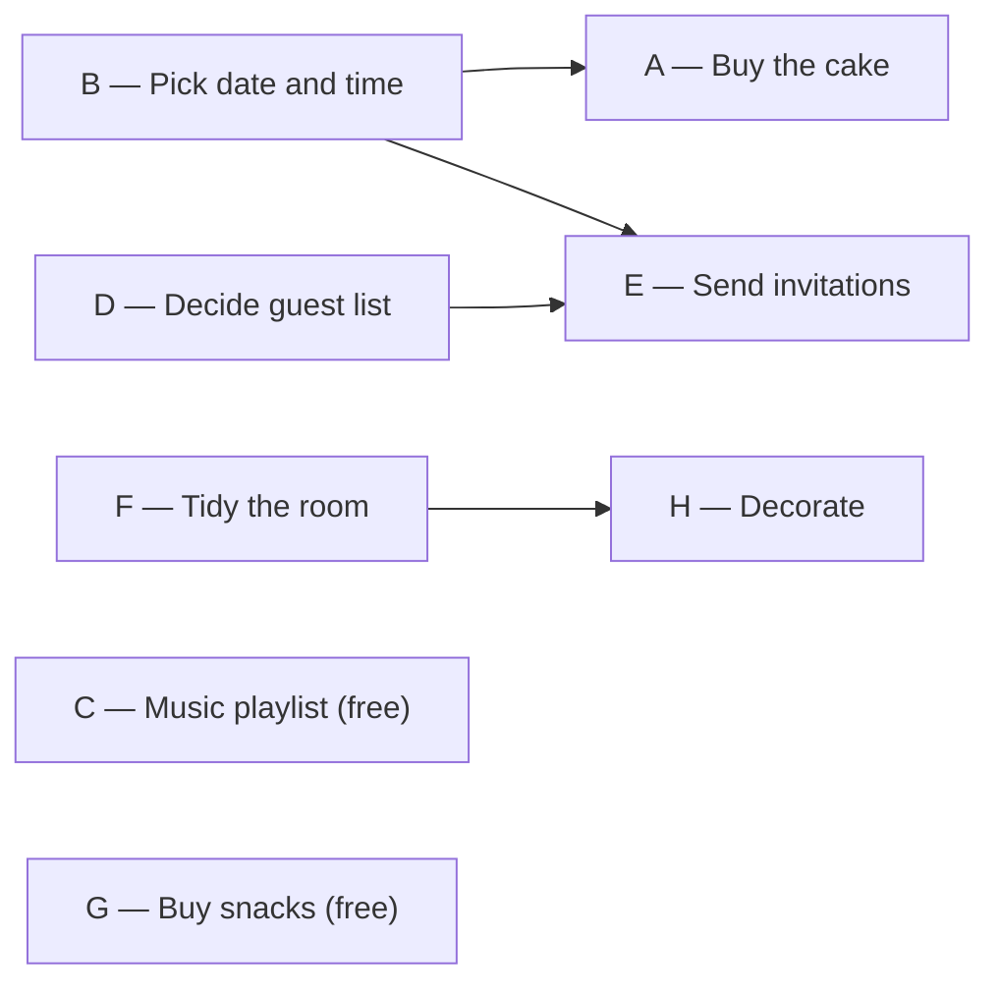

# Lesson 5 — Order of steps and dependencies

### Some subtasks depend on others

A decomposition is not finished when you have a main task, subtasks and sub-goals. You also have to think about **order**. Some subtasks have to come after others; some are free.

A **dependency** is a connection between two subtasks where one needs the **output** of another before it can start. Use the breakfast on the page. *"Eat the toast"* depends on *"toast the bread"*: the toasting subtask's output (a toasted slice) is the eating subtask's input. If you swap the order, the literal follower has cold bread on a plate and no toast.

A second tiny example: *"pour the coffee into the mug"* depends on *"brew the coffee"*, because the brewing subtask's output (hot coffee) is the pouring subtask's input. There is no way to pour first.

Notice the word *output*. A dependency is not "feels like it should come first" — it is the precise fact that one subtask needs something only another subtask produces. When you spot a dependency, write it in one short sentence: *"Subtask 5 (pour the coffee) depends on subtask 4 (brew the coffee), because pouring needs hot coffee, which brewing produces."*

### Some subtasks are independent

Not every pair has a dependency. Some can happen in either order — or "at the same time" if there are two people in the kitchen.

*Set the table* (subtask 6) does not depend on *prepare the hot food* (subtask 3). Neither's output is the other's input. You can set the table before the eggs are on the plate; you can set it after. If your sister sets the table while you do the eggs, they happen "at the same time" — informally **parallel**. (We do not introduce the technical idea of concurrency this week; *parallel* here means "could happen in either order, including at the same time if there are two pairs of hands".)

This is worth spotting. First, free-order subtasks are where you have flexibility. Second, they are where two people can help each other instead of stepping on each other.

### Putting subtasks in a defensible order

**Example — organising a birthday party.** Imagine you have to plan a small birthday party at home for next Saturday. Here are eight subtasks, written deliberately **out of order**:

- A. *Buy the cake.*
- B. *Pick a date and a time.*
- C. *Set up the music playlist.*
- D. *Decide the guest list.*
- E. *Send invitations.*
- F. *Tidy the room.*
- G. *Buy snacks.*
- H. *Decorate.*

Now find the dependencies. *Send invitations* (E) depends on the guest list (D) — you cannot send to a list you do not have. E also depends on the date and time (B) — invitations have to say *when*. *Decorate* (H) depends on *tidy the room* (F): you cannot hang a banner over a pile of laundry. *Buy the cake* (A) depends on the date being fixed (B).

What is **free**? *Set up the music* (C) does not depend on most of the others. *Buying snacks* (G) is free with respect to tidying and decorating. A defensible order, then: **B → D → E**, with **A, G, F, H, C** filling in where they fit. A defensible order is not the only order; it is an order you can justify with the dependencies you have written down.

Drawn as a dependency graph (arrow = "must finish before"):

C and G have no arrows in or out — those are the *free* subtasks. They fit anywhere.

### The IT mirror — sharing a file

The same move on a small IT task. Your teacher asks you to share a document with a class group.

- **Main task:** *Share the project handout with the class group on the school drive.*
- **Goal:** *Every student in the class group can open the handout within 24 hours, and the teacher has confirmed receipt.*
- **Subtasks:**
  1. *Find the document on the school drive.* Sub-goal: *the handout is located and its path is known.*
  2. *Identify the class group.* Sub-goal: *the correct group name is found in the people picker.*
  3. *Set the sharing permissions.* Sub-goal: *the class group has read access.*
  4. *Copy the share link.* Sub-goal: *a working link is on the clipboard.*
  5. *Write the email body.* Sub-goal: *a short email says what the document is and includes the link.*
  6. *Send the email.* Sub-goal: *the email has gone out and is in your sent folder.*
  7. *Confirm receipt with the teacher.* Sub-goal: *the teacher has replied "got it".*

Dependencies. Subtask 4 (*copy the share link*) depends on subtask 3 (without permissions, no shareable link). Subtask 6 depends on subtasks 4 (a link) and 5 (a body). Subtask 7 depends on subtask 6.

What is free? Writing the email body (5) does not depend on the link (4). If two people were doing this, one could draft the body while the other set permissions.

> **Pause for a moment:** Take the birthday-party example and pick one pair of subtasks you think are *free* (no dependency between them). Now ask: would a literal follower actually treat them as free, or is there a hidden dependency you have been assuming without writing it down? If there is one, write it down.

> **Pause for a moment:** Picture sharing a file with a class group in your own school's system this afternoon. Which subtask in the IT example above would change most because of *your* school's specific software? Write one sentence.

---
