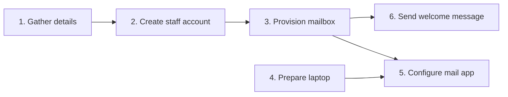

# Lesson 6 — Decomposing an IT-related task

### Stepping up to a realistic IT task

Time to put the whole move on a realistic IT task — the kind a first-line help-desk colleague might handle on their first week. The scenario for this lesson is:

> *"It is Monday morning. A new colleague is starting at your school in two hours. They need a working email account on their new laptop by the time they sit down at their desk."*

That is the kind of sentence that sounds small until you start writing the steps. Then it grows. There is no one button to press. There are several systems involved (the laptop, the mail server, the directory of staff accounts), there are several pieces of information you have to gather first, and several of the subtasks have hard dependencies on each other.

The move is the same as the breakfast and the birthday party. Start with the main task and the goal. Then write the subtasks with sub-goals. Then think about order and dependencies.

- **Main task:** *Set up a new colleague's email account on their new laptop in time for their 10:00 start.*
- **Goal:** *At 10:00 the new colleague sits down at their laptop, opens the mail app, signs in once, and reads the welcome email that was waiting for them.*

### From scenario to subtasks

Six subtasks, with sub-goals:

1. *Gather the new colleague's details.* Sub-goal: *Full name, role, line manager, start date, and a temporary password are written down and confirmed by HR.*
2. *Create the staff account in the directory.* Sub-goal: *An account exists in the staff directory with the agreed username; the temporary password works; the account is in the correct staff group.*
3. *Provision the mailbox.* Sub-goal: *A working mailbox exists for that account; sending and receiving a test message to yourself succeeds.*
4. *Prepare the laptop.* Sub-goal: *The laptop is on, updated, signed in to the school network, and the mail app is installed.*
5. *Configure the mail app with the new account.* Sub-goal: *The mail app on the laptop is signed in to the new mailbox; the inbox loads.*
6. *Send the welcome message.* Sub-goal: *A short welcome email from the line manager is in the inbox, visible the moment the colleague opens the laptop.*

Each subtask is small enough that you could, in Week 1 style, write five to eight literal steps under it for a help-desk colleague to follow. *We are not writing those steps in this course this week.* Decomposition stops at the subtask level — Week 1's literal-step writing happens *inside* each subtask, on the day a real help-desk colleague needs it.

### Order and dependencies in the real task

Now the dependencies. Mark them explicitly.

- Subtask 2 (*create the staff account*) depends on subtask 1 (*gather details*). You cannot create an account without a name, a role and a username.
- Subtask 3 (*provision the mailbox*) depends on subtask 2 (*create the account*). The mailbox is attached to the account; no account, no mailbox.
- Subtask 5 (*configure the mail app*) depends on both subtask 3 (a working mailbox) and subtask 4 (a prepared laptop). It needs the mailbox to sign in to *and* the laptop to sign in *from*.
- Subtask 6 (*send the welcome message*) depends on subtask 3 (a working mailbox to receive it).

What is **free**? Subtask 4 (*prepare the laptop*) is independent of subtasks 1, 2, and 3. You can hand the laptop to someone else to prepare while you set up the account in the directory. The two streams meet at subtask 5. A defensible order with one free branch:

- Track A: 1 → 2 → 3 → 6
- Track B: 4 (any time before subtask 5)
- Merge: 5 happens once both tracks A (through subtask 3) and B are done.

Track A runs along the top (1 → 2 → 3 → 6). Track B is just subtask 4 on its own. They meet at subtask 5.

That is the shape of a real IT task most weeks. Some subtasks form a hard chain; one or two branches run in parallel; everything meets at a join.

### Two valid decompositions of the same task

A small but important note before AT1. The decomposition above is one valid way to break up the colleague-email task. Another colleague might decompose it differently — for example, by merging "create the account" and "provision the mailbox" into a single subtask (because their tool does both in one click) and splitting "prepare the laptop" into "update the laptop" and "install the mail app" as two subtasks (because, at their school, those are two different jobs done by two different people).

Both decompositions can be valid. Neither is wrong. You will get more practice with this idea in Week 4, where the course teaches you how to compare two valid solutions and choose between them. For Week 2 the message is gentler: notice that the right decomposition depends on the **shape of the work where you are**, not on a universal best answer. Your job in AT1 is to write a decomposition you can defend — not the only possible one.

### Preparing for AT1

At the end of Lesson 6, you submit **AT1**, the first assessed task of the course. AT1 asks you to do exactly what this week has been training:

- Pick one task — everyday or IT-related, your choice.
- Write the main task and its goal in one sentence each.
- List 4–8 subtasks, each with its own sub-goal in one sentence.
- Put the subtasks in a defensible order and **call out at least one dependency** in plain English.
- Add a 3–5 sentence reflection: which subtask was the hardest to name a sub-goal for, and why?

The notes you have been keeping from this week's tasks — your everyday decomposition from Task 2.1, the partner-tested one from Task 2.2, the dependency map from Task 2.3, the school-IT decomposition from Task 2.4, the sparring-partner rewrite from Task 2.5 — are the raw material for AT1. If you have done Task 2.4 cleanly, most of AT1 is already in your notebook. If you have only done the mandatory tasks, you still have everything you need.

A reminder of the central message of the week, since it is also the central message of AT1:

> *"A big problem becomes a manageable problem once you name the main task, its subtasks, and the order in which they have to happen."*

That is the sentence to keep in your head while you write AT1. If you can name the main task, name the subtasks with their sub-goals, and put them in an order with at least one dependency, you have done the move this week trained.

> **Pause for a moment:** Imagine you are submitting AT1 tomorrow. Which one of this week's tasks gave you the artefact you would submit? If your answer is "I don't have one yet", which task will you do tonight to get one?

---

## Summary and what comes next

Week 2 added one move on top of Week 1's literal-follower mindset. When the task is too big for one list of steps, you split it. You name the main task and its goal. You name the subtasks with their sub-goals. You put the subtasks in an order, and you call out which ones depend on which. The literal follower from Week 1 is still in the room — every subtask, on its own, has to be small enough that a literal follower could carry it out without guessing.

The whole week sits inside one sentence:

> *"A big problem becomes a manageable problem once you name the main task, its subtasks, and the order in which they have to happen."*

In **Week 3** we add the third of the four pillars of computational thinking: **abstraction**. Decomposition gave you a tree of small tasks; abstraction is the move of *hiding the detail you do not need*. When you said *"prepare the hot food"* this week, you were already abstracting — you were not yet saying which pan, which temperature, which order to put the eggs in. Week 3 makes that move explicit, gives it a name, and introduces a first picture of a process: a simple **flowchart** (start, end, arrows). No code yet — that is Week 7.

Keep your AT1 artefact and your notes. Week 3 will reuse the decomposition shape, and the flowchart you draw in Week 3 will live one level above your decomposition, not below it.
