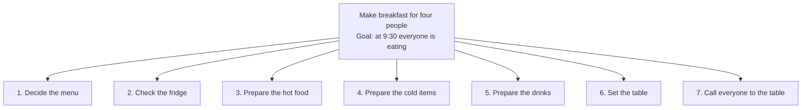
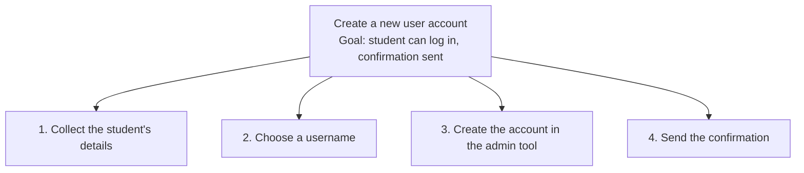
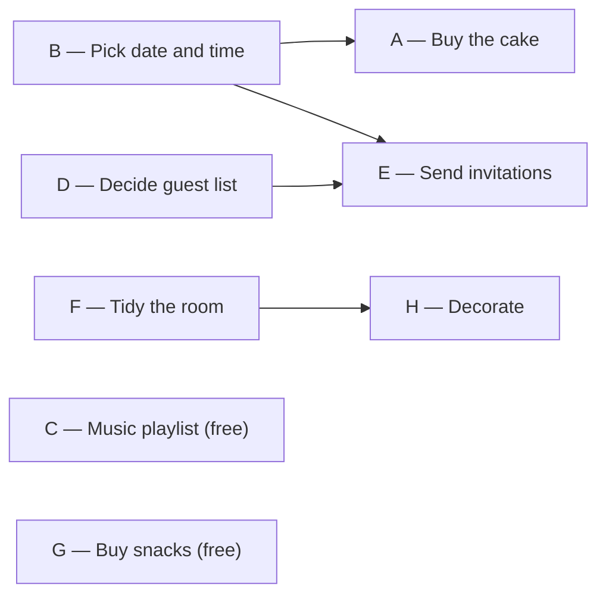
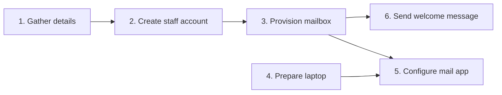

# From one list of steps to a tree of small tasks — decomposing problems

## Introduction

Imagine you have promised to make breakfast for four people on Sunday morning. Coffee for two adults, hot chocolate for a younger cousin, tea for your grandmother, scrambled eggs, toast, fruit on a plate, and everyone at the table by 9:30. You have done every one of these things on its own before — but never all of them at once, in the same kitchen, in the same hour, with the same pair of hands. If you sit down to write *one* clear list of steps, you will hit a wall by step seven. The kettle has to boil while the eggs are in the pan. The toast cannot start before the bread is out of the freezer. Someone — you — has to set the table at some point, but no single step in your list says when.

This is not a Week 1 problem. In Week 1 every instruction was small enough to fit in one flat list — tea, the route to school, a morning routine. Breakfast for four is something else. It is not unclear; it is *too big* for one list.

The central question from Week 1 is still the question of the whole course:

**How do I speak to a computer so that it understands what I want it to do?**

This week the answer gets a new part. When the task is too big for one list of steps, you split it. You name the **main task** and its **goal**. You name the **subtasks** that have to happen on the way. You think about the **order** of those subtasks and which ones have to come after which. Then each subtask, on its own, is small enough to write as a clean little algorithm of the Week 1 kind. The new move has a name:

> *"A big problem becomes a manageable problem once you name the main task, its subtasks, and the order in which they have to happen."*

The three lessons walk that move through three stages. **Lesson 4** names it: *decomposition*. You meet the words *main task*, *subtask*, *sub-goal*. **Lesson 5** sharpens it with *order* and *dependencies* — some subtasks have to come after others, some are free, and noticing which is which is most of the skill. **Lesson 6** takes the move to a realistic IT scenario, and at the end of Lesson 6 you submit **AT1**, the first assessed task of the course.

The literal-follower mindset from Week 1 is still in force, every single subtask. Decomposition does not retire it; it stacks on top.

---

## Lesson 4 — Decomposing a problem (main task, subtasks, and goal)

### What is decomposition?

**Decomposition** is the move of taking a task that is too big for one flat list of steps and splitting it into a **main task** with a **goal** and a small set of **subtasks**, each with its own sub-goal. That is the whole definition for this week. The move is one you already do in your head whenever you plan a weekend or organise an evening with friends; what is new this week is doing it on the page, on purpose, with a name for each part.

Last week your instructions were small enough to live as one flat list. This week they get too big for that. You will notice it when a step turns out to need its own list under it. *"Prepare hot food"* is not one step; it is three or four. *"Set up a colleague's email"* is six or seven, in an order that matters. The moment you see that, decomposition is the move that gets you unstuck.

Two things to hold on to. First, decomposition is a **planning move** — the steps still have to exist underneath, just at a manageable size. Second, decomposition is **not the same as making a long list**. A long list is flat: step 1, step 2, … step 30. A decomposition has a shape: one main task at the top, a handful of subtasks underneath, each with its own goal.

### Main task, subtasks, and the goal

Three words carry most of the week.

**Main task.** The thing you are actually trying to carry out, written as one short sentence. *"Make breakfast for four people on Sunday morning."* Not *"breakfast"* — the full short sentence that names what you are doing.

**Goal.** What is true at the end. One short sentence describing the world after the main task has finished. The main task is the *doing*; the goal is the *end state*. Compare:

- Main task: *Make breakfast for four people on Sunday morning.*
- Goal: *At 9:30 everyone is sitting at the table eating; coffee, hot chocolate, tea, eggs, toast, fruit are all on the table.*

If you cannot write the goal in one short sentence, the main task is still too big or too vague. Go back and name the main task more precisely until the goal fits in a sentence.

**Subtask.** A smaller task that lives under the main task. A subtask is small enough that you can write a clean little algorithm for it (one short sequence of literal steps), and it has its own **sub-goal** — narrower and more specific than the main task's goal. The sub-goal of *"prepare hot food"* is not *"breakfast is ready"*; it is *"scrambled eggs and toast are warm and on a serving plate."*

Let us walk through one everyday decomposition fully.

**Example — making breakfast for four people.**

- **Main task:** *Make breakfast for four people on Sunday morning.*
- **Goal:** *At 9:30 everyone is sitting at the table eating; coffee, hot chocolate, tea, eggs, toast, fruit are all on the table.*
- **Subtasks** (with sub-goals):
  1. *Decide the menu.* Sub-goal: *Six items are named — two coffees, one hot chocolate, one tea, eggs, toast, fruit — and the exact quantities are decided.*
  2. *Check what is in the fridge and on the shelves.* Sub-goal: *Every ingredient on the menu is confirmed to exist in the kitchen, or it is on a short shopping list.*
  3. *Prepare the hot food.* Sub-goal: *Scrambled eggs and toast are warm and on a serving plate.*
  4. *Prepare the cold items.* Sub-goal: *Fruit is washed, cut, and on a plate; jam and butter are out of the fridge.*
  5. *Prepare the drinks.* Sub-goal: *Two coffees, one hot chocolate, one tea are in mugs and hot.*
  6. *Set the table.* Sub-goal: *Four plates, four mugs, four sets of cutlery and napkins are on the table.*
  7. *Call everyone to the table.* Sub-goal: *All four people are at the table by 9:30.*

Drawn as a tree, the same decomposition looks like this:

Notice what happened. The phrase in your head was *"make breakfast for four people"* — one line. On the page it became a main task, a goal, and seven subtasks. Each subtask is now small enough that you could write a five-step algorithm for it the way you did in Week 1. The task did not get smaller; it became a shape you can hold in your head.

### Why decompose at all?

Three reasons, in plain English.

**One — you can write each subtask as a clean small algorithm.** Once *"prepare the hot food"* is its own subtask with its own sub-goal, the Week 1 skill comes back to life. You can write five literal steps for it. You could not do the same for the whole breakfast in five steps; you can for one subtask.

**Two — you can give different subtasks to different people.** If your sister is in the kitchen with you, she can take subtask 6 (*set the table*) while you take subtask 3 (*prepare the hot food*). Without a decomposition you cannot say *"you do that bit, I'll do this bit"* — there are no bits, only "breakfast".

**Three — you can check your work subtask by subtask, instead of all at once.** When the table is set, subtask 6 is done. When the eggs are on the plate, subtask 3 is done. You do not have to wait until 9:30 to find out you forgot the forks. Decomposition gives you **checkpoints**.

### A first IT example

Switching to an IT-related task. Keep it light here; the deeper version lives in Lesson 6.

**Example — creating a user account.**

- **Main task:** *Create a new user account on the school's learning platform for a new student.*
- **Goal:** *The new student can log in with a working username and password, and an account-created confirmation has been sent.*
- **Subtasks** (with sub-goals):
  1. *Collect the student's details.* Sub-goal: *Full name, date of birth, school email and student number are written down, spelled correctly.*
  2. *Choose a username.* Sub-goal: *A username following the school's pattern is decided, and it does not collide with an existing account.*
  3. *Create the account in the platform's admin tool.* Sub-goal: *An account exists with the chosen username; first-login password is set.*
  4. *Send the confirmation.* Sub-goal: *The student has received their username and first-login password and knows where to log in.*

Same shape, IT version:

Same shape: main task, goal, four small subtasks, each with its own sub-goal. Lesson 6 will stretch this kind of task to 5–8 subtasks with named dependencies.

> **Pause for a moment:** Look at the breakfast example above. Pick one of the seven subtasks and write its sub-goal again *in your own words*. Then ask yourself: if a flatmate read only your sub-goal and not the rest of the page, could they tell when they were done with that subtask? If not, rewrite the sub-goal until they could.

---

## Lesson 5 — Order of steps and dependencies

### Some subtasks depend on others

A decomposition is not finished when you have a main task, subtasks and sub-goals. You also have to think about **order**. Some subtasks have to come after others; some are free.

A **dependency** is a connection between two subtasks where one needs the **output** of another before it can start. Use the breakfast on the page. *"Eat the toast"* depends on *"toast the bread"*: the toasting subtask's output (a toasted slice) is the eating subtask's input. If you swap the order, the literal follower has cold bread on a plate and no toast.

A second tiny example: *"pour the coffee into the mug"* depends on *"brew the coffee"*, because the brewing subtask's output (hot coffee) is the pouring subtask's input. There is no way to pour first.

Notice the word *output*. A dependency is not "feels like it should come first" — it is the precise fact that one subtask needs something only another subtask produces. When you spot a dependency, write it in one short sentence: *"Subtask 5 (pour the coffee) depends on subtask 4 (brew the coffee), because pouring needs hot coffee, which brewing produces."*

### Some subtasks are independent

Not every pair has a dependency. Some can happen in either order — or "at the same time" if there are two people in the kitchen.

*Set the table* (subtask 6) does not depend on *prepare the hot food* (subtask 3). Neither's output is the other's input. You can set the table before the eggs are on the plate; you can set it after. If your sister sets the table while you do the eggs, they happen "at the same time" — informally **parallel**. (We do not introduce the technical idea of concurrency this week; *parallel* here means "could happen in either order, including at the same time if there are two pairs of hands".)

This is worth spotting. First, free-order subtasks are where you have flexibility. Second, they are where two people can help each other instead of stepping on each other.

### Putting subtasks in a defensible order

**Example — organising a birthday party.** Imagine you have to plan a small birthday party at home for next Saturday. Here are eight subtasks, written deliberately **out of order**:

- A. *Buy the cake.*
- B. *Pick a date and a time.*
- C. *Set up the music playlist.*
- D. *Decide the guest list.*
- E. *Send invitations.*
- F. *Tidy the room.*
- G. *Buy snacks.*
- H. *Decorate.*

Now find the dependencies. *Send invitations* (E) depends on the guest list (D) — you cannot send to a list you do not have. E also depends on the date and time (B) — invitations have to say *when*. *Decorate* (H) depends on *tidy the room* (F): you cannot hang a banner over a pile of laundry. *Buy the cake* (A) depends on the date being fixed (B).

What is **free**? *Set up the music* (C) does not depend on most of the others. *Buying snacks* (G) is free with respect to tidying and decorating. A defensible order, then: **B → D → E**, with **A, G, F, H, C** filling in where they fit. A defensible order is not the only order; it is an order you can justify with the dependencies you have written down.

Drawn as a dependency graph (arrow = "must finish before"):

C and G have no arrows in or out — those are the *free* subtasks. They fit anywhere.

### The IT mirror — sharing a file

The same move on a small IT task. Your teacher asks you to share a document with a class group.

- **Main task:** *Share the project handout with the class group on the school drive.*
- **Goal:** *Every student in the class group can open the handout within 24 hours, and the teacher has confirmed receipt.*
- **Subtasks:**
  1. *Find the document on the school drive.* Sub-goal: *the handout is located and its path is known.*
  2. *Identify the class group.* Sub-goal: *the correct group name is found in the people picker.*
  3. *Set the sharing permissions.* Sub-goal: *the class group has read access.*
  4. *Copy the share link.* Sub-goal: *a working link is on the clipboard.*
  5. *Write the email body.* Sub-goal: *a short email says what the document is and includes the link.*
  6. *Send the email.* Sub-goal: *the email has gone out and is in your sent folder.*
  7. *Confirm receipt with the teacher.* Sub-goal: *the teacher has replied "got it".*

Dependencies. Subtask 4 (*copy the share link*) depends on subtask 3 (without permissions, no shareable link). Subtask 6 depends on subtasks 4 (a link) and 5 (a body). Subtask 7 depends on subtask 6.

What is free? Writing the email body (5) does not depend on the link (4). If two people were doing this, one could draft the body while the other set permissions.

> **Pause for a moment:** Take the birthday-party example and pick one pair of subtasks you think are *free* (no dependency between them). Now ask: would a literal follower actually treat them as free, or is there a hidden dependency you have been assuming without writing it down? If there is one, write it down.

> **Pause for a moment:** Picture sharing a file with a class group in your own school's system this afternoon. Which subtask in the IT example above would change most because of *your* school's specific software? Write one sentence.

---

## Lesson 6 — Decomposing an IT-related task

### Stepping up to a realistic IT task

Time to put the whole move on a realistic IT task — the kind a first-line help-desk colleague might handle on their first week. The scenario for this lesson is:

> *"It is Monday morning. A new colleague is starting at your school in two hours. They need a working email account on their new laptop by the time they sit down at their desk."*

That is the kind of sentence that sounds small until you start writing the steps. Then it grows. There is no one button to press. There are several systems involved (the laptop, the mail server, the directory of staff accounts), there are several pieces of information you have to gather first, and several of the subtasks have hard dependencies on each other.

The move is the same as the breakfast and the birthday party. Start with the main task and the goal. Then write the subtasks with sub-goals. Then think about order and dependencies.

- **Main task:** *Set up a new colleague's email account on their new laptop in time for their 10:00 start.*
- **Goal:** *At 10:00 the new colleague sits down at their laptop, opens the mail app, signs in once, and reads the welcome email that was waiting for them.*

### From scenario to subtasks

Six subtasks, with sub-goals:

1. *Gather the new colleague's details.* Sub-goal: *Full name, role, line manager, start date, and a temporary password are written down and confirmed by HR.*
2. *Create the staff account in the directory.* Sub-goal: *An account exists in the staff directory with the agreed username; the temporary password works; the account is in the correct staff group.*
3. *Provision the mailbox.* Sub-goal: *A working mailbox exists for that account; sending and receiving a test message to yourself succeeds.*
4. *Prepare the laptop.* Sub-goal: *The laptop is on, updated, signed in to the school network, and the mail app is installed.*
5. *Configure the mail app with the new account.* Sub-goal: *The mail app on the laptop is signed in to the new mailbox; the inbox loads.*
6. *Send the welcome message.* Sub-goal: *A short welcome email from the line manager is in the inbox, visible the moment the colleague opens the laptop.*

Each subtask is small enough that you could, in Week 1 style, write five to eight literal steps under it for a help-desk colleague to follow. *We are not writing those steps in this course this week.* Decomposition stops at the subtask level — Week 1's literal-step writing happens *inside* each subtask, on the day a real help-desk colleague needs it.

### Order and dependencies in the real task

Now the dependencies. Mark them explicitly.

- Subtask 2 (*create the staff account*) depends on subtask 1 (*gather details*). You cannot create an account without a name, a role and a username.
- Subtask 3 (*provision the mailbox*) depends on subtask 2 (*create the account*). The mailbox is attached to the account; no account, no mailbox.
- Subtask 5 (*configure the mail app*) depends on both subtask 3 (a working mailbox) and subtask 4 (a prepared laptop). It needs the mailbox to sign in to *and* the laptop to sign in *from*.
- Subtask 6 (*send the welcome message*) depends on subtask 3 (a working mailbox to receive it).

What is **free**? Subtask 4 (*prepare the laptop*) is independent of subtasks 1, 2, and 3. You can hand the laptop to someone else to prepare while you set up the account in the directory. The two streams meet at subtask 5. A defensible order with one free branch:

- Track A: 1 → 2 → 3 → 6
- Track B: 4 (any time before subtask 5)
- Merge: 5 happens once both tracks A (through subtask 3) and B are done.

Track A runs along the top (1 → 2 → 3 → 6). Track B is just subtask 4 on its own. They meet at subtask 5.

That is the shape of a real IT task most weeks. Some subtasks form a hard chain; one or two branches run in parallel; everything meets at a join.

### Two valid decompositions of the same task

A small but important note before AT1. The decomposition above is one valid way to break up the colleague-email task. Another colleague might decompose it differently — for example, by merging "create the account" and "provision the mailbox" into a single subtask (because their tool does both in one click) and splitting "prepare the laptop" into "update the laptop" and "install the mail app" as two subtasks (because, at their school, those are two different jobs done by two different people).

Both decompositions can be valid. Neither is wrong. You will get more practice with this idea in Week 4, where the course teaches you how to compare two valid solutions and choose between them. For Week 2 the message is gentler: notice that the right decomposition depends on the **shape of the work where you are**, not on a universal best answer. Your job in AT1 is to write a decomposition you can defend — not the only possible one.

### Preparing for AT1

At the end of Lesson 6, you submit **AT1**, the first assessed task of the course. AT1 asks you to do exactly what this week has been training:

- Pick one task — everyday or IT-related, your choice.
- Write the main task and its goal in one sentence each.
- List 4–8 subtasks, each with its own sub-goal in one sentence.
- Put the subtasks in a defensible order and **call out at least one dependency** in plain English.
- Add a 3–5 sentence reflection: which subtask was the hardest to name a sub-goal for, and why?

The notes you have been keeping from this week's tasks — your everyday decomposition from Task 2.1, the partner-tested one from Task 2.2, the dependency map from Task 2.3, the school-IT decomposition from Task 2.4, the sparring-partner rewrite from Task 2.5 — are the raw material for AT1. If you have done Task 2.4 cleanly, most of AT1 is already in your notebook. If you have only done the mandatory tasks, you still have everything you need.

A reminder of the central message of the week, since it is also the central message of AT1:

> *"A big problem becomes a manageable problem once you name the main task, its subtasks, and the order in which they have to happen."*

That is the sentence to keep in your head while you write AT1. If you can name the main task, name the subtasks with their sub-goals, and put them in an order with at least one dependency, you have done the move this week trained.

> **Pause for a moment:** Imagine you are submitting AT1 tomorrow. Which one of this week's tasks gave you the artefact you would submit? If your answer is "I don't have one yet", which task will you do tonight to get one?

---

## Summary and what comes next

Week 2 added one move on top of Week 1's literal-follower mindset. When the task is too big for one list of steps, you split it. You name the main task and its goal. You name the subtasks with their sub-goals. You put the subtasks in an order, and you call out which ones depend on which. The literal follower from Week 1 is still in the room — every subtask, on its own, has to be small enough that a literal follower could carry it out without guessing.

The whole week sits inside one sentence:

> *"A big problem becomes a manageable problem once you name the main task, its subtasks, and the order in which they have to happen."*

In **Week 3** we add the third of the four pillars of computational thinking: **abstraction**. Decomposition gave you a tree of small tasks; abstraction is the move of *hiding the detail you do not need*. When you said *"prepare the hot food"* this week, you were already abstracting — you were not yet saying which pan, which temperature, which order to put the eggs in. Week 3 makes that move explicit, gives it a name, and introduces a first picture of a process: a simple **flowchart** (start, end, arrows). No code yet — that is Week 7.

Keep your AT1 artefact and your notes. Week 3 will reuse the decomposition shape, and the flowchart you draw in Week 3 will live one level above your decomposition, not below it.
