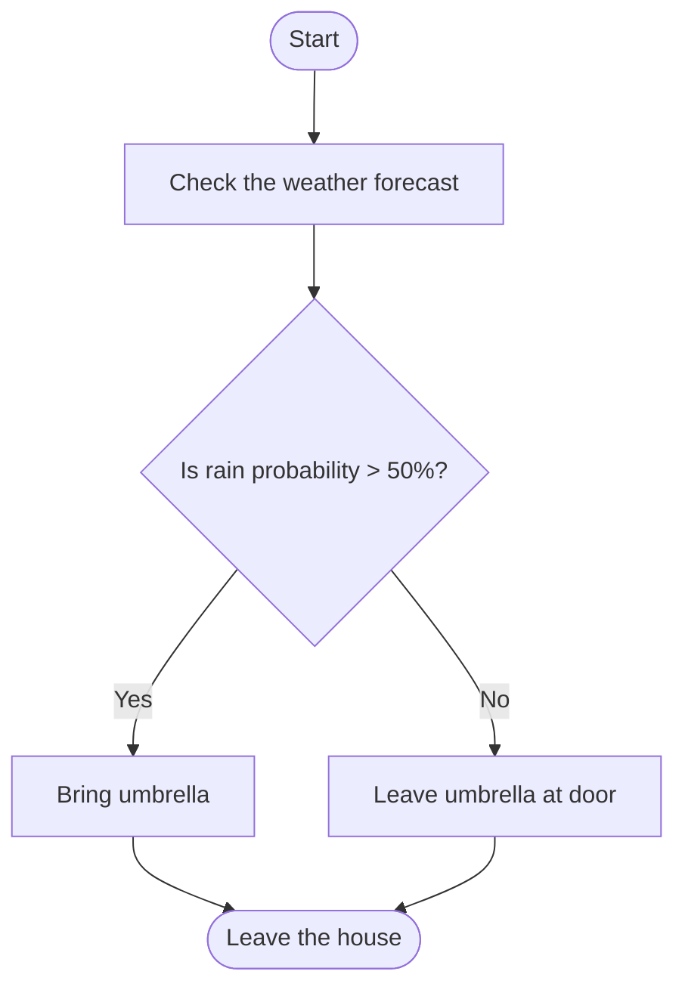
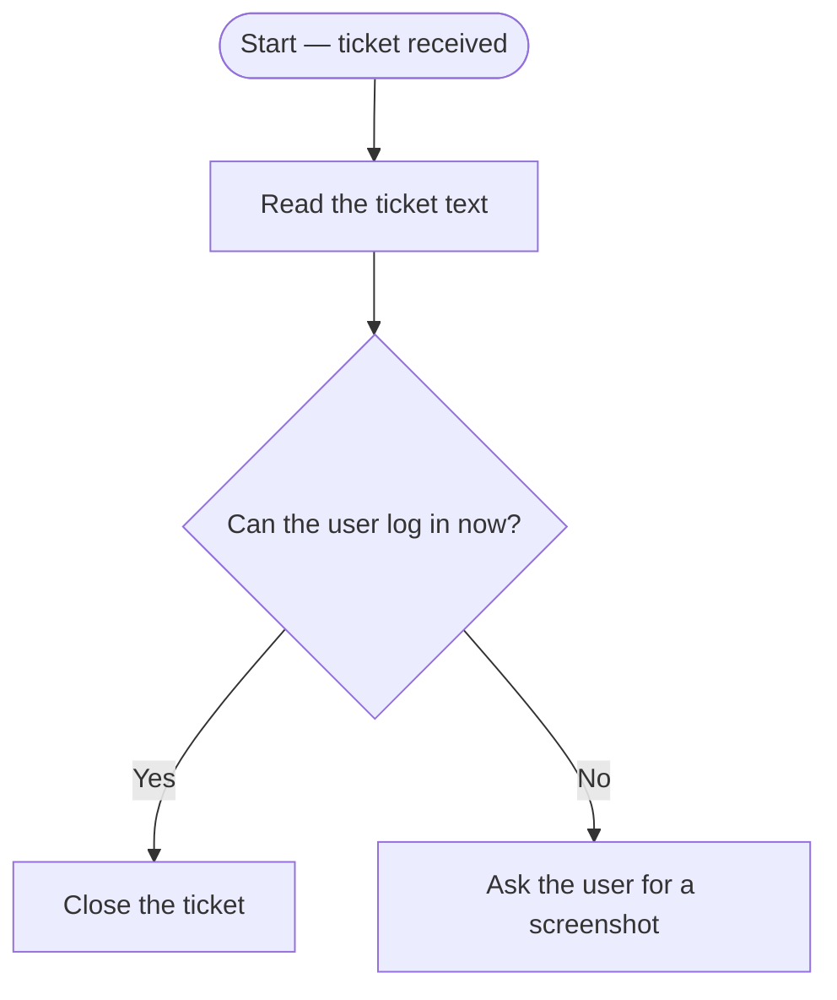

# Lesson 7 — Describing a process and the simple flowchart

### When a list is not enough

Picture your morning routine on a normal school day. Alarm, get up, wash, dress, eat, bag, out the door. Seven steps in a flat list. A literal follower could carry this out without a single decision. The list works.

Now picture the same morning when something is off. *Did the alarm actually go off?* If it did, you have time for breakfast. If it did not, it is 8:10 already and you have to skip breakfast. *Is it raining?* If yes, bring an umbrella. *Is there milk in the fridge?* If yes, cereal; if no, toast.

The flat list cannot hold this. *Step 5 — eat breakfast* is now several different things depending on the answers to several different questions. By the time there are three or four questions in the process, the list becomes unreadable.

A flowchart is what a list becomes when the process has branches. A list says *do this, then this*. A flowchart says *do this, then ask this question, and depending on the answer go this way or that way*. The moment a process has a yes/no question in it, a flat list stops being enough.

The same shift happens on a help-desk. *"Did the user provide a screenshot?"* If yes, attach it and move on. If no, ask for one first. A flat list cannot draw that question. A flowchart can.

### The four shapes

A flowchart in this course uses exactly four shapes. Each one has one job.

- **Start / End (oval).** The oval that opens or closes the flowchart. Every flowchart has exactly one **Start** oval and at least one **End** oval. The Start oval says where the process begins; an End oval says where one path stops.
- **Step (rectangle).** A rectangle holds one action — *"Check the weather forecast"*, *"Save the file"*, *"Send the ticket to the user"*. One rectangle, one action. If a rectangle turns out to mean three different things, you either split it into three rectangles or hide them inside a named block (Lesson 9).
- **Decision (diamond).** A diamond holds one yes/no question — *"Is rain probability above 50%?"*, *"Does the file name match the convention?"*, *"Can the user log in?"*. A decision diamond has two outgoing arrows, one for each answer, and each arrow carries its own label (usually *Yes / No*).
- **Arrow / flow.** Arrows show the order in which the follower moves through the flowchart. Every shape has at least one outgoing arrow, except End ovals. Decision diamonds have exactly two.

Four shapes. That is the whole vocabulary of the picture. The skill of this lesson is not memorising more shapes; it is using these four well.

Here is a very small flowchart that uses all four. It is the morning umbrella decision, drawn as a process:



Read it from the top. Start. Check the forecast. Ask the question in the diamond. If the answer is yes, bring the umbrella. If no, leave it at the door. Either way, leave the house. The flowchart has one Start oval, one End oval, two rectangles before the diamond and one after on each path. Eight shapes. The branch is the whole reason this is a flowchart and not a list.

### Reading a flowchart

Reading a flowchart is following the arrows. You start at the Start oval. At each rectangle, you do what it says. At each diamond, you ask the question and take the arrow whose label matches the answer. You stop when you reach an End oval.

Try the umbrella flowchart with a worked answer. The forecast says 70% probability of rain. *Start.* Check the forecast. Hit the diamond and ask *"is rain probability > 50%?"* — yes, 70% is above 50%. Take the Yes arrow. Bring the umbrella. Leave the house. One run through the process.

Now imagine the forecast says 20%. Same flowchart, the No arrow this time, umbrella stays at the door. Two valid runs, both ending at the same End oval. That is what a branch buys you.

A flowchart is correct when **every path** through it lands at an End oval. An arrow that goes off the page leaves the follower stuck.

### Drawing your first flowchart

Pick one familiar process from your own life that has at least one yes/no question in it: *"should I bring an umbrella?"*, *"should I take the bus or walk?"*, *"which charger fits this device?"*, *"should I save this file with the date in the name?"*. Pick one where the answer changes depending on the day.

On paper or on a tablet, draw the four shapes in pencil. Start oval at the top. Rectangles for the actions you always do. A diamond where you have to make a yes/no decision. Two arrows out of the diamond, each labelled. Rectangles on each branch. End oval (or two, if the branches end in different places). Maximum eight shapes — if you need more, the level of detail is too low and Lesson 8 will help.

Once it is drawn, follow it with your eyes from Start to End on each branch. Did you actually do what the flowchart says, this morning? If yes, the flowchart is honest. If no, fix the flowchart — not your morning.

This is the work of **Task 3.1**. Draw the flowchart, sign and date it, and keep a photo of it for your AT2 notes.

> **Pause for a moment:** Look at your morning so far today. Was there a moment when you made a yes/no decision without thinking about it (umbrella, bus or walk, hot or cold drink)? Could you describe that decision as a single diamond with two arrows out of it? What did the two arrows actually do today?

### IT examples

Two short IT processes drawn as flowcharts.

**Help-desk triage.** A user opens a ticket saying *"I can't log in"*. The first-line agent has to decide what to do next.



One decision diamond, two paths, two different End ovals. *"Can the user log in now?"* honestly leads to two outcomes.

**File-naming check.** Before saving a document to the shared drive, the school's convention says the file must be named like `2026-05-20_invoice-001.pdf`.

```
   ( Start )
       |
       v
[ Look at the file name ]
       |
       v
< Does the file name match the convention? >
   /                              \
  Match                           No match
   |                                |
   v                                v
[ Save to shared drive ]      [ Rename the file first ]
   |                                |
   v                                v
( Saved )                       [ Save to shared drive ]
                                    |
                                    v
                                ( Saved )
```

Notice two things. The branch labels are *Match / No match* — the rule is *each branch has a short label*, and *Match* reads more clearly than *Yes* here. Both branches eventually reach a *Saved* End oval, but the No-match path has an extra step.

> **Pause for a moment:** Pick one IT task you have actually done — installing an app, sharing a file, joining a video call. Is there a yes/no question hiding inside it that you do without thinking? What would the diamond look like?

---
