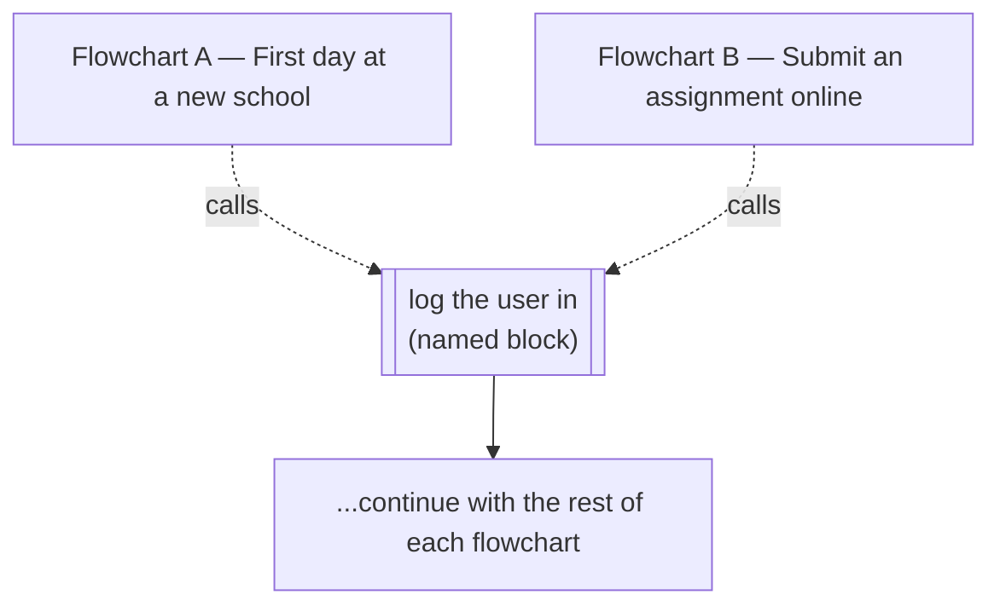

# Lesson 9 — Reusable instructions: the idea of a function without code

### When the same chunk keeps reappearing

Look at two flowcharts side by side.

The first is *"first day at a new school"*. Somewhere in the middle there is a chunk: *Open the school portal → enter username → enter password → press Login → wait for landing page*. Five rectangles.

The second is *"submit an assignment online"*. Near the start, the same chunk appears: *Open the school portal → enter username → enter password → press Login → wait for landing page*.

You could keep drawing it every time. By the third flowchart your hand is tired and the page is full before you reach the interesting part. There is a better move. **Give the chunk a name.**

### Give the chunk a name



Two flowcharts. One named block. The same five rectangles, drawn once.


The name is a short verb-phrase that says *what the chunk does*, not *how it does it*. For the chunk above, the name is *"log the user in"*. Three words. The whole chunk in a verb-phrase.

A good name passes a simple test. Someone who has never seen the original five rectangles can read *"log the user in"* and know what to expect: at the end of this box, the user is logged in. They do not know *how* — that is hidden. But they know *what*, and they know *when the box is done*.

More names from the everyday and IT worlds: *"rename the file"*, *"back up the device"*, *"reset a password"*, *"register a new device"*, *"send a notification to the parent"*. Each is a verb-phrase that says what happens.

A bad name fails the test. *"Do the thing"* tells nobody anything. *"Step 7"* is just a number. The rule is *verb-phrase that says what it does*.

Now the second flowchart with the named block in place of five rectangles:

```
   ( Start — student wants to submit assignment )
        |
        v
[ log the user in ]   <-- one named block, not five rectangles
        |
        v
[ Find the assignment in the course list ]
        |
        v
[ Upload the file ]
        |
        v
[ Click submit ]
        |
        v
( Submitted )
```

Five flowchart shapes total. The original would have been nine. The flowchart fits on the page, the reader sees the interesting part clearly, and *"log the user in"* still contains all five original steps — they just live in a separate description below the flowchart.

### What a "function" means in this week's sense

In Week 3, a **function** is informally defined as **a named, reusable chunk of process, described in plain English, with a clear input and a clear output**. Five things to keep in your head:

- **Named** — a short verb-phrase name.
- **Reusable** — appears in more than one larger process.
- **Chunk of process** — some steps grouped together, usually 3 to 8.
- **Plain English description** — a short paragraph of what the chunk does.
- **Input and output** — what it needs to start, and what it produces when done.

For *"log the user in"*:

> **log the user in** — Takes the user from a not-signed-in state to a signed-in state. The user opens the portal, types their username and password, presses Login, and waits for the landing page.
> **Input:** the user has a valid username and password.
> **Output:** the user is signed in and the portal landing page is on screen.

That is the whole "function" in Week 3 sense. **No code, no parentheses, no return values.** That all comes in Week 7. This week, a function is a labelled box on a flowchart and a paragraph underneath.

A second example:

> **rename the file to the school convention** — Takes a file with any name and produces a file whose name follows the school's date-and-topic convention.
> **Input:** the file exists; the user knows the date and a one-word topic.
> **Output:** the file has a name of the form `YYYY-MM-DD_topic.ext`.

Each named block has a clear input, a clear output, and a one-paragraph description. AT2 will ask you to write this shape — so it is worth practising now.

### Vocational example — "register a new device"

The IT example to lean on this week is **"register a new device"**. Every time a new laptop, projector, or conference-room display arrives at the school, somebody runs the same chunk: sticker with serial number, entry in the device directory, install the standard software set, check the network. About eight steps, every time, for every new device.

A flowchart for *"set up a new conference room"* without the named block:

```
( Start ) → [ Order the display ] → [ Receive the display ] → [ Sticker with serial number ]
   → [ Add entry to device directory ] → [ Install standard software ] → [ Check network ]
   → [ Mount on the wall ] → [ Run the cable to the laptop dock ] → [ Test with a test laptop ]
   → ( Done )
```

Ten boxes. Half are "register the device" steps. The IT manager who cares about the conference room has to scan five register-the-device boxes before reaching the interesting bit.

The same flowchart with the named block:

```
( Start ) → [ Order the display ] → [ Receive the display ] → [ register a new device ]
   → [ Mount on the wall ] → [ Run the cable to the laptop dock ] → [ Test with a test laptop ]
   → ( Done )
```

Seven boxes. The named block carries the five hidden steps. The hidden steps still exist — they live in the "register a new device" description, filed in the school's IT handbook for the trainee who actually has to run that block.

### The trade-off in one sentence

A named block **hides detail** so readers at this level do not drown, **but the reader who needs the detail has to know where to look**. Abstraction in Lesson 8 was about *which boxes deserve to be drawn*; named blocks in Lesson 9 are the same move at a higher zoom level — one box that stands for a whole sub-flowchart.

Bridge to Week 7. There, *"log the user in"* will become a real JavaScript function. The verb-phrase becomes the function name; the plain-English input and output become parameters and return values; the chunk becomes code. But the *shape* — a named, reusable chunk with an input and an output — is what you build this week, in English, in pencil.

> **Pause for a moment:** Look at your Task 3.1 flowchart and any other flowchart you have drawn this week. Is there a chunk of three or four boxes that you suspect would also appear in a different process you do? Write a verb-phrase name for it now, before you read on.

---

## Summary and what comes next

Week 3 added one move on top of Week 2's decomposition. You learned to describe a task as a flowchart with four shapes, to choose the right level of detail for the audience, and to spot chunks of process that reappear and give them reusable names. The literal-follower mindset from Week 1 still holds on every box: each rectangle says one thing, each diamond asks one question, each arrow goes one place.

The central message of the week, one more time, verbatim:

> *"Once you can decompose a problem, the next skill is to describe the process so someone else can run it — and to decide which details matter and which can be safely hidden."*

If you can draw a small flowchart, choose a level of detail for an audience, and name one reusable chunk, you have done the move Week 3 trained.

In **Week 4** the question changes. So far you have written *one* good description of a process. Week 4 asks: *what if there is more than one valid flowchart for the same goal?* You will draw two valid flowcharts for the same task, compare them with simple criteria, and practise peer feedback.

Keep your Task 3.1 flowchart, your named-block notes, and your abstraction reflections. This week's vocabulary — *flowchart*, *decision*, *abstraction*, *level of detail*, *reusable block*, *named block / function* — is exactly what **AT2 — process description** expects at the end of Week 5 / during Week 6.
