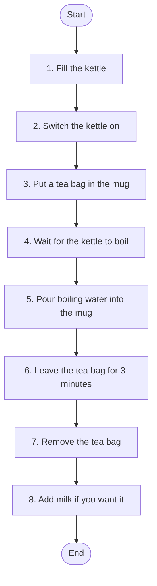

# Lesson 13 — Sequence: a program proceeds step by step

### What sequence means

A **sequence** is the simplest of the three building blocks: *doing one step after another, in a fixed order, unless the instruction tells you otherwise.* That last part is important. Sequence is the **default**. When no condition is written and no repetition is written, a literal follower just walks the steps from top to bottom and does each one exactly once.

If sequence sounds too obvious to be a "building block", that is a useful warning sign. Most real-world breakdowns in described processes — recipes that fail, deployments that go wrong, morning routines that leave you running for the bus — come from a single swapped step or a single missing step. Sequence is the default and the default is where things break.

### Sequence in everyday processes

Here is a tiny algorithm you already know how to do: making a mug of tea.

1. Fill the kettle with water.
2. Switch the kettle on.
3. Put a tea bag in the mug.
4. Wait for the kettle to boil.
5. Pour the boiling water into the mug.
6. Leave the tea bag for three minutes.
7. Remove the tea bag.
8. Add milk if you want it.

That is a sequence: eight numbered steps, each one a clear action, in a fixed order. A literal follower with no tea-making experience could still end up with a drinkable cup if they followed it exactly.

The same sequence as a flowchart — just one shape (rectangle) and one arrow direction:

Now try a thought experiment. Swap steps 4 and 5 — *pour the boiling water into the mug*, then *wait for the kettle to boil*. What happens? The follower pours cold water into the mug, then stands and watches an already-empty kettle that has nothing to boil. The instruction is no longer a tea recipe; it is a confused set of moves. The point: **the order you wrote is the order the follower gets**. Sequence is not a guarantee that the process works — it is a guarantee that the follower will not silently rearrange your steps.

Some steps in a sequence can be swapped without breaking anything. You can brush your teeth before getting dressed, or after — either order ends with the same morning-ready you. Other steps cannot be swapped. You cannot pour the tea before boiling the water; you cannot eat the cake before baking it. We say that the steps which cannot be swapped have a **dependency**: a later step needs the result of an earlier step before it can run.

You do not have to formally analyse dependencies this week. It is enough to *notice* them, and to write your sequences in an order that respects the dependencies you know about.

### Sequence in an IT context — a deployment checklist

Here is a sequence from the world of vocational IT: a simplified *deployment checklist* — the steps a small team might follow to push a new version of a website to its users.

1. Merge the new branch into the main branch.
2. Run the build.
3. Run the smoke tests.
4. Deploy to the staging environment.
5. Notify the team in the chat.
6. Wait for sign-off from a second person.
7. Deploy to production.
8. Watch the dashboard for ten minutes.

This is the same shape as the tea recipe: a numbered list of clear actions in a fixed order. Several steps cannot be reordered without breaking the process. You cannot run the build before the merge — there is nothing new to build. You cannot deploy to production before the sign-off — that is what the sign-off is *for*. The deployment checklist is a sequence held together by its dependencies.

Notice how everyday and IT live next to each other here. *Boil the kettle → pour the water* is the same shape as *run the build → run the smoke tests*. The everyday version came first because it was familiar; the IT version is the same idea in a different setting. This is how the rest of the week will go: everyday example first, then the vocational mirror.

### Independence vs. dependency — a gentle introduction

Two more small examples to feel the difference.

- **Two steps that don't depend on each other.** "Brush your teeth" and "put on your shoes" can happen in either order in a morning routine. There is no dependency between them.
- **Two steps that do.** "Open the file" and "save the file" depend on each other. You cannot save what you have not opened.

You do not need to draw a dependency diagram. The exercise this week is just to *write the order you mean*, and to be honest with yourself when a step has to come before another one because it sets up something the later step needs.

> **Pause for a moment:** Write down a three-step everyday process where the order can be swapped, and another three-step process where it cannot. What single word would you use to describe the difference between the two?

---
