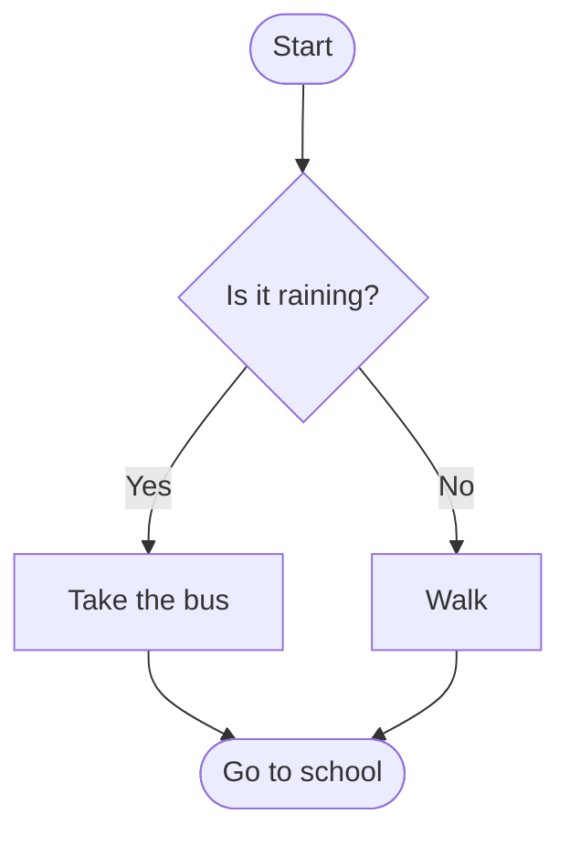

# Lesson 14 — Conditions: if-then-else thinking and decision trees

### What a condition is

A **condition** is a test that decides which step happens next. It is the moment in a process where the path splits.

Sequence on its own is a straight line: do A, then B, then C. A condition adds a fork: do A, then **if X is true** do B, **else** do C. From the follower's point of view, the condition is the moment they pause, check a test, and choose a branch.

### Everyday conditions you already use

You use conditions every day, usually without naming them.

- *"If it rains, take the bus; otherwise walk."* — a two-branch condition (`if … then … else …`).
- *"If you finish your homework before dinner, you can play games."* — a one-branch condition (`if … then …`). If the homework is not finished before dinner, the rule says nothing extra; the follower just does nothing extra.
- *"If the milk smells off, throw it out."* — another one-branch condition. If the milk smells fine, you do nothing about it; you leave it alone.

The difference between *if … then …* (no `else`) and *if … then … else …* (with `else`) is small but real. Without an `else`, the follower has only one extra thing they might do — the "then" — and if the test fails, they just move on. With `else`, the follower always does one thing or the other; the `else` names the alternative.

### Writing a condition in natural language

You can write conditions in the same casual shape across the rest of the week. The shapes look like English with a tiny bit of layout:

> **if** *it is raining*, **then** *take the bus*, **else** *walk*.

The same condition as a decision tree — one diamond, two arrows out:




> **if** *the milk smells off*, **then** *throw it out*.

These are not code. They are English shorthand. The words *if*, *then* and *else* are doing the same job punctuation marks do — they make it easier to see where the test ends and the action starts. Keep them lowercase or italicised; do not turn them into a programming language with strict rules yet (that is Week 6).

A good condition has three honest parts:

1. **A test that the follower can actually check.** *"Is it raining now?"* — yes or no. *"Is the password shorter than 8 characters?"* — yes or no.
2. **A then-branch** — what to do when the test is true.
3. **An else-branch** *(optional)* — what to do when the test is false. If you do not write an else, you are saying "do nothing extra otherwise"; make sure that is what you actually meant.

### Decision trees — drawing the split

A **decision tree** is just a picture of a condition. It puts the test at the top and draws the branches downward.

For "if it rains, bus; else walk":

```
        Is it raining?
        /            \
      yes             no
      /                \
take the bus         walk
```

That is a two-branch tree. You can also have three branches, by adding an `else if`:

```
                 Is it raining?
                 /            \
               yes             no
               /                \
       take the bus         Are you late?
                                /        \
                              yes         no
                              /            \
                           run            walk
```

You do not need any special software to draw a decision tree. A pen and a corner of a notebook is enough. The reason a decision tree is useful is not the drawing — it is the conversation it forces you to have with yourself. Once you have to put a test at every fork, you notice the forks where you had not been honest about what the test really is.

### Conditions in an IT context — password validation

Imagine a sign-up form on a website. When you click *create account*, the system checks your password against a set of rules. Here is a simplified version of the rules in plain English:

- **if** the password is shorter than 8 characters, **then** reject it.
- **if** the password has no number, **then** reject it.
- **if** the password has no capital letter, **then** reject it.
- **otherwise** accept it.

That is a chain of three conditions and an else-branch — four branches in total, ending in two possible outcomes (reject, accept). You can draw it as a decision tree, with each test in turn at the top of a new node:

```
                Is it shorter than 8 chars?
                 /                       \
               yes                        no
               /                            \
            reject              Does it have no number?
                                   /                  \
                                 yes                   no
                                  /                     \
                               reject       Does it have no capital letter?
                                                  /                  \
                                                yes                   no
                                                 /                     \
                                              reject                 accept
```

Notice that this is the same shape as "if it rains, bus; else if you are late, run; else walk." The scene is different — passwords instead of weather — but the *shape* is the same: a chain of tests, each one routing to either a final step or another test. **Same shape, different scene.** That is the lesson.

### Compound conditions — AND, OR *(deepening reading, optional)*

Sometimes a single condition has more than one test inside it. You use these every day too, in plain English:

- *"If you have your bus card **and** there is money on it, you can take the bus."* — two tests connected by AND. Both must be true.
- *"If it rains **or** the wind is strong, take the bus."* — two tests connected by OR. Either one being true is enough.

Compound conditions are perfectly fine to use in plain English. You do not need any symbols (you will not see `∧` or `||` anywhere in this course this year). The word *and* and the word *or* do exactly the work they do in normal sentences. If a compound condition starts to feel cramped — say, *"if A and B or C and not D"* — that is a sign to rewrite it as a small tree with several shorter tests, one per branch.

> **Pause for a moment:** Write down one rule someone in your family uses with you that has the shape *if … then … else …*. What is the test? Could the test fail to be honest — could two people reading it disagree on whether it is true?

> **Pause for a moment:** Look at a website's sign-up form (any one — a streaming service, a school portal, a game). Can you name three different conditions the form is checking before it lets you submit? You do not need to see the code; you can read them off the error messages.

---
