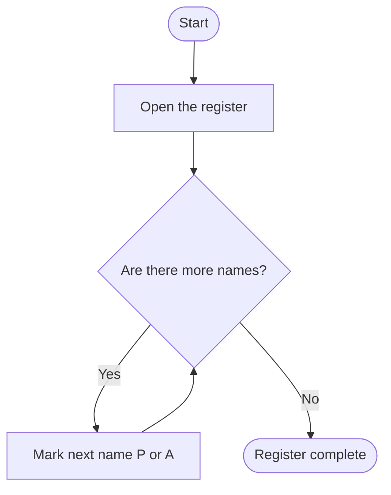

# Lesson 15 — Repetition: doing the same thing multiple times

### What repetition means

A **repetition** is doing the same step, or the same block of steps, more than once, with a stopping condition that tells the follower when to stop. Repetition is also called a *loop* in everyday tech speak — both words mean the same thing in this course; we will mostly say *repetition*.

A sequence is a straight line. A condition is a fork. A repetition is a circle that *also* has an honest exit. If the exit is missing, the follower goes around forever — a *runaway repetition*. More on that below.

### Everyday repetitions you already use

You do these all the time, just like conditions, without giving them a name.

- *"Mark each name in the register present or absent."* You do the same small action — write P or A next to a name — once for every name on the list, and stop when the list runs out.
- *"Keep adding sugar and stirring until it tastes right."* You do the same action — add a pinch, stir, taste — and stop when the test "tastes right" finally comes back true.
- *"While the kettle is still hot, do not boil it again."* You check the condition *before* you act; as long as it is true, you keep going (or, in this case, you keep *not* boiling).

### Three shapes of repetition

There are three small casual shapes that cover almost every repetition you will ever write in plain English:

- **For each** — *for each item in a list, do …*. Use when the list is **known in advance**. The list is the stopping condition: you stop when the list runs out. Example: *for each name in the register, mark present or absent*.
- **Repeat until** — *do … until a stopping condition is true*. Use when the stop depends on **what happens** during the repetition. Example: *keep stirring until the sugar dissolves*.
- **While** — *while a condition is true, keep doing …*. Use when the test is **checked before each repeat**. Example: *while the kettle is still hot, do not boil it again*.

You do not need to memorise the difference between these shapes the way you would memorise a vocabulary word. They are three rhythms, and you will pick the one that fits the situation. The thing that matters in all three is: **the stop is real, and the follower can see it.**

Drawn as a flowchart, every repetition has the same shape: a check, a body, and an arrow that goes back. The arrow that goes back is what makes it a loop. The check on the diamond is the **stopping condition**.

### Repetition in an IT context — the inbox sweep

Here is the same idea in a vocational scene. You open your email inbox at the start of the day. You see 47 unread messages. You sweep through them:

> **for each** unread message in the inbox:
> &nbsp;&nbsp;&nbsp;&nbsp;**if** it is from a person, **then** mark it for reply;
> &nbsp;&nbsp;&nbsp;&nbsp;**else if** it is a newsletter, **then** archive it;
> &nbsp;&nbsp;&nbsp;&nbsp;**else if** it is spam, **then** delete it.
> Repeat until the inbox is empty.

Stop and notice something: that single process uses **all three building blocks**.

- The 1–2 steps you do per message (mark / archive / delete) are a small **sequence**.
- The "is it from a person / a newsletter / spam" choice is a **condition** (with three branches).
- The "for each unread message … until the inbox is empty" frame is a **repetition**.

Most real processes look like this — a sequence wrapped in a condition wrapped in a repetition, or a repetition that contains a condition that contains a small sequence. Naming the three blocks separately is what makes the description readable. Without the names, the inbox sweep is just a paragraph that says "go through your emails." With the names, it is a process a literal follower could carry out.

### The stopping condition is the safety belt

Compare these two sentences:

- *"For each photo on my phone from the weekend, decide whether to keep it."* — Honest stop: the list of weekend photos is finite, so the follower will eventually run out of photos.
- *"Keep working on it until you understand."* — Not an honest stop. There is no observable test for "understand". The follower (you) might go around forever, or — more likely — give up at random and feel bad about it.

Every repetition needs a stop the follower can see. *"Until the inbox is empty"* is observable. *"Until the seat is available"* is observable. *"Until you feel ready"* is not — unless you turn it into something checkable (*"until you can explain it to your classmate in one sentence"*, *"until you have answered three practice questions correctly in a row"*).

When a repetition does not have an honest stop, you have a **runaway repetition**. The fix is almost always the same: add a safety stop in plain English. *"Repeat until the page loads — or stop after 30 seconds and try again later."* The safety stop is the safety belt.

> **Pause for a moment:** Name one thing you did today that was a repetition. What was the stopping condition? Was the stopping condition something you could actually observe, or did you stop because you "felt done"?

> **Pause for a moment:** Imagine a *"repeat until …"* with no stop you can actually observe. Write it down. Now write the safety stop that would save it. What did you have to change?

### Counters — when the stop is a count

Sometimes the stop is just a count. *"Do twenty push-ups."* *"Repeat the chorus three times."* You do the inside step, you keep track of how many times you have done it, and you stop when you reach the number.

A count is a kind of `for each` over the numbers from 1 to N. *"Do twenty push-ups"* is the same shape as *"for each number from 1 to 20, do one push-up."* You do not need any special syntax for this; you just need the count to be honest. *"Repeat until you have done enough"* is not a count; *"repeat 20 times"* is.

---

## Summary and what comes next

This week named the three structural moves that almost every described process is made of:

- **Sequence** — do A, then B, then C, in order, by default.
- **Condition** — at this point, test something, and choose a branch.
- **Repetition** — do this again, with a stop the follower can see.

> **Almost any process can be described with three building blocks: sequence, condition, and repetition.** Once you can name them in everyday tasks, you have the skeleton of every program.

You met each block first in an everyday scene — a tea recipe, "if it rains, take the bus", marking the register — and then in a vocational mirror — a deployment checklist, a password-validation rule, an inbox sweep. The everyday version came first on purpose. The IT version is the same idea worn differently.

**AT2 connection — again.** AT2 lands at the end of Week 5 / during Week 6. It asks you to describe a process you choose, in natural language, with all three building blocks visible. The must-do minimum task this week is the same artefact at a smaller scale: pick a process you really do, write a 3–6 step sequence backbone, add at least one condition (with a tree), add at least one repetition (with a real stop). Keep your notes — the work you do this week is the AT2 artefact in miniature.

**What comes next: Week 6 — pseudocode and dry-running.** Next week we tighten these natural-language descriptions into something a little closer to code — but still on paper. It is called **pseudocode**: a few extra conventions (small variables, simple indentation, a trace table) that turn the loose English you wrote this week into something a beginner programmer could read line by line. The thinking you trained this week — naming the three building blocks — is exactly what makes pseudocode readable. Code itself does not arrive until Week 7.
