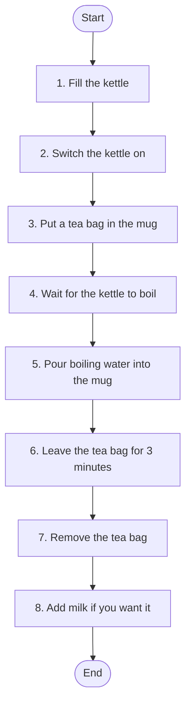
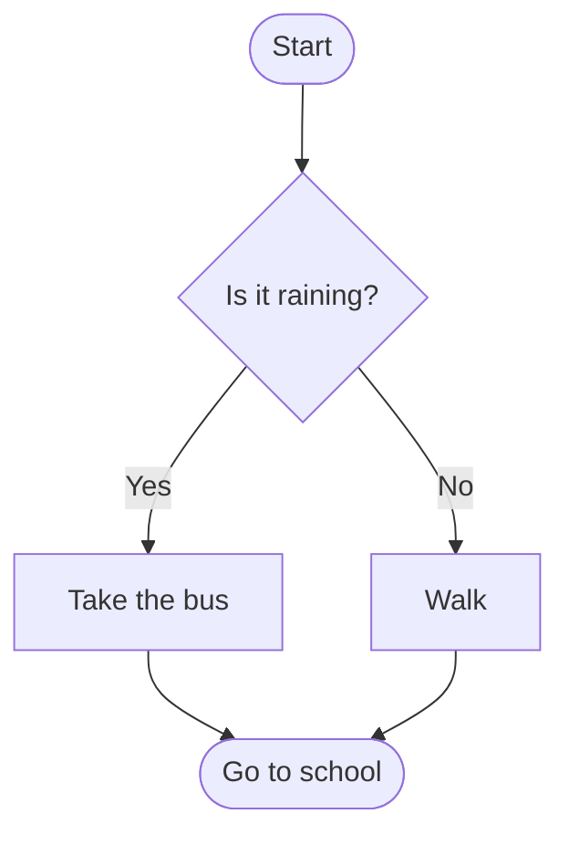
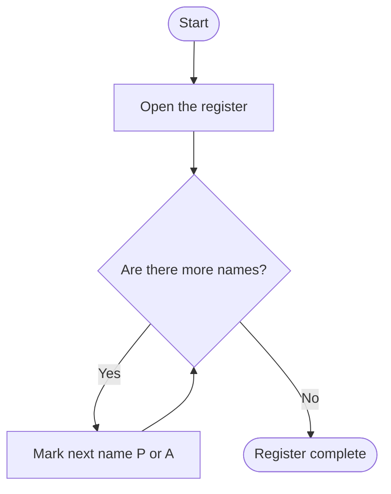

# Three moves: sequence, condition, repetition

## Introduction

You wake up. You check your phone. If it is past 7:30, you skip breakfast; otherwise you eat. Then you walk to school. On the way you check every traffic light: if it is red, you stop; if it is green, you keep going. You repeat this for every crossing until you are at the gate.

That short paragraph describes a real morning. It uses the same three moves that every program ever written has used. You walked through *steps in order* (wake up, then check phone, then walk to school). You made *decisions* (past 7:30 or not? red or green?). And you *repeated* the same check, again and again, for every crossing, until a stop you could see (arriving at the gate).

Those three moves have short, clear names: **sequence**, **condition**, and **repetition**.

> **Almost any process can be described with three building blocks: sequence, condition, and repetition.** Once you can name them in everyday tasks, you have the skeleton of every program.

That is the central message of this week. Week 1 said a computer is a literal follower, not a clever one. Weeks 2 and 3 said big problems can be broken down and described as processes. Week 4 said "correct" can mean more than one thing. Week 5 puts a name on the three structural moves inside every described process — so that next week, when you start writing in something closer to code (called *pseudocode*), the moves are already familiar.

This week stays in plain English. There is no code yet. You will write conditions as `if … then … else …` and repetitions as `for each …` or `repeat until …`, but those phrases are English shorthand, not a programming language. The thinking is what matters this week.

**AT2 connection.** AT2 lands at the end of Week 5 / during Week 6. It asks you to describe a process you choose, in natural language, with all three building blocks visible. The must-do minimum task in `student-tasks.md` is exactly that artefact at a smaller scale. Keep your notes from every lesson — they are the raw material for AT2.

---

## Lesson 13 — Sequence: a program proceeds step by step

### What sequence means

A **sequence** is the simplest of the three building blocks: *doing one step after another, in a fixed order, unless the instruction tells you otherwise.* That last part is important. Sequence is the **default**. When no condition is written and no repetition is written, a literal follower just walks the steps from top to bottom and does each one exactly once.

If sequence sounds too obvious to be a "building block", that is a useful warning sign. Most real-world breakdowns in described processes — recipes that fail, deployments that go wrong, morning routines that leave you running for the bus — come from a single swapped step or a single missing step. Sequence is the default and the default is where things break.

### Sequence in everyday processes

Here is a tiny algorithm you already know how to do: making a mug of tea.

1. Fill the kettle with water.
2. Switch the kettle on.
3. Put a tea bag in the mug.
4. Wait for the kettle to boil.
5. Pour the boiling water into the mug.
6. Leave the tea bag for three minutes.
7. Remove the tea bag.
8. Add milk if you want it.

That is a sequence: eight numbered steps, each one a clear action, in a fixed order. A literal follower with no tea-making experience could still end up with a drinkable cup if they followed it exactly.

The same sequence as a flowchart — just one shape (rectangle) and one arrow direction:




Now try a thought experiment. Swap steps 4 and 5 — *pour the boiling water into the mug*, then *wait for the kettle to boil*. What happens? The follower pours cold water into the mug, then stands and watches an already-empty kettle that has nothing to boil. The instruction is no longer a tea recipe; it is a confused set of moves. The point: **the order you wrote is the order the follower gets**. Sequence is not a guarantee that the process works — it is a guarantee that the follower will not silently rearrange your steps.

Some steps in a sequence can be swapped without breaking anything. You can brush your teeth before getting dressed, or after — either order ends with the same morning-ready you. Other steps cannot be swapped. You cannot pour the tea before boiling the water; you cannot eat the cake before baking it. We say that the steps which cannot be swapped have a **dependency**: a later step needs the result of an earlier step before it can run.

You do not have to formally analyse dependencies this week. It is enough to *notice* them, and to write your sequences in an order that respects the dependencies you know about.

### Sequence in an IT context — a deployment checklist

Here is a sequence from the world of vocational IT: a simplified *deployment checklist* — the steps a small team might follow to push a new version of a website to its users.

1. Merge the new branch into the main branch.
2. Run the build.
3. Run the smoke tests.
4. Deploy to the staging environment.
5. Notify the team in the chat.
6. Wait for sign-off from a second person.
7. Deploy to production.
8. Watch the dashboard for ten minutes.

This is the same shape as the tea recipe: a numbered list of clear actions in a fixed order. Several steps cannot be reordered without breaking the process. You cannot run the build before the merge — there is nothing new to build. You cannot deploy to production before the sign-off — that is what the sign-off is *for*. The deployment checklist is a sequence held together by its dependencies.

Notice how everyday and IT live next to each other here. *Boil the kettle → pour the water* is the same shape as *run the build → run the smoke tests*. The everyday version came first because it was familiar; the IT version is the same idea in a different setting. This is how the rest of the week will go: everyday example first, then the vocational mirror.

### Independence vs. dependency — a gentle introduction

Two more small examples to feel the difference.

- **Two steps that don't depend on each other.** "Brush your teeth" and "put on your shoes" can happen in either order in a morning routine. There is no dependency between them.
- **Two steps that do.** "Open the file" and "save the file" depend on each other. You cannot save what you have not opened.

You do not need to draw a dependency diagram. The exercise this week is just to *write the order you mean*, and to be honest with yourself when a step has to come before another one because it sets up something the later step needs.

> **Pause for a moment:** Write down a three-step everyday process where the order can be swapped, and another three-step process where it cannot. What single word would you use to describe the difference between the two?

---

## Lesson 14 — Conditions: if-then-else thinking and decision trees

### What a condition is

A **condition** is a test that decides which step happens next. It is the moment in a process where the path splits.

Sequence on its own is a straight line: do A, then B, then C. A condition adds a fork: do A, then **if X is true** do B, **else** do C. From the follower's point of view, the condition is the moment they pause, check a test, and choose a branch.

### Everyday conditions you already use

You use conditions every day, usually without naming them.

- *"If it rains, take the bus; otherwise walk."* — a two-branch condition (`if … then … else …`).
- *"If you finish your homework before dinner, you can play games."* — a one-branch condition (`if … then …`). If the homework is not finished before dinner, the rule says nothing extra; the follower just does nothing extra.
- *"If the milk smells off, throw it out."* — another one-branch condition. If the milk smells fine, you do nothing about it; you leave it alone.

The difference between *if … then …* (no `else`) and *if … then … else …* (with `else`) is small but real. Without an `else`, the follower has only one extra thing they might do — the "then" — and if the test fails, they just move on. With `else`, the follower always does one thing or the other; the `else` names the alternative.

### Writing a condition in natural language

You can write conditions in the same casual shape across the rest of the week. The shapes look like English with a tiny bit of layout:

> **if** *it is raining*, **then** *take the bus*, **else** *walk*.

The same condition as a decision tree — one diamond, two arrows out:




> **if** *the milk smells off*, **then** *throw it out*.

These are not code. They are English shorthand. The words *if*, *then* and *else* are doing the same job punctuation marks do — they make it easier to see where the test ends and the action starts. Keep them lowercase or italicised; do not turn them into a programming language with strict rules yet (that is Week 6).

A good condition has three honest parts:

1. **A test that the follower can actually check.** *"Is it raining now?"* — yes or no. *"Is the password shorter than 8 characters?"* — yes or no.
2. **A then-branch** — what to do when the test is true.
3. **An else-branch** *(optional)* — what to do when the test is false. If you do not write an else, you are saying "do nothing extra otherwise"; make sure that is what you actually meant.

### Decision trees — drawing the split

A **decision tree** is just a picture of a condition. It puts the test at the top and draws the branches downward.

For "if it rains, bus; else walk":

```
        Is it raining?
        /            \
      yes             no
      /                \
take the bus         walk
```

That is a two-branch tree. You can also have three branches, by adding an `else if`:

```
                 Is it raining?
                 /            \
               yes             no
               /                \
       take the bus         Are you late?
                                /        \
                              yes         no
                              /            \
                           run            walk
```

You do not need any special software to draw a decision tree. A pen and a corner of a notebook is enough. The reason a decision tree is useful is not the drawing — it is the conversation it forces you to have with yourself. Once you have to put a test at every fork, you notice the forks where you had not been honest about what the test really is.

### Conditions in an IT context — password validation

Imagine a sign-up form on a website. When you click *create account*, the system checks your password against a set of rules. Here is a simplified version of the rules in plain English:

- **if** the password is shorter than 8 characters, **then** reject it.
- **if** the password has no number, **then** reject it.
- **if** the password has no capital letter, **then** reject it.
- **otherwise** accept it.

That is a chain of three conditions and an else-branch — four branches in total, ending in two possible outcomes (reject, accept). You can draw it as a decision tree, with each test in turn at the top of a new node:

```
                Is it shorter than 8 chars?
                 /                       \
               yes                        no
               /                            \
            reject              Does it have no number?
                                   /                  \
                                 yes                   no
                                  /                     \
                               reject       Does it have no capital letter?
                                                  /                  \
                                                yes                   no
                                                 /                     \
                                              reject                 accept
```

Notice that this is the same shape as "if it rains, bus; else if you are late, run; else walk." The scene is different — passwords instead of weather — but the *shape* is the same: a chain of tests, each one routing to either a final step or another test. **Same shape, different scene.** That is the lesson.

### Compound conditions — AND, OR *(deepening reading, optional)*

Sometimes a single condition has more than one test inside it. You use these every day too, in plain English:

- *"If you have your bus card **and** there is money on it, you can take the bus."* — two tests connected by AND. Both must be true.
- *"If it rains **or** the wind is strong, take the bus."* — two tests connected by OR. Either one being true is enough.

Compound conditions are perfectly fine to use in plain English. You do not need any symbols (you will not see `∧` or `||` anywhere in this course this year). The word *and* and the word *or* do exactly the work they do in normal sentences. If a compound condition starts to feel cramped — say, *"if A and B or C and not D"* — that is a sign to rewrite it as a small tree with several shorter tests, one per branch.

> **Pause for a moment:** Write down one rule someone in your family uses with you that has the shape *if … then … else …*. What is the test? Could the test fail to be honest — could two people reading it disagree on whether it is true?

> **Pause for a moment:** Look at a website's sign-up form (any one — a streaming service, a school portal, a game). Can you name three different conditions the form is checking before it lets you submit? You do not need to see the code; you can read them off the error messages.

---

## Lesson 15 — Repetition: doing the same thing multiple times

### What repetition means

A **repetition** is doing the same step, or the same block of steps, more than once, with a stopping condition that tells the follower when to stop. Repetition is also called a *loop* in everyday tech speak — both words mean the same thing in this course; we will mostly say *repetition*.

A sequence is a straight line. A condition is a fork. A repetition is a circle that *also* has an honest exit. If the exit is missing, the follower goes around forever — a *runaway repetition*. More on that below.

### Everyday repetitions you already use

You do these all the time, just like conditions, without giving them a name.

- *"Mark each name in the register present or absent."* You do the same small action — write P or A next to a name — once for every name on the list, and stop when the list runs out.
- *"Keep adding sugar and stirring until it tastes right."* You do the same action — add a pinch, stir, taste — and stop when the test "tastes right" finally comes back true.
- *"While the kettle is still hot, do not boil it again."* You check the condition *before* you act; as long as it is true, you keep going (or, in this case, you keep *not* boiling).

### Three shapes of repetition

There are three small casual shapes that cover almost every repetition you will ever write in plain English:

- **For each** — *for each item in a list, do …*. Use when the list is **known in advance**. The list is the stopping condition: you stop when the list runs out. Example: *for each name in the register, mark present or absent*.
- **Repeat until** — *do … until a stopping condition is true*. Use when the stop depends on **what happens** during the repetition. Example: *keep stirring until the sugar dissolves*.
- **While** — *while a condition is true, keep doing …*. Use when the test is **checked before each repeat**. Example: *while the kettle is still hot, do not boil it again*.

You do not need to memorise the difference between these shapes the way you would memorise a vocabulary word. They are three rhythms, and you will pick the one that fits the situation. The thing that matters in all three is: **the stop is real, and the follower can see it.**

Drawn as a flowchart, every repetition has the same shape: a check, a body, and an arrow that goes back. The arrow that goes back is what makes it a loop. The check on the diamond is the **stopping condition**.




### Repetition in an IT context — the inbox sweep

Here is the same idea in a vocational scene. You open your email inbox at the start of the day. You see 47 unread messages. You sweep through them:

> **for each** unread message in the inbox:
> &nbsp;&nbsp;&nbsp;&nbsp;**if** it is from a person, **then** mark it for reply;
> &nbsp;&nbsp;&nbsp;&nbsp;**else if** it is a newsletter, **then** archive it;
> &nbsp;&nbsp;&nbsp;&nbsp;**else if** it is spam, **then** delete it.
> Repeat until the inbox is empty.

Stop and notice something: that single process uses **all three building blocks**.

- The 1–2 steps you do per message (mark / archive / delete) are a small **sequence**.
- The "is it from a person / a newsletter / spam" choice is a **condition** (with three branches).
- The "for each unread message … until the inbox is empty" frame is a **repetition**.

Most real processes look like this — a sequence wrapped in a condition wrapped in a repetition, or a repetition that contains a condition that contains a small sequence. Naming the three blocks separately is what makes the description readable. Without the names, the inbox sweep is just a paragraph that says "go through your emails." With the names, it is a process a literal follower could carry out.

### The stopping condition is the safety belt

Compare these two sentences:

- *"For each photo on my phone from the weekend, decide whether to keep it."* — Honest stop: the list of weekend photos is finite, so the follower will eventually run out of photos.
- *"Keep working on it until you understand."* — Not an honest stop. There is no observable test for "understand". The follower (you) might go around forever, or — more likely — give up at random and feel bad about it.

Every repetition needs a stop the follower can see. *"Until the inbox is empty"* is observable. *"Until the seat is available"* is observable. *"Until you feel ready"* is not — unless you turn it into something checkable (*"until you can explain it to your classmate in one sentence"*, *"until you have answered three practice questions correctly in a row"*).

When a repetition does not have an honest stop, you have a **runaway repetition**. The fix is almost always the same: add a safety stop in plain English. *"Repeat until the page loads — or stop after 30 seconds and try again later."* The safety stop is the safety belt.

> **Pause for a moment:** Name one thing you did today that was a repetition. What was the stopping condition? Was the stopping condition something you could actually observe, or did you stop because you "felt done"?

> **Pause for a moment:** Imagine a *"repeat until …"* with no stop you can actually observe. Write it down. Now write the safety stop that would save it. What did you have to change?

### Counters — when the stop is a count

Sometimes the stop is just a count. *"Do twenty push-ups."* *"Repeat the chorus three times."* You do the inside step, you keep track of how many times you have done it, and you stop when you reach the number.

A count is a kind of `for each` over the numbers from 1 to N. *"Do twenty push-ups"* is the same shape as *"for each number from 1 to 20, do one push-up."* You do not need any special syntax for this; you just need the count to be honest. *"Repeat until you have done enough"* is not a count; *"repeat 20 times"* is.

---

## Summary and what comes next

This week named the three structural moves that almost every described process is made of:

- **Sequence** — do A, then B, then C, in order, by default.
- **Condition** — at this point, test something, and choose a branch.
- **Repetition** — do this again, with a stop the follower can see.

> **Almost any process can be described with three building blocks: sequence, condition, and repetition.** Once you can name them in everyday tasks, you have the skeleton of every program.

You met each block first in an everyday scene — a tea recipe, "if it rains, take the bus", marking the register — and then in a vocational mirror — a deployment checklist, a password-validation rule, an inbox sweep. The everyday version came first on purpose. The IT version is the same idea worn differently.

**AT2 connection — again.** AT2 lands at the end of Week 5 / during Week 6. It asks you to describe a process you choose, in natural language, with all three building blocks visible. The must-do minimum task this week is the same artefact at a smaller scale: pick a process you really do, write a 3–6 step sequence backbone, add at least one condition (with a tree), add at least one repetition (with a real stop). Keep your notes — the work you do this week is the AT2 artefact in miniature.

**What comes next: Week 6 — pseudocode and dry-running.** Next week we tighten these natural-language descriptions into something a little closer to code — but still on paper. It is called **pseudocode**: a few extra conventions (small variables, simple indentation, a trace table) that turn the loose English you wrote this week into something a beginner programmer could read line by line. The thinking you trained this week — naming the three building blocks — is exactly what makes pseudocode readable. Code itself does not arrive until Week 7.
