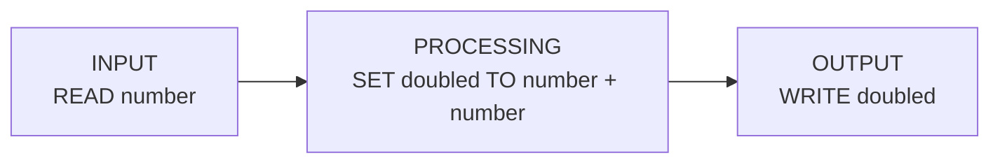

# Lesson 17 — Input, processing, output, and the idea of a variable

### Input → processing → output

Almost every piece of pseudocode you will ever write has the same three-part shape. Something comes *in* from the outside (the user types a password, a sensor reports a temperature, a list of files is given). Something happens *in the middle* (a test is run, a sum is calculated, a list is walked). Something goes back *out* (a message is shown, a result is returned, a file is written).

Here is the smallest possible example. Read a number from the user, double it, write the result back.

```text
READ number
SET doubled TO number + number
WRITE doubled
```

Three lines, one for each part of the skeleton. *Input* is the `READ`. *Processing* is the `SET ... TO number + number`. *Output* is the `WRITE`. Almost everything you will write for the rest of this course is some variation on this shape — usually with more in the middle, sometimes with several inputs or several outputs, but always with the three parts visibly present.

Drawn as three boxes, the skeleton looks like this:




### What is a variable?

A **variable** is a named container for one value that can change while the pseudocode runs.

The everyday metaphor that does the most work here is a labelled sticky note on a jar. The jar sits on a shelf. The label on the jar says `passwordLength` (or `takesSugar`, or `total`). The number written on the sticky note inside the jar is the variable's current value. You can rub out the number and write a new one — that is what `SET passwordLength TO 8` does. But the label on the jar does not change; the *name* of the variable stays the same as long as the pseudocode is running.

Look at one line of pseudocode you have already seen:

```text
SET passwordLength TO 7
```

That line creates a jar called `passwordLength` (or opens it if it already exists) and puts the number `7` inside. From the next line onwards, any time the pseudocode says `passwordLength`, it means *"the number currently in the jar called `passwordLength`"* — which right now is `7`. If a later line says `SET passwordLength TO 8`, the `7` is rubbed out and `8` is written in its place. The jar still says `passwordLength`. The value inside has changed.

In Week 6 your variables hold one of three simple things: a *number* (`7`, `42`), a *yes/no* (which we write `YES` and `NO`), or a *short piece of text* (`"hunter2"`). You will not need lists, objects or anything fancier this week.

### A variable name should describe what it holds

Compare these two lines:

```text
SET x TO 7
```

```text
SET passwordLength TO 7
```

For the computer, both lines do exactly the same thing: they put the number `7` in a named container. For the next person reading the pseudocode — a classmate, a teacher, you in three weeks — they are very different. The first line is a mystery: *what is `x`?* The second line tells you what the `7` is for. **Name your variables for what they hold**, not for what is convenient at the moment. Good names are the cheapest readability fix in the world; bad names are the most expensive bug you can leave for future you.

A simple rule of thumb: if a stranger could read the line aloud and guess what is being stored, the name is good enough. `x`, `tmp`, `n`, `data2` fail this test. `passwordLength`, `isStrong`, `takesSugar`, `totalCost`, `unreadCount` pass it.

### A vocational example — a password-strength check

A common job-shaped task: a user types a password, and your pseudocode decides whether it is strong enough.

```text
READ password
SET length TO numberOfCharactersIn(password)
SET hasDigit TO doesPasswordContainADigit(password)
IF length >= 8 AND hasDigit = YES THEN
  SET isStrong TO YES
ELSE
  SET isStrong TO NO
ENDIF
IF isStrong = YES THEN
  WRITE "password is strong"
ELSE
  WRITE "password is too weak"
ENDIF
```

Trace the three parts. *Input:* the first line (`READ password`). *Processing:* lines 2–8 (count the length, check for a digit, decide `isStrong`). *Output:* the second `IF`, which writes a message to the user. Notice four variables, each with a name that describes what it holds: `password`, `length`, `hasDigit`, `isStrong`. None of them is `x`.

Notice also that `length` and `hasDigit` are *helper* variables — they exist to make the test on line 4 readable. You could squash everything into one giant `IF`, but the version above is easier for a stranger to follow. Pseudocode rewards being kind to the next reader.

> **Pause for a moment:** Pick one of your own three best variable names so far, and one of your worst. Write out, in one sentence each, *what value* each variable was meant to hold. If the bad name's sentence is longer than the good one's, you have just shown yourself why the good one is better.

> **Pause for a moment:** Look at the password-strength example. If a user types a 9-character password with no digits, what does the trace produce? Walk it on a scrap of paper before you read on.

---
