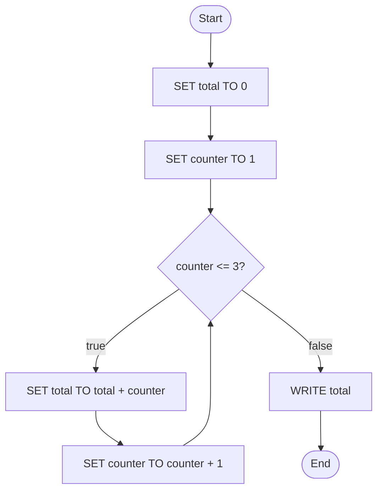

# Lesson 18 — Testing pseudocode: dry running and finding errors

### What is a dry run?

A **dry run** is walking through a piece of pseudocode by hand, line by line, on paper, pretending to be the computer.

Week 1 introduced the *literal robot*: a follower with no common sense, who only does exactly what the words on the page say. Dry-running is you playing that literal robot, on your own pseudocode. You are not allowed to skip ahead, not allowed to assume, not allowed to "see what it means" — you read line one, do exactly what line one says, write down the result, and only then read line two. The discipline is the whole point. Dry-running on paper finds bugs that re-reading does not, because re-reading lets your eye smooth over the very mistake the computer would not smooth over.

### The trace table

The **trace table** is the small grid you draw next to your pseudocode while you dry-run it. One column per variable. One column at the end for output. One row of the table per line of pseudocode you execute. Each row shows what the variables are *after* that line ran.

Here is a worked example. Suppose your pseudocode is supposed to add the numbers 1, 2 and 3 and write the total.

```text
SET total TO 0
SET counter TO 1
WHILE counter <= 3 DO
  SET total TO total + counter
  SET counter TO counter + 1
ENDWHILE
WRITE total
```

Expected output (decided *before* you trace): `6`.

The same pseudocode as a flowchart — handy for spotting where the loop comes back to the diamond:




The trace table:

| Line | counter | total | Output |
|------|---------|-------|--------|
| 1    | —       | 0     |        |
| 2    | 1       | 0     |        |
| 3    | 1       | 0     |        | *(test: 1 <= 3, yes)*
| 4    | 1       | 1     |        |
| 5    | 2       | 1     |        |
| 3    | 2       | 1     |        | *(test: 2 <= 3, yes)*
| 4    | 2       | 3     |        |
| 5    | 3       | 3     |        |
| 3    | 3       | 3     |        | *(test: 3 <= 3, yes)*
| 4    | 3       | 6     |        |
| 5    | 4       | 6     |        |
| 3    | 4       | 6     |        | *(test: 4 <= 3, no — exit loop)*
| 7    | 4       | 6     | 6      |

Actual output: `6`. Expected: `6`. The pseudocode is correct for this input.

Notice the rhythm. Every time a variable changes, you write the new value in its column. Every time the `WHILE` checks its test, you note the answer in the margin. Every time something is written to output, it goes in the output column. By the time you reach the bottom of the table, the actual output is staring at you, and you can compare it to the expected output line by line.

### Finding a bug

Now look at almost the same pseudocode, with one small change:

```text
SET total TO 0
SET counter TO 1
WHILE counter < 3 DO            <-- changed
  SET total TO total + counter
  SET counter TO counter + 1
ENDWHILE
WRITE total
```

Expected output: still `6` (we are still trying to add 1, 2 and 3).

Trace it:

| Line | counter | total | Output |
|------|---------|-------|--------|
| 1    | —       | 0     |        |
| 2    | 1       | 0     |        |
| 3    | 1       | 0     |        | *(test: 1 < 3, yes)*
| 4    | 1       | 1     |        |
| 5    | 2       | 1     |        |
| 3    | 2       | 1     |        | *(test: 2 < 3, yes)*
| 4    | 2       | 3     |        |
| 5    | 3       | 3     |        |
| 3    | 3       | 3     |        | *(test: 3 < 3, no — exit loop)*
| 7    | 3       | 3     | 3      |

Actual output: `3`. Expected: `6`. They disagree. The trace table just caught a bug.

Where is the bug? Look at the lines where the values stopped doing what you expected. The third pass through the loop never happened — the test on line 3 became false one repeat early. The bug is on line 3: `counter < 3` should be `counter <= 3`. This is one of the most common bugs in pseudocode and in real code, and it has a name in plain English: an **off-by-one**. The condition was off by one comparison. Fix the line, re-trace from the top, and the actual output now matches the expected output. The bug is gone.

A bug, in pseudocode, is a small specific defect — a wrong comparison, a missing initialisation, a wrong branch, a confused variable name. Naming the bug is the first half of fixing it.

### Edge cases on paper

The trace table catches what the eye misses, and *the eye misses most often at the boundary*. The numbers you want to trace are not the comfortable middle ones — they are the awkward ones. An **edge case** (a term you met in Week 1) is an input that sits at the boundary of what your pseudocode expects.

For the sum-from-1-to-N pseudocode above, what does it do if `N` is `0`? What if `N` is `1`? What if `N` is negative? For the password-strength check from L17, what if the password is empty? What if it is exactly 8 characters long when the rule says "at least 8"? What if it is 8 characters of digits only? Each of those is an edge case, and each of those is where most real bugs hide. The discipline of L18 is to trace at least one normal input *and* at least one edge case, every time.

### About AT2

This is also where AT2 lives. **AT2 is submitted around Lesson 18 of this week.** It asks you to write a short piece of pseudocode for a small task you choose (a familiar everyday process, or a small vocational scene like a help-desk reply triage, a password-strength check, or a daily backup routine), dry-run it with a trace table for one normal input and one awkward input, and write a five-sentence reflection on what your trace found. There are no new tools between here and AT2. There is no new notation. Everything AT2 asks for is in this self-study and in `student-tasks.md`. Keep your pseudocode and your trace tables — they are exactly the raw material AT2 will ask for.

> **Pause for a moment:** Look at the off-by-one bug above. If you only re-read the pseudocode, would you have caught it on the second read? Be honest. Now ask: what was different about reading it *with the trace table*?

---

## Summary and what comes next

Week 6 took everything from Weeks 1–5 and gave it a single shared shape. You met *pseudocode* — a small set of keywords (`SET`, `READ`, `WRITE`, `IF/ELSE/ENDIF`, `WHILE/ENDWHILE`, `FOR/ENDFOR`) wrapped around the three building blocks you already named in Week 5. You met the *variable* — a named container for one value that can change while the pseudocode runs, sitting inside an input → processing → output skeleton most pseudocode follows. And you met the *dry run* with a *trace table* — the discipline of being your own literal robot, on paper, line by line, until the actual output matches the expected output on both a normal input and an awkward one.

The bridge image is worth keeping. Pseudocode is the bridge between everyday English and real code. The English bank is where Weeks 1–5 lived. The real-code bank is Week 7. Next week the same pseudocode shape becomes a tiny program in a real language you can run in a browser: the keywords you used this week have direct partners there, the `IF` is still an `IF`, the `WHILE` is still a `WHILE`, and the trace table is still the way you check that you got it right. The thinking does not change. Only the alphabet does.

For now: write your pseudocode, draw your trace tables, find your off-by-ones, and bring everything you wrote to Lesson 18. AT2 is waiting on the other side of those tables.
