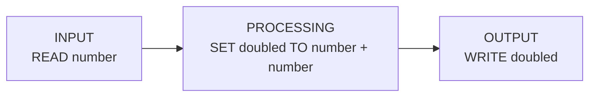
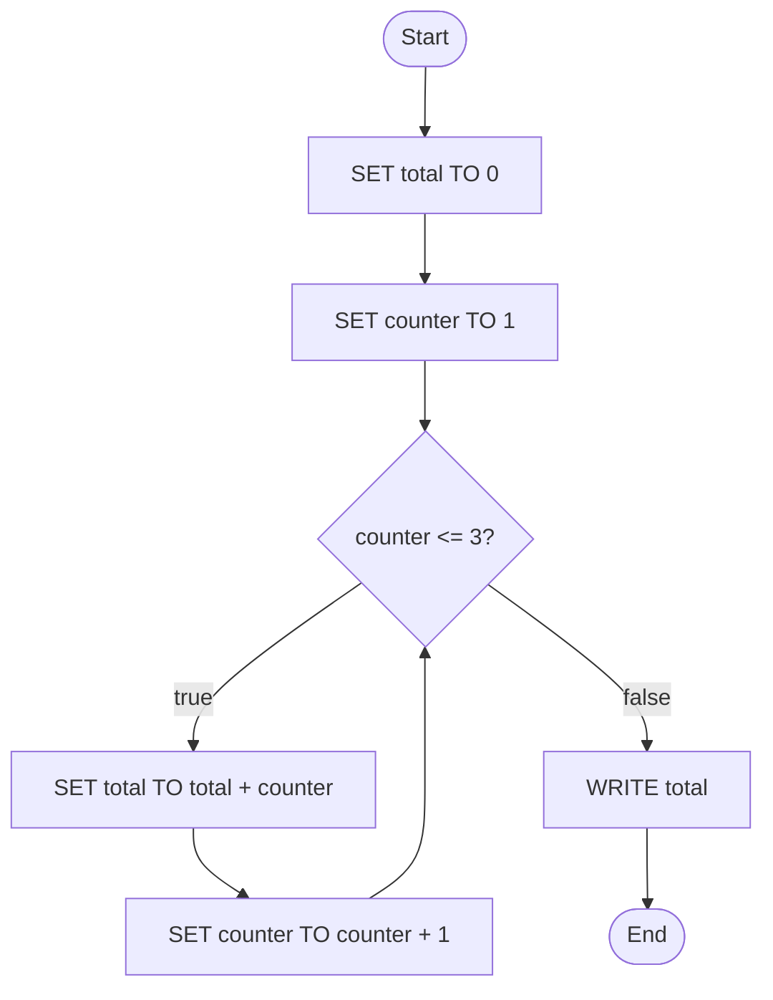

# From thinking to code — meet pseudocode

## Introduction

You walk into the laundry room. The basket has darks today, so you start a darks load; if it had been mostly whites, you would have started a whites load instead. While the machine runs, you scroll your phone; the moment it beeps, you stop scrolling and hang the clothes. Nothing in that paragraph is unusual — but if you wrote it down for somebody else to follow exactly, you would be writing something very close to pseudocode.

This is Week 6, the synthesis week of the thinking half of this course. Week 1 said a computer is a literal follower, not a clever one. Weeks 2 and 3 said big problems can be broken down and described as processes. Week 4 said "correct" can mean more than one thing. Week 5 named the three structural moves inside every described process — sequence, condition, repetition. This week, all of that folds into a single, slightly tighter notation called **pseudocode**. The course's central question is still the same one you have been answering since Week 1:

> *How do I speak to a computer so that it understands what I want it to do?*

The central message of this week, the one you should be able to repeat back by Lesson 18, is this:

> **Pseudocode is the bridge between everyday English and real code: precise enough for a computer to follow if it had to, readable enough to share with a non-programmer.**

That bridge metaphor is the whole point of Week 6. You stand on one bank in plain English, where Weeks 1–5 have lived. On the far bank is real code, which arrives in Week 7. Pseudocode is the bridge between the two. You build that bridge this week by writing a few short pieces of pseudocode for processes you already know, and by reading them line by line, on paper, with something called a *trace table*, to prove they do what you expect.

**AT2 lands this week.** It is submitted around Lesson 18. It asks you to write a short piece of pseudocode for a small task you choose, dry-run it with a trace table for one normal input and one awkward input, and write a five-sentence reflection on what your trace found. The work of L16, L17 and L18 is exactly the raw material AT2 will ask for — there are no new tools and no new notation between here and AT2. Keep every scrap of paper.

---

## Lesson 16 — Pseudocode: from natural language to a more precise format

### From English to pseudocode

Here is a familiar process in English. You are making a mug of tea, and you may or may not take sugar today.

> You fill the kettle and switch it on. You wait until it clicks. You put a tea bag in your mug and pour the hot water. You leave the bag in for three minutes. If you take sugar, you add one spoon and stir. Then the tea is ready.

Read it once aloud. A human friend understands it. A computer does not — *"wait until it clicks"* (how long? how does the computer notice the click?) and *"if you take sugar"* (how does it know?) are both polite gaps that depend on the reader being a person.

Now the same process in pseudocode:

```text
READ takesSugar
SET kettleOn TO YES
WHILE kettleHasNotClicked DO
  wait
ENDWHILE
SET bagInMug TO YES
WRITE "pour hot water"
WRITE "wait three minutes"
IF takesSugar = YES THEN
  WRITE "add one spoon of sugar"
  WRITE "stir"
ENDIF
WRITE "tea is ready"
```

Side by side: what is different? The English is shorter and friendlier. The pseudocode is longer, but every line is one thing the follower must do, and every gap the English left polite (the click, the sugar) is now a named question (`kettleHasNotClicked`, `takesSugar`) with a clear answer. The pseudocode also separates *what we ask the user* (the `READ`) from *what we tell the user* (the `WRITE`s) — the English squashed those together. Notice that the `IF` and `WHILE` you met in Week 5 in plain English are still there: they have just been given a uniform shape and a closing word (`ENDIF`, `ENDWHILE`) so a reader can see where each block starts and stops at a glance.

Pseudocode is not a new language to memorise. It is the things you already write in Week 5, with a few shared words and a fixed shape so a stranger can read it the same way you do.

### The small set of keywords

This course uses a small fixed set of pseudocode keywords. All of them appeared, in plain English form, in Week 5. The keywords are always written in UPPERCASE so the eye finds them quickly. Everything else (variable names, values, messages) is your own English.

```text
SET passwordLength TO 7
```
*Assignment.* Put the value `7` into the named container `passwordLength`. After this line, `passwordLength` is `7`.

```text
READ password
```
*Input.* Take whatever the user types and put it into the named container `password`.

```text
WRITE "your password is strong"
```
*Output.* Show this message to the user.

```text
IF length >= 8 THEN
  WRITE "long enough"
ELSE
  WRITE "too short"
ENDIF
```
*Condition.* If the test is true, do the first block; otherwise do the second block. The `ENDIF` says where the condition stops.

```text
WHILE inboxIsNotEmpty DO
  WRITE "process one message"
ENDWHILE
```
*Repetition with the test before each repeat.* As soon as the test stops being true, the loop stops.

```text
FOR each folder IN backupList DO
  WRITE "back up the folder"
ENDFOR
```
*Repetition over a list known in advance.* The follower does the inside once for every item in the list.

Six shapes. Treat this section as a reference card — you will come back to it through L17 and L18.

### Sequence, condition, repetition — meet again

Look back at the tea pseudocode. The lines that just run top to bottom (`SET kettleOn TO YES`, then `SET bagInMug TO YES`, then the `WRITE`s) are *sequence*. The block opening with `IF takesSugar = YES THEN` is *condition*. The block opening with `WHILE kettleHasNotClicked DO` is *repetition*. Sequence, condition, repetition — exactly the three building blocks from Week 5. Pseudocode does not add a fourth move; it only gives each of the three moves a shared shape on paper.

### Why pseudocode is more reliable to share than English prose

If you and a classmate both wrote the tea process in English, two friendly readers could read the two versions and come away with subtly different ideas of what happens in the sugar step. The pseudocode version closes those gaps. *"If you take sugar"* becomes *"is the value of `takesSugar` equal to `YES` right now?"* There is one and only one way to read that. The point of pseudocode is not that it is easier to write — it is usually harder to write than English. The point is that it is harder to *misread*. When you hand it to a stranger, the stranger gets the same process you meant.

> **Pause for a moment:** Pick one short process you do every morning (charging your phone, brushing your teeth, checking your bus app). Where in that process would your English be polite — where would it leave a gap a literal follower would trip on? Name one specific gap, in writing, before moving on.

> **Pause for a moment:** The tea pseudocode above is 12 lines. If you removed the `ENDIF` and `ENDWHILE`, would the meaning still be clear? Why do you think the course uses them anyway?

---

## Lesson 17 — Input, processing, output, and the idea of a variable

### Input → processing → output

Almost every piece of pseudocode you will ever write has the same three-part shape. Something comes *in* from the outside (the user types a password, a sensor reports a temperature, a list of files is given). Something happens *in the middle* (a test is run, a sum is calculated, a list is walked). Something goes back *out* (a message is shown, a result is returned, a file is written).

Here is the smallest possible example. Read a number from the user, double it, write the result back.

```text
READ number
SET doubled TO number + number
WRITE doubled
```

Three lines, one for each part of the skeleton. *Input* is the `READ`. *Processing* is the `SET ... TO number + number`. *Output* is the `WRITE`. Almost everything you will write for the rest of this course is some variation on this shape — usually with more in the middle, sometimes with several inputs or several outputs, but always with the three parts visibly present.

Drawn as three boxes, the skeleton looks like this:




### What is a variable?

A **variable** is a named container for one value that can change while the pseudocode runs.

The everyday metaphor that does the most work here is a labelled sticky note on a jar. The jar sits on a shelf. The label on the jar says `passwordLength` (or `takesSugar`, or `total`). The number written on the sticky note inside the jar is the variable's current value. You can rub out the number and write a new one — that is what `SET passwordLength TO 8` does. But the label on the jar does not change; the *name* of the variable stays the same as long as the pseudocode is running.

Look at one line of pseudocode you have already seen:

```text
SET passwordLength TO 7
```

That line creates a jar called `passwordLength` (or opens it if it already exists) and puts the number `7` inside. From the next line onwards, any time the pseudocode says `passwordLength`, it means *"the number currently in the jar called `passwordLength`"* — which right now is `7`. If a later line says `SET passwordLength TO 8`, the `7` is rubbed out and `8` is written in its place. The jar still says `passwordLength`. The value inside has changed.

In Week 6 your variables hold one of three simple things: a *number* (`7`, `42`), a *yes/no* (which we write `YES` and `NO`), or a *short piece of text* (`"hunter2"`). You will not need lists, objects or anything fancier this week.

### A variable name should describe what it holds

Compare these two lines:

```text
SET x TO 7
```

```text
SET passwordLength TO 7
```

For the computer, both lines do exactly the same thing: they put the number `7` in a named container. For the next person reading the pseudocode — a classmate, a teacher, you in three weeks — they are very different. The first line is a mystery: *what is `x`?* The second line tells you what the `7` is for. **Name your variables for what they hold**, not for what is convenient at the moment. Good names are the cheapest readability fix in the world; bad names are the most expensive bug you can leave for future you.

A simple rule of thumb: if a stranger could read the line aloud and guess what is being stored, the name is good enough. `x`, `tmp`, `n`, `data2` fail this test. `passwordLength`, `isStrong`, `takesSugar`, `totalCost`, `unreadCount` pass it.

### A vocational example — a password-strength check

A common job-shaped task: a user types a password, and your pseudocode decides whether it is strong enough.

```text
READ password
SET length TO numberOfCharactersIn(password)
SET hasDigit TO doesPasswordContainADigit(password)
IF length >= 8 AND hasDigit = YES THEN
  SET isStrong TO YES
ELSE
  SET isStrong TO NO
ENDIF
IF isStrong = YES THEN
  WRITE "password is strong"
ELSE
  WRITE "password is too weak"
ENDIF
```

Trace the three parts. *Input:* the first line (`READ password`). *Processing:* lines 2–8 (count the length, check for a digit, decide `isStrong`). *Output:* the second `IF`, which writes a message to the user. Notice four variables, each with a name that describes what it holds: `password`, `length`, `hasDigit`, `isStrong`. None of them is `x`.

Notice also that `length` and `hasDigit` are *helper* variables — they exist to make the test on line 4 readable. You could squash everything into one giant `IF`, but the version above is easier for a stranger to follow. Pseudocode rewards being kind to the next reader.

> **Pause for a moment:** Pick one of your own three best variable names so far, and one of your worst. Write out, in one sentence each, *what value* each variable was meant to hold. If the bad name's sentence is longer than the good one's, you have just shown yourself why the good one is better.

> **Pause for a moment:** Look at the password-strength example. If a user types a 9-character password with no digits, what does the trace produce? Walk it on a scrap of paper before you read on.

---

## Lesson 18 — Testing pseudocode: dry running and finding errors

### What is a dry run?

A **dry run** is walking through a piece of pseudocode by hand, line by line, on paper, pretending to be the computer.

Week 1 introduced the *literal robot*: a follower with no common sense, who only does exactly what the words on the page say. Dry-running is you playing that literal robot, on your own pseudocode. You are not allowed to skip ahead, not allowed to assume, not allowed to "see what it means" — you read line one, do exactly what line one says, write down the result, and only then read line two. The discipline is the whole point. Dry-running on paper finds bugs that re-reading does not, because re-reading lets your eye smooth over the very mistake the computer would not smooth over.

### The trace table

The **trace table** is the small grid you draw next to your pseudocode while you dry-run it. One column per variable. One column at the end for output. One row of the table per line of pseudocode you execute. Each row shows what the variables are *after* that line ran.

Here is a worked example. Suppose your pseudocode is supposed to add the numbers 1, 2 and 3 and write the total.

```text
SET total TO 0
SET counter TO 1
WHILE counter <= 3 DO
  SET total TO total + counter
  SET counter TO counter + 1
ENDWHILE
WRITE total
```

Expected output (decided *before* you trace): `6`.

The same pseudocode as a flowchart — handy for spotting where the loop comes back to the diamond:




The trace table:

| Line | counter | total | Output |
|------|---------|-------|--------|
| 1    | —       | 0     |        |
| 2    | 1       | 0     |        |
| 3    | 1       | 0     |        | *(test: 1 <= 3, yes)*
| 4    | 1       | 1     |        |
| 5    | 2       | 1     |        |
| 3    | 2       | 1     |        | *(test: 2 <= 3, yes)*
| 4    | 2       | 3     |        |
| 5    | 3       | 3     |        |
| 3    | 3       | 3     |        | *(test: 3 <= 3, yes)*
| 4    | 3       | 6     |        |
| 5    | 4       | 6     |        |
| 3    | 4       | 6     |        | *(test: 4 <= 3, no — exit loop)*
| 7    | 4       | 6     | 6      |

Actual output: `6`. Expected: `6`. The pseudocode is correct for this input.

Notice the rhythm. Every time a variable changes, you write the new value in its column. Every time the `WHILE` checks its test, you note the answer in the margin. Every time something is written to output, it goes in the output column. By the time you reach the bottom of the table, the actual output is staring at you, and you can compare it to the expected output line by line.

### Finding a bug

Now look at almost the same pseudocode, with one small change:

```text
SET total TO 0
SET counter TO 1
WHILE counter < 3 DO            <-- changed
  SET total TO total + counter
  SET counter TO counter + 1
ENDWHILE
WRITE total
```

Expected output: still `6` (we are still trying to add 1, 2 and 3).

Trace it:

| Line | counter | total | Output |
|------|---------|-------|--------|
| 1    | —       | 0     |        |
| 2    | 1       | 0     |        |
| 3    | 1       | 0     |        | *(test: 1 < 3, yes)*
| 4    | 1       | 1     |        |
| 5    | 2       | 1     |        |
| 3    | 2       | 1     |        | *(test: 2 < 3, yes)*
| 4    | 2       | 3     |        |
| 5    | 3       | 3     |        |
| 3    | 3       | 3     |        | *(test: 3 < 3, no — exit loop)*
| 7    | 3       | 3     | 3      |

Actual output: `3`. Expected: `6`. They disagree. The trace table just caught a bug.

Where is the bug? Look at the lines where the values stopped doing what you expected. The third pass through the loop never happened — the test on line 3 became false one repeat early. The bug is on line 3: `counter < 3` should be `counter <= 3`. This is one of the most common bugs in pseudocode and in real code, and it has a name in plain English: an **off-by-one**. The condition was off by one comparison. Fix the line, re-trace from the top, and the actual output now matches the expected output. The bug is gone.

A bug, in pseudocode, is a small specific defect — a wrong comparison, a missing initialisation, a wrong branch, a confused variable name. Naming the bug is the first half of fixing it.

### Edge cases on paper

The trace table catches what the eye misses, and *the eye misses most often at the boundary*. The numbers you want to trace are not the comfortable middle ones — they are the awkward ones. An **edge case** (a term you met in Week 1) is an input that sits at the boundary of what your pseudocode expects.

For the sum-from-1-to-N pseudocode above, what does it do if `N` is `0`? What if `N` is `1`? What if `N` is negative? For the password-strength check from L17, what if the password is empty? What if it is exactly 8 characters long when the rule says "at least 8"? What if it is 8 characters of digits only? Each of those is an edge case, and each of those is where most real bugs hide. The discipline of L18 is to trace at least one normal input *and* at least one edge case, every time.

### About AT2

This is also where AT2 lives. **AT2 is submitted around Lesson 18 of this week.** It asks you to write a short piece of pseudocode for a small task you choose (a familiar everyday process, or a small vocational scene like a help-desk reply triage, a password-strength check, or a daily backup routine), dry-run it with a trace table for one normal input and one awkward input, and write a five-sentence reflection on what your trace found. There are no new tools between here and AT2. There is no new notation. Everything AT2 asks for is in this self-study and in `student-tasks.md`. Keep your pseudocode and your trace tables — they are exactly the raw material AT2 will ask for.

> **Pause for a moment:** Look at the off-by-one bug above. If you only re-read the pseudocode, would you have caught it on the second read? Be honest. Now ask: what was different about reading it *with the trace table*?

---

## Summary and what comes next

Week 6 took everything from Weeks 1–5 and gave it a single shared shape. You met *pseudocode* — a small set of keywords (`SET`, `READ`, `WRITE`, `IF/ELSE/ENDIF`, `WHILE/ENDWHILE`, `FOR/ENDFOR`) wrapped around the three building blocks you already named in Week 5. You met the *variable* — a named container for one value that can change while the pseudocode runs, sitting inside an input → processing → output skeleton most pseudocode follows. And you met the *dry run* with a *trace table* — the discipline of being your own literal robot, on paper, line by line, until the actual output matches the expected output on both a normal input and an awkward one.

The bridge image is worth keeping. Pseudocode is the bridge between everyday English and real code. The English bank is where Weeks 1–5 lived. The real-code bank is Week 7. Next week the same pseudocode shape becomes a tiny program in a real language you can run in a browser: the keywords you used this week have direct partners there, the `IF` is still an `IF`, the `WHILE` is still a `WHILE`, and the trace table is still the way you check that you got it right. The thinking does not change. Only the alphabet does.

For now: write your pseudocode, draw your trace tables, find your off-by-ones, and bring everything you wrote to Lesson 18. AT2 is waiting on the other side of those tables.
