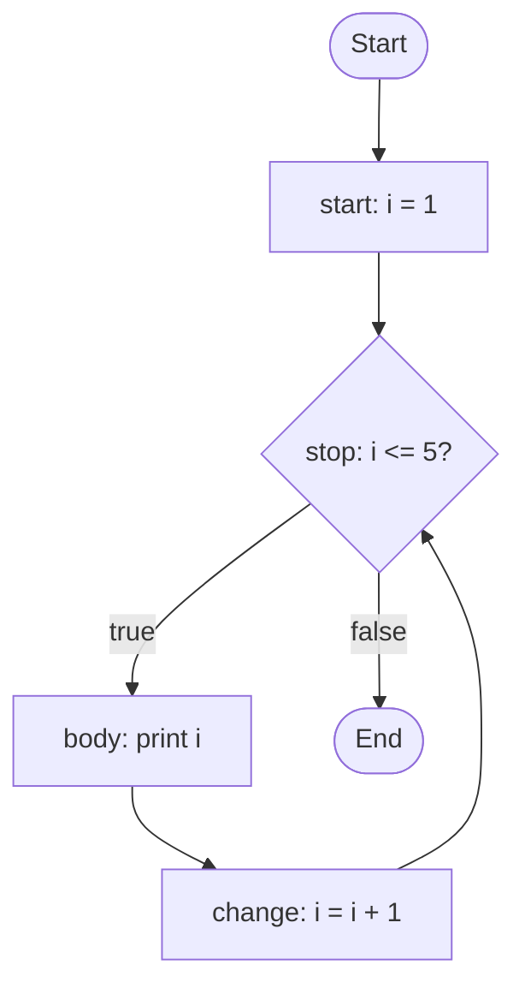

# Lesson 22 — Loops in code

### Why loops exist

In Week 5 you wrote your first *repeat-until* sentences (`REPEAT … UNTIL the password is long enough`), and in Week 6 you wrote pseudocode loops in similar shapes — `WHILE password is too short DO …`, `FOR each item in the list DO …`. They were already loops. The only thing missing was a computer that could read them.

A **loop** is the formal name for the *repeat-until* idea your pseudocode already used — only now the computer, not a human, is doing the repeating. The thinking is identical. What changes this week is the syntax: a small fixed shape JavaScript and C# both accept, with four named parts you can point at. The computer needs three things to loop: *Where do I start? When do I stop? What do I change between each repeat?* A loop is the place those three answers live in one tidy block.




> **Pause for a moment:** Find one Week 6 pseudocode page where you wrote `WHILE`, `REPEAT`, or `FOR each`. Read it. Write down, in your own words, what is repeating and what makes the repetition stop. Those two answers are exactly what a `for` or `while` loop will need.

### The shape of a `for` loop

The most useful loop for this week is the **`for` loop**. Use it when you know in advance how many times you want the body to run — for example, "print the numbers 1 to 5", or "say hello three times". Here is the same simple counter in both languages.

#### JavaScript

```js
for (let i = 1; i <= 5; i++) {
  console.log(i);
}
```

#### C#

```csharp
for (int i = 1; i <= 5; i++) {
    Console.WriteLine(i);
}
```

Both programs print:

```text
1
2
3
4
5
```

The two snippets are almost identical. Both use the keyword `for`, three small pieces in round brackets separated by semicolons, and a curly-brace body. The only surface differences are exactly the ones from Week 7: `let` vs `int`, and `console.log` vs `Console.WriteLine`.

### Counter, condition, body, update

Inside the brackets of a `for` loop, there are three small pieces. Add the curly-brace block after, and a `for` loop has four named parts:

- **Counter** — a small variable, usually called `i`, that keeps track of how far the loop has got. In the snippet above the counter starts at `1`.
- **Condition** — a yes/no test that runs *before* every repeat. While the condition is true, the loop runs the body once more. The condition above is `i <= 5` — "while the counter is still 5 or below, keep going".
- **Body** — the curly-brace block. Anything you write in here happens once per repeat. The body above is just `console.log(i);` (or `Console.WriteLine(i);`), so each repeat prints the current counter.
- **Update** — what changes between each repeat. Usually it adds one to the counter. The update above is `i++`, which is short for "increase `i` by one".

Read the loop out loud once: "**Counter** starts at 1. **Condition**: while the counter is 5 or below. **Body**: print the counter. **Update**: add one to the counter." Both languages let you read it in exactly that order.

If the counter never changes — if you forgot the `i++` — the condition stays true forever and the loop never stops. That is a bug called an **infinite loop**, and we will name it in a moment.

### The shape of a `while` loop

`for` is the loop you use when you know how many times. **`while`** is the loop you use when you know the *stopping condition* but not the exact number of repeats — "keep asking until the password is long enough", "keep going while there is still tea in the cup". The shape is even simpler than `for`: just a condition in brackets and a body in braces.

#### JavaScript

```js
let count = 0;
while (count < 3) {
  console.log("Hello");
  count = count + 1;
}
```

#### C#

```csharp
int count = 0;
while (count < 3) {
    Console.WriteLine("Hello");
    count = count + 1;
}
```

Both programs print:

```text
Hello
Hello
Hello
```

Read the while loop in plain English: "while `count` is less than 3, print `Hello`, then add one to `count`." Notice that the counter (`count`), the condition (`count < 3`), the body (`console.log("Hello")`) and the update (`count = count + 1`) are all still there — they are just spread out across the loop rather than packed into the brackets. A `while` loop is a `for` loop with the four parts moved around for legibility.

A small trade-off: `while` is more flexible, but you have to remember to update the counter yourself inside the body. A `for` loop puts the update in the brackets where it is hard to forget. Most of this week's programs are happier as `for` loops; reach for `while` only when "until" is more natural than "repeat N times".

### When a loop runs forever

An **infinite loop** is a loop whose condition never becomes false, so the body keeps running and the program never ends. It happens most often when you forget the update step.

```js
let count = 0;
while (count < 3) {
  console.log("Hello");
  // missing: count = count + 1;
}
```

```csharp
int count = 0;
while (count < 3) {
    Console.WriteLine("Hello");
    // missing: count = count + 1;
}
```

In the browser console you will see output stream by until the page hangs; in .NET Fiddle the run will time out after a few seconds with a message like *"The process was terminated"*. Neither is dangerous — close the tab if you need to — but the *fix* is the same in both languages: make sure something inside the body changes the value the condition is checking.

If your program seems to hang the first time you run it, the most likely cause is exactly this: a loop whose counter never updates.

> **Pause for a moment:** Look at the `for` loop above (counter from 1 to 5). What would happen if you changed `i++` to `i--`? Without running it, predict the output. Then mentally trace: does the condition `i <= 5` ever become false? If not, what kind of bug is that?

---
