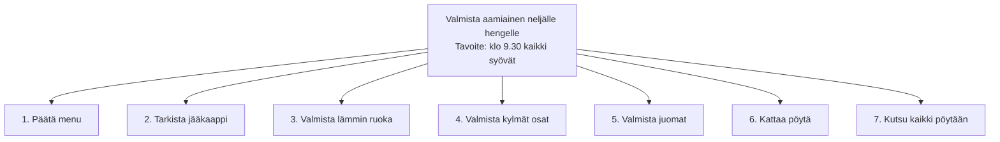
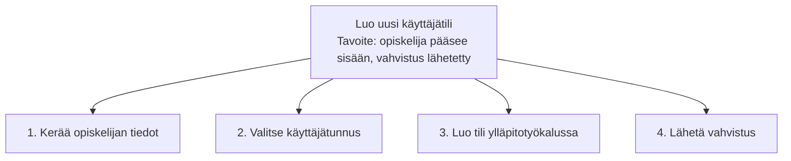
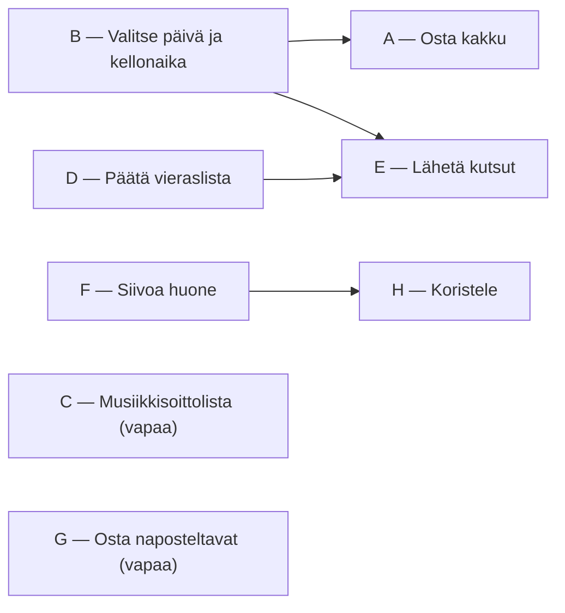
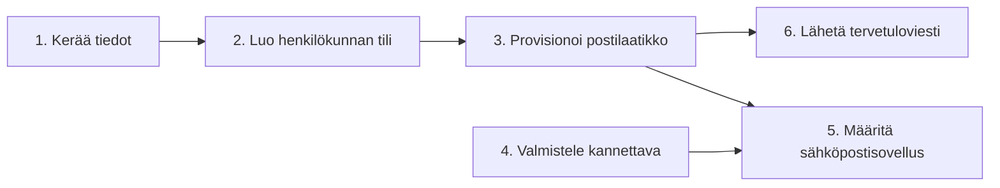

# Itseopiskelu

Kuvittele, että olet luvannut tehdä sunnuntaiaamuna aamiaisen neljälle hengelle. Kahvia
kahdelle aikuiselle, kaakaota nuoremmalle serkulle, teetä isoäidille, munakokkelia,
paahtoleipää, hedelmiä lautaselle ja kaikki pöytään klo 9.30 mennessä. Olet tehnyt jokaisen
näistä asioista yksitellen ennenkin — mutta et koskaan kaikkia yhtä aikaa, samassa keittiössä,
saman tunnin aikana, samoilla käsillä.
Jos istut kirjoittamaan yhtä selkeää vaihelistaa, törmäät seinään jo seitsemännen vaiheen
kohdalla. Vedenkeittimen täytyy kiehua samaan aikaan kun munat ovat pannulla. Paahtoleipä
ei voi alkaa ennen kuin leipä on otettu pakastimesta. Jonkun — sinun — täytyy kattaa pöytä
jossain vaiheessa, mutta mikään yksittäinen vaihe ei kerro, milloin se tapahtuu.
Tämä ei ole viikon 1 ongelma. Viikolla 1 jokainen ohje oli tarpeeksi pieni mahtuakseen yhteen
tasalukuiseen listaan: tee, koulumatka, aamurutiini. Aamiainen neljälle on jotain muuta. Se ei
ole epäselvä; se on liian suuri yhdelle listalle.
Viikon 1 keskeinen kysymys on yhä koko kurssin kysymys: Miten puhun tietokoneelle niin,
että se ymmärtää, mitä haluan sen tekevän? Tällä viikolla vastaukseen tulee uusi osa. Kun
tehtävä on liian suuri yhdelle vaihelistalle, tehtävä pilkotaan. Nimeät päätehtävän ja sen
tavoitteen. Nimeät osatehtävät, jotka täytyy tehdä matkalla kohti tavoitetta. Mietit
osatehtävien järjestyksen ja sen, mitkä niistä täytyy tehdä ennen muita. Tämän jälkeen
jokainen osatehtävä on yksinään tarpeeksi pieni kirjoitettavaksi viikon 1 tyyliseksi pieneksi
algoritmiksi.
Uudella liikkeellä on nimi:
“Suuresta ongelmasta tulee hallittava, kun nimeät päätehtävän, sen osatehtävät ja
järjestyksen, jossa niiden täytyy tapahtua.”
Kolme oppituntia käyvät tämän liikkeen läpi kolmessa vaiheessa. Oppitunti 4 nimeää sen:
pilkkominen. Tutustut sanoihin päätehtävä, osatehtävä ja osatavoite. Oppitunti 5 terävöittää
ajattelua järjestyksen ja riippuvuuksien avulla — osa osatehtävistä täytyy tehdä muiden jälkeen,
osa on vapaita, ja juuri tämän huomaaminen on suuri osa osaamista. Oppitunti 6 vie tämän
realistiseen IT-skenaarioon, ja oppitunnin lopussa palautat AT1-tehtävän, kurssin
ensimmäisen arvioitavan tehtävän.
Viikon 1 kirjaimellisen suorittajan ajattelutapa on edelleen voimassa jokaisessa osatehtävässä.
Pilkkominen ei korvaa sitä, vaan rakentuu sen päälle.
Ajattele näin: viikolla 1 opit kirjoittamaan hyvän pienen ohjeen. Viikolla 2 opit päättämään,
mikä kannattaa olla yksi ohje ja mikä kannattaa jakaa erillisiksi ohjeiksi.

## Oppituntikohtainen lukemisto

## Oppitunti 4 — Ongelman pilkkominen (päätehtävä, osatehtävät ja tavoite)

### Mitä pilkkominen on?

Pilkkominen on sitä, että otat tehtävän, joka on liian suuri yhdelle tasaiselle vaihelistalle, ja
jaat sen päätehtäväksi, jolla on tavoite, sekä pieneksi joukoksi osatehtäviä, joilla jokaisella
on oma osatavoitteensa. Siinä on koko tämän viikon määritelmä. Tätä liikettä teet jo mielessäsi
aina, kun suunnittelet viikonloppua tai järjestät iltaa kavereiden kanssa; uutta tällä viikolla on
se, että teet saman tarkoituksella paperilla ja nimeät jokaisen osan.
Viime viikolla ohjeesi olivat vielä tarpeeksi pieniä mahtuakseen yhteen listaan. Tällä viikolla ne
kasvavat liian suuriksi. Huomaat sen usein siinä hetkessä, kun jokin “vaihe” paljastuu
tarvitsevan oman listansa. “Valmista lämmin ruoka” ei ole yksi vaihe, vaan kolme tai neljä. “Ota
kollegan sähköposti käyttöön” voi olla kuusi tai seitsemän vaihetta, ja niiden järjestyksellä on
väliä. Juuri siinä kohtaa pilkkominen auttaa.
Pidä mielessä kaksi asiaa. Ensimmäinen: pilkkominen on suunnitteluliike — varsinaisten
vaiheiden pitää yhä olla olemassa niiden alla, mutta hallittavan kokoisina. Toinen:
pilkkominen ei ole sama asia kuin pitkän listan kirjoittaminen. Pitkä lista on litteä: vaihe 1,
vaihe 2, vaihe 3 … vaihe 30. Pilkkomisessa on muoto: yksi päätehtävä ylhäällä, muutama
osatehtävä sen alla, jokaisella oma tavoitteensa.

### Päätehtävä, osatehtävät ja tavoite

Kolme sanaa kantaa suurimman osan tästä viikosta.
Päätehtävä. Se asia, jonka oikeasti yrität tehdä, kirjoitettuna yhdeksi lyhyeksi lauseeksi.
“Valmista aamiainen neljälle hengelle sunnuntaiaamuna.” Ei vain “aamiainen”, vaan täysi lyhyt
lause, joka kertoo mitä olet tekemässä.
Tavoite. Se, mikä on totta lopussa. Yksi lyhyt lause, joka kuvaa maailman tilaa sen jälkeen, kun
päätehtävä on valmis. Päätehtävä on tekeminen; tavoite on lopputila.
Vertaa:
• Päätehtävä: Valmista aamiainen neljälle hengelle sunnuntaiaamuna.
• Tavoite: Klo 9.30 kaikki istuvat pöydässä syömässä; kahvi, kaakao, tee, munat,
paahtoleipä ja hedelmät ovat pöydällä.
Jos et pysty kirjoittamaan tavoitetta yhteen lyhyeen lauseeseen, päätehtävä on yhä liian suuri
tai liian epämääräinen. Palaa takaisin ja nimeä päätehtävä tarkemmin, kunnes tavoite mahtuu
yhteen lauseeseen.
Osatehtävä. Pienempi tehtävä, joka elää päätehtävän alla. Osatehtävä on riittävän pieni siihen,
että voit kirjoittaa sille siistin pienen algoritmin (yhden lyhyen sarjan kirjaimellisia vaiheita),
ja sillä on oma osatavoite — päätehtävän tavoitetta kapeampi ja tarkempi. Osatavoite
tehtävälle “valmista lämmin ruoka” ei ole “aamiainen on valmis” vaan “munakokkeli ja
paahtoleipä ovat lämpimiä ja tarjoiluastialla”.
Käydään yksi arkinen pilkkominen kokonaan läpi.

### Esimerkki — aamiaisen valmistaminen neljälle hengelle.

• Päätehtävä: Valmista aamiainen neljälle hengelle sunnuntaiaamuna.
• Tavoite: Klo 9.30 kaikki istuvat pöydässä syömässä; kahvi, kaakao, tee, munat,
paahtoleipä ja hedelmät ovat pöydällä.
• Osatehtävät (osatavoitteineen):
1. Päätä menu.
Osatavoite: Kuusi asiaa on nimetty — kaksi kahvia, yksi kaakao, yksi tee, munat,
paahtoleipä ja hedelmät — ja tarkat määrät on päätetty.
2. Tarkista, mitä jääkaapissa ja kaapeissa on.
Osatavoite: Jokainen menun ainesosa on todettu löytyväksi keittiöstä tai merkitty
lyhyelle ostoslistalle.
3. Valmista lämmin ruoka.
Osatavoite: Munakokkeli ja paahtoleipä ovat lämpimiä ja tarjoiluastialla.
4. Valmista kylmät osat.
Osatavoite: Hedelmät on pesty, pilkottu ja asetettu lautaselle; hillo ja voi ovat pois
jääkaapista.
5. Valmista juomat.
Osatavoite: Kaksi kahvia, yksi kaakao ja yksi tee ovat kuumina mukeissa.
6. Kattaa pöytä.
Osatavoite: Pöydässä on neljä lautasta, neljä mukia, neljä aterinsettiä ja
lautasliinat.
7. Kutsu kaikki pöytään.
Osatavoite: Kaikki neljä henkilöä ovat pöydässä klo 9.30 mennessä.
Puumuodossa sama pilkkominen näyttää tältä:

Huomaa, mitä tapahtui. Mielessäsi oli yksi lause: “tee aamiainen neljälle hengelle”. Paperilla
siitä tuli päätehtävä, tavoite ja seitsemän osatehtävää. Jokainen osatehtävä on nyt tarpeeksi
pieni siihen, että voisit kirjoittaa sille viiden vaiheen algoritmin samalla tavalla kuin viikolla
1. Tehtävä ei pienentynyt; siitä tuli muoto, jonka pystyt pitämään mielessä.

### Miksi pilkkoa ylipäätään?

Kolme syytä tavallisella kielellä.

### Ensimmäinen — voit kirjoittaa jokaisesta osatehtävästä siistin pienen algoritmin. Kun

“valmista lämmin ruoka” on oma osatehtävänsä ja sillä on oma osatavoitteensa, viikon 1 taito
alkaa taas toimia. Voit kirjoittaa sille viisi kirjaimellista vaihetta. Et olisi pystynyt tekemään
samaa koko aamiaiselle viidessä vaiheessa.
Toinen — voit jakaa osatehtäviä eri ihmisille. Jos siskosi on keittiössä kanssasi, hän voi
ottaa osatehtävän 6 (kattaa pöytä) ja sinä osatehtävän 3 (valmista lämmin ruoka). Ilman
pilkkomista et voisi sanoa “sinä hoidat tuon osan, minä tämän”, koska osia ei vielä olisi
nimetty.

### Kolmas — voit tarkistaa työn osatehtävä kerrallaan etkä vasta lopussa. Kun pöytä on

katettu, osatehtävä 6 on valmis. Kun munat ovat lautasella, osatehtävä 3 on valmis. Sinun ei
tarvitse odottaa klo 9.30 asti huomatakseen, että haarukat unohtuivat. Pilkkominen antaa
sinulle tarkistuspisteitä.

### Ensimmäinen IT-esimerkki

Vaihdetaan hetkeksi IT-tehtävään. Pidetään tämä vielä kevyenä; syvempi versio tulee
oppitunnilla 6.

### Esimerkki — käyttäjätilin luominen.

• Päätehtävä: Luo koulun oppimisalustalle uusi käyttäjätili uudelle opiskelijalle.
• Tavoite: Uusi opiskelija pystyy kirjautumaan sisään toimivalla käyttäjätunnuksella ja
salasanalla, ja tilin luomisesta on lähetetty vahvistus.
• Osatehtävät (osatavoitteineen):
1. Kerää opiskelijan tiedot.
Osatavoite: Koko nimi, syntymäaika, koulun sähköposti ja opiskelijanumero on
kirjoitettu ylös oikein.
2. Valitse käyttäjätunnus.
Osatavoite: Koulun käytännön mukainen käyttäjätunnus on päätetty, eikä se
törmää olemassa olevaan tiliin.
3. Luo tili alustan ylläpitotyökalussa.
Osatavoite: Tili on olemassa valitulla käyttäjätunnuksella ja ensimmäisen
kirjautumisen salasana on asetettu.
4. Lähetä vahvistus.
Osatavoite: Opiskelija on saanut käyttäjätunnuksensa ja ensimmäisen
kirjautumisen salasanan sekä tietää, mistä kirjautua sisään.
Sama rakenne, IT-versio:

Muoto on täsmälleen sama: päätehtävä, tavoite ja neljä pientä osatehtävää, joilla on omat
osatavoitteensa. Oppitunnilla 6 venytämme tämän tyyppisen tehtävän 5–8 osatehtävän
mittaiseksi ja lisäämme nimettyjä riippuvuuksia.
Pysähdy hetkeksi: Katso yllä olevaa aamiaisesimerkkiä. Valitse yksi seitsemästä
osatehtävästä ja kirjoita sen osatavoite uudelleen omin sanoin. Kysy sitten itseltäsi:
jos kämppis lukisi vain tuon osatavoitteen eikä muuta sivua, tietäisikö hän, milloin
osatehtävä on valmis? Jos ei, kirjoita osatavoite uudelleen, kunnes tietäisi.
Vinkki: hyvä osatavoite kertoo valmiin tilanteen, ei vain tekemisen nimeä.

## Oppitunti 5 — Vaiheiden järjestys ja riippuvuudet

### Osa osatehtävistä riippuu toisistaan

Pilkkominen ei ole valmis silloin, kun sinulla on päätehtävä, osatehtävät ja osatavoitteet. Sinun
täytyy miettiä myös järjestystä. Osa osatehtävistä täytyy tehdä toisten jälkeen; osa on vapaita.
Riippuvuus on yhteys kahden osatehtävän välillä: toinen tarvitsee toisen tuotoksen ennen
kuin se voi alkaa.
Käytetään taas aamiaisesimerkkiä. “Syö paahtoleipä” riippuu tehtävästä “paahta leipä”:
paahtamisen tuotos (paahdettu leipä) on syömisen syöte. Jos vaihdat järjestyksen,
kirjaimellisella suorittajalla on lautasella kylmä leipä eikä paahtoleipää.
Toinen pieni esimerkki: “kaada kahvi mukiin” riippuu tehtävästä “keitä kahvi”, koska
keittämisen tuotos (kuuma kahvi) on kaatamisen syöte. Kaatamista ei voi tehdä ensin.
Huomaa sana tuotos. Riippuvuus ei tarkoita “tuntuu siltä, että tämän pitäisi tulla ensin”.
Riippuvuus tarkoittaa täsmällistä asiaa: toinen osatehtävä tarvitsee jotakin, jonka vain toinen
osatehtävä tuottaa.
Kun huomaat riippuvuuden, kirjoita se yhteen lyhyeen lauseeseen:
“Osatehtävä 5 (kaada kahvi mukiin) riippuu osatehtävästä 4 (keitä kahvi), koska kaataminen
tarvitsee kuumaa kahvia, jonka keittäminen tuottaa.”

### Osa osatehtävistä on toisistaan riippumattomia

Kaikilla pareilla ei ole riippuvuutta. Jotkin osatehtävät voivat tapahtua kummassa
järjestyksessä tahansa — tai samaan aikaan, jos keittiössä on kaksi ihmistä. Kattaa pöytä
(osatehtävä 6) ei riipu tehtävästä valmista lämmin ruoka (osatehtävä 3). Kummankaan tuotos
ei ole toisen syöte. Voit kattaa pöydän ennen munia tai niiden jälkeen.
Jos siskosi kattaa pöytää samaan aikaan kun sinä teet munia, tehtävät tapahtuvat “samaan
aikaan” — arkikielessä rinnakkain. (Tällä viikolla emme vielä käsittele teknistä
samanaikaisuuden käsitettä; rinnakkain tarkoittaa tässä vain sitä, että tehtävät voivat tapahtua
kummassa järjestyksessä tahansa, myös yhtä aikaa, jos käsipareja on kaksi.)
Tämä kannattaa opetella huomaamaan kahdesta syystä. Ensiksi vapaan järjestyksen
osatehtävät antavat sinulle joustavuutta. Toiseksi ne ovat kohtia, joissa kaksi ihmistä voi
aidosti auttaa toisiaan eikä vain olla toistensa tiellä.

### Osatehtävien asettaminen perusteltuun järjestykseen

### Esimerkki — syntymäpäiväjuhlien järjestäminen.

Kuvittele, että sinun pitää järjestää pienet syntymäpäiväjuhlat kotona ensi lauantaille. Tässä on
kahdeksan osatehtävää tarkoituksella väärässä järjestyksessä:
• A. Osta kakku.
• B. Valitse päivä ja kellonaika.
• C. Tee musiikkisoittolista.
• D. Päätä vieraslista.
• E. Lähetä kutsut.
• F. Siivoa huone.
• G. Osta naposteltavat.
• H. Koristele.
Etsi nyt riippuvuudet.
Kutsujen lähettäminen (E) riippuu vieraslistasta (D) — et voi lähettää kutsuja listalle, jota ei
ole. Se riippuu myös päivästä ja kellonajasta (B) — kutsussa pitää lukea, milloin juhla on.
Koristelu (H) riippuu huoneen siivoamisesta (F): et ripusta viiriä pyykkikasan päälle. Kakun
ostaminen (A) riippuu siitä, että päivämäärä on päätetty (B).
Mikä on vapaata? Musiikkisoittolistan tekeminen (C) ei riipu useimmista muista tehtävistä.
Naposteltavien ostaminen (G) on vapaa suhteessa siivoamiseen ja koristeluun.
Perusteltu järjestys voisi siis olla: B → D → E, ja tehtävät A, G, F, H, C mahtuvat mukaan sinne,
missä ne sopivat.
Perusteltu järjestys ei ole ainoa oikea järjestys. Se on järjestys, jonka pystyt perustelemaan
kirjoittamillasi riippuvuuksilla.
Riippuvuuskaaviona (nuoli = “tämän on oltava valmis ennen tuota”) sama näyttää tältä:

Tehtävillä C ja G ei ole nuolia sisään eikä ulos — ne ovat vapaita osatehtäviä. Ne voidaan
sijoittaa useampaan kohtaan.

### IT-peili — tiedoston jakaminen

Sama ajattelu pienessä IT-tehtävässä. Opettaja pyytää sinua jakamaan dokumentin luokan
ryhmälle.
• Päätehtävä: Jaa projektiohje luokan ryhmälle koulun levyasemalla.
• Tavoite: Jokainen ryhmän opiskelija pystyy avaamaan ohjeen 24 tunnin sisällä, ja
opettaja on vahvistanut vastaanoton.

### • Osatehtävät:

1. Etsi dokumentti koulun levyasemalta.
Osatavoite: Ohje on löytynyt ja sen polku on tiedossa.
2. Tunnista luokan ryhmä.
Osatavoite: Oikea ryhmän nimi löytyy henkilövalitsimesta.
3. Aseta jakamisoikeudet.
Osatavoite: Luokan ryhmällä on lukuoikeus.
4. Kopioi jakolinkki.
Osatavoite: Toimiva linkki on leikepöydällä.
5. Kirjoita sähköpostin runko.
Osatavoite: Lyhyt sähköposti kertoo, mikä dokumentti on kyseessä, ja sisältää
linkin.
6. Lähetä sähköposti.
Osatavoite: Sähköposti on lähetetty ja näkyy Lähetetyt-kansiossa.
7. Varmista vastaanotto opettajalta.
Osatavoite: Opettaja on vastannut “sain sen”.
Riippuvuudet: osatehtävä 4 (kopioi jakolinkki) riippuu osatehtävästä 3 (ilman oikeuksia ei ole
jaettavaa linkkiä). Osatehtävä 6 riippuu osatehtävistä 4 (linkki) ja 5 (viestin runko). Osatehtävä
7 riippuu osatehtävästä 6. Mikä on vapaata? Viestin rungon kirjoittaminen (5) ei riipu linkistä
(4). Jos tehtävää tekisi kaksi ihmistä, toinen voisi luonnostella viestiä samalla kun toinen
asettaa oikeuksia.
Pysähdy hetkeksi: Ota syntymäpäiväesimerkistä yksi osatehtäväpari, jonka luulet
olevan vapaa (ei riippuvuutta). Kysy sitten itseltäsi: kohtelisiko kirjaimellinen
suorittaja sitä todella vapaana, vai oletatko taustalla jonkin riippuvuuden
kirjoittamatta sitä auki? Jos oletat, kirjoita se näkyviin.
Pysähdy hetkeksi: Kuvittele, että jaat tiedoston oman koulusi järjestelmässä tänä
iltapäivänä. Mikä yllä olevan IT-esimerkin osatehtävä muuttuisi eniten juuri teidän
koulunne ohjelmiston takia? Kirjoita yksi lause.
Ajattele näin: riippuvuus ei ole mielipide järjestyksestä. Riippuvuus on syy sille, miksi
järjestystä ei voi vaihtaa rikkomatta tehtävää.

## Oppitunti 6 — IT-tehtävän pilkkominen

### Siirrytään realistiseen IT-tehtävään

Nyt on aika käyttää koko liikettä realistiseen IT-tehtävään — sellaiseen, jonka ensimmäisen
viikon helpdesk-työntekijä voisi oikeasti saada hoidettavakseen.
Tämän oppitunnin skenaario on:
“On maanantaiaamu. Uusi kollega aloittaa koulussasi kahden tunnin kuluttua. Hän
tarvitsee toimivan sähköpostitilin uudella kannettavallaan ennen kuin istuu
työpöytänsä ääreen.”
Tällainen lause kuulostaa pieneltä, kunnes alat kirjoittaa vaiheita. Sitten se kasvaa. Tässä ei ole
yhtä nappia, jota painamalla kaikki tapahtuu. Mukana on useita järjestelmiä (kannettava,
sähköpostipalvelin, henkilökunnan hakemisto), ensin on kerättävä useita tietoja, ja monilla
osatehtävillä on tiukat riippuvuudet toisiinsa.
Liike on kuitenkin sama kuin aamiainen- ja juhlaesimerkeissä. Aloita päätehtävästä ja
tavoitteesta. Kirjoita sitten osatehtävät osatavoitteineen. Mieti lopuksi järjestys ja riippuvuudet.
• Päätehtävä: Ota uuden kollegan sähköpostitili käyttöön hänen uudella kannettavallaan
ennen klo 10 alkavaa työpäivää.
• Tavoite: Klo 10 uusi kollega istuu kannettavansa ääreen, avaa sähköpostisovelluksen,
kirjautuu sisään kerran ja näkee tervetuloviestin odottamassa.

### Skenaariosta osatehtäviin

Kuusi osatehtävää osatavoitteineen:
1. Kerää uuden kollegan tiedot.
Osatavoite: Koko nimi, rooli, esihenkilö, aloituspäivä ja väliaikainen salasana on kirjattu
ylös ja vahvistettu HR:ltä.
2. Luo henkilökunnan tili hakemistoon.
Osatavoite: Hakemistossa on tili sovitulla käyttäjätunnuksella; väliaikainen salasana
toimii; tili kuuluu oikeaan henkilökuntaryhmään.
3. Provisionoi postilaatikko.
Osatavoite: Tilille on olemassa toimiva postilaatikko; testiviestin lähettäminen ja
vastaanottaminen onnistuu.
4. Valmistele kannettava.
Osatavoite: Kannettava on käynnissä, päivitetty, kirjautunut koulun verkkoon ja
sähköpostisovellus on asennettu.
5. Määritä sähköpostisovellus uudelle tilille.
Osatavoite: Sähköpostisovellus on kirjautunut uuden tilin postilaatikkoon; Saapuneet-
kansio latautuu.
6. Lähetä tervetuloviesti.
Osatavoite: Esihenkilön lähettämä lyhyt tervetulosähköposti näkyy saapuneissa heti, kun
kollega avaa kannettavan.
Jokainen näistä osatehtävistä on riittävän pieni siihen, että voisit kirjoittaa sille viikon 1 tyyliin
5–8 kirjaimellista vaihetta helpdesk-kollegan seurattavaksi. Tällä viikolla emme kuitenkaan
kirjoita niitä vaiheita. Pilkkominen pysähtyy osatehtävien tasolle — viikon 1 kirjaimelliset
vaiheet tapahtuvat osatehtävän sisällä sinä päivänä, kun oikea helpdesk-kollega niitä tarvitsee.

### Järjestys ja riippuvuudet oikeassa tehtävässä

Merkitään nyt riippuvuudet näkyviin.
• Osatehtävä 2 (luo henkilökunnan tili) riippuu osatehtävästä 1 (kerää tiedot). Et voi luoda
tiliä ilman nimeä, roolia ja käyttäjätunnusta.
• Osatehtävä 3 (provisionoi postilaatikko) riippuu osatehtävästä 2 (luo tili). Postilaatikko
kiinnittyy tiliin; ilman tiliä ei ole postilaatikkoa.
• Osatehtävä 5 (määritä sähköpostisovellus) riippuu sekä osatehtävästä 3 (toimiva
postilaatikko) että osatehtävästä 4 (valmis kannettava). Se tarvitsee postilaatikon, johon
kirjautua, ja kannettavan, jolta kirjautua.
• Osatehtävä 6 (lähetä tervetuloviesti) riippuu osatehtävästä 3 (toimiva postilaatikko, joka
voi vastaanottaa viestin).
Mikä on vapaata? Osatehtävä 4 (valmistele kannettava) on riippumaton osatehtävistä 1, 2 ja 3.
Voit antaa kannettavan jonkun toisen valmisteltavaksi samalla kun itse luot tilin hakemistossa.
Nämä kaksi virtaa kohtaavat osatehtävässä 5.
Perusteltu järjestys, jossa on yksi vapaa haara:
• Reitti A:
→ → → `1 2 3 6`
• Reitti B: (milloin tahansa ennen osatehtävää 5) `4`
• Yhdistyminen: tapahtuu, kun sekä reitti A (osatehtävään 3 asti) että reitti B ovat `5`
valmiit

Reitti A kulkee yläreunaa pitkin (1 → 2 → 3 → 6). Reitti B on yksittäinen osatehtävä 4. Ne
kohtaavat osatehtävässä 5. Tällainen on monen oikean IT-tehtävän muoto: osa osatehtävistä
muodostaa tiukan ketjun, yksi tai kaksi haaraa kulkee rinnakkain, ja lopuksi kaikki yhdistyvät.

### Kaksi toimivaa pilkkomista samasta tehtävästä

Pieni mutta tärkeä huomio ennen AT1-tehtävää. Yllä oleva pilkkominen on yksi toimiva tapa
jakaa kollegan sähköpostitilin käyttöönotto. Toinen kollega voisi pilkkoa saman tehtävän eri
tavalla — esimerkiksi yhdistää luo tili ja provisionoi postilaatikko yhdeksi osatehtäväksi (jos
heidän työkalunsa tekee molemmat yhdellä napilla) ja jakaa valmistele kannettava kahdeksi
osatehtäväksi: päivitä kannettava ja asenna sähköpostisovellus (jos heidän koulussaan nämä
ovat eri ihmisten eri vastuita).
Molemmat pilkkomiset voivat olla toimivia. Kumpikaan ei ole väärä. Saat lisää harjoitusta
tähän ajatukseen viikolla 4, jolloin kurssi opettaa vertaamaan kahta pätevää ratkaisua ja
valitsemaan niiden välillä. Viikolla 2 viesti on lempeämpi: oikea pilkkominen riippuu siitä,
miltä työ näyttää juuri sinun ympäristössäsi, ei siitä, mikä olisi jokin universaali paras
vastaus. Sinun tehtäväsi AT1:ssä on kirjoittaa pilkkominen, jonka pystyt perustelemaan — ei
ainoaa mahdollista oikeaa vastausta.

### Valmistautuminen AT1-tehtävään

Oppitunnin 6 lopussa palautat AT1-tehtävän, kurssin ensimmäisen arvioitavan tehtävän. AT1
pyytää sinua tekemään täsmälleen sitä, mitä tämä viikko on harjoitellut:
• valitse yksi tehtävä — arkinen tai IT-aiheinen, itse päätät
• kirjoita päätehtävä ja sen tavoite, kumpikin yhteen lauseeseen
• listaa 4–8 osatehtävää, joista jokaisella on oma osatavoitteensa yhdessä lauseessa
• laita osatehtävät perusteltuun järjestykseen ja nimeä vähintään yksi riippuvuus
selkeällä yleiskielellä
• lisää 3–5 lauseen pohdinta: minkä osatehtävän osatavoite oli vaikein nimetä ja miksi?
Tämän viikon tehtävistä tekemäsi muistiinpanot — arkinen pilkkomisesi tehtävästä 2.1, parin
kanssa testattu versio tehtävästä 2.2, riippuvuuskartta tehtävästä 2.3, koulu-IT-pilkkominen
tehtävästä 2.4 ja sparrauskumppanin kanssa muokattu versio tehtävästä 2.5 — muodostavat
AT1:n raakamateriaalin. Jos olet tehnyt tehtävän 2.4 huolellisesti, suuri osa AT1:stä on jo
vihkossasi. Jos olet tehnyt vain pakolliset tehtävät, sinulla on silti kaikki tarvittava.
Viikon keskeinen lause on sama kuin AT1-tehtävän keskeinen lause:
“Suuresta ongelmasta tulee hallittava, kun nimeät päätehtävän, sen osatehtävät ja
järjestyksen, jossa niiden täytyy tapahtua.”
Pidä tuo lause mielessäsi, kun kirjoitat AT1:tä. Jos osaat nimetä päätehtävän, nimetä
osatehtävät osatavoitteineen ja laittaa ne järjestykseen vähintään yhden riippuvuuden kanssa,
olet tehnyt juuri sen liikkeen, jota tämä viikko harjoitti.
Pysähdy hetkeksi: Kuvittele, että palautat AT1:n huomenna. Mikä tämän viikon
tehtävistä tuotti tuotoksen, jonka lähettäisit? Jos vastauksesi on “ei mikään vielä”,
minkä tehtävän teet tänä iltana, jotta saat sellaisen?
Vinkki: jos et tiedä, mistä aloittaa AT1, aloita päätehtävän ja tavoitteen kirjoittamisesta. Ne
ratkaisevat usein puolet ongelmasta.
