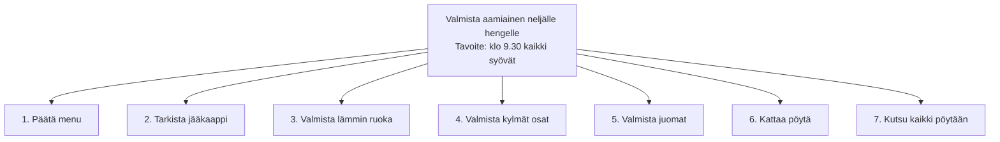
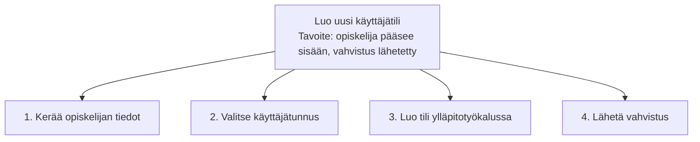

# Oppitunti 4 — Ongelman pilkkominen (päätehtävä, osatehtävät ja tavoite)

### Mitä pilkkominen on?

Pilkkominen on sitä, että otat tehtävän, joka on liian suuri yhdelle tasaiselle vaihelistalle, ja
jaat sen päätehtäväksi, jolla on tavoite, sekä pieneksi joukoksi osatehtäviä, joilla jokaisella
on oma osatavoitteensa. Siinä on koko tämän viikon määritelmä. Tätä liikettä teet jo mielessäsi
aina, kun suunnittelet viikonloppua tai järjestät iltaa kavereiden kanssa; uutta tällä viikolla on
se, että teet saman tarkoituksella paperilla ja nimeät jokaisen osan.
Viime viikolla ohjeesi olivat vielä tarpeeksi pieniä mahtuakseen yhteen listaan. Tällä viikolla ne
kasvavat liian suuriksi. Huomaat sen usein siinä hetkessä, kun jokin “vaihe” paljastuu
tarvitsevan oman listansa. “Valmista lämmin ruoka” ei ole yksi vaihe, vaan kolme tai neljä. “Ota
kollegan sähköposti käyttöön” voi olla kuusi tai seitsemän vaihetta, ja niiden järjestyksellä on
väliä. Juuri siinä kohtaa pilkkominen auttaa.
Pidä mielessä kaksi asiaa. Ensimmäinen: pilkkominen on suunnitteluliike — varsinaisten
vaiheiden pitää yhä olla olemassa niiden alla, mutta hallittavan kokoisina. Toinen:
pilkkominen ei ole sama asia kuin pitkän listan kirjoittaminen. Pitkä lista on litteä: vaihe 1,
vaihe 2, vaihe 3 … vaihe 30. Pilkkomisessa on muoto: yksi päätehtävä ylhäällä, muutama
osatehtävä sen alla, jokaisella oma tavoitteensa.

### Päätehtävä, osatehtävät ja tavoite

Kolme sanaa kantaa suurimman osan tästä viikosta.
Päätehtävä. Se asia, jonka oikeasti yrität tehdä, kirjoitettuna yhdeksi lyhyeksi lauseeksi.
“Valmista aamiainen neljälle hengelle sunnuntaiaamuna.” Ei vain “aamiainen”, vaan täysi lyhyt
lause, joka kertoo mitä olet tekemässä.
Tavoite. Se, mikä on totta lopussa. Yksi lyhyt lause, joka kuvaa maailman tilaa sen jälkeen, kun
päätehtävä on valmis. Päätehtävä on tekeminen; tavoite on lopputila.
Vertaa:
• Päätehtävä: Valmista aamiainen neljälle hengelle sunnuntaiaamuna.
• Tavoite: Klo 9.30 kaikki istuvat pöydässä syömässä; kahvi, kaakao, tee, munat,
paahtoleipä ja hedelmät ovat pöydällä.
Jos et pysty kirjoittamaan tavoitetta yhteen lyhyeen lauseeseen, päätehtävä on yhä liian suuri
tai liian epämääräinen. Palaa takaisin ja nimeä päätehtävä tarkemmin, kunnes tavoite mahtuu
yhteen lauseeseen.
Osatehtävä. Pienempi tehtävä, joka elää päätehtävän alla. Osatehtävä on riittävän pieni siihen,
että voit kirjoittaa sille siistin pienen algoritmin (yhden lyhyen sarjan kirjaimellisia vaiheita),
ja sillä on oma osatavoite — päätehtävän tavoitetta kapeampi ja tarkempi. Osatavoite
tehtävälle “valmista lämmin ruoka” ei ole “aamiainen on valmis” vaan “munakokkeli ja
paahtoleipä ovat lämpimiä ja tarjoiluastialla”.
Käydään yksi arkinen pilkkominen kokonaan läpi.

### Esimerkki — aamiaisen valmistaminen neljälle hengelle.

• Päätehtävä: Valmista aamiainen neljälle hengelle sunnuntaiaamuna.
• Tavoite: Klo 9.30 kaikki istuvat pöydässä syömässä; kahvi, kaakao, tee, munat,
paahtoleipä ja hedelmät ovat pöydällä.
• Osatehtävät (osatavoitteineen):
1. Päätä menu.
Osatavoite: Kuusi asiaa on nimetty — kaksi kahvia, yksi kaakao, yksi tee, munat,
paahtoleipä ja hedelmät — ja tarkat määrät on päätetty.
2. Tarkista, mitä jääkaapissa ja kaapeissa on.
Osatavoite: Jokainen menun ainesosa on todettu löytyväksi keittiöstä tai merkitty
lyhyelle ostoslistalle.
3. Valmista lämmin ruoka.
Osatavoite: Munakokkeli ja paahtoleipä ovat lämpimiä ja tarjoiluastialla.
4. Valmista kylmät osat.
Osatavoite: Hedelmät on pesty, pilkottu ja asetettu lautaselle; hillo ja voi ovat pois
jääkaapista.
5. Valmista juomat.
Osatavoite: Kaksi kahvia, yksi kaakao ja yksi tee ovat kuumina mukeissa.
6. Kattaa pöytä.
Osatavoite: Pöydässä on neljä lautasta, neljä mukia, neljä aterinsettiä ja
lautasliinat.
7. Kutsu kaikki pöytään.
Osatavoite: Kaikki neljä henkilöä ovat pöydässä klo 9.30 mennessä.
Puumuodossa sama pilkkominen näyttää tältä:

Huomaa, mitä tapahtui. Mielessäsi oli yksi lause: “tee aamiainen neljälle hengelle”. Paperilla
siitä tuli päätehtävä, tavoite ja seitsemän osatehtävää. Jokainen osatehtävä on nyt tarpeeksi
että
pieni siihen, voisit kirjoittaa sille viiden vaiheen algoritmin samalla tavalla kuin viikolla
1. Tehtävä ei pienentynyt; siitä tuli muoto, jonka pystyt pitämään mielessä.

### Miksi pilkkoa ylipäätään?

Kolme syytä tavallisella kielellä.

### Ensimmäinen — voit kirjoittaa jokaisesta osatehtävästä siistin pienen algoritmin. Kun

“valmista lämmin ruoka” on oma osatehtävänsä ja sillä on oma osatavoitteensa, viikon 1 taito
alkaa taas toimia. Voit kirjoittaa sille viisi kirjaimellista vaihetta. Et olisi pystynyt tekemään
samaa koko aamiaiselle viidessä vaiheessa.
Toinen — voit jakaa osatehtäviä eri ihmisille. Jos siskosi on keittiössä kanssasi, hän voi
ottaa osatehtävän 6 (kattaa pöytä) ja sinä osatehtävän 3 (valmista lämmin ruoka). Ilman
pilkkomista et voisi sanoa “sinä hoidat tuon osan, minä tämän”, koska osia ei vielä olisi
nimetty.

### Kolmas — voit tarkistaa työn osatehtävä kerrallaan etkä vasta lopussa. Kun pöytä on

katettu, osatehtävä 6 on valmis. Kun munat ovat lautasella, osatehtävä 3 on valmis. Sinun ei
tarvitse odottaa klo 9.30 asti huomatakseen, että haarukat unohtuivat. Pilkkominen antaa
sinulle tarkistuspisteitä.

### Ensimmäinen IT-esimerkki

Vaihdetaan hetkeksi IT-tehtävään. Pidetään tämä vielä kevyenä; syvempi versio tulee
oppitunnilla 6.

### Esimerkki — käyttäjätilin luominen.

• Päätehtävä: Luo koulun oppimisalustalle uusi käyttäjätili uudelle opiskelijalle.
• Tavoite: Uusi opiskelija pystyy kirjautumaan sisään toimivalla käyttäjätunnuksella ja
salasanalla, ja tilin luomisesta on lähetetty vahvistus.
• Osatehtävät (osatavoitteineen):
1. Kerää opiskelijan tiedot.
Osatavoite: Koko nimi, syntymäaika, koulun sähköposti ja opiskelijanumero on
kirjoitettu ylös oikein.
2. Valitse käyttäjätunnus.
Osatavoite: Koulun käytännön mukainen käyttäjätunnus on päätetty, eikä se
törmää olemassa olevaan tiliin.
3. Luo tili alustan ylläpitotyökalussa.
Osatavoite: Tili on olemassa valitulla käyttäjätunnuksella ja ensimmäisen
kirjautumisen salasana on asetettu.
4. Lähetä vahvistus.
Osatavoite: Opiskelija on saanut käyttäjätunnuksensa ja ensimmäisen
kirjautumisen salasanan sekä tietää, mistä kirjautua sisään.
Sama rakenne, IT-versio:

Muoto on täsmälleen sama: päätehtävä, tavoite ja neljä pientä osatehtävää, joilla on omat
osatavoitteensa. Oppitunnilla 6 venytämme tämän tyyppisen tehtävän 5–8 osatehtävän
mittaiseksi ja lisäämme nimettyjä riippuvuuksia.
Pysähdy hetkeksi: Katso yllä olevaa aamiaisesimerkkiä. Valitse yksi seitsemästä
osatehtävästä ja kirjoita sen osatavoite uudelleen omin sanoin. Kysy sitten itseltäsi:
jos kämppis lukisi vain tuon osatavoitteen eikä muuta sivua, tietäisikö hän, milloin
osatehtävä on valmis? Jos ei, kirjoita osatavoite uudelleen, kunnes tietäisi.
Vinkki: hyvä osatavoite kertoo valmiin tilanteen, ei vain tekemisen nimeä.
