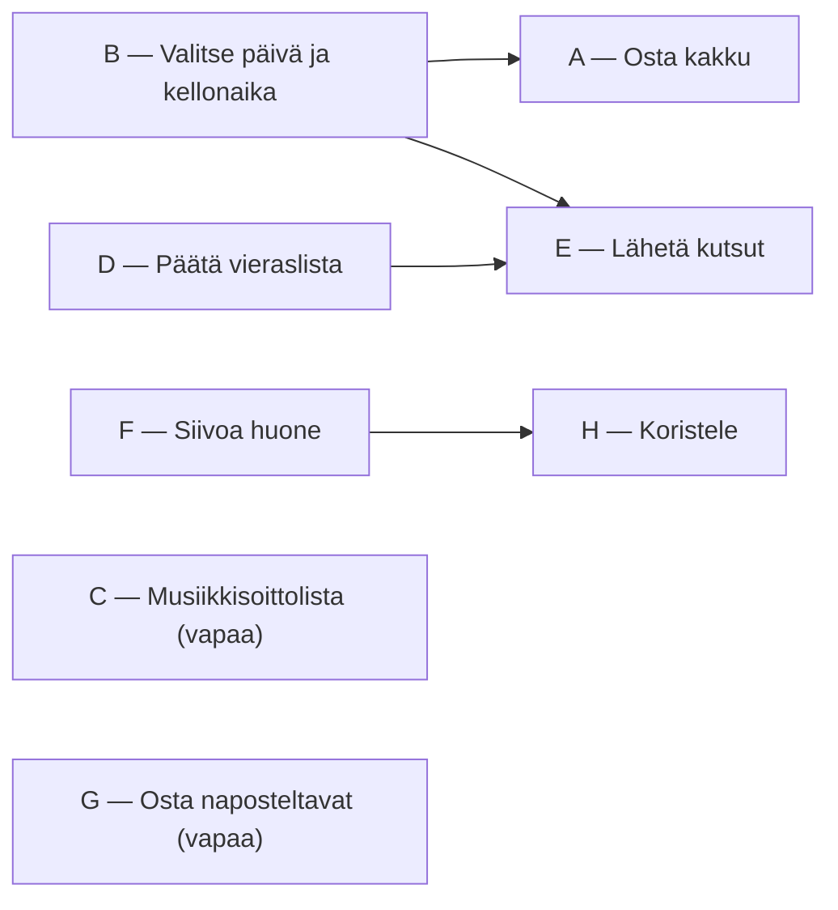

# Oppitunti 5 — Vaiheiden järjestys ja riippuvuudet

### Osa osatehtävistä riippuu toisistaan

Pilkkominen ei ole valmis silloin, kun sinulla on päätehtävä, osatehtävät ja osatavoitteet. Sinun
täytyy miettiä myös järjestystä. Osa osatehtävistä täytyy tehdä toisten jälkeen; osa on vapaita.
Riippuvuus on yhteys kahden osatehtävän välillä: toinen tarvitsee toisen tuotoksen ennen
kuin se voi alkaa.
Käytetään taas aamiaisesimerkkiä. “Syö paahtoleipä” riippuu tehtävästä “paahta leipä”:
paahtamisen tuotos (paahdettu leipä) on syömisen syöte. Jos vaihdat järjestyksen,
kirjaimellisella suorittajalla on lautasella kylmä leipä eikä paahtoleipää.
Toinen pieni esimerkki: “kaada kahvi mukiin” riippuu tehtävästä “keitä kahvi”, koska
keittämisen tuotos (kuuma kahvi) on kaatamisen syöte. Kaatamista ei voi tehdä ensin.
Huomaa sana tuotos. Riippuvuus ei tarkoita “tuntuu siltä, että tämän pitäisi tulla ensin”.
Riippuvuus tarkoittaa täsmällistä asiaa: toinen osatehtävä tarvitsee jotakin, jonka vain toinen
osatehtävä tuottaa.
Kun huomaat riippuvuuden, kirjoita se yhteen lyhyeen lauseeseen:
“Osatehtävä 5 (kaada kahvi mukiin) riippuu osatehtävästä 4 (keitä kahvi), koska kaataminen
tarvitsee kuumaa kahvia, jonka keittäminen tuottaa.”

### Osa osatehtävistä on toisistaan riippumattomia

Kaikilla pareilla ei ole riippuvuutta. Jotkin osatehtävät voivat tapahtua kummassa
järjestyksessä tahansa — tai samaan aikaan, jos keittiössä on kaksi ihmistä. Kattaa pöytä
(osatehtävä 6) ei riipu tehtävästä valmista lämmin ruoka (osatehtävä 3). Kummankaan tuotos
ei ole toisen syöte. Voit kattaa pöydän ennen munia tai niiden jälkeen.
Jos siskosi kattaa pöytää samaan aikaan kun sinä teet munia, tehtävät tapahtuvat “samaan
aikaan” — arkikielessä rinnakkain. (Tällä viikolla emme vielä käsittele teknistä
samanaikaisuuden käsitettä; rinnakkain tarkoittaa tässä vain sitä, että tehtävät voivat tapahtua
kummassa järjestyksessä tahansa, myös yhtä aikaa, jos käsipareja on kaksi.)
Tämä kannattaa opetella huomaamaan kahdesta syystä. Ensiksi vapaan järjestyksen
osatehtävät antavat sinulle joustavuutta. Toiseksi ne ovat kohtia, joissa kaksi ihmistä voi
aidosti auttaa toisiaan eikä vain olla toistensa tiellä.

### Osatehtävien asettaminen perusteltuun järjestykseen

### Esimerkki — syntymäpäiväjuhlien järjestäminen.

Kuvittele, että sinun pitää järjestää pienet syntymäpäiväjuhlat kotona ensi lauantaille. Tässä on
kahdeksan osatehtävää tarkoituksella väärässä järjestyksessä:
• A. Osta kakku.
• B. Valitse päivä ja kellonaika.
• C. Tee musiikkisoittolista.
• D. Päätä vieraslista.
• E. Lähetä kutsut.
• F. Siivoa huone.
• G. Osta naposteltavat.
• H. Koristele.
Etsi nyt riippuvuudet.
Kutsujen lähettäminen (E) riippuu vieraslistasta (D) — et voi lähettää kutsuja listalle, jota ei
ole. Se riippuu myös päivästä ja kellonajasta (B) — kutsussa pitää lukea, milloin juhla on.
Koristelu (H) riippuu huoneen siivoamisesta (F): et ripusta viiriä pyykkikasan päälle. Kakun
ostaminen (A) riippuu siitä, että päivämäärä on päätetty (B).
Mikä on vapaata? Musiikkisoittolistan tekeminen (C) ei riipu useimmista muista tehtävistä.
Naposteltavien ostaminen (G) on vapaa suhteessa siivoamiseen ja koristeluun.
Perusteltu järjestys voisi siis olla: B → D → E, ja tehtävät A, G, F, H, C mahtuvat mukaan sinne,
missä ne sopivat.
Perusteltu järjestys ei ole ainoa oikea järjestys. Se on järjestys, jonka pystyt perustelemaan
kirjoittamillasi riippuvuuksilla.
Riippuvuuskaaviona (nuoli = “tämän on oltava valmis ennen tuota”) sama näyttää tältä:

Tehtävillä C ja G ei ole nuolia sisään eikä ulos — ne ovat vapaita osatehtäviä. Ne voidaan
sijoittaa useampaan kohtaan.

### IT-peili — tiedoston jakaminen

Sama ajattelu pienessä IT-tehtävässä. Opettaja pyytää sinua jakamaan dokumentin luokan
ryhmälle.
• Päätehtävä: Jaa projektiohje luokan ryhmälle koulun levyasemalla.
• Tavoite: Jokainen ryhmän opiskelija pystyy avaamaan ohjeen 24 tunnin sisällä, ja
opettaja on vahvistanut vastaanoton.

### • Osatehtävät:

1. Etsi dokumentti koulun levyasemalta.
Osatavoite: Ohje on löytynyt ja sen polku on tiedossa.
2. Tunnista luokan ryhmä.
Osatavoite: Oikea ryhmän nimi löytyy henkilövalitsimesta.
3. Aseta jakamisoikeudet.
Osatavoite: Luokan ryhmällä on lukuoikeus.
4. Kopioi jakolinkki.
Osatavoite: Toimiva linkki on leikepöydällä.
5. Kirjoita sähköpostin runko.
Osatavoite: Lyhyt sähköposti kertoo, mikä dokumentti on kyseessä, ja sisältää
linkin.
6. Lähetä sähköposti.
Osatavoite: Sähköposti on lähetetty ja näkyy Lähetetyt-kansiossa.
7. Varmista vastaanotto opettajalta.
Osatavoite: Opettaja on vastannut “sain sen”.
Riippuvuudet: osatehtävä 4 (kopioi jakolinkki) riippuu osatehtävästä 3 (ilman oikeuksia ei ole
jaettavaa linkkiä). Osatehtävä 6 riippuu osatehtävistä 4 (linkki) ja 5 (viestin runko). Osatehtävä
7 riippuu osatehtävästä 6. Mikä on vapaata? Viestin rungon kirjoittaminen (5) ei riipu linkistä
(4). Jos tehtävää tekisi kaksi ihmistä, toinen voisi luonnostella viestiä samalla kun toinen
asettaa oikeuksia.
Pysähdy hetkeksi: Ota syntymäpäiväesimerkistä yksi osatehtäväpari, jonka luulet
olevan vapaa (ei riippuvuutta). Kysy sitten itseltäsi: kohtelisiko kirjaimellinen
suorittaja sitä todella vapaana, vai oletatko taustalla jonkin riippuvuuden
kirjoittamatta sitä auki? Jos oletat, kirjoita se näkyviin.
Pysähdy hetkeksi: Kuvittele, että jaat tiedoston oman koulusi järjestelmässä tänä
iltapäivänä. Mikä yllä olevan IT-esimerkin osatehtävä muuttuisi eniten juuri teidän
koulunne ohjelmiston takia? Kirjoita yksi lause.
Ajattele näin: riippuvuus ei ole mielipide järjestyksestä. Riippuvuus on syy sille, miksi
järjestystä ei voi vaihtaa rikkomatta tehtävää.
