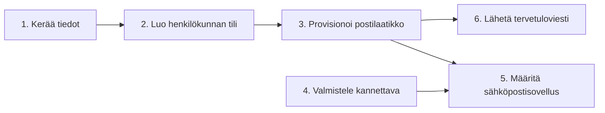

# Oppitunti 6 — IT-tehtävän pilkkominen

### Siirrytään realistiseen IT-tehtävään

Nyt on aika käyttää koko liikettä realistiseen IT-tehtävään — sellaiseen, jonka ensimmäisen
viikon helpdesk-työntekijä voisi oikeasti saada hoidettavakseen.
Tämän oppitunnin skenaario on:
“On maanantaiaamu. Uusi kollega aloittaa koulussasi kahden tunnin kuluttua. Hän
tarvitsee toimivan sähköpostitilin uudella kannettavallaan ennen kuin istuu
työpöytänsä ääreen.”
Tällainen lause kuulostaa pieneltä, kunnes alat kirjoittaa vaiheita. Sitten se kasvaa. Tässä ei ole
yhtä nappia, jota painamalla kaikki tapahtuu. Mukana on useita järjestelmiä (kannettava,
sähköpostipalvelin, henkilökunnan hakemisto), ensin on kerättävä useita tietoja, ja monilla
osatehtävillä on tiukat riippuvuudet toisiinsa.
Liike on kuitenkin sama kuin aamiainen- ja juhlaesimerkeissä. Aloita päätehtävästä ja
tavoitteesta. Kirjoita sitten osatehtävät osatavoitteineen. Mieti lopuksi järjestys ja riippuvuudet.
• Päätehtävä: Ota uuden kollegan sähköpostitili käyttöön hänen uudella kannettavallaan
ennen klo 10 alkavaa työpäivää.
• Tavoite: Klo 10 uusi kollega istuu kannettavansa ääreen, avaa sähköpostisovelluksen,
kirjautuu sisään kerran ja näkee tervetuloviestin odottamassa.

### Skenaariosta osatehtäviin

Kuusi osatehtävää osatavoitteineen:
1. Kerää uuden kollegan tiedot.
Osatavoite: Koko nimi, rooli, esihenkilö, aloituspäivä ja väliaikainen salasana on kirjattu
ylös ja vahvistettu HR:ltä.
2. Luo henkilökunnan tili hakemistoon.
Osatavoite: Hakemistossa on tili sovitulla käyttäjätunnuksella; väliaikainen salasana
toimii; tili kuuluu oikeaan henkilökuntaryhmään.
3. Provisionoi postilaatikko.
Osatavoite: Tilille on olemassa toimiva postilaatikko; testiviestin lähettäminen ja
vastaanottaminen onnistuu.
4. Valmistele kannettava.
Osatavoite: Kannettava on käynnissä, päivitetty, kirjautunut koulun verkkoon ja
sähköpostisovellus on asennettu.
5. Määritä sähköpostisovellus uudelle tilille.
Osatavoite: Sähköpostisovellus on kirjautunut uuden tilin postilaatikkoon; Saapuneet-
kansio latautuu.
6. Lähetä tervetuloviesti.
Osatavoite: Esihenkilön lähettämä lyhyt tervetulosähköposti näkyy saapuneissa heti, kun
kollega avaa kannettavan.
Jokainen näistä osatehtävistä on riittävän pieni siihen, että voisit kirjoittaa sille viikon 1 tyyliin
5–8 kirjaimellista vaihetta helpdesk-kollegan seurattavaksi. Tällä viikolla emme kuitenkaan
kirjoita niitä vaiheita. Pilkkominen pysähtyy osatehtävien tasolle — viikon 1 kirjaimelliset
vaiheet tapahtuvat osatehtävän sisällä sinä päivänä, kun oikea helpdesk-kollega niitä tarvitsee.

### Järjestys ja riippuvuudet oikeassa tehtävässä

Merkitään nyt riippuvuudet näkyviin.
• Osatehtävä 2 (luo henkilökunnan tili) riippuu osatehtävästä 1 (kerää tiedot). Et voi luoda
tiliä ilman nimeä, roolia ja käyttäjätunnusta.
• Osatehtävä 3 (provisionoi postilaatikko) riippuu osatehtävästä 2 (luo tili). Postilaatikko
kiinnittyy tiliin; ilman tiliä ei ole postilaatikkoa.
• Osatehtävä 5 (määritä sähköpostisovellus) riippuu sekä osatehtävästä 3 (toimiva
postilaatikko) että osatehtävästä 4 (valmis kannettava). Se tarvitsee postilaatikon, johon
kirjautua, ja kannettavan, jolta kirjautua.
• Osatehtävä 6 (lähetä tervetuloviesti) riippuu osatehtävästä 3 (toimiva postilaatikko, joka
voi vastaanottaa viestin).
Mikä on vapaata? Osatehtävä 4 (valmistele kannettava) on riippumaton osatehtävistä 1, 2 ja 3.
Voit antaa kannettavan jonkun toisen valmisteltavaksi samalla kun itse luot tilin hakemistossa.
Nämä kaksi virtaa kohtaavat osatehtävässä 5.
Perusteltu järjestys, jossa on yksi vapaa haara:
• Reitti A: → → → `1 2 3 6`
• Reitti B: (milloin tahansa ennen osatehtävää 5) `4`
• Yhdistyminen: tapahtuu, kun sekä reitti A (osatehtävään 3 asti) että reitti B ovat `5`
valmiit

Reitti A kulkee yläreunaa pitkin (1 → 2 → 3 → 6). Reitti B on yksittäinen osatehtävä 4. Ne
kohtaavat osatehtävässä 5. Tällainen on monen oikean IT-tehtävän muoto: osa osatehtävistä
muodostaa tiukan ketjun, yksi tai kaksi haaraa kulkee rinnakkain, ja lopuksi kaikki yhdistyvät.

### Kaksi toimivaa pilkkomista samasta tehtävästä

Pieni mutta tärkeä huomio ennen AT1-tehtävää. Yllä oleva pilkkominen on yksi toimiva tapa
jakaa kollegan sähköpostitilin käyttöönotto. Toinen kollega voisi pilkkoa saman tehtävän eri
tavalla — esimerkiksi yhdistää luo tili ja provisionoi postilaatikko yhdeksi osatehtäväksi (jos
heidän työkalunsa tekee molemmat yhdellä napilla) ja jakaa valmistele kannettava kahdeksi
osatehtäväksi: päivitä kannettava ja asenna sähköpostisovellus (jos heidän koulussaan nämä
ovat eri ihmisten eri vastuita).
Molemmat pilkkomiset voivat olla toimivia. Kumpikaan ei ole väärä. Saat lisää harjoitusta
tähän ajatukseen viikolla 4, jolloin kurssi opettaa vertaamaan kahta pätevää ratkaisua ja
valitsemaan niiden välillä. Viikolla 2 viesti on lempeämpi: oikea pilkkominen riippuu siitä,
miltä työ näyttää juuri sinun ympäristössäsi, ei siitä, mikä olisi jokin universaali paras
vastaus. Sinun tehtäväsi AT1:ssä on kirjoittaa pilkkominen, jonka pystyt perustelemaan — ei
ainoaa mahdollista oikeaa vastausta.

### Valmistautuminen AT1-tehtävään

Oppitunnin 6 lopussa palautat AT1-tehtävän, kurssin ensimmäisen arvioitavan tehtävän. AT1
pyytää sinua tekemään täsmälleen sitä, mitä tämä viikko on harjoitellut:
• valitse yksi tehtävä — arkinen tai IT-aiheinen, itse päätät
• kirjoita päätehtävä ja sen tavoite, kumpikin yhteen lauseeseen
• listaa 4–8 osatehtävää, joista jokaisella on oma osatavoitteensa yhdessä lauseessa
• laita osatehtävät perusteltuun järjestykseen ja nimeä vähintään yksi riippuvuus
selkeällä yleiskielellä
• lisää 3–5 lauseen pohdinta: minkä osatehtävän osatavoite oli vaikein nimetä ja miksi?
Tämän viikon tehtävistä tekemäsi muistiinpanot — arkinen pilkkomisesi tehtävästä 2.1, parin
kanssa testattu versio tehtävästä 2.2, riippuvuuskartta tehtävästä 2.3, koulu-IT-pilkkominen
tehtävästä 2.4 ja sparrauskumppanin kanssa muokattu versio tehtävästä 2.5 — muodostavat
AT1:n raakamateriaalin. Jos olet tehnyt tehtävän 2.4 huolellisesti, suuri osa AT1:stä on jo
vihkossasi. Jos olet tehnyt vain pakolliset tehtävät, sinulla on silti kaikki tarvittava.
Viikon keskeinen lause on sama kuin AT1-tehtävän keskeinen lause:
“Suuresta ongelmasta tulee hallittava, kun nimeät päätehtävän, sen osatehtävät ja
järjestyksen, jossa niiden täytyy tapahtua.”
Pidä tuo lause mielessäsi, kun kirjoitat AT1:tä. Jos osaat nimetä päätehtävän, nimetä
osatehtävät osatavoitteineen ja laittaa ne järjestykseen vähintään yhden riippuvuuden kanssa,
olet tehnyt juuri sen liikkeen, jota tämä viikko harjoitti.
Pysähdy hetkeksi: Kuvittele, että palautat AT1:n huomenna. Mikä tämän viikon
tehtävistä tuotti tuotoksen, jonka lähettäisit? Jos vastauksesi on “ei mikään vielä”,
minkä tehtävän teet tänä iltana, jotta saat sellaisen?
Vinkki: jos et tiedä, mistä aloittaa AT1, aloita päätehtävän ja tavoitteen kirjoittamisesta. Ne
ratkaisevat usein puolet ongelmasta.
