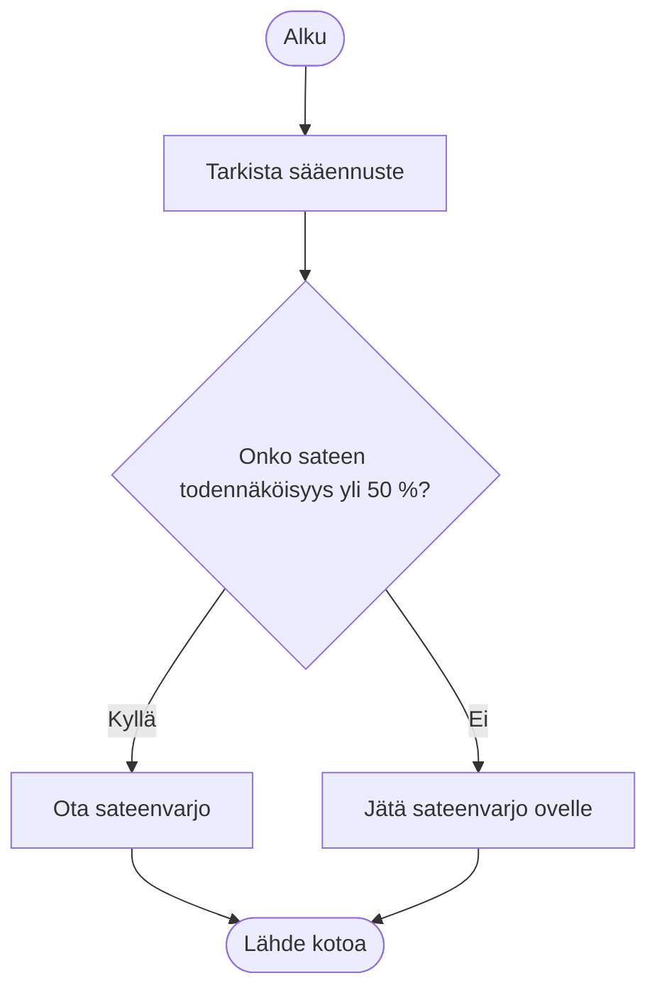
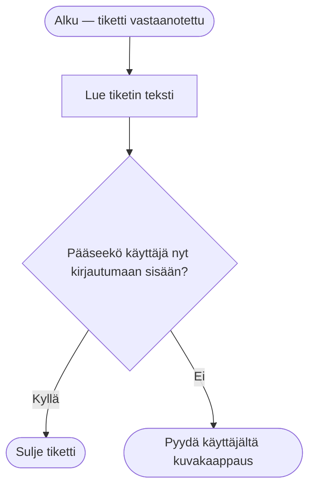
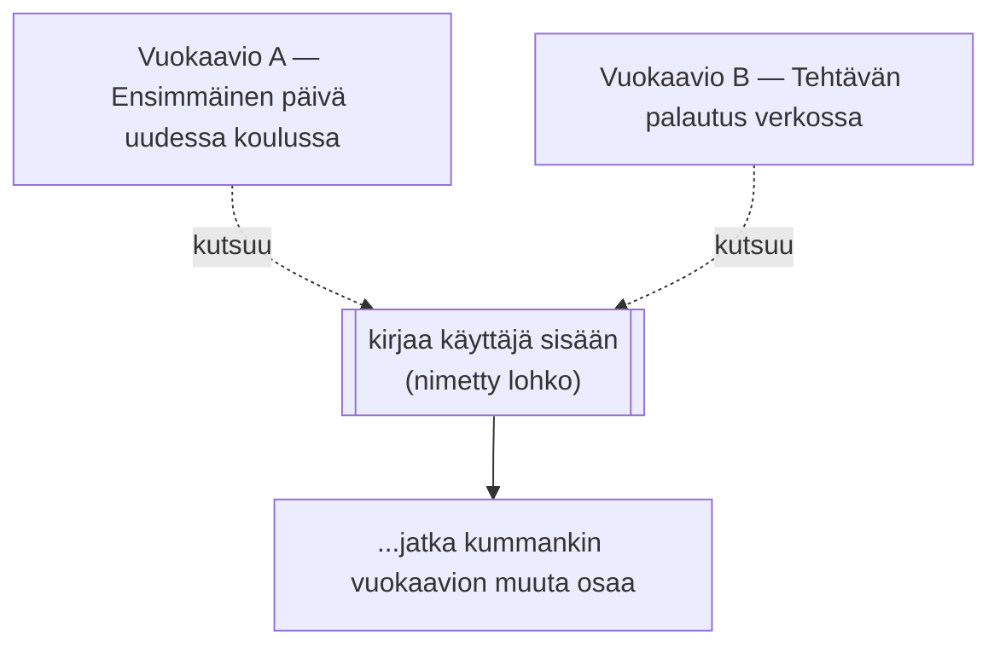

# Itseopiskelu

Viime viikolla pilkoit suuren tehtävän pienempiin osiin — päätehtävä, osatehtävät,
osatavoitteet, riippuvuudet. Tuo työ lähti juuri käsistäsi AT1-tehtävänä tämän viikon alussa.
Avaa AT1-muistiinpanosi ja katso tekemääsi pilkkomista. Sinulla on edessäsi pienten tehtävien
puu. Kuvittele nyt, että annat koko tuon puun uudelle kollegalle ja kävelet pois. Mitä
oikeastaan annat hänelle? Pelkkä lista osatehtävien nimistä ei riitä — matkan varrella tulee
valintoja. Yksittäisten vaiheiden litteä lista taas on liian pitkä yhdelle sivulle. Tarvitset jotain
muuta: kuvan.
Viikon keskeinen viesti on yksi lause:
“Kun osaat pilkkoa ongelman, seuraava taito on kuvata prosessi niin, että joku toinen
pystyy suorittamaan sen — ja päättää, mitkä yksityiskohdat ovat tärkeitä ja mitkä
voidaan turvallisesti piilottaa.”
Tällä viikolla harjoitellaan kolmea toisiinsa läheisesti liittyvää liikettä. Oppitunti 7 esittelee
yksinkertaisen vuokaavion — kurssin ensimmäisen kuvan, joka rakentuu neljästä
perusmuodosta. Oppitunti 8 esittelee abstrahoinnin — sen, mitä jätetään pois, jotta kuva
sopii yleisölle. Kaupungin kartan bussipysäkki on abstraktio; puhelimen Tallenna-painike on
abstraktio. Oppitunti 9 esittelee funktion epämuodollisen idean — prosessin osan, joka
ilmestyy moniin vuokaavioihin, nimetään kerran ja käytetään uudelleen kaikkialla. “Kirjaa
käyttäjä sisään” on yksi tällainen. “Rekisteröi uusi laite” on toinen. Viikolla 7 samasta
ajatuksesta tulee oikea JavaScript-funktio. Tällä viikolla se on nimetty laatikko ja yksi selittävä
kappale tavallista kieltä. Ei vielä koodia.
Viikon 1 kirjaimellisen suorittajan ajattelutapa on edelleen mukana. Jokainen laatikko,
jokainen nimetty lohko ja jokainen kyllä/ei-polku luetaan kirjaimellisesti. Viikolla 3 ei ole
arvioitavaa palautusta. AT2 — prosessikuvaus palautetaan viikon 5 lopussa / viikon 6
aikana, ja juuri tämän viikon vuokaaviosanasto on sitä, mitä AT2 odottaa.
Ajattele näin: pilkkominen kertoo, mistä osista työ koostuu. Vuokaavio kertoo, miten työ
etenee.

## Oppituntikohtainen lukemisto

## Oppitunti 7 — Prosessin kuvaaminen ja yksinkertainen vuokaavio

### Milloin lista ei enää riitä?

Kuvittele tavallinen kouluaamusi. Herätys, ylös, peseytyminen, pukeutuminen, syöminen,
reppu, ulos ovesta. Seitsemän vaihetta litteässä listassa. Kirjaimellinen suorittaja voisi seurata
sen ilman yhtäkään päätöstä. Lista toimii.
Kuvittele nyt sama aamu, kun jokin on pielessä. Soiko herätys oikeasti? Jos soi, ehdit syödä
aamupalan. Jos ei soinut, kello on jo 8.10 ja aamupala jää väliin. Sataako? Jos kyllä, ota
sateenvarjo. Onko jääkaapissa maitoa? Jos kyllä, muroja; jos ei, paahtoleipää. Litteä lista ei enää
pysty pitämään tätä kasassa. Vaihe 5 — syö aamupala ei ole enää yksi asia vaan useita eri
asioita riippuen useiden kysymysten vastauksista. Kun prosessissa on kolme tai neljä
kysymystä, lista muuttuu nopeasti lukukelvottomaksi.
Vuokaavio on se, miksi lista muuttuu silloin, kun prosessissa on haaroja. Lista sanoo: tee tämä,
sitten tämä. Vuokaavio sanoo: tee tämä, kysy sitten tämä kysymys ja kulje vastauksesta riippuen
tätä tai tuota reittiä. Heti kun prosessissa on kyllä/ei-kysymys, pelkkä lista ei enää riitä.
Sama muutos tapahtuu helpdeskissä. “Lähettikö käyttäjä kuvakaappauksen?” Jos kyllä, liitä se
mukaan ja jatka. Jos ei, pyydä sitä ensin. Pelkkä lista ei pysty piirtämään tuota kysymystä.
Vuokaavio pystyy.

### Neljä perusmuotoa

Tämän kurssin vuokaavio käyttää täsmälleen neljää muotoa. Jokaisella on yksi tehtävä.
• Alku / loppu (ovaali). Ovaali avaa tai sulkee vuokaavion. Jokaisessa vuokaaviossa on
täsmälleen yksi Alku-ovaali ja vähintään yksi Loppu-ovaali. Alku kertoo, mistä prosessi
käynnistyy. Loppu kertoo, mihin jokin polku päättyy.
• Vaihe (suorakulmio). Suorakulmio sisältää yhden toiminnon — “Tarkista
sääennuste”, “Tallenna tiedosto”, “Lähetä tiketti käyttäjälle”. Yksi suorakulmio, yksi
toiminto. Jos suorakulmio osoittautuu käytännössä kolmeksi eri asiaksi, pilkot sen
kolmeen suorakulmioon tai piilotat ne nimettyyn lohkoon (oppitunti 9).
• Päätös (vinoneliö). Vinoneliö sisältää yhden kyllä/ei-kysymyksen — “Onko sateen
todennäköisyys yli 50 %?”, “Vastaako tiedostonimi käytäntöä?”, “Pääseekö käyttäjä
kirjautumaan sisään?” Päätös-vinoneliöllä on kaksi ulospäin lähtevää nuolta, yksi
kumpaakin vastausta varten, ja jokaisella nuolella on oma nimilappunsa.
• Nuoli / kulku. Nuolet näyttävät, missä järjestyksessä suorittaja etenee vuokaaviossa.
Jokaisesta muodosta lähtee vähintään yksi nuoli, paitsi Loppu-ovaalista. Päätös-
vinoneliöstä lähtee täsmälleen kaksi.
Nämä neljä muotoa muodostavat koko kuvan sanaston. Tämän oppitunnin taito ei ole
muotojen ulkoa muistaminen, vaan niiden käyttäminen hyvin.
Tässä on hyvin pieni vuokaavio, joka käyttää kaikkia neljää. Se kuvaa aamun
sateenvarjopäätöksen prosessina:



Lue sitä ylhäältä alas. Aloita. Tarkista ennuste. Kysy vinoneliössä oleva kysymys. Jos vastaus on
kyllä, ota sateenvarjo. Jos ei, jätä se ovelle. Kummassakin tapauksessa lähde kotoa.
Vuokaaviossa on yksi Alku-ovaali, yksi Loppu-ovaali, yksi suorakulmio ennen päätöstä ja yksi
suorakulmio kummallakin haaralla. Juuri haara tekee tästä vuokaavion eikä pelkkää listaa.

### Vuokaavion lukeminen

Vuokaaviota luetaan seuraamalla nuolia. Aloitat Alku-ovaalista. Jokaisen suorakulmion
kohdalla teet sen, mitä siinä lukee. Jokaisen vinoneliön kohdalla kysyt kysymyksen ja seuraat
sitä nuolta, jonka etiketti vastaa vastausta. Lopetat, kun saavut Loppu-ovaaliin.
Kokeillaan sateenvarjovuokaaviota valmiilla vastauksella. Ennuste lupaa 70 % sateen
todennäköisyyttä. Alku. Tarkista ennuste. Saavuta vinoneliö ja kysy: “Onko sateen
todennäköisyys yli 50 %?” — kyllä, 70 % on yli 50 %. Seuraa Kyllä-nuolta. Ota sateenvarjo.
Lähde kotoa. Yksi läpijuoksu prosessin läpi.
Kuvittele nyt, että ennuste on 20 %. Sama vuokaavio, mutta tällä kertaa seuraat Ei-nuolta, ja
sateenvarjo jää ovelle. Kaksi toimivaa läpijuoksua, molemmat päätyvät samaan Loppu-ovaaliin.
Juuri tämän haarautuminen antaa.
Vuokaavio on oikein, kun jokainen polku siinä päätyy Loppu-ovaaliin. Nuoli, joka katoaa
sivun reunasta, jättää suorittajan jumiin.

### Ensimmäisen vuokaavion piirtäminen

Valitse omasta arjestasi tuttu prosessi, jossa on vähintään yksi kyllä/ei-kysymys: “Pitäisikö
ottaa sateenvarjo?”, “Menenkö bussilla vai kävellen?”, “Mikä laturi sopii tähän laitteeseen?”,
“Tallennanko tiedoston päivämäärä nimessä?” Valitse sellainen, jonka vastaus vaihtelee päivän
mukaan.
Piirrä paperille tai tabletille neljä muotoa lyijykynällä:
• Alku-ovaali ylös
• suorakulmiot niille asioille, jotka teet aina
• vinoneliö siihen kohtaan, jossa pitää tehdä kyllä/ei-päätös
• kaksi nimettyä nuolta ulos päätöksestä
• suorakulmiot kummallekin haaralle
• yksi tai kaksi Loppu-ovaalia riippuen siitä, päättyvätkö haarat eri paikkoihin
Enintään kahdeksan muotoa — jos tarvitset enemmän, yksityiskohtaisuuden taso on liian
alhainen, ja oppitunti 8 auttaa siihen.
Kun vuokaavio on valmis, seuraa sitä silmilläsi Alusta Loppuun molemmilla haaroilla. Teitkö
oikeasti sen, mitä vuokaavio tänä aamuna väittää? Jos kyllä, vuokaavio on rehellinen. Jos ei,
korjaa vuokaavio — älä aamuasi. Tämä on tehtävän 3.1 ydin. Piirrä vuokaavio, allekirjoita ja
päivää se, ja säilytä kuva siitä AT2-muistiinpanojasi varten.
Pysähdy hetkeksi: Oliko tänään aamullasi kohta, jossa teit kyllä/ei-päätöksen
ajattelematta sitä tietoisesti (sateenvarjo, bussi vai kävely, kuuma vai kylmä juoma)?
Voisitko kuvata tuon päätöksen yhtenä vinoneliönä, josta lähtee kaksi nuolta? Mitä
nuolet oikeasti johtivat tekemään tänään?

### IT-esimerkkejä

Kaksi lyhyttä IT-prosessia vuokaavioina.
Helpdesk-triage. Käyttäjä avaa tiketin ja kirjoittaa: “En pääse kirjautumaan sisään.”
Ensimmäisen tason tukihenkilön täytyy päättää, mitä tehdään seuraavaksi.



Yksi päätös-vinoneliö, kaksi polkua, kaksi eri lopputilaa. Kysymys “Pääseekö käyttäjä nyt
kirjautumaan sisään?” johtaa aidosti kahteen eri lopputulokseen.
Tiedostonimen tarkistus. Ennen kuin dokumentti tallennetaan jaetulle asemalle, koulun
käytäntö sanoo, että tiedostonimen täytyy olla muotoa .

```mermaid
2026-05-20_invoice-001.pdf
flowchart TD
A([Alku])
B[Tarkista tiedostonimi]
C{Vastaako tiedostonimi käytäntöä?}
D[Tallenna jaetulle asemalle]
E[Muuta tiedostonimi ensin]
F([Tallennettu])
A --> B --> C
C -->|Vastaa| D --> F
C -->|Ei vastaa| E --> D
```

Huomaa kaksi asiaa. Haarojen nimet ovat Vastaa / Ei vastaa — sääntö on, että jokaisella
haaralla on lyhyt nimilappu, ja tässä Vastaa on selvempi kuin pelkkä Kyllä. Molemmat
haarat päätyvät lopulta Tallennettu-lopputilaan, mutta väärän nimen haara tarvitsee yhden
lisävaiheen.
Pysähdy hetkeksi: Valitse yksi oikeasti tekemäsi IT-tehtävä — sovelluksen asennus,
tiedoston jakaminen, videopuheluun liittyminen. Piiloutuuko sen sisään kyllä/ei-
kysymys, jonka teet lähes automaattisesti? Miltä tuo vinoneliö näyttäisi?

## Oppitunti 8 — Abstrahointi

### Mitä “abstrahointi” tarkoittaa tässä?

Kun piirsit vuokaaviosi, teit valinnan jokaisessa suorakulmiossa. “Tarkista sääennuste” on yksi
laatikko. Se olisi yhtä hyvin voinut olla neljä laatikkoa: “Avaa sääsovellus → lue päivän ennuste
→ katso sateen todennäköisyys → sulje sovellus.” Molemmat kuvaavat samaa toimintaa. Piirsit
yhden laatikon neljän sijasta. Tuo valinta on abstrahointia.
Abstrahointi on liikettä, jossa piilotetaan yksityiskohta, jolla ei ole merkitystä sillä
tasolla, jolla asiaa juuri nyt kuvataan. Piirtämäsi laatikot pysyvät täsmällisinä; et vain
piirrä niitä laatikoita, jotka eivät tällä tasolla auttaisi lukijaa. Abstrahointi ei ole
epämääräisyyttä — “tarkista sää” on täsmällinen sen suhteen, mitä suorittaja tekee. Se vain
piilottaa miten.
Pieni arkinen esimerkki: ajattele bussipysäkkiä koulun lähellä. Bussia odottavalle
matkustajalle pysäkki on kyltti, jossa lukee pysäkin nimi, ja sen alla aikataulu. Se on juuri se
abstraktio, jonka matkustaja tarvitsee. Liikenteenohjauskeskuksen työntekijälle sama pysäkki
on GPS-koordinaatti, tietokannan tunniste ja lista busseista, jotka saapuvat seuraavan 20
minuutin aikana. Näyttölaitteen asentajalle pysäkki on sähkölaatikko ja ruuveja. Sama
fyysinen kohde. Kolme eri abstrahointia. Jokainen oikea eri yleisölle.
Juuri tätä abstrahointi tässä tarkoittaa: sen päättämistä, mitä jätetään pois, jotta kuvaus sopii
yleisölle.

### “Kirjaudu sisään” -painike on abstraktio

Otetaan IT-esimerkki. Avaa koulusi portaali ja katso Kirjaudu sisään -painiketta. Muutama
sana tekstinä ja värillinen suorakulmio. Mitä kaikkea sen sisällä on piilossa?
Kun painat painiketta, sivu lähettää käyttäjätunnuksesi ja salasanasi koulun
tunnistautumispalvelimelle. Palvelin tarkistaa salasanan verraten sitä tallennettuun, salattuun
versioon. Jos tarkistus onnistuu, palvelin palauttaa evästeen (cookie), jonka selain tallentaa;
jokainen seuraava sivu lähettää tämän evästeen mukana, jotta järjestelmä tietää edelleen sinun
olevan sinä. Jos koulu käyttää kirjautumiseen Microsoftia tai Googlea, taustalla tapahtuu lisäksi
usean palvelimen välinen edestakainen viestinvaihto, jota kutsutaan OAuth-tanssiksi — kaikki
tämä samalla kun ruudulla näkyy pyörivä latauskuvake.
Juuri tämän kaiken Kirjaudu sisään -painike ostaa sinulle abstraktiona. Painike tarkoittaa
käyttäjälle: “kirjaudu portaaliin”. Et näe tunnistautumispalvelinta, salasanan tarkistusta,
evästettä etkä OAuth-tanssia. Ne ovat piilossa — yhä olemassa, mutta eivät painikkeessa.
Painike on oikea kuvaus käyttäjälle.
Kuvittele nyt sama painike tietoturva-asiantuntijalle, joka selvittää epäonnistunutta
kirjautumista. Pelkkä Kirjaudu sisään ei enää riitä; asiantuntija tarvitsee pyynnön, vastauksen,
evästeen ja aikaleimat. Sama painike. Kaksi yleisöä. Kaksi oikeaa vastausta.

### Yksityiskohtaisuuden taso seuraa yleisöä

Tämän oppitunnin sääntö voidaan sanoa näin:

### Oikea yksityiskohtaisuuden taso seuraa yleisöä.

Ennen kuin päätät, mitkä laatikot piirrät, kysy: kuka tämän lukee ja mitä hän tekee sillä?
Vuokaavio tiedostonimen tarkistuksesta aivan uudelle helpdesk-harjoittelijalle ensimmäisenä
päivänä tarvitsee enemmän suorakulmioita — esimerkiksi “avaa tiedostonimikäytäntöjen
ohje”, “etsi nykyinen nimeämistapa”, “tarkista jokainen nimen osa”. Saattaa olla kuusi laatikkoa
ennen vinoneliötä. Sama vuokaavio kokeneelle IT-ylläpitäjälle, joka on tehnyt työtä kymmenen
vuotta, voi sisältää yhden laatikon: “Lue tiedostonimi.” Sama prosessi, sama tavoite, eri yleisö,
eri yksityiskohtaisuuden taso. Molemmat voivat olla oikein.
Kysymykseen “mikä on oikea yksityiskohtaisuuden taso?” ei ole yhtä universaalia vastausta. On
vain vastaus tälle yleisölle.

### Piilottaminen ei ole unohtamista

Abstrahointi on yksityiskohdan piilottamista, eikä piilottaminen ole sama asia kuin

unohtaminen.

Pieni arkinen esimerkki: aamurutiinisi vuokaaviossa on laatikko “Pukeudu”. Tuohon
laatikkoon on piilotettu paljon yksityiskohtia — mitkä vaatteet, missä järjestyksessä. Mikään
tästä ei näy vuokaaviossa, mutta et ole unohtanut sitä. Jos pikku serkkusi kysyy “mitä
‘pukeudu’ tarkoittaa?”, pystyt avaamaan laatikon mielessäsi ja selittämään. Yksityiskohta on
yhä olemassa. Se on arkistoitu, ei poistettu.
IT-versio on sama. Kirjaudu sisään -painike piilottaa OAuth-tanssin. Asiantuntija, joka asensi
koulun portaalin kolme vuotta sitten, on todennäköisesti kirjannut OAuth-vaiheet jonnekin
käyttöohjeeseen tai dokumentaatioon. Piilotettu yksityiskohta on arkistoitu. Piilotettu
tarkoittaa, että on olemassa paikka, josta yksityiskohta löytyy. Unohdettu tarkoittaa, että
sellaista paikkaa ei ole.
Yhteen lauseeseen tiivistetty vaihtokauppa kuuluu näin: hyvä abstraktio piilottaa sen, mikä ei
auta lukijaa tällä tasolla, ja osoittaa, mistä yksityiskohta löytyy, jos lukija tarvitsee sen.
Pysähdy hetkeksi: Valitse yksi ohjelman painike, linkki tai valikkokohta, jota käytät
oikeasti — Discordin Lähetä, Spotifyn Toista, puhelimen Ota kuva tai koulun
portaalin Palauta. Listaa kolme asiaa, jotka ovat sen sisällä piilossa, kun painat sitä.
Ovatko ne piilotettuja (jossain dokumentoituna) vai unohdettuja? Miten voisit
selvittää, kumpi on totta?
Pysähdy hetkeksi: Palaa tehtäväsi 3.1 vuokaavioon oppitunnilta 7. Valitse yksi
suorakulmio. Onko sen yksityiskohtaisuuden taso oikea sinulle, joka piirsit oman
aamusi, vai oikea jollekin toiselle, joka lukisi sen? Jos yleisö on väärä, piirtäisitkö
laatikon eri tavalla oikeaa yleisöä varten?
Vinkki: jos laatikko tuntuu liian suurelta, kysy itseltäsi kaksi kysymystä: kuka tämän lukee? ja
mitä hänen pitää tämän jälkeen tehdä? Usein oikea taso löytyy juuri siitä.

## Oppitunti 9 — Uudelleenkäytettävät ohjeet: funktion idea ilman koodia

### Kun sama prosessin osa ilmestyy yhä uudelleen

Aseta kaksi vuokaaviota vierekkäin. Ensimmäinen on “ensimmäinen päivä uudessa koulussa”.
Jossain keskellä on vaiheketju: Avaa koulun portaali → kirjoita käyttäjätunnus → kirjoita
salasana → paina Kirjaudu sisään → odota aloitussivua. Viisi laatikkoa.
Toinen vuokaavio on “palauta tehtävä verkossa”. Lähellä alkua esiintyy täsmälleen sama
vaiheketju: Avaa koulun portaali → kirjoita käyttäjätunnus → kirjoita salasana → paina
Kirjaudu sisään → odota aloitussivua.
Voisit piirtää saman joka kerta. Kolmannen vuokaavion kohdalla kätesi väsyy ja sivu on täynnä
jo ennen kuin ehdit kiinnostavaan kohtaan. On olemassa parempi liike: anna tälle prosessin

osalle nimi.

### Anna prosessin osalle nimi



Kaksi vuokaaviota. Yksi nimetty lohko. Samat viisi laatikkoa piirrettyinä vain kerran.
Nimi on lyhyt verbifraasi, joka kertoo mitä tämä osuus tekee, ei miten se tekee sen. Yllä olevan
vaihejokon nimi on “kirjaa käyttäjä sisään”. Kolme sanaa. Koko prosessin osa yhdessä
verbifraasissa.
Hyvä nimi läpäisee yksinkertaisen testin. Henkilö, joka ei ole koskaan nähnyt alkuperäisiä
viittä laatikkoa, pystyy lukemaan nimen “kirjaa käyttäjä sisään” ja odottamaan oikeaa
lopputilaa: tämän laatikon lopussa käyttäjä on kirjautunut sisään. Hän ei tiedä miten — se on
piilotettu. Mutta hän tietää mitä tapahtuu ja milloin laatikko on valmis.
Muita hyviä nimiä arjesta ja IT-maailmasta:
• nimeä tiedosto uudelleen
• varmuuskopioi laite
• nollaa salasana
• rekisteröi uusi laite
• lähetä ilmoitus huoltajalle
Jokainen näistä on verbifraasi, joka kertoo, mitä tapahtuu. Huono nimi epäonnistuu tässä
testissä. “Tee se juttu” ei kerro kenellekään mitään. “Vaihe 7” on pelkkä numero. Sääntö on:

verbifraasi, joka kertoo mitä lohko saa aikaan.

### Mitä “funktio” tarkoittaa tällä viikolla?

Viikolla 3 funktio määritellään epämuodollisesti näin:

### nimetty, uudelleenkäytettävä prosessin osa, joka on kuvattu tavallisella kielellä ja

jolla on selkeä syöte ja selkeä tuotos.

Pidä mielessä viisi asiaa:
• nimetty — sillä on lyhyt verbifraasin muotoinen nimi
• uudelleenkäytettävä — se esiintyy useammassa kuin yhdessä suuremmassa
prosessissa
• prosessi-osa — joukko vaiheita, yleensä noin 3–8 vaihetta
• tavallisella kielellä kirjoitettu kuvaus — lyhyt kappale siitä, mitä lohko tekee
• syöte ja tuotos — mitä lohko tarvitsee alussa ja mitä se tuottaa lopuksi
Esimerkiksi:
kirjaa käyttäjä sisään — vie käyttäjän tilasta “ei kirjautunut” tilaan “kirjautunut”.
Käyttäjä avaa portaalin, kirjoittaa käyttäjätunnuksen ja salasanan, painaa Kirjaudu
sisään -painiketta ja odottaa aloitussivua.
Syöte: käyttäjällä on toimiva käyttäjätunnus ja salasana.
Tuotos: käyttäjä on kirjautunut sisään ja portaalin aloitussivu näkyy.
Siinä on koko funktion idea viikon 3 merkityksessä. Ei koodia, ei sulkuja, ei paluuarvoja.
Kaikki se tulee viikolla 7. Tällä viikolla funktio on vuokaavion nimetty laatikko ja sen alla oleva
selityskappale.
Toinen esimerkki:
nimeä tiedosto koulun käytännön mukaisesti — ottaa tiedoston, jolla voi olla
mikä tahansa nimi, ja tuottaa tiedoston, jonka nimi seuraa koulun päivämäärä- ja
aihekäytäntöä.
Syöte: tiedosto on olemassa; käyttäjä tietää päivämäärän ja aiheen yhdellä sanalla.
Tuotos: tiedostolla on nimi muodossa . `YYYY-MM-DD_topic.ext`
Jokaisella nimetyllä lohkolla on siis selkeä syöte, selkeä tuotos ja yhden kappaleen kuvaus. AT2
pyytää sinua kirjoittamaan juuri tämän muodon, joten sitä kannattaa harjoitella nyt.

### Ammatillinen esimerkki — “rekisteröi uusi laite”

Tämän viikon IT-esimerkki on “rekisteröi uusi laite”. Aina kun kouluun tulee uusi
kannettava, projektori tai neuvotteluhuoneen näyttö, joku tekee saman prosessin osan:
sarjanumerotarra paikalleen, merkintä laitehakemistoon, vakio-ohjelmistojen asennus, verkon
tarkistus. Noin kahdeksan vaihetta joka kerta, jokaiselle uudelle laitteelle.
Vuokaavio tehtävälle “ota uusi neuvotteluhuone käyttöön” ilman nimettyä lohkoa voisi näyttää
tältä:

```
(Alku) -> [Tilaa näyttö] -> [Vastaanota näyttö] -> [Kiinnitä sarjanumerotarra]
-> [Lisää merkintä laitehakemistoon] -> [Asenna vakio-ohjelmistot] -> [Tarkista
verkko]
-> [Asenna seinälle] -> [Vedä kaapeli telakkaan] -> [Testaa testikannettavalla]
-> (Valmis)
```

Kymmenen laatikkoa. Puolet niistä liittyy laitteen rekisteröintiin. IT-päällikkö, jota kiinnostaa
oikeasti neuvotteluhuone, joutuu lukemaan viisi rekisteröintilaatikkoa ennen kuin pääsee
kiinnostavaan kohtaan.
Sama vuokaavio nimetyllä lohkolla:

```
(Alku) -> [Tilaa näyttö] -> [Vastaanota näyttö] -> [rekisteröi uusi laite]
-> [Asenna seinälle] -> [Vedä kaapeli telakkaan] -> [Testaa testikannettavalla]
-> (Valmis)
```

Seitsemän laatikkoa. Nimetyssä lohkossa kulkevat ne viisi piilotettua vaihetta. Piilotetut
vaiheet eivät ole kadonneet — ne elävät rekisteröi uusi laite -kuvauksessa, joka on arkistoitu
koulun IT-ohjeeseen sitä harjoittelijaa varten, jonka täytyy oikeasti suorittaa tuo lohko.

### Vaihtokauppa yhdessä lauseessa

Nimetty lohko piilottaa yksityiskohtia, jotta tämän tason lukija ei huku niihin, mutta
yksityiskohtaa tarvitsevan lukijan täytyy tietää, mistä se löytyy. Oppitunnin 8
abstrahointi oli sitä, mitkä laatikot kannattaa piirtää; oppitunnin 9 nimetyt lohkot ovat sama
liike yhdellä suuremmalla zoomaustasolla — yksi laatikko voi edustaa kokonaisen
alivuokaavion.
Silta viikkoon 7: siellä “kirjaa käyttäjä sisään” muuttuu oikeaksi JavaScript-funktioksi.
Verbifraasista tulee funktion nimi; tavallisella kielellä kuvatuista syötteestä ja tuotoksesta tulee
parametreja ja paluuarvoja; prosessin osasta tulee koodia. Mutta muoto — nimetty,
uudelleenkäytettävä prosessin osa, jolla on syöte ja tuotos — on juuri se, mitä rakennat tällä
viikolla englannin sijaan suomeksi ja lyijykynällä.
Pysähdy hetkeksi: Katso tehtäväsi 3.1 vuokaaviota ja mitä tahansa muuta tällä
viikolla piirtämääsi vuokaaviota. Onko niissä 3–4 laatikon mittainen prosessin osa,
joka voisi esiintyä myös jossakin muussa prosessissa? Kirjoita sille nyt verbifraasin
muotoinen nimi.
Ajattele näin: kun annat prosessin osalle hyvän nimen, autat lukijaa näkemään
kokonaisuuden. Kun taas tarvitset yksityiskohdat, voit “avata laatikon”.
