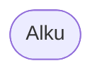
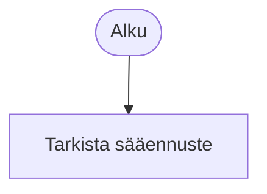
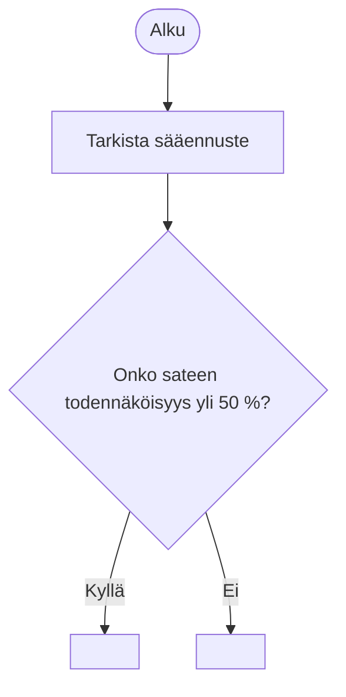
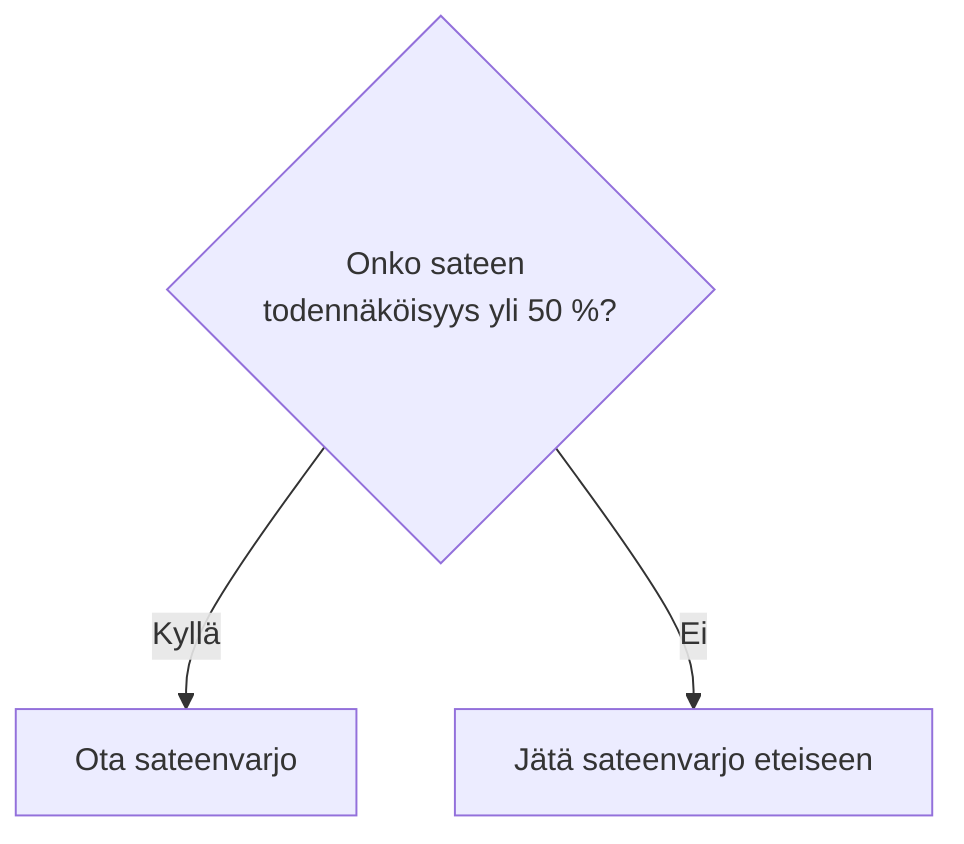
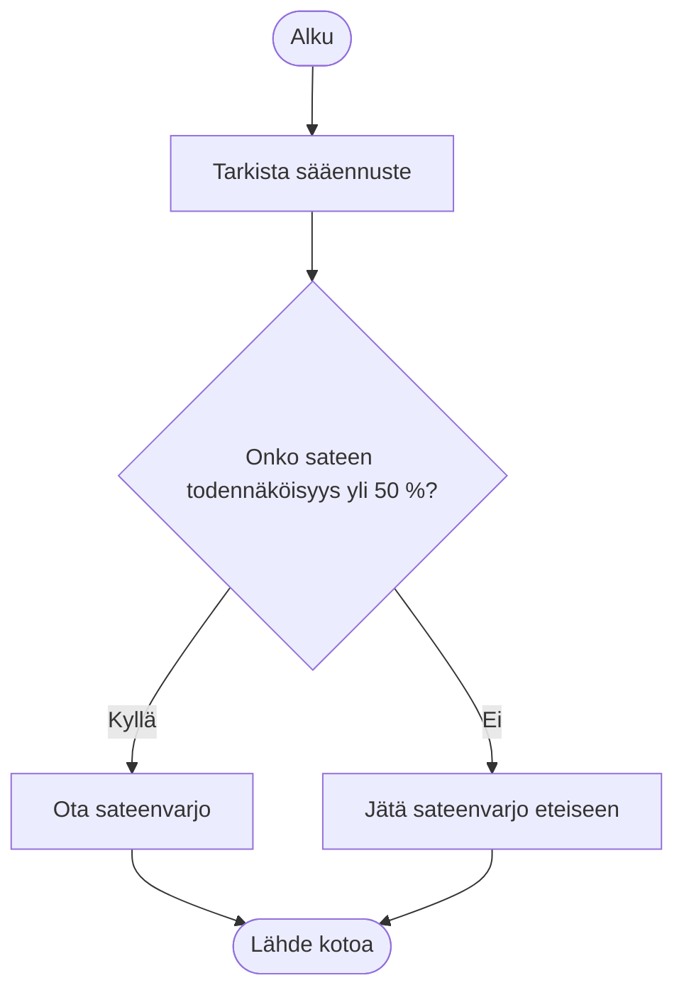

# Viikko 3 — Oppitunti 7 lisämateriaali

---

## Oppitunti 7 - Vuokaavion läpikäynti

Yhden arkisen vuokaavion rakentaminen muoto muodosta.
Käytä vain, jos luokka tarvitsee hitaamman rakentamisen. Ohita, jos live-piirros taululla toimii hyvin.

---

## Dia 1 - Alku

Jokainen vuokaavio alkaa täsmälleen yhdellä Alku-soikiolla. Se kertoo, mistä prosessi alkaa.
Tämän päivän esimerkissä prosessi on "päätetään, otanko sateenvarjon mukaan tänä
aamuna".

### Vinkki: Alku ei ole vielä toiminto. Se on lähtöpiste. ---

## Dia 2 - Ensimmäinen vaihe

Yksi suorakulmio. Yksi toiminto. "Tarkista sääennuste" on yksi vaihe, jonka suorittaja tekee.
Huomaa, että siinä ei sanota, miten ennuste tarkistetaan - se yksityiskohta on piilotettu
laatikon sisään.

### Ajattele näin: laatikko voi olla abstraktio. ---

## Dia 3 - Päätös

Vinoneliössä on yksi kyllä/ei-kysymys. Siitä lähtee kaksi nuolta - yksi kummallekin vastaukselle.
Jokaisella nuolella on oma lyhyt nimike.
Tämä on hetki, jota suora lista ei pysty tekemään - prosessi jakautuu. ---

## Dia 4 - Molemmat haarat

Jokaisella haaralla on omat suorakulmionsa. Kyllä-polku tekee yhden asian; Ei-polku tekee
toisen. Molemmat haarat kertovat rehellisesti, mitä suorittaja oikeasti tekee tilanteessa.

### Vinkki: älä jätä toista haaraa tyhjäksi. ---

## Dia 5 - Vuokaavion sulkeminen

Molemmat polut kohtaavat Loppu-soikiossa. Jokaisen polun vuokaaviossa täytyy päätyä Loppu-soikioon.
Yhteensä kahdeksan muotoa: yksi Alku, yksi Loppu, kolme suorakulmiota ja yksi vinoneliö. Koko sateenvarjoprosessi
yhdellä sivulla. ---

## Dia 6 - Sama muoto, IT-esimerkki

• Samat viisi muotoa, eri konteksti.
• Alku → *"Lue tiketin teksti"* → *"Pääseekö käyttäjä nyt kirjautumaan?"*
• Kyllä → *"Sulje tiketti"* → Loppu (Suljettu)
• Ei → *"Pyydä käyttäjältä kuvakaappaus"* → Loppu (Odottaa vastausta)
• Neljä vuokaaviomuotoa kantavat IT-prosessin yhtä siististi kuin sateenvarjoprosessin. Sama
kuvan sanasto; uusi yleisö.

### Vinkki: vaihda vain sisältö, älä perusmuotoa.
