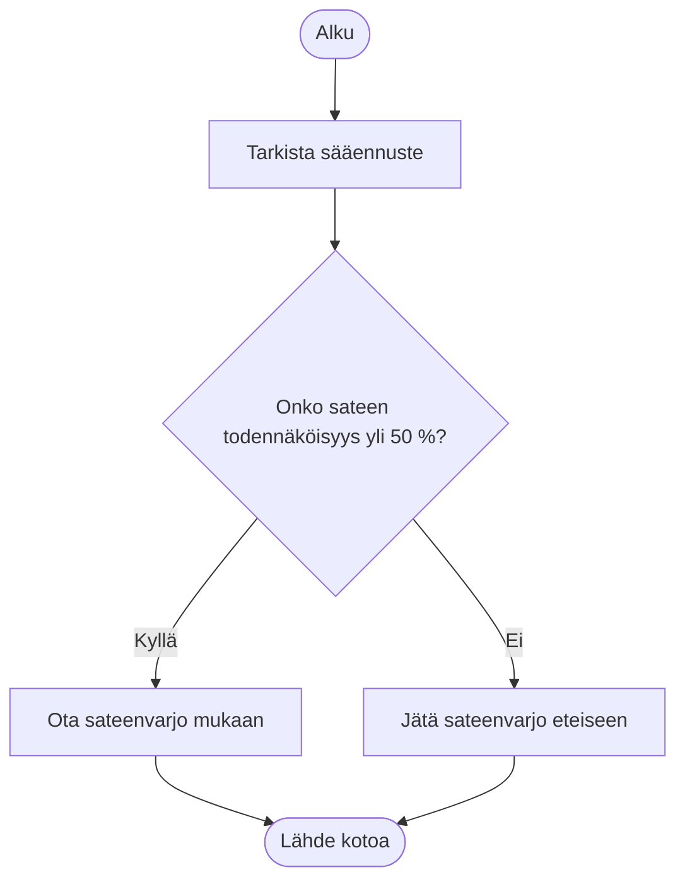
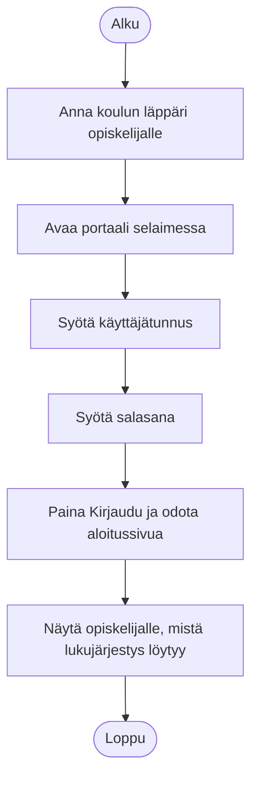
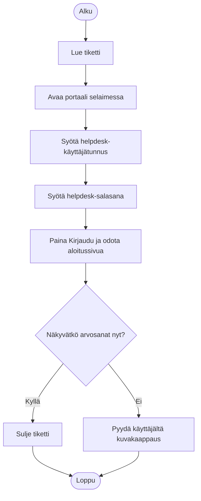
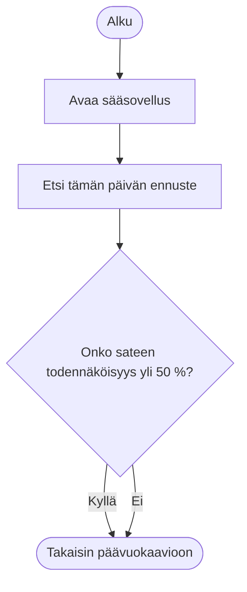

# Viikko 3 — Prosessin piirtäminen

## Viikon tehtävien yleiskuva

Tällä viikolla on neljä tehtävää. Vihreällä pisteellä merkitty tehtävä (🟢 PAKOLLINEN) on
vähimmäissuoritus — tehtävä 3.1, jossa piirrät ensimmäisen vuokaaviosi omasta elämästäsi.
Kolme violetilla pisteellä merkittyä tehtävää (🟣 SYVENTÄVÄ) ovat valinnaisia laajennuksia;
valitse niistä ne, jotka kiinnostavat sinua.
AT2 — prosessikuvaus — palautetaan viikon 5 lopussa / viikon 6 aikana. Tällä viikolla
tekemäsi muistiinpanot, kuten vuokaaviot, uudelleenkäytettävät lohkot ja abstraktiovalinnat,
ovat raaka-ainetta, jota AT2 kysyy. Älä heitä mitään pois.
Tietokone on edelleen kirjaimellinen. Jokaisen vuokaavion laatikon sisällä olevan vaiheen
täytyy olla niin pieni ja selkeä, että kirjaimellinen suorittaja voisi toteuttaa sen arvaamatta. Se,
että piirrät prosessista kuvan, ei muuta tätä sääntöä.
Muistutus: vuokaavio ei ole vain “kaunis lista”. Nuolten, päätöspisteiden ja lopputilojen pitää
näyttää, mitä tapahtuu missäkin tilanteessa.

## Tehtävä 3.1 — Piirrä ensimmäinen vuokaaviosi 🟢 PAKOLLINEN

Tavoite. Ota yksi tuttu arjen prosessi omasta elämästäsi ja piirrä siitä pieni vuokaavio, jossa
käytät neljää muotoa ja vähintään yhtä päätöspistettä. Tämä on viikon 3 vähimmäissuoritus.

### Vaiheet

1. Valitse yksi tuttu arjen prosessi, jota oikeasti teet ja jonka sisällä on vähintään yksi
kyllä/ei-kysymys. Hyviä vaihtoehtoja: “otanko tänään sateenvarjon mukaan?”,
“menenkö kouluun bussilla vai kävelen?”, “mikä laturi sopii tähän laitteeseen?”, “onko
jääkaapissa oleva maito vielä kunnossa?”.
2. Piirrä vuokaavio paperille (suositus) tai tabletille. Käytä neljää muotoa: ovaali
(alku / loppu), suorakulmio (yksi vaihe), vinoneliö (yksi kyllä/ei-päätös, josta lähtee
kaksi nuolta), nuoli (etenemissuunta).
3. Pidä kaavio pienenä — enintään 8 muotoa yhteensä, alku ja loppu mukaan
laskettuna. Jos tarvitset enemmän, valitse prosessista pienempi osa.
4. Allekirjoita ja päivää piirros. Kirjoita sivulle nimikirjaimesi ja tämän päivän

päivämäärä.

5. Ota kuva ja liitä se viikon muistiinpanoihisi. Jos muistiinpanosi ovat vain tekstiä, piirrä
vuokaavio uudelleen tavallisena ASCII-kaaviona.
6. Vastaa 3–5 virkkeellä: minkä kysymyksen päätösvinoneliösi kysyy? Mitkä ovat kaksi
siitä lähtevää polkua? Mikä on kummankin polun lopputila? Jokaisen polun pitäisi
päätyä Loppu-ovaaliin — ei umpikujanuolia.

### Esimerkkirunko (ASCII)



Kuusi muotoa. Omasi voi olla pienempi tai enintään kahdeksan muotoa.
💡
Vinkki: Jos vuokaaviossasi ei ole vinoneliötä, olet kirjoittanut listan ja piirtänyt
laatikot sen ympärille. Etsi yksi kyllä/ei-kysymys, vaikka pieni.

### Säilytä muistiinpanosi

Säilytä päivätty ja nimikirjaimilla merkitty piirros tai sen kuva sekä 3–5 virkkeen vastauksesi.

### AT2 — prosessikuvaus — palautetaan viikon 5 lopussa / viikon 6 aikana, ja tässä

rakentamasi vuokaaviosanasto on juuri sitä, mitä AT2 odottaa.

## Tehtävä 3.3 — Mitä kirjautumispainikkeen sisällä piilossa tapahtuu? 🟣 SYVENTÄVÄ

Tavoite. Valitse yksi painike, jota oikeasti käytät, ja kirjoita ylös, mitä se piilottaa sinulta.
Harjoittelet oppitunnin 8 liikettä: abstraktion näkemistä.
Ajattele näin: abstraktio on kuin “yksi nappi”, jonka taakse on pakattu monta vaihetta. Nappi
ei poista vaiheita, se vain piilottaa ne käyttäjältä.

### Vaiheet

1. Valitse yksi painike tai valikkokohta ohjelmistosta, jota käytät — koulun portaalin
“Kirjaudu sisään”, Discordin “Lähetä”, Spotifyn “Toista”, puhelimen kameran laukaisin,
sähköpostiohjelman “Vastaa”.
2. Listaa vähintään 5 asiaa, jotka painike piilottaa — asioita, jotka tapahtuvat, kun
painat sitä mutta joita et näe. Esimerkiksi “Kirjaudu sisään”: salasana tarkistetaan
salattua tallennetta vasten, saat istuntoevästeen, sinut ohjataan oikealle aloitussivulle,
yritys kirjataan lokiin tietoturvatiimiä varten, näkyvät valikkokohdat päivitetään
käyttöoikeuksiesi mukaan. Järkevät arvaukset riittävät.
3. Listaa vähintään 2 asiaa, joita painike EI piilota — asioita, jotka vaativat edelleen
sinun toimintaasi. Esimerkiksi “Kirjaudu sisään”: “sinulla täytyy jo olla käyttäjätili”,
“sinun täytyy tietää salasanasi”, “sinun täytyy olla oikealla kirjautumissivulla, ei
kalastelusivulla”.
4. Pohdinta (3–5 virkettä). Kuka on tämän abstraktion yleisö — kuka päätti, mitä
piilotetaan ja miksi? Onko jotakin, minkä pitäisi olla näkyvissä mutta jonka painike tällä
hetkellä piilottaa?
💡 Vinkki: Kuvittele, että painike katoaa, ja kuvaile, mitä joutuisit tekemään itse sen
sijaan. Se lista on täsmälleen se, mitä abstraktio piilottaa.

### Säilytä muistiinpanosi

Säilytä painikkeen nimi, piilotettujen asioiden lista, ei piilotettujen asioiden lista ja pohdinta.
AT2 — prosessikuvaus — palautetaan viikon 5 lopussa / viikon 6 aikana, ja abstraktion
piilottamien asioiden nimeäminen on juuri sitä sanastoa, jota AT2 odottaa.

## Tehtävä 3.4 — Tunnista uudelleenkäytetty osa 🟣 SYVENTÄVÄ

Tavoite. Etsi prosessin osa, joka esiintyy kahdessa vuokaaviossa, nimeä se lyhyellä
verbilausekkeella ja piirrä yksi omista vuokaavioistasi uudelleen niin, että kyseinen osa näkyy
yhtenä nimettynä laatikkona. Harjoittelet oppitunnin 9 liikettä: toistuvan mallin muuttamista
nimetyksi, uudelleenkäytettäväksi lohkoksi.

### Aloitusesimerkki: kaaviopari

Kaksi pientä ammatillista vuokaaviota. Molemmissa on sama prosessin osa — löydä se.

### Vuokaavio A — “Uuden opiskelijan ensimmäinen päivä”.



### Vuokaavio B — “Helpdesk-tiketti: arvosanat eivät näy”.



### Vaiheet

1. Etsi yhteinen osa. Alleviivaa vaiheet, jotka esiintyvät molemmissa vuokaavioissa.
Yhteinen osa on avaa portaali → syötä käyttäjätunnus → syötä salasana → paina
Kirjaudu — neljä suorakulmiota kahteen kertaan.
2. Ehdota lyhyt verbilausekenimi yhteiselle osalle, enintään kolme sanaa. Hyvä:
“kirjaudu portaaliin”. Huono: “tee kirjautumisjuttu” (ei kerro merkitystä).
3. Valitse yksi omista vuokaavioistasi (tehtävä 3.1 tai jokin muistiinpanoissasi oleva) ja
etsi siitä osa, joka voisi esiintyä myös toisessa tutussa prosessissa. Ehdota sille lyhyt
verbilausekenimi.
4. Piirrä vuokaaviosi uudelleen niin, että korvaat kyseisen osan yhdellä nimetyllä
laatikolla, jossa on verbilauseke. Kirjoita laatikon alle yksi tai kaksi virkettä tavallisella
kielellä: “Tämä nimetty lohko tekee seuraavaa: …”.
5. Testaa nimeä parin kanssa. Näytä luokkakaverille vain uudelleen piirretty
vuokaavio eli nimetty laatikko, ei alkuperäistä yksityiskohtaista versiota. Pyydä häntä
sanomaan yhdellä virkkeellä, mitä hän luulee nimetyn laatikon tekevän. Jos hänen
arvauksensa vastaa kuvaustasi, nimi on hyvä. Jos ei, nimi vaatii työtä.

### Jos teet tämän yksin

Jos et löydä luokkakaveria, käytä jotakin näistä:
• 24 tunnin väli. Laita uudelleenpiirros sivuun. Lue nimetty laatikko huomenna tuorein
silmin. “Ymmärränkö nimen perusteella, mitä tämä laatikko tekee?” Jos et, nimeä se
uudelleen.
• Luokan chatti tai kurssialusta. Lähetä uudelleen piirretty vuokaavio ilman kuvausta
ja kysy: “Mitä luulet tämän nimetyn laatikon tekevän?” Yksi vastaus riittää.
• Perheenjäsen. Näytä uudelleenpiirros henkilölle, joka ei ole nähnyt alkuperäisiä
yksityiskohtia. Kantaako verbilauseke merkityksen yksin?
💡 Vinkki: Hyvä nimi kuvaa, mitä lohko tekee, ei miten se tekee sen. “Kirjaudu
portaaliin” on hyvä. “Avaa selain, kirjoita käyttäjätunnus, kirjoita salasana, paina
Kirjaudu” on itse lohko, ei sen nimi.

### Säilytä muistiinpanosi

Säilytä esimerkkivuokaaviot, ehdottamasi nimi, uudelleenpiirros nimettyine laatikoineen,
yhden virkkeen kuvaus ja luokkakaverin reaktio. AT2 — prosessikuvaus — palautetaan
viikon 5 lopussa / viikon 6 aikana, ja uudelleenkäytettävien lohkojen nimeäminen on juuri
sitä sanastoa, jota AT2 odottaa.

## Tehtävä 3.5 — Kirjoita yksi vaihe alemmalla tarkkuustasolla 🟣 SYVENTÄVÄ

Tavoite. Ota yksi vaihe tehtävän 3.1 vuokaaviostasi ja avaa se 3–5 alivaiheen minivuokaavioksi.
Kerro, mille yleisölle alemman tarkkuustason versio on tarkoitettu. Harjoittelet oppitunnin 8
liikettä: tarkkuustason valitsemista tarkoituksella.
Ajattele näin: sama vaihe voi olla yhdelle ihmiselle liian karkea ja toiselle turhan
yksityiskohtainen. “Tarkista sää” voi riittää sinulle, mutta ei henkilölle, joka ei tiedä mitä
sovellusta käytät.

### Vaiheet

1. Valitse yksi vaihe tehtävän 3.1 vuokaaviostasi, joka piilottaa sarjan pienempiä
vaiheita — esimerkiksi “Tarkista sääennuste” tai “Valitse oikea laturi”.
2. Kirjoita vaihe minivuokaavioksi, jossa on 3–5 alivaihetta. Saatat tarvita uuden
vinoneliön, mutta et välttämättä. Esimerkiksi “Tarkista sääennuste” muuttuu näin:



3. Kerro yleisö yhdessä virkkeessä. “Tämä alemman tarkkuustason versio on
tarkoitettu [yleisölle].” Ole täsmällinen: pikkusisarukselle, joka ei ole koskaan käyttänyt
sääsovellusta; ensimmäistä päiväänsä tekevälle uudelle helpdesk-työntekijälle; minulle
itselleni puolen vuoden päästä.
4. Valinnainen sparrauskumppanivaihe. Liitä molemmat versiot LLM:ään alla
olevalla kehotteella. Päätä jokaisesta ehdotuksesta: hyväksyn / muokkaan /
hylkään, ja kirjoita yksi lyhyt virke siitä, miksi.

```javascript
Olet sparrauskumppanini, et opettajani. Olen ammatillisen
ICT-alan opiskelija ja harjoittelen abstraktiota. Alla on yksi
vaihe vuokaaviostani kahdella tarkkuustasolla sekä valitsemani yleisö.
Ylätason vaihe: [liitä]
Alemman tason minivuokaavio: [liitä]
Yleisö: [liitä yleisövirkkeesi]
Haasta minua. Valitsemani yleisön kannalta:
- Onko merkitys muuttunut kahden version välillä?
- Onko tarkkuustaso sopiva tälle yleisölle?
- Onko jokin alivaihe itse vielä liian suuri ja pitäisi avata?
Älä anna minulle “oikeaa” vastausta. Kysy kysymys, joka auttaa
minua näkemään aukon itse.
```

Älä liitä LLM:n tekstiä lopulliseen vuokaavioosi. LLM on sparrauskumppani; vuokaavio on
sinun.
5. Pohdinta (3–5 virkettä). Minkä tyyppinen haaste oli hyödyllisin: merkityksen
muuttuminen, väärä tarkkuustaso vai liian suuri alivaihe? Mitä pidit mukana, mitä
hylkäsit?
💡 Vinkki: Jos hyväksyt yli 80 % LLM:n ehdotuksista, et haasta takaisin tarpeeksi.
Kysy: “Olisinko muuttanut tämän, jos luokkakaveri olisi kysynyt samaa?” Jos et, hylkää
ehdotus.

### Säilytä muistiinpanosi

Säilytä molemmat versiot, yleisövirke, mahdollinen LLM-keskustelu päätöksinesi ja pohdinta.

### AT2 — prosessikuvaus — palautetaan viikon 5 lopussa / viikon 6 aikana, ja tässä

rakentamasi sanasto on sitä, mitä AT2 odottaa.
