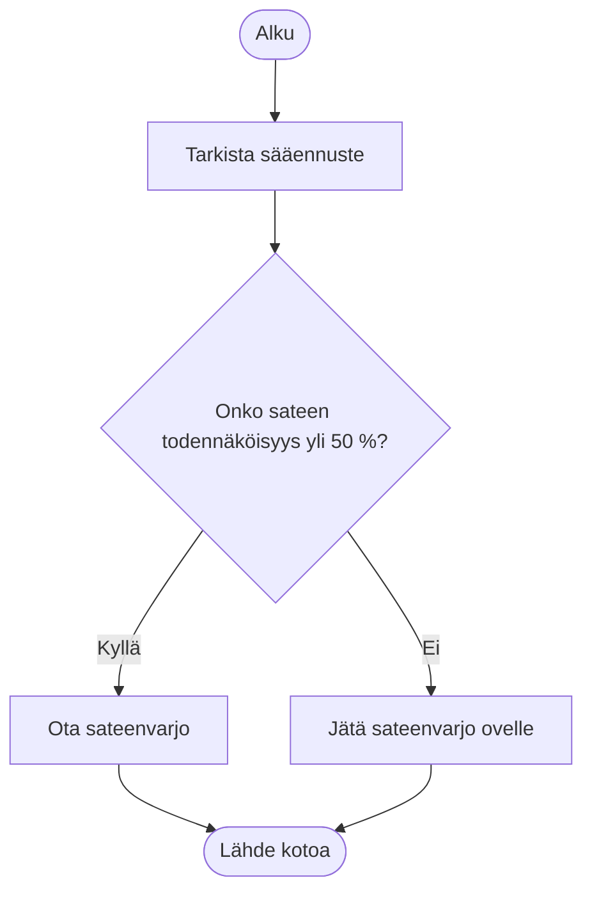
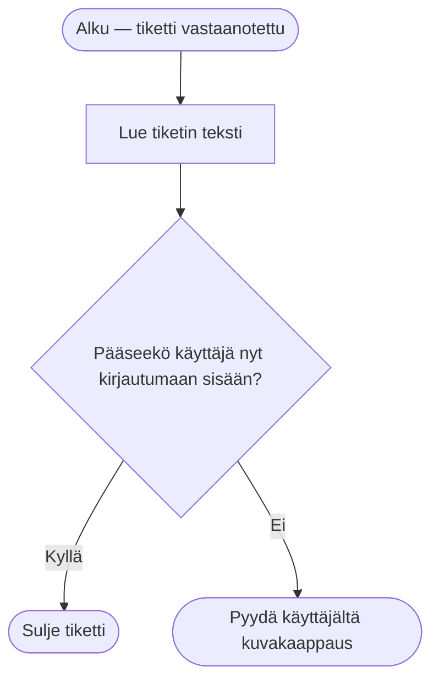
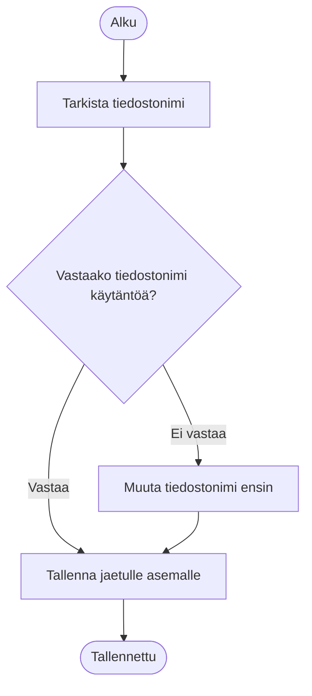

# Oppitunti 7 — Prosessin kuvaaminen ja yksinkertainen vuokaavio

### Milloin lista ei enää riitä?

Kuvittele tavallinen kouluaamusi. Herätys, ylös, peseytyminen, pukeutuminen, syöminen,
reppu, ulos ovesta. Seitsemän vaihetta litteässä listassa. Kirjaimellinen suorittaja voisi seurata
sen ilman yhtäkään päätöstä. Lista toimii.
Kuvittele nyt sama aamu, kun jokin on pielessä. Soiko herätys oikeasti? Jos soi, ehdit syödä
aamupalan. Jos ei soinut, kello on jo 8.10 ja aamupala jää väliin. Sataako? Jos kyllä, ota
sateenvarjo. Onko jääkaapissa maitoa? Jos kyllä, muroja; jos ei, paahtoleipää. Litteä lista ei enää
pysty pitämään tätä kasassa. Vaihe 5 — syö aamupala ei ole enää yksi asia vaan useita eri
asioita riippuen useiden kysymysten vastauksista. Kun prosessissa on kolme tai neljä
kysymystä, lista muuttuu nopeasti lukukelvottomaksi.
Vuokaavio on se, miksi lista muuttuu silloin, kun prosessissa on haaroja. Lista sanoo: tee tämä,
sitten tämä. Vuokaavio sanoo: tee tämä, kysy sitten tämä kysymys ja kulje vastauksesta riippuen
tätä tai tuota reittiä. Heti kun prosessissa on kyllä/ei-kysymys, pelkkä lista ei enää riitä.
Sama muutos tapahtuu helpdeskissä. “Lähettikö käyttäjä kuvakaappauksen?” Jos kyllä, liitä se
mukaan ja jatka. Jos ei, pyydä sitä ensin. Pelkkä lista ei pysty piirtämään tuota kysymystä.
Vuokaavio pystyy.

### Neljä perusmuotoa

Tämän kurssin vuokaavio käyttää täsmälleen neljää muotoa. Jokaisella on yksi tehtävä.
• Alku / loppu (ovaali). Ovaali avaa tai sulkee vuokaavion. Jokaisessa vuokaaviossa on
täsmälleen yksi Alku-ovaali ja vähintään yksi Loppu-ovaali. Alku kertoo, mistä prosessi
käynnistyy. Loppu kertoo, mihin jokin polku päättyy.
• Vaihe (suorakulmio). Suorakulmio sisältää yhden toiminnon — “Tarkista
sääennuste”, “Tallenna tiedosto”, “Lähetä tiketti käyttäjälle”. Yksi suorakulmio, yksi
toiminto. Jos suorakulmio osoittautuu käytännössä kolmeksi eri asiaksi, pilkot sen
kolmeen suorakulmioon tai piilotat ne nimettyyn lohkoon (oppitunti 9).
• Päätös (vinoneliö). Vinoneliö sisältää yhden kyllä/ei-kysymyksen — “Onko sateen
todennäköisyys yli 50 %?”, “Vastaako tiedostonimi käytäntöä?”, “Pääseekö käyttäjä
kirjautumaan sisään?” Päätös-vinoneliöllä on kaksi ulospäin lähtevää nuolta, yksi
kumpaakin vastausta varten, ja jokaisella nuolella on oma nimilappunsa.
• Nuoli / kulku. Nuolet näyttävät, missä järjestyksessä suorittaja etenee vuokaaviossa.
Jokaisesta muodosta lähtee vähintään yksi nuoli, paitsi Loppu-ovaalista. Päätös-
vinoneliöstä lähtee täsmälleen kaksi.
Nämä neljä muotoa muodostavat koko kuvan sanaston. Tämän oppitunnin taito ei ole
muotojen ulkoa muistaminen, vaan niiden käyttäminen hyvin.
Tässä on hyvin pieni vuokaavio, joka käyttää kaikkia neljää. Se kuvaa aamun
sateenvarjopäätöksen prosessina:

Lue sitä ylhäältä alas. Aloita. Tarkista ennuste. Kysy vinoneliössä oleva kysymys. Jos vastaus on
kyllä, ota sateenvarjo. Jos ei, jätä se ovelle. Kummassakin tapauksessa lähde kotoa.
Vuokaaviossa on yksi Alku-ovaali, yksi Loppu-ovaali, yksi suorakulmio ennen päätöstä ja yksi
suorakulmio kummallakin haaralla. Juuri haara tekee tästä vuokaavion eikä pelkkää listaa.

### Vuokaavion lukeminen

Vuokaaviota luetaan seuraamalla nuolia. Aloitat Alku-ovaalista. Jokaisen suorakulmion
kohdalla teet sen, mitä siinä lukee. Jokaisen vinoneliön kohdalla kysyt kysymyksen ja seuraat
sitä nuolta, jonka etiketti vastaa vastausta. Lopetat, kun saavut Loppu-ovaaliin.
Kokeillaan sateenvarjovuokaaviota valmiilla vastauksella. Ennuste lupaa 70 % sateen
todennäköisyyttä. Alku. Tarkista ennuste. Saavuta vinoneliö ja kysy: “Onko sateen
todennäköisyys yli 50 %?” — kyllä, 70 % on yli 50 %. Seuraa Kyllä-nuolta. Ota sateenvarjo.
Lähde kotoa. Yksi läpijuoksu prosessin läpi.
Kuvittele nyt, että ennuste on 20 %. Sama vuokaavio, mutta tällä kertaa seuraat Ei-nuolta, ja
sateenvarjo jää ovelle. Kaksi toimivaa läpijuoksua, molemmat päätyvät samaan Loppu-ovaaliin.
Juuri tämän haarautuminen antaa.
Vuokaavio on oikein, kun jokainen polku siinä päätyy Loppu-ovaaliin. Nuoli, joka katoaa
sivun reunasta, jättää suorittajan jumiin.

### Ensimmäisen vuokaavion piirtäminen

Valitse omasta arjestasi tuttu prosessi, jossa on vähintään yksi kyllä/ei-kysymys: “Pitäisikö
ottaa sateenvarjo?”, “Menenkö bussilla vai kävellen?”, “Mikä laturi sopii tähän laitteeseen?”,
“Tallennanko tiedoston päivämäärä nimessä?” Valitse sellainen, jonka vastaus vaihtelee päivän
mukaan.
Piirrä paperille tai tabletille neljä muotoa lyijykynällä:
• Alku-ovaali ylös
• suorakulmiot niille asioille, jotka teet aina
• vinoneliö siihen kohtaan, jossa pitää tehdä kyllä/ei-päätös
• kaksi nimettyä nuolta ulos päätöksestä
• suorakulmiot kummallekin haaralle
• yksi tai kaksi Loppu-ovaalia riippuen siitä, päättyvätkö haarat eri paikkoihin
Enintään kahdeksan muotoa — jos tarvitset enemmän, yksityiskohtaisuuden taso on liian
alhainen, ja oppitunti 8 auttaa siihen.
Kun vuokaavio on valmis, seuraa sitä silmilläsi Alusta Loppuun molemmilla haaroilla. Teitkö
oikeasti sen, mitä vuokaavio tänä aamuna väittää? Jos kyllä, vuokaavio on rehellinen. Jos ei,
korjaa vuokaavio — älä aamuasi. Tämä on tehtävän 3.1 ydin. Piirrä vuokaavio, allekirjoita ja
päivää se, ja säilytä kuva siitä AT2-muistiinpanojasi varten.
Pysähdy hetkeksi: Oliko tänään aamullasi kohta, jossa teit kyllä/ei-päätöksen
ajattelematta sitä tietoisesti (sateenvarjo, bussi vai kävely, kuuma vai kylmä juoma)?
Voisitko kuvata tuon päätöksen yhtenä vinoneliönä, josta lähtee kaksi nuolta? Mitä
nuolet oikeasti johtivat tekemään tänään?

### IT-esimerkkejä

Kaksi lyhyttä IT-prosessia vuokaavioina.
Helpdesk-triage. Käyttäjä avaa tiketin ja kirjoittaa: “En pääse kirjautumaan sisään.”
Ensimmäisen tason tukihenkilön täytyy päättää, mitä tehdään seuraavaksi.

Yksi päätös-vinoneliö, kaksi polkua, kaksi eri lopputilaa. Kysymys “Pääseekö käyttäjä nyt
kirjautumaan sisään?” johtaa aidosti kahteen eri lopputulokseen.
Tiedostonimen tarkistus. Ennen kuin dokumentti tallennetaan jaetulle asemalle, koulun
käytäntö sanoo, että tiedostonimen täytyy olla muotoa `2026-05-20_invoice-001.pdf`.

Huomaa kaksi asiaa. Haarojen nimet ovat Vastaa / Ei vastaa — sääntö on, että jokaisella
haaralla on lyhyt nimilappu, ja tässä Vastaa on selvempi kuin pelkkä Kyllä. Molemmat
haarat päätyvät lopulta Tallennettu-lopputilaan, mutta väärän nimen haara tarvitsee yhden
lisävaiheen.
Pysähdy hetkeksi: Valitse yksi oikeasti tekemäsi IT-tehtävä — sovelluksen asennus,
tiedoston jakaminen, videopuheluun liittyminen. Piiloutuuko sen sisään kyllä/ei-
kysymys, jonka teet lähes automaattisesti? Miltä tuo vinoneliö näyttäisi?
