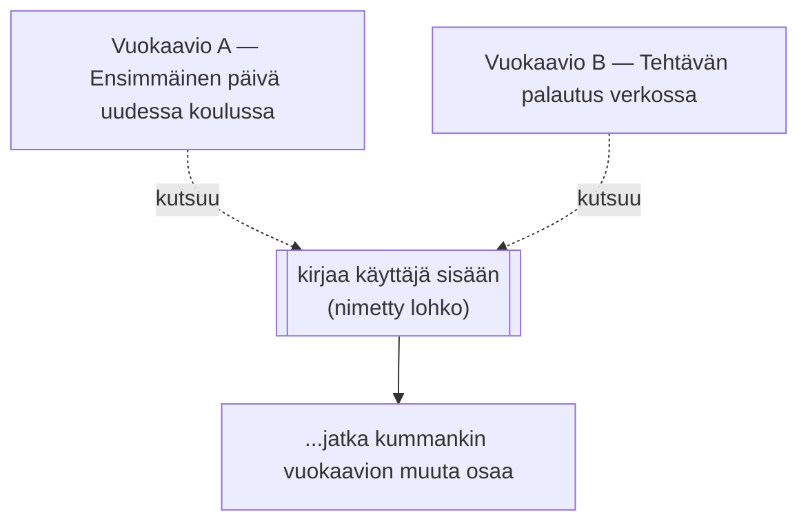
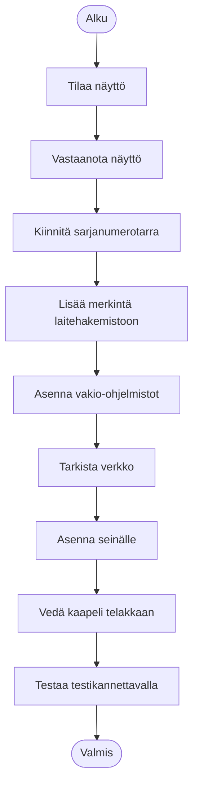
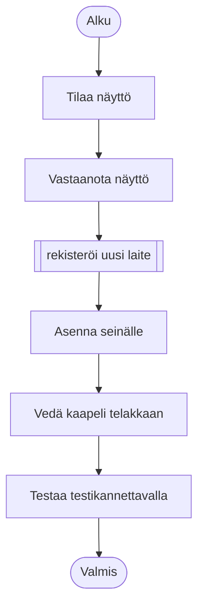

# Oppitunti 9 — Uudelleenkäytettävät ohjeet: funktion idea ilman koodia

### Kun sama prosessin osa ilmestyy yhä uudelleen

Aseta kaksi vuokaaviota vierekkäin. Ensimmäinen on “ensimmäinen päivä uudessa koulussa”.
Jossain keskellä on vaiheketju: Avaa koulun portaali → kirjoita käyttäjätunnus → kirjoita
salasana → paina Kirjaudu sisään → odota aloitussivua. Viisi laatikkoa.
Toinen vuokaavio on “palauta tehtävä verkossa”. Lähellä alkua esiintyy täsmälleen sama
vaiheketju: Avaa koulun portaali → kirjoita käyttäjätunnus → kirjoita salasana → paina
Kirjaudu sisään → odota aloitussivua.
Voisit piirtää saman joka kerta. Kolmannen vuokaavion kohdalla kätesi väsyy ja sivu on täynnä
jo ennen kuin ehdit kiinnostavaan kohtaan. On olemassa parempi liike: anna tälle prosessin

osalle nimi.

### Anna prosessin osalle nimi

Kaksi vuokaaviota. Yksi nimetty lohko. Samat viisi laatikkoa piirrettyinä vain kerran.
Nimi on lyhyt verbifraasi, joka kertoo mitä tämä osuus tekee, ei miten se tekee sen. Yllä olevan
vaihejokon nimi on “kirjaa käyttäjä sisään”. Kolme sanaa. Koko prosessin osa yhdessä
verbifraasissa.
Hyvä nimi läpäisee yksinkertaisen testin. Henkilö, joka ei ole koskaan nähnyt alkuperäisiä
viittä laatikkoa, pystyy lukemaan nimen “kirjaa käyttäjä sisään” ja odottamaan oikeaa
lopputilaa: tämän laatikon lopussa käyttäjä on kirjautunut sisään. Hän ei tiedä miten — se on
piilotettu. Mutta hän tietää mitä tapahtuu ja milloin laatikko on valmis.
Muita hyviä nimiä arjesta ja IT-maailmasta:
• nimeä tiedosto uudelleen
• varmuuskopioi laite
• nollaa salasana
• rekisteröi uusi laite
• lähetä ilmoitus huoltajalle
Jokainen näistä on verbifraasi, joka kertoo, mitä tapahtuu. Huono nimi epäonnistuu tässä
testissä. “Tee se juttu” ei kerro kenellekään mitään. “Vaihe 7” on pelkkä numero. Sääntö on:

verbifraasi, joka kertoo mitä lohko saa aikaan.

### Mitä “funktio” tarkoittaa tällä viikolla?

Viikolla 3 funktio määritellään epämuodollisesti näin:

### nimetty, uudelleenkäytettävä prosessin osa, joka on kuvattu tavallisella kielellä ja

jolla on selkeä syöte ja selkeä tuotos.

Pidä mielessä viisi asiaa:
• nimetty — sillä on lyhyt verbifraasin muotoinen nimi
• uudelleenkäytettävä — se esiintyy useammassa kuin yhdessä suuremmassa
prosessissa
• prosessi-osa — joukko vaiheita, yleensä noin 3–8 vaihetta
• tavallisella kielellä kirjoitettu kuvaus — lyhyt kappale siitä, mitä lohko tekee
• syöte ja tuotos — mitä lohko tarvitsee alussa ja mitä se tuottaa lopuksi
Esimerkiksi:
kirjaa käyttäjä sisään — vie käyttäjän tilasta “ei kirjautunut” tilaan “kirjautunut”.
Käyttäjä avaa portaalin, kirjoittaa käyttäjätunnuksen ja salasanan, painaa Kirjaudu
sisään -painiketta ja odottaa aloitussivua.
Syöte: käyttäjällä on toimiva käyttäjätunnus ja salasana.
Tuotos: käyttäjä on kirjautunut sisään ja portaalin aloitussivu näkyy.
Siinä on koko funktion idea viikon 3 merkityksessä. Ei koodia, ei sulkuja, ei paluuarvoja.
Kaikki se tulee viikolla 7. Tällä viikolla funktio on vuokaavion nimetty laatikko ja sen alla oleva
selityskappale.
Toinen esimerkki:
nimeä tiedosto koulun käytännön mukaisesti — ottaa tiedoston, jolla voi olla
mikä tahansa nimi, ja tuottaa tiedoston, jonka nimi seuraa koulun päivämäärä- ja
aihekäytäntöä.
Syöte: tiedosto on olemassa; käyttäjä tietää päivämäärän ja aiheen yhdellä sanalla.
Tuotos: tiedostolla on nimi muodossa . `YYYY-MM-DD_topic.ext`
Jokaisella nimetyllä lohkolla on siis selkeä syöte, selkeä tuotos ja yhden kappaleen kuvaus. AT2
pyytää sinua kirjoittamaan juuri tämän muodon, joten sitä kannattaa harjoitella nyt.

### Ammatillinen esimerkki — “rekisteröi uusi laite”

Tämän viikon IT-esimerkki on “rekisteröi uusi laite”. Aina kun kouluun tulee uusi
kannettava, projektori tai neuvotteluhuoneen näyttö, joku tekee saman prosessin osan:
sarjanumerotarra paikalleen, merkintä laitehakemistoon, vakio-ohjelmistojen asennus, verkon
tarkistus. Noin kahdeksan vaihetta joka kerta, jokaiselle uudelle laitteelle.
Vuokaavio tehtävälle “ota uusi neuvotteluhuone käyttöön” ilman nimettyä lohkoa voisi näyttää
tältä:

Kymmenen laatikkoa. Puolet niistä liittyy laitteen rekisteröintiin. IT-päällikkö, jota kiinnostaa
oikeasti neuvotteluhuone, joutuu lukemaan viisi rekisteröintilaatikkoa ennen kuin pääsee
kiinnostavaan kohtaan.
Sama vuokaavio nimetyllä lohkolla:

Seitsemän laatikkoa. Nimetyssä lohkossa kulkevat ne viisi piilotettua vaihetta. Piilotetut
vaiheet eivät ole kadonneet — ne elävät rekisteröi uusi laite -kuvauksessa, joka on arkistoitu
koulun IT-ohjeeseen sitä harjoittelijaa varten, jonka täytyy oikeasti suorittaa tuo lohko.

### Vaihtokauppa yhdessä lauseessa

Nimetty lohko piilottaa yksityiskohtia, jotta tämän tason lukija ei huku niihin, mutta
yksityiskohtaa tarvitsevan lukijan täytyy tietää, mistä se löytyy. Oppitunnin 8
abstrahointi oli sitä, mitkä laatikot kannattaa piirtää; oppitunnin 9 nimetyt lohkot ovat sama
liike yhdellä suuremmalla zoomaustasolla — yksi laatikko voi edustaa kokonaisen
alivuokaavion.
Silta viikkoon 7: siellä “kirjaa käyttäjä sisään” muuttuu oikeaksi JavaScript-funktioksi.
Verbifraasista tulee funktion nimi; tavallisella kielellä kuvatuista syötteestä ja tuotoksesta tulee
parametreja ja paluuarvoja; prosessin osasta tulee koodia. Mutta muoto — nimetty,
uudelleenkäytettävä prosessin osa, jolla on syöte ja tuotos — on juuri se, mitä rakennat tällä
viikolla englannin sijaan suomeksi ja lyijykynällä.
Pysähdy hetkeksi: Katso tehtäväsi 3.1 vuokaaviota ja mitä tahansa muuta tällä
viikolla piirtämääsi vuokaaviota. Onko niissä 3–4 laatikon mittainen prosessin osa,
joka voisi esiintyä myös jossakin muussa prosessissa? Kirjoita sille nyt verbifraasin
muotoinen nimi.
Ajattele näin: kun annat prosessin osalle hyvän nimen, autat lukijaa näkemään
kokonaisuuden. Kun taas tarvitset yksityiskohdat, voit “avata laatikon”.
