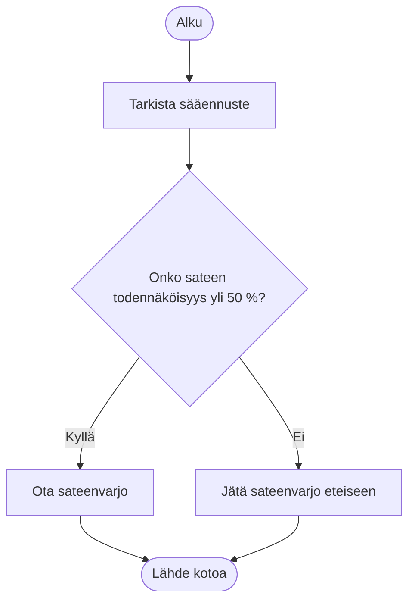

# Viikko 3 — Prosessin piirtäminen

---

## Viikko 3 - Prosessin piirtäminen

Ohjelmallinen ajattelu
Ammatillisen tieto- ja viestintätekniikan ensimmäisen vuoden kurssi

---

## Mihin viikko 2 jäi

• Osaat pilkkoa ongelman päätehtäväksi, osatehtäviksi ja osatavoitteiksi.
• AT1 palautettiin tämän viikon alussa.
• Tällä viikolla kysytään: miten kirjoitan prosessin muistiin niin, että joku toinen voi suorittaa
sen?

### Vinkki: prosessi on tekemisen kulku alusta loppuun. ---

## Viikon 3 keskeinen viesti

> "Kun osaat pilkkoa ongelman, seuraava taito on kuvata prosessi niin, että joku toinen voi
suorittaa sen - ja päättää, mitkä yksityiskohdat ovat tärkeitä ja mitkä voi turvallisesti
piilottaa." ---

## Mitä tällä viikolla harjoitellaan

• Oppitunti 7 - yksinkertainen vuokaavio, kurssin ensimmäinen kuva.
• Oppitunti 8 - abstraktio: valitaan, mitä jätetään pois.
• Oppitunti 9 - uudelleenkäytettävät ohjeet: funktion idea ilman koodia.

### Ajattele näin: tällä viikolla siirrytään tekstilistasta prosessin kuvaan. ---

## Kun lista ei enää riitä

Aamurutiini toimii suorana listana: herätys, peseydy, pukeudu, syö, lähde.
Heti kun mukaan tulee kyllä/ei-kysymys ("sataako?"), lista hajoaa.
Vuokaavio on se, miksi lista muuttuu, kun prosessissa on haarautuminen.

### Esimerkki: jos sataa, otat sateenvarjon. Jos ei sada, et ota. Yksi prosessi, kaksi polkua. ---

## Neljä muotoa

• Soikio - alku / loppu
• Suorakulmio - yksi vaihe eli toiminto
• Vinoneliö - yksi kyllä/ei-päätös, kaksi lähtevää nuolta
• Nuoli - kulku yhdestä muodosta seuraavaan
• Neljä muotoa. Siinä on koko kuvan sanasto.

### Vinkki: jos vinoneliössä ei voi vastata kyllä tai ei, kysymys on vielä liian epäselvä. ---

## Vuokaavio: "pitäisikö minun ottaa sateenvarjo?"

Kahdeksan muotoa: yksi Alku, yksi Loppu, kolme suorakulmiota, yksi vinoneliö ja nuolia joka
puolella.

### Vinkki: piirrä ensin polku, jonka luulet olevan tavallisin, ja lisää sitten toinen haara. ---

## IT-esimerkki - help desk -tikettien lajittelu

• *Lue tiketti.*
• *Pääseekö käyttäjä nyt kirjautumaan?*
• Kyllä → sulje tiketti.
• Ei → pyydä käyttäjältä kuvakaappaus.
• Yksi vinoneliö, kaksi polkua, kaksi erilaista Loppu-soikiota.

### Esimerkki: "Suljettu" ja "Odottaa vastausta" voivat molemmat olla lopputiloja. Abstraktio - piilota yksityiskohta, jolla ei ole väliä
Abstraktio tarkoittaa, että valitset, mitä jätät pois, jotta kuvaus sopii yleisölle.
Se ei ole epämääräisyyttä - ne laatikot, jotka piirrät, pysyvät täsmällisinä.
Se ei ole filosofiaa - kyse voi olla bussipysäkistä, Kirjaudu-painikkeesta tai tiedostonimestä.

### Ajattele näin: abstraktio on sopiva tarkkuustaso. ---

## Bussipysäkki on abstraktio

• Matkustaja - kyltti, jossa lukee "Park Street", ja aikataulu.
• Liikenteenohjaaja - GPS-koordinaatti, tunnistenumero ja lista busseista.
• Insinööri - jakorasia, virtakaapeli ja ruuvit.
• Sama fyysinen asia. Kolme abstraktiota. Kolme oikeaa vastausta.

### Vinkki: kysy aina: kenelle kuvaus on tarkoitettu? ---

## "Kirjaudu"-painike on abstraktio

• Sen sisälle piiloutuu esimerkiksi:
• tunnistuspalvelin
• salasanan tarkistus salattua tietovarastoa vastaan
• istuntoeväste
• OAuth-vaiheistus, jos kirjautuminen kulkee Microsoftin tai Googlen kautta
• Painike on oikea kuvaus *käyttäjälle*.

### Esimerkki: käyttäjän ei tarvitse tietää OAuthin vaiheita voidakseen painaa Kirjaudu. ---

## Yksityiskohtien taso riippuu yleisöstä

• Uusi help desk -työntekijä, ensimmäinen päivä - kuusi suorakulmiota ennen vinoneliötä.
• Kokenut IT-ylläpitäjä, kymmenen vuotta alalla - yksi suorakulmio ennen vinoneliötä.
• Sama prosessi. Sama tavoite. Eri yleisö. Eri tarkkuustaso.
• Molemmat vuokaaviot ovat oikein.

### Ajattele näin: aloittelija tarvitsee enemmän näkyviä vaiheita kuin asiantuntija. ---

## Uudelleenkäytettävät ohjeet - anna osalle nimi

Kaksi vuokaaviota. Molemmissa on vaiheet: Avaa portaali → syötä käyttäjätunnus → syötä
salasana → paina Kirjaudu → odota etusivua.
Viisi suorakulmiota, kahdesti.
Tai: yksi nimetty lohko - "kirjaa käyttäjä sisään".

### Vinkki: jos sama vaihejoukko toistuu, anna sille nimi. ---

## Funktio (viikon 3 merkityksessä)

• Nimetty - lyhyt verbilauseke
• Uudelleenkäytettävä - esiintyy monessa prosessissa
• Kuvaus yleiskielellä - yksi lyhyt kappale
• Syöte - mitä se tarvitsee aloittaakseen
• Tuloste - mitä se tuottaa valmistuessaan
• Ei vielä koodia. Vain nimetty laatikko ja kappale.

### Esimerkki: "rekisteröi uusi laite" voi olla nimetty lohko, jonka sisällä on useita piilovaiheita. ---

## Ammatillinen esimerkki - "rekisteröi uusi laite"

Käytetään aina, kun uusi kannettava, projektori tai neuvotteluhuoneen näyttö saapuu.
Kymmenen laatikon vuokaavio tehtävälle "ota uusi neuvotteluhuone käyttöön" muuttuu
seitsemän laatikon vuokaavioksi, kun "rekisteröi uusi laite" on yksi nimetty laatikko.
Viisi piilotettua vaihetta ovat yhä olemassa - ne löytyvät koulun IT-käsikirjasta.

### Huomaa: abstraktio ei poista työtä. Se vain piilottaa yksityiskohdat oikeaan paikkaan. ---

## Viikon 3 sanasto yhdellä silmäyksellä

• *prosessi, vuokaavio, alku/loppu, vaihe, päätös, nuoli, haara, kyllä/ei-polku*
• *abstraktio, tarkkuustaso, piilotettu yksityiskohta, yleisö*
• *uudelleenkäytettävä lohko, nimetty lohko / funktio (viikon 3 merkityksessä)*
• *kompromissi / trade-off; ehto* (ennakkoon - viikko 5)

### Vinkki: kirjoita jokaisesta termistä yksi oma esimerkki. ---

## Pakollinen vähimmäistaso vs. syventäminen

• Pakollinen vähimmäistaso
• Määrittele ydintermit.
• Lue pieni vuokaavio ja kuvaa, mitä se tekee.
• Piirrä omasta elämästäsi pieni vuokaavio, jossa on päätös.
• Nimeä kaksi piilotettua yksityiskohtaa yhden abstraktion sisällä.
• Etsi yksi uudelleenkäytetty osa ja nimeä se.
• Syventäminen
• Kirjoita yksi vaihe uudelleen tarkemmalla tasolla.
• Etsi kolme uudelleenkäytettävää lohkoa kahdesta prosessista.
• Sparraa abstraktiovalintoja LLM:n kanssa. ---

## Tämän viikon tehtävät

• Tehtävä 3.1 - Piirrä ensimmäinen vuokaaviosi (PAKOLLINEN).
• Tehtävä 3.3 - Mitä Kirjaudu-painikkeen sisällä piiloutuu? (SYVENTÄVÄ)
• Tehtävä 3.4 - Etsi uudelleenkäytetty osa (SYVENTÄVÄ).
• Tehtävä 3.5 - Kirjoita yksi vaihe tarkemmalla tasolla (SYVENTÄVÄ).
• Säilytä muistiinpanosi - niitä käytetään AT2:ssa viikon 5 lopussa / viikon 6 aikana.

### Tee näin: piirrä ensin käsin. Siisti vasta sen jälkeen, jos aikaa jää. ---

## Seuraavaksi: Viikko 4 - vaihtoehtoiset ratkaisut

Useampi kuin yksi kelvollinen vuokaavio voi saavuttaa saman tavoitteen.
Viikko 4 kysyy: miten kahta kelvollista ratkaisua verrataan ja miten valitaan?
Sama vuokaaviotaito; päälle tulee uusi kysymys.

### Vinkki: eri ratkaisuja verrataan kriteerien avulla, ei pelkän mielipiteen perusteella. ---

## Kertaus - viikon keskeinen viesti vielä kerran

> "Kun osaat pilkkoa ongelman, seuraava taito on kuvata prosessi niin, että joku toinen voi
suorittaa sen - ja päättää, mitkä yksityiskohdat ovat tärkeitä ja mitkä voi turvallisesti
piilottaa."
