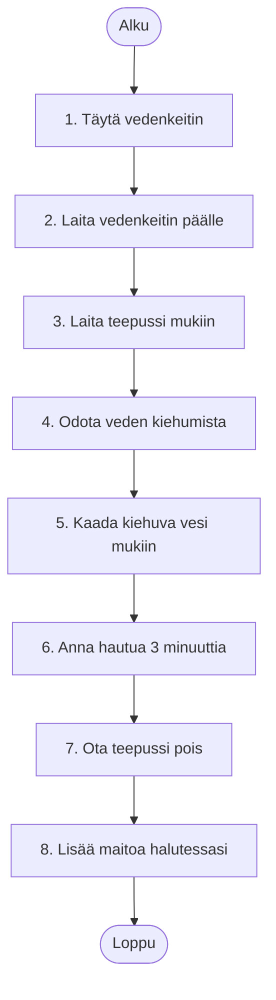
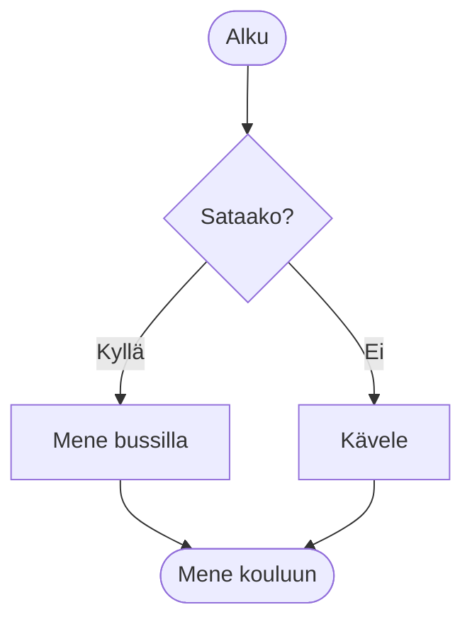

# Itseopiskelu

Heräät. Tarkistat puhelimen. Jos kello on yli 7.30, jätät aamupalan väliin; muuten syöt. Sitten
kävelet kouluun. Matkalla tarkistat jokaiset liikennevalot: jos valo on punainen, pysähdyt; jos
vihreä, jatkat. Toistat tämän jokaisessa risteyksessä, kunnes olet portilla.
Tuo lyhyt kappale kuvaa oikeaa aamua. Se käyttää samoja kolmea liikettä, joita jokainen
koskaan kirjoitettu ohjelma käyttää. Kuljit vaiheet järjestyksessä (herää, sitten tarkista puhelin,
sitten kävele kouluun). Teit päätöksiä (yli 7.30 vai ei? punainen vai vihreä?). Ja toistit samaa
tarkistusta uudelleen ja uudelleen jokaisessa risteyksessä, kunnes saavuiksi paikkaan, jonka
pystyit havaitsemaan.
Näillä kolmella liikkeellä on lyhyet nimet: järjestys, ehto ja toisto.

### Lähes mikä tahansa prosessi voidaan kuvata kolmella rakennuspalikalla:

järjestyksellä, ehdolla ja toistolla.

Se on tämän viikon keskeinen viesti.
Viikko 1 sanoi, että tietokone on kirjaimellinen suorittaja, ei kekseliäs. Viikot 2 ja 3 sanoivat,
että suuret ongelmat voidaan pilkkoa ja kuvata prosesseina. Viikko 4 sanoi, että “oikea” voi
tarkoittaa useampaa kuin yhtä asiaa. Viikko 5 antaa nimet kolmelle rakenteelliselle liikkeelle,
jotka elävät jokaisen kuvatun prosessin sisällä — ettäettä ensi viikolla, kun alat kirjoittaa jotain
koodin kaltaisempaa (pseudokoodia), liikkeet ovat jo tuttuja.
Tällä viikolla pysytään tavallisessa kielessä. Koodia ei vielä tule. Kirjoitat ehtoja muodossa `jos`
ja toistoja muodossa tai , mutta nämä ovat

```
… niin … muuten … jokaiselle … toista kunnes …
```

tavallisen kielen oikoteitä, eivät ohjelmointikieltä. Tällä viikolla tärkeintä on ajattelu.
AT2-yhteys. AT2 tulee viikon 5 lopussa / viikon 6 aikana. Se pyytää sinua kuvaamaan
valitsemasi prosessin luonnollisella kielellä niin, että kaikki kolme rakennuspalikkaa näkyvät.
Tämän viikon pakollinen minimi on sama tuotos pienemmässä mittakaavassa. Säilytä
muistiinpanot jokaiselta oppitunnilta — niistä rakentuu AT2.

## Oppituntikohtainen lukemisto

## Oppitunti 13 — Järjestys: ohjelma etenee vaihe vaiheelta

### Mitä järjestys tarkoittaa?

Järjestys on kolmesta rakennuspalikasta yksinkertaisin: tehdään yksi vaihe toisen jälkeen
kiinteässä järjestyksessä, ellei ohje sano muuta. Tuo viimeinen osa on tärkeä. Järjestys on
oletus. Kun mitään ehtoa ei ole kirjoitettu eikä mitään toistoa ole kirjoitettu, kirjaimellinen
suorittaja kulkee vaiheet ylhäältä alas ja tekee jokaisen täsmälleen kerran.
Jos järjestys kuulostaa liian itsestään selvältä ollakseen “rakennuspalikka”, se on hyödyllinen
varoitusmerkki. Monet oikean elämän prosessikuvauksien hajoamiset — epäonnistuvat
reseptit, pieleen menevät julkaisut, aamurutiinit, jotka jättävät sinut juoksemaan bussin
perään — johtuvat yhdestä vaihdetusta tai yhdestä puuttuvasta vaiheesta. Järjestys on oletus,
ja juuri oletus on usein kohta, jossa asiat rikkoutuvat.

### Järjestys arkisissa prosesseissa

Tässä on pieni algoritmi, jonka osaat jo: teen tekeminen.
1. Täytä vedenkeitin vedellä.
2. Laita vedenkeitin päälle.
3. Laita teepussi mukiin.
4. Odota, että vesi kiehuu.
5. Kaada kiehuva vesi mukiin.
6. Anna teepussin olla kolme minuuttia.
7. Ota teepussi pois.
8. Lisää maitoa, jos haluat.
Tämä on järjestys: kahdeksan numeroitua vaihetta, jokainen yksi selkeä toiminto, tietyssä
järjestyksessä. Kirjaimellinen suorittaja, jolla ei ole teekokemusta, voisi silti päätyä juotavaan
kuppiin, jos hän seuraisi vaiheita täsmälleen.
Sama järjestys vuokaaviona näyttää tältä:



Tee ajatuskoe: vaihda vaiheet 4 ja 5 keskenään — kaada kiehuva vesi mukiin ja vasta sitten
odota, että vesi kiehuu. Mitä tapahtuu? Suorittaja kaataa kylmän veden mukiin ja jää sitten
seisomaan jo tyhjän vedenkeittimen ääreen. Ohje ei enää ole teeresepti vaan sekava liikesarja.
Ydinajatus on tämä: kirjoittamasi järjestys on se järjestys, jonka suorittaja saa. Järjestys
ei takaa, että prosessi toimii; se takaa, että suorittaja ei järjestä vaiheita uudelleen puolestasi.
Jotkin vaiheet voidaan vaihtaa rikkomatta mitään. Voit harjata hampaat ennen pukeutumista
tai sen jälkeen. Muut vaiheet eivät ole vaihdettavissa. Et voi kaataa teetä ennen veden
keittämistä etkä syödä kakkua ennen sen paistamista. Tällöin sanomme, että vaiheiden välillä
on riippuvuus: myöhempi vaihe tarvitsee aikaisemman vaiheen tuloksen ennen kuin se voi
alkaa.
Tällä viikolla sinun ei tarvitse analysoida riippuvuuksia muodollisesti. Riittää, että huomaat
ne ja kirjoitat järjestyksen niin, että se kunnioittaa niitä riippuvuuksia, jotka jo tiedät.

### Järjestys IT-kontekstissa — julkaisutarkistuslista

Tässä on järjestys ammatillisen IT:n maailmasta: yksinkertaistettu julkaisutarkistuslista —
vaiheet, joita pieni tiimi voisi seurata viedessään verkkosivun uuden version käyttäjille.
1. Yhdistä uusi haara päähaaraan.
2. Aja build.
3. Aja pikaiset savutestit.
4. Vie versio staging-ympäristöön.
5. Ilmoita tiimille chatissa.
6. Odota toisen henkilön hyväksyntää.
7. Vie versio tuotantoon.
8. Seuraa koontinäyttöä kymmenen minuutin ajan.
Muoto on sama kuin teereseptissä: numeroitu lista selkeitä toimintoja tietyssä järjestyksessä.
Useita vaiheita ei voi järjestää uudelleen rikkomatta prosessia. Et voi ajaa buildia ennen
yhdistämistä — mitään uutta ei ole vielä rakennettavana. Et voi viedä tuotantoon ennen
hyväksyntää — juuri sitä varten hyväksyntä on olemassa.
Huomaa, miten arki ja IT elävät tässä rinnakkain. Kiehauta vesi → kaada vesi on sama muoto
kuin aja build → aja savutestit. Arkinen versio tulee ensin, koska se on tuttu. IT-versio on sama
ajatus eri ympäristössä.

### Riippumattomuus vs. riippuvuus — lempeä aloitus

Kaksi pientä esimerkkiä:
• Kaksi vaihetta, jotka eivät riipu toisistaan: harjaa hampaat ja laita kengät jalkaan
voivat tapahtua aamurutiinissa kummassa järjestyksessä tahansa.
• Kaksi vaihetta, jotka riippuvat toisistaan: avaa tiedosto ja tallenna tiedosto
riippuvat toisistaan. Et voi tallentaa sitä, mitä et ole avannut.
Sinun ei tarvitse piirtää riippuvuuskaaviota. Tämän viikon harjoitus on vain kirjoittaa se
järjestys, jota tarkoitat, ja olla rehellinen itsellesi, kun joku vaihe täytyy sijoittaa ennen toista,
koska se valmistaa jotakin myöhempi vaihe tarvitsee.
Pysähdy hetkeksi: Kirjoita yksi kolmivaiheinen arkinen prosessi, jossa järjestystä
voi vaihtaa, ja toinen, jossa sitä ei voi vaihtaa. Millä yhdellä sanalla kuvaisit näiden
kahden eroa?

## Oppitunti 14 — Ehdot: jos–niin–muuten-ajattelu ja päätöspuut

### Mikä ehto on?

Ehto on testi, joka päättää, mikä vaihe tapahtuu seuraavaksi. Se on se hetki prosessissa, jossa
polku haarautuu. Pelkkä järjestys on suora viiva: tee A, sitten B, sitten C. Ehto lisää haaran: tee
A, ja jos X on totta, tee B, muuten tee C. Suorittajan näkökulmasta ehto on hetki, jossa
pysähdytään, tarkistetaan testi ja valitaan haara.

### Arkisia ehtoja, joita käytät jo

Käytät ehtoja joka päivä, yleensä nimeämättä niitä.
• “Jos sataa, mene bussilla; muuten kävele.” — kaksiharakainen ehto ( `jos … niin …`
) `muuten …`
• “Jos saat läksyt valmiiksi ennen ruokaa, saat pelata.” — yksiharainen ehto ( `jos … niin`
). Jos läksyt eivät ole valmiit, mitään ylimääräistä ei tapahdu. `…`
• “Jos maito haisee pahalta, heitä se pois.” — toinen yksiharainen ehto. Jos maito ei haise
pahalta, et tee sille mitään.
Ero muodon ja muodon välillä on pieni mutta todellinen. `jos … niin … jos … niin … muuten …`
Ilman -haaraa suorittajalla on vain yksi mahdollinen lisätoiminto; jos testi `muuten`
epäonnistuu, hän vain jatkaa eteenpäin. -haaralla suorittaja tekee aina joko toisen tai `Muuten`
toisen — vaihtoehto on nimetty.

### Ehdon kirjoittaminen tavallisella kielellä

Voit kirjoittaa ehtoja loppuviikon ajan samanlaisella arkisella muodolla. Ne näyttävät
tavalliselta suomelta, jossa on pieni määrä asettelua:
jos sataa, niin mene bussilla, muuten kävele
Sama ehto päätöspuuna:



Toinen esimerkki:
jos maito haisee pahalta, niin heitä se pois
Nämä eivät ole koodia. Ne ovat tavallisen kielen oikoteitä. Sanat jos, niin ja muuten tekevät
saman työn kuin välimerkit: ne auttavat näkemään, missä testi loppuu ja missä toiminta alkaa.
Älä tee niistä vielä tiukkaa ohjelmointikieltä — se tulee viikolla 6.
Hyvässä ehdossa on kolme rehellistä osaa:
1. Testi, jonka suorittaja voi oikeasti tarkistaa. “Sataako nyt?” — kyllä tai ei. “Onko
salasana lyhyempi kuin 8 merkkiä?” — kyllä tai ei.
2. Niin-haara — mitä tehdään silloin, kun testi on tosi.
3. Muuten-haara (valinnainen) — mitä tehdään, kun testi on epätosi.
Jos et kirjoita -haaraa, sanot samalla: “muuten ei tehdä mitään ylimääräistä”. `muuten`
Varmista, että tämä on todella se, mitä tarkoitit.

### Päätöspuut — haaran piirtäminen

Päätöspuu on vain kuvan muotoon piirretty ehto. Se sijoittaa testin ylös ja piirtää haarat
alaspäin. Esimerkiksi:

```
Sataako?
/ \
kyllä ei
/ \
mene bussilla kävele
```

Tämä on kaksiharainen puu. Voit tehdä myös kolmihaaraisen puun lisäämällä `muuten jos`
-haaran:

```
Sataako?
/ \
kyllä ei
/ \
mene bussilla Oletko myöhässä?
/ \
kyllä ei
/ \
juokse kävele
```

Et tarvitse mitään erityistä ohjelmistoa päätöspuun piirtämiseen. Kynä ja vihkon kulma
riittävät. Piirtäminen ei ole tärkeää piirroksen vuoksi vaan siksi, että se pakottaa sinut
rehelliseen keskusteluun itsesi kanssa. Kun jokaisen haaran kohdalla on pakko nimetä testi,
huomaat ne kohdat, joissa et ollut aiemmin rehellinen siitä, mikä testi oikeasti on.

### Ehdot IT-kontekstissa — salasanan tarkistus

Kuvittele rekisteröitymislomake verkkosivulla. Kun painat luo tili, järjestelmä tarkistaa
salasanan sääntöjä vasten. Yksinkertaistettu sääntö voisi olla näin kirjoitettuna:
• jos salasana on lyhyempi kuin 8 merkkiä, niin hylkää se
• jos salasanassa ei ole numeroa, niin hylkää se
• jos salasanassa ei ole isoa kirjainta, niin hylkää se
• muuten hyväksy se
Tämä on kolmen ehdon ketju plus -haara — yhteensä neljä reittiä, jotka päätyvät `muuten`
kahteen lopputulokseen (hylkää / hyväksy). Voit piirtää sen päätöspuuna:

```
Onko pituus alle 8 merkkiä?
/ \
kyllä ei
/ \
hylkää Eikö salasanassa ole numeroa?
/ \
kyllä ei
/ \
hylkää Eikö salasanassa ole isoa kirjainta?
/ \
kyllä ei
/ \
hylkää hyväksy
```

Huomaa: tämä on sama muoto kuin “jos sataa, mene bussilla; muuten jos olet myöhässä, juokse;
muuten kävele.” Tilanne on eri — salasanat sään sijasta — mutta muoto on sama.

### Yhdistetyt ehdot — JA, TAI (syventävä, valinnainen)

Joskus yksi ehto sisältää useamman testin. Tätäkin käytät arjessa koko ajan.
• “Jos sinulla on bussikortti ja siinä on rahaa, voit mennä bussilla.” — kaksi testiä JA-
sanalla yhdistettynä. Molempien pitää olla tosia.
• “Jos sataa tai tuulee kovaa, mene bussilla.” — kaksi testiä TAI-sanalla yhdistettynä.
Toisenkin riittäminen riittää.
Yhdistetyt ehdot ovat täysin sallittuja tavallisessa kielessä. Et tarvitse symboleja. Sana ja ja sana
tai tekevät saman työn kuin tavallisissa lauseissa.
Jos yhdistetty ehto alkaa tuntua ahtaalta — esimerkiksi “jos A ja B tai C eikä D” — se on merkki
siitä, että kannattaa piirtää pieni päätöspuu useammalla lyhyellä testillä yhden liian pitkän
testin sijaan.
Pysähdy hetkeksi: Kirjoita yksi sääntö, jota perheessäsi käytetään ja jossa on muoto
jos … niin … muuten …. Mikä siinä on testi? Voisiko kaksi eri lukijaa olla eri mieltä
siitä, onko testi tosi? Jos voisi, testi ei ole vielä tarpeeksi rehellinen.
Pysähdy hetkeksi: Katso mitä tahansa verkkosivun rekisteröitymislomaketta.
Pystytkö nimeämään kolme eri ehtoa, joita lomake tarkistaa ennen lähettämisen
sallimista? Sinun ei tarvitse nähdä koodia; virheilmoitukset paljastavat paljon.

## Oppitunti 15 — Toisto: saman asian tekeminen useita kertoja

### Mitä toisto tarkoittaa?

Toisto tarkoittaa saman vaiheen tai saman vaiheryhmän tekemistä useammin kuin kerran
niin, että mukana on pysäytysehto, joka kertoo suorittajalle, milloin pitää lopettaa. Teknologian
arkikielessä tästä puhutaan usein myös silmukkana (loop), mutta tällä kurssilla käytämme
enimmäkseen sanaa toisto.
Järjestys on suora viiva. Ehto on haara. Toisto on ympyrä, jolla on myös rehellinen uloskäynti.
Jos uloskäynti puuttuu, suorittaja kiertää ikuisesti — syntyy karkaava toisto. Palaamme
siihen aivan kohta.

### Arkisia toistoja, joita käytät jo

Teet näitä koko ajan, aivan kuten ehtoja, yleensä nimeämättä niitä.
• “Merkitse jokainen nimi läsnäolevaksi tai poissaolevaksi.” Teet saman pienen toiminnon
jokaiselle nimelle ja lopetat, kun lista loppuu.
• “Lisää sokeria ja sekoita, kunnes maku on oikea.” Teet saman toiminnon uudelleen ja
lopetat, kun testi “maku on oikea” palautuu todeksi.
• “Niin kauan kuin vedenkeitin on yhä kuuma, älä keitä sitä uudelleen.” Tarkistat ehdon
ennen jokaista kierrosta; niin kauan kuin se on tosi, jatkat.

### Kolme toiston perusmuotoa

Kolme arkista muotoa riittää melkein jokaiseen toistoon, jonka kirjoitat tavallisella kielellä.
• Jokaiselle — jokaiselle listan kohteelle tee …
Käytä silloin, kun lista on tiedossa etukäteen. Pysäytysehto on listan loppuminen.
Esimerkki: jokaiselle nimelle luettelossa merkitse läsnä tai poissa.
• Toista kunnes — tee … kunnes pysäytysehto on tosi
Käytä silloin, kun lopettaminen riippuu siitä, mitä toiston aikana tapahtuu.
Esimerkki: sekoita kunnes sokeri liukenee.
• Niin kauan kuin ( ) — niin kauan kuin ehto on tosi, tee … `while`
Käytä silloin, kun testi tarkistetaan ennen jokaista kierrosta.
Esimerkki: niin kauan kuin vedenkeitin on kuuma, älä keitä sitä uudelleen.
Sinun ei tarvitse opetella näitä kuin sanalistaa. Ne ovat kolme rytmiä, joista valitset
tilanteeseen sopivan. Kaikissa tärkeintä on sama:

pysäytyksen täytyy olla todellinen, ja suorittajan täytyy pystyä havaitsemaan se.

### Pysäytysehto on turvavyö

Vertaa kahta lausetta:
• “Jokaiselle viikonlopun kuvalle puhelimessa päätä, säilytätkö sen.”
Rehellinen pysäytys: viikonlopun kuvien lista on rajallinen, joten kuvat loppuvat.
• “Työskentele sen parissa, kunnes ymmärrät.”
Ei rehellinen pysäytys. Ymmärtäminen ei ole havaittava testi. Suorittaja saattaa jatkaa
loputtomiin — tai luovuttaa satunnaisesti.
Jokainen toisto tarvitsee lopun, jonka suorittaja voi havaita. “Kunnes saapuneet-kansio on
tyhjä” on havaittava. “Kunnes paikka vapautuu” on havaittava. “Kunnes tunnet olevasi valmis”
ei ole — ellei sitä muuteta tarkistettavaksi muodoksi, esimerkiksi “kunnes pystyt selittämään
asian luokkakaverille yhdellä lauseella” tai “kunnes vastaat kolmeen harjoituskysymykseen
peräkkäin oikein”.
Kun toistolla ei ole rehellistä pysäytystä, sinulla on karkaava toisto. Korjaus on lähes aina
sama: lisää turvapysäytys tavallisella kielellä.
Esimerkiksi:
“Toista, kunnes sivu latautuu — tai lopeta 30 sekunnin jälkeen ja yritä myöhemmin uudelleen.”
Turvapysäytys on toiston turvavyö.
Pysähdy hetkeksi: Nimeä yksi asia, jonka teit tänään ja joka oli toisto. Mikä oli
pysäytysehto? Oliko se oikeasti havaittava, vai lopetitko vain siksi, että “tuntui
valmiilta”?
Pysähdy hetkeksi: Kuvittele “toista kunnes …” -muoto, jossa loppua ei voi oikeasti
havaita. Kirjoita se ylös. Lisää sitten turvapysäytys, joka pelastaisi sen. Mitä jouduit
muuttamaan?

### Laskurit — kun pysäytys on määrä

Joskus pysäytys on pelkkä lukumäärä. “Tee kaksikymmentä punnerrusta.” “Toista kertosäe
kolme kertaa.” Teet sisäisen vaiheen, pidät kirjaa siitä, montako kertaa olet tehnyt sen, ja
lopetat, kun saavutat luvun.
Laskuri on tavallaan erityistapaus muodosta jokaiselle:
“tee 20 punnerrusta” = “jokaiselle luvulle 1:stä 20:een tee yksi punnerrus.”
Et tarvitse tähän mitään erityistä syntaksia. Riittää, että määrä on rehellinen.
“Toista, kunnes olet tehnyt tarpeeksi” ei ole laskuri.
“Toista 20 kertaa” on.

### Kaikki kolme yhdessä — oikea prosessi

Suurin osa todellisista prosesseista näyttää tältä: järjestys, jonka sisällä on ehto, jonka sisällä on
toisto — tai toisto, jonka sisällä on ehto, jonka sisällä on pieni järjestys. Juuri kolmen
rakennuspalikan erikseen nimeäminen tekee kuvauksesta luettavan.
Ajattele saapuneet-kansion läpikäyntiä:
1. Avaa sähköposti.
2. Käy viestit läpi järjestyksessä.
3. Jos viesti vaatii vastauksen, niin vastaa tai merkitse se tehtäväksi.
4. Jos viesti on vain tiedoksi, niin arkistoi se.
5. Toista tämä jokaiselle viestille, kunnes saapuneet-kansio on tyhjä.
Ilman rakennuspalikoiden nimiä tämä olisi vain kappale, joka sanoo “käy sähköpostit läpi”.
Nimien kanssa siitä tulee prosessi, jonka kirjaimellinen suorittaja pystyy seuraamaan.
Ajattele näin: hyvä toisto ei kerro vain mitä tehdään uudelleen, vaan myös mistä tiedetään,
että ollaan valmiita.
