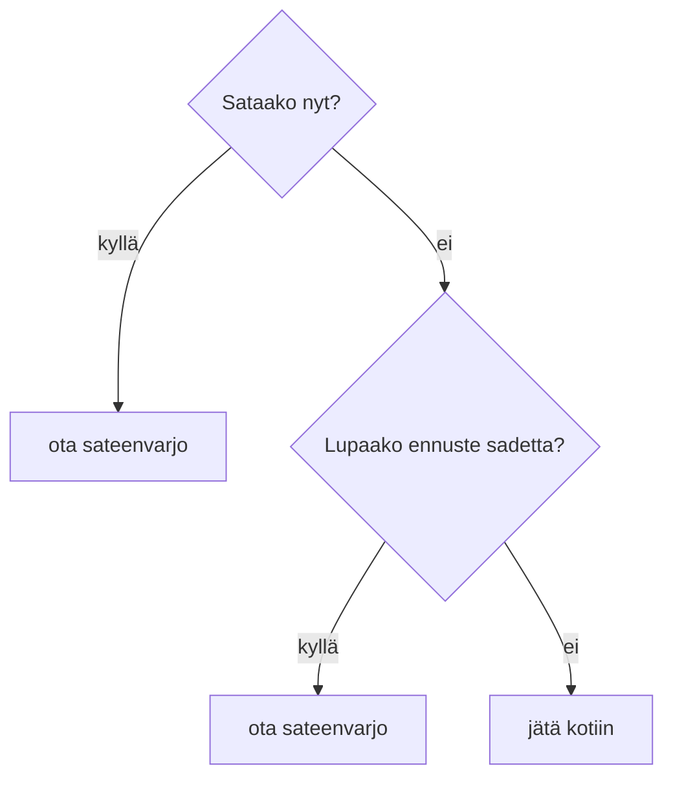
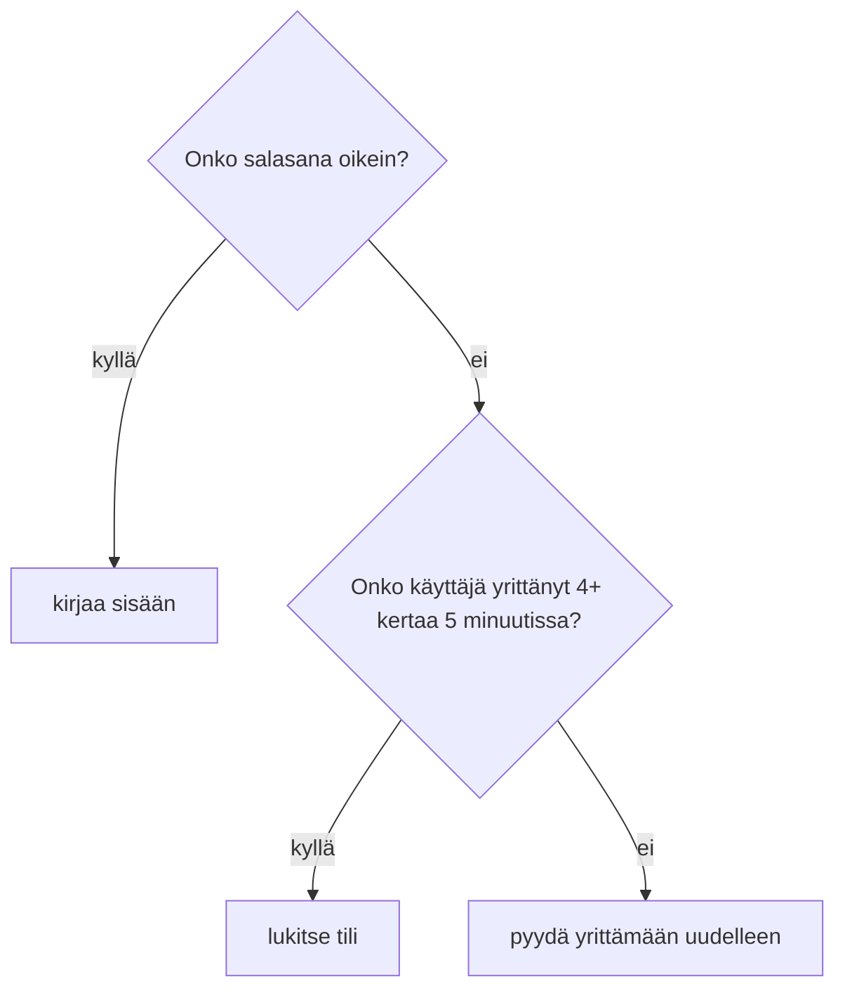

# Viikko 5 — Oppitunti 14 lisämateriaali

---

## Päätöspuut - yksi puu alusta loppuun

Lisädiasto oppitunnille 14.
Käy yksi arkinen päätöspuu hitaasti läpi ja näytä sitten, miten sama muoto ilmestyy IT-tilanteeseen.

---

## Arkinen sääntö

"Pitäisikö minun ottaa sateenvarjo tänään?"
Sääntö yhtenä suullisena virkkeenä:
> Jos sataa nyt, kyllä.
> Jos ei sada, mutta ennuste lupaa sadetta, kyllä.
> Muuten ei.

### Vinkki: päätöspuu muuttaa suullisen säännön näkyviksi kysymyksiksi ja lopputuloksiksi. ---

## Piirrä puu - haarat ja testit

Juurikysymys on ylhäällä. Kaksi testiä, kolme lehteä. Jokainen testi on asia, jonka voit oikeasti
tarkistaa.

### Vinkki: "lehti" on päätöspuun lopputulos, ei uusi kysymys. ---

## Kirjoita sääntö kevyenä if ... then ... -muotona

• if *sataa nyt*, then *ota sateenvarjo*
• else if *ennuste lupaa sadetta*, then *ota sateenvarjo*
• else *jätä se kotiin*
• Sama sääntö kirjoitettuna englanninkielisenä pikakirjoituksena. Ei koodia - vain asettelu, joka
tekee testin ja toiminnon helpommaksi nähdä.

### Vinkki: `else if` tarkoittaa "muuten, jos seuraava testi on tosi". ---

## IT-peili - pitäisikö tämä kirjautumisyritys estää?

Sääntö yhtenä suullisena virkkeenä:

> Jos salasana on väärin ja tämä on jo 4. yritys 5 minuutin sisällä, lukitse tili.
> Jos salasana on väärin, mutta yrityksiä on alle 4, pyydä käyttäjää yrittämään uudelleen.
> Jos salasana on oikein, kirjaa sisään.

### Ajattele näin: sama päätöspuun muoto, mutta testit ovat IT-järjestelmän mitattavia asioita. ---

## Sama puu, eri tilanne

Kolme haaraa. Kaksi testiä. Sama muoto kuin sateenvarjopuussa - eri testit, eri lehdet.

### Vinkki: hyvä testi perustuu tietoon, jonka järjestelmä voi oikeasti tarkistaa. ---

## Nimeä testi rehellisesti

• Päätöspuun laatu on sen haarojen testien laatua.
• Rehellinen: *"Sataako nyt?"*, *"Onko yrityksiä ollut 4+ viiden minuutin sisällä?"*
• Ei vielä rehellinen: *"Sataako joskus?"*, *"Onko käyttäjä epäilyttävä?"*
• Jos testi on epämääräinen, suorittajan täytyy arvata - ja puusta lakkaa olemasta hyötyä.
• Muistettava asia: kun piirrät tällä viikolla puun, tarkenna jokaista haaraa, kunnes testi on
asia, jonka kirjaimellinen suorittaja voi tarkistaa.

### Tee näin: vaihda adjektiivit mitattaviin ehtoihin, esimerkiksi "paljon" → "4 tai enemmän".
