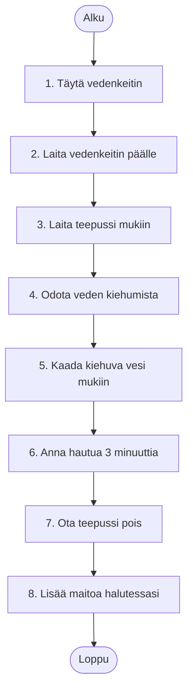

# Oppitunti 13 — Järjestys: ohjelma etenee vaihe vaiheelta

### Mitä järjestys tarkoittaa?

Järjestys on kolmesta rakennuspalikasta yksinkertaisin: tehdään yksi vaihe toisen jälkeen
kiinteässä järjestyksessä, ellei ohje sano muuta. Tuo viimeinen osa on tärkeä. Järjestys on
oletus. Kun mitään ehtoa ei ole kirjoitettu eikä mitään toistoa ole kirjoitettu, kirjaimellinen
suorittaja kulkee vaiheet ylhäältä alas ja tekee jokaisen täsmälleen kerran.
Jos järjestys kuulostaa liian itsestään selvältä ollakseen “rakennuspalikka”, se on hyödyllinen
varoitusmerkki. Monet oikean elämän prosessikuvauksien hajoamiset — epäonnistuvat
reseptit, pieleen menevät julkaisut, aamurutiinit, jotka jättävät sinut juoksemaan bussin
perään — johtuvat yhdestä vaihdetusta tai yhdestä puuttuvasta vaiheesta. Järjestys on oletus,
ja juuri oletus on usein kohta, jossa asiat rikkoutuvat.

### Järjestys arkisissa prosesseissa

Tässä on pieni algoritmi, jonka osaat jo: teen tekeminen.
1. Täytä vedenkeitin vedellä.
2. Laita vedenkeitin päälle.
3. Laita teepussi mukiin.
4. Odota, että vesi kiehuu.
5. Kaada kiehuva vesi mukiin.
6. Anna teepussin olla kolme minuuttia.
7. Ota teepussi pois.
8. Lisää maitoa, jos haluat.
Tämä on järjestys: kahdeksan numeroitua vaihetta, jokainen yksi selkeä toiminto, tietyssä
järjestyksessä. Kirjaimellinen suorittaja, jolla ei ole teekokemusta, voisi silti päätyä juotavaan
kuppiin, jos hän seuraisi vaiheita täsmälleen.
Sama järjestys vuokaaviona näyttää tältä:

Tee ajatuskoe: vaihda vaiheet 4 ja 5 keskenään — kaada kiehuva vesi mukiin ja vasta sitten
odota, että vesi kiehuu. Mitä tapahtuu? Suorittaja kaataa kylmän veden mukiin ja jää sitten
seisomaan jo tyhjän vedenkeittimen ääreen. Ohje ei enää ole teeresepti vaan sekava liikesarja.
Ydinajatus on tämä: kirjoittamasi järjestys on se järjestys, jonka suorittaja saa. Järjestys
ei takaa, että prosessi toimii; se takaa, että suorittaja ei järjestä vaiheita uudelleen puolestasi.
Jotkin vaiheet voidaan vaihtaa rikkomatta mitään. Voit harjata hampaat ennen pukeutumista
tai sen jälkeen. Muut vaiheet eivät ole vaihdettavissa. Et voi kaataa teetä ennen veden
keittämistä etkä syödä kakkua ennen sen paistamista. Tällöin sanomme, että vaiheiden välillä
on riippuvuus: myöhempi vaihe tarvitsee aikaisemman vaiheen tuloksen ennen kuin se voi
alkaa.
Tällä viikolla sinun ei tarvitse analysoida riippuvuuksia muodollisesti. Riittää, että huomaat
ne ja kirjoitat järjestyksen niin, että se kunnioittaa niitä riippuvuuksia, jotka jo tiedät.

### Järjestys IT-kontekstissa — julkaisutarkistuslista

Tässä on järjestys ammatillisen IT:n maailmasta: yksinkertaistettu julkaisutarkistuslista —
vaiheet, joita pieni tiimi voisi seurata viedessään verkkosivun uuden version käyttäjille.
1. Yhdistä uusi haara päähaaraan.
2. Aja build.
3. Aja pikaiset savutestit.
4. Vie versio staging-ympäristöön.
5. Ilmoita tiimille chatissa.
6. Odota toisen henkilön hyväksyntää.
7. Vie versio tuotantoon.
8. Seuraa koontinäyttöä kymmenen minuutin ajan.
Muoto on sama kuin teereseptissä: numeroitu lista selkeitä toimintoja tietyssä järjestyksessä.
Useita vaiheita ei voi järjestää uudelleen rikkomatta prosessia. Et voi ajaa buildia ennen
yhdistämistä — mitään uutta ei ole vielä rakennettavana. Et voi viedä tuotantoon ennen
hyväksyntää — juuri sitä varten hyväksyntä on olemassa.
Huomaa, miten arki ja IT elävät tässä rinnakkain. Kiehauta vesi → kaada vesi on sama muoto
kuin aja build → aja savutestit. Arkinen versio tulee ensin, koska se on tuttu. IT-versio on sama
ajatus eri ympäristössä.

### Riippumattomuus vs. riippuvuus — lempeä aloitus

Kaksi pientä esimerkkiä:
• Kaksi vaihetta, jotka eivät riipu toisistaan: harjaa hampaat ja laita kengät jalkaan
voivat tapahtua aamurutiinissa kummassa järjestyksessä tahansa.
• Kaksi vaihetta, jotka riippuvat toisistaan: avaa tiedosto ja tallenna tiedosto
riippuvat toisistaan. Et voi tallentaa sitä, mitä et ole avannut.
Sinun ei tarvitse piirtää riippuvuuskaaviota. Tämän viikon harjoitus on vain kirjoittaa se
järjestys, jota tarkoitat, ja olla rehellinen itsellesi, kun joku vaihe täytyy sijoittaa ennen toista,
koska se valmistaa jotakin myöhempi vaihe tarvitsee.
Pysähdy hetkeksi: Kirjoita yksi kolmivaiheinen arkinen prosessi, jossa järjestystä
voi vaihtaa, ja toinen, jossa sitä ei voi vaihtaa. Millä yhdellä sanalla kuvaisit näiden
kahden eroa?
