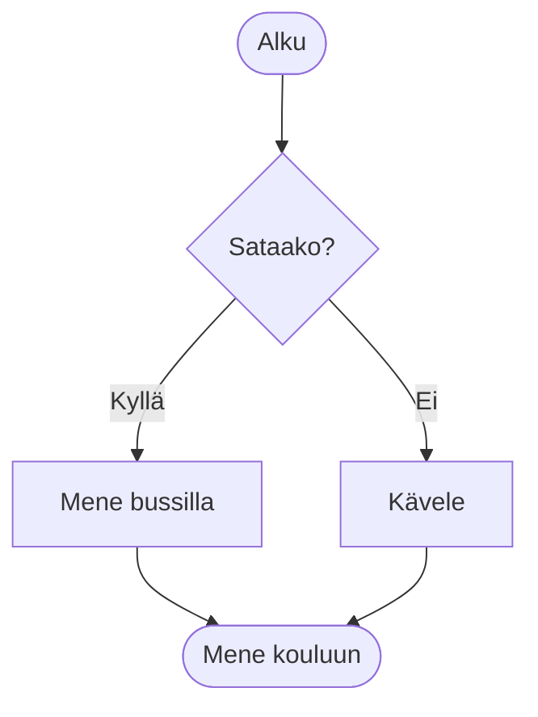

# Oppitunti 14 — Ehdot: jos–niin–muuten-ajattelu ja päätöspuut

### Mikä ehto on?

Ehto on testi, joka päättää, mikä vaihe tapahtuu seuraavaksi. Se on se hetki prosessissa, jossa
polku haarautuu. Pelkkä järjestys on suora viiva: tee A, sitten B, sitten C. Ehto lisää haaran: tee
A, ja jos X on totta, tee B, muuten tee C. Suorittajan näkökulmasta ehto on hetki, jossa
pysähdytään, tarkistetaan testi ja valitaan haara.

### Arkisia ehtoja, joita käytät jo

Käytät ehtoja joka päivä, yleensä nimeämättä niitä.
• “Jos sataa, mene bussilla; muuten kävele.” — kaksiharakainen ehto ( `jos … niin …`
) `muuten …`
• “Jos saat läksyt valmiiksi ennen ruokaa, saat pelata.” — yksiharainen ehto ( `jos … niin`
). Jos läksyt eivät ole valmiit, mitään ylimääräistä ei tapahdu. `…`
• “Jos maito haisee pahalta, heitä se pois.” — toinen yksiharainen ehto. Jos maito ei haise
pahalta, et tee sille mitään.
Ero muodon ja muodon välillä on pieni mutta todellinen. `jos … niin … jos … niin … muuten …`
Ilman -haaraa suorittajalla on vain yksi mahdollinen lisätoiminto; jos testi `muuten`
epäonnistuu, hän vain jatkaa eteenpäin. -haaralla suorittaja tekee aina joko toisen tai `Muuten`
toisen — vaihtoehto on nimetty.

### Ehdon kirjoittaminen tavallisella kielellä

Voit kirjoittaa ehtoja loppuviikon ajan samanlaisella arkisella muodolla. Ne näyttävät
tavalliselta suomelta, jossa on pieni määrä asettelua:
jos sataa, niin mene bussilla, muuten kävele
Sama ehto päätöspuuna:



Toinen esimerkki:
jos maito haisee pahalta, niin heitä se pois
Nämä eivät ole koodia. Ne ovat tavallisen kielen oikoteitä. Sanat jos, niin ja muuten tekevät
saman työn kuin välimerkit: ne auttavat näkemään, missä testi loppuu ja missä toiminta alkaa.
Älä tee niistä vielä tiukkaa ohjelmointikieltä — se tulee viikolla 6.
Hyvässä ehdossa on kolme rehellistä osaa:
1. Testi, jonka suorittaja voi oikeasti tarkistaa. “Sataako nyt?” — kyllä tai ei. “Onko
salasana lyhyempi kuin 8 merkkiä?” — kyllä tai ei.
2. Niin-haara — mitä tehdään silloin, kun testi on tosi.
3. Muuten-haara (valinnainen) — mitä tehdään, kun testi on epätosi.
Jos et kirjoita -haaraa, sanot samalla: “muuten ei tehdä mitään ylimääräistä”. `muuten`
Varmista, että tämä on todella se, mitä tarkoitit.

### Päätöspuut — haaran piirtäminen

Päätöspuu on vain kuvan muotoon piirretty ehto. Se sijoittaa testin ylös ja piirtää haarat
alaspäin. Esimerkiksi:

```
Sataako?
/ \
kyllä ei
/ \
mene bussilla kävele
```

Tämä on kaksiharainen puu. Voit tehdä myös kolmihaaraisen puun lisäämällä `muuten jos`
-haaran:

```
Sataako?
/ \
kyllä ei
/ \
mene bussilla Oletko myöhässä?
/ \
kyllä ei
/ \
juokse kävele
```

Et tarvitse mitään erityistä ohjelmistoa päätöspuun piirtämiseen. Kynä ja vihkon kulma
riittävät. Piirtäminen ei ole tärkeää piirroksen vuoksi vaan siksi, että se pakottaa sinut
rehelliseen keskusteluun itsesi kanssa. Kun jokaisen haaran kohdalla on pakko nimetä testi,
huomaat ne kohdat, joissa et ollut aiemmin rehellinen siitä, mikä testi oikeasti on.

### Ehdot IT-kontekstissa — salasanan tarkistus

Kuvittele rekisteröitymislomake verkkosivulla. Kun painat luo tili, järjestelmä tarkistaa
salasanan sääntöjä vasten. Yksinkertaistettu sääntö voisi olla näin kirjoitettuna:
• jos salasana on lyhyempi kuin 8 merkkiä, niin hylkää se
• jos salasanassa ei ole numeroa, niin hylkää se
• jos salasanassa ei ole isoa kirjainta, niin hylkää se
• muuten hyväksy se
Tämä on kolmen ehdon ketju plus -haara — yhteensä neljä reittiä, jotka päätyvät `muuten`
kahteen lopputulokseen (hylkää / hyväksy). Voit piirtää sen päätöspuuna:

```
Onko pituus alle 8 merkkiä?
/ \
kyllä ei
/ \
hylkää Eikö salasanassa ole numeroa?
/ \
kyllä ei
/ \
hylkää Eikö salasanassa ole isoa kirjainta?
/ \
kyllä ei
/ \
hylkää hyväksy
```

Huomaa: tämä on sama muoto kuin “jos sataa, mene bussilla; muuten jos olet myöhässä, juokse;
muuten kävele.” Tilanne on eri — salasanat sään sijasta — mutta muoto on sama.

### Yhdistetyt ehdot — JA, TAI (syventävä, valinnainen)

Joskus yksi ehto sisältää useamman testin. Tätäkin käytät arjessa koko ajan.
• “Jos sinulla on bussikortti ja siinä on rahaa, voit mennä bussilla.” — kaksi testiä JA-
sanalla yhdistettynä. Molempien pitää olla tosia.
• “Jos sataa tai tuulee kovaa, mene bussilla.” — kaksi testiä TAI-sanalla yhdistettynä.
Toisenkin riittäminen riittää.
Yhdistetyt ehdot ovat täysin sallittuja tavallisessa kielessä. Et tarvitse symboleja. Sana ja ja sana
tai tekevät saman työn kuin tavallisissa lauseissa.
Jos yhdistetty ehto alkaa tuntua ahtaalta — esimerkiksi “jos A ja B tai C eikä D” — se on merkki
siitä, että kannattaa piirtää pieni päätöspuu useammalla lyhyellä testillä yhden liian pitkän
testin sijaan.
Pysähdy hetkeksi: Kirjoita yksi sääntö, jota perheessäsi käytetään ja jossa on muoto
jos … niin … muuten …. Mikä siinä on testi? Voisiko kaksi eri lukijaa olla eri mieltä
siitä, onko testi tosi? Jos voisi, testi ei ole vielä tarpeeksi rehellinen.
Pysähdy hetkeksi: Katso mitä tahansa verkkosivun rekisteröitymislomaketta.
Pystytkö nimeämään kolme eri ehtoa, joita lomake tarkistaa ennen lähettämisen
sallimista? Sinun ei tarvitse nähdä koodia; virheilmoitukset paljastavat paljon.
