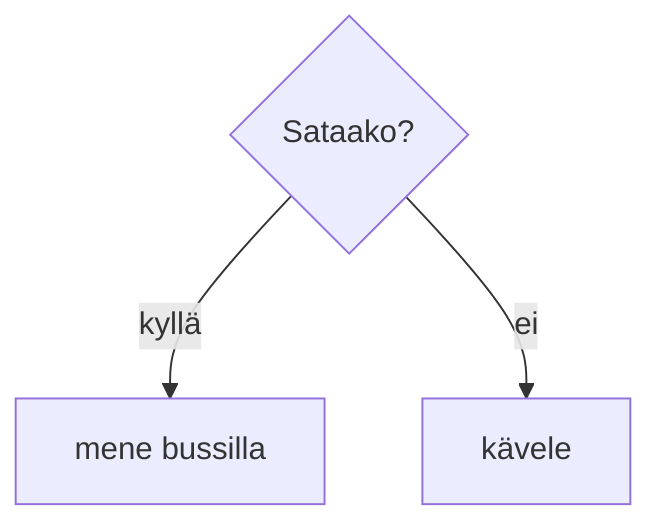

# Viikko 5 — Kolme perusliikettä: järjestys, ehto ja toisto

---

## Viikko 5 - Kolme liikettä: järjestys, ehto, toisto

Ohjelmallinen ajattelu
Ammatillisen tieto- ja viestintätekniikan ensimmäisen vuoden kurssi

---

## Keskeinen viesti

Melkein mikä tahansa prosessi voidaan kuvata kolmella rakennuspalikalla: järjestys, ehto ja
toisto.
Kun osaat nimetä ne arjen tehtävissä, sinulla on jokaisen ohjelman runko.

### Ajattele näin: ohjelmat eivät synny taikatempuista, vaan samoista kolmesta muodosta yhä

uudelleen. ---

## Mitä tällä viikolla harjoitellaan

• Oppitunti 13 - järjestys: asioita tehdään oikeassa järjestyksessä.
• Oppitunti 14 - ehdot: päätetään, mitä tehdään seuraavaksi.
• Oppitunti 15 - toisto: sama asia tehdään uudelleen, pysäytysehdolla.
• Vain yleiskieltä. Ei vielä koodia.

### Vinkki: nämä vastaavat myöhemmin koodissa rivejä, if/else-rakenteita ja silmukoita. ---

## Järjestys - oletusliike

Järjestys tarkoittaa, että yksi vaihe tehdään toisen jälkeen kiinteässä järjestyksessä.
Teeresepti:
1. Täytä vedenkeitin.
2. Kytke se päälle.
3. Laita teepussi mukiin.
4. Kaada kiehuva vesi.

### Ajattele näin: järjestys on prosessin "ylhäältä alas" -kulku. ---

## Kun järjestyksellä on väliä

Vaihda vaiheet 2 ja 4:
1. Täytä vedenkeitin.
2. Kaada kiehuva vesi.
3. Laita teepussi mukiin.
4. Kytke vedenkeitin päälle.
Kirjaimellinen suorittaja kaataa kylmää vettä ja katsoo tyhjää keitintä. Kirjoittamasi järjestys
on se järjestys, jonka saat.

### Vinkki: jos vaihe tarvitsee edellisen vaiheen tulosta, järjestys on lukittu. ---

## Järjestys työssä - käyttöönoton tarkistuslista

1. Yhdistä uusi branch eli haara.
2. Suorita build / koonti.
3. Suorita savutestit eli nopeat perustestit.
4. Vie staging-ympäristöön.
5. Hanki hyväksyntä.
6. Vie tuotantoon.
Sama muoto kuin teereseptissä. Useita vaiheita ei voi järjestää uudelleen rikkomatta
prosessia.

### Esimerkki: tuotantoon ei viedä ennen kuin staging on tarkistettu. ---

## Ehto - testi, joka jakaa polun

Ehto on testi, joka päättää, mikä vaihe tapahtuu seuraavaksi.
"Jos sataa, mene bussilla, muuten kävele."
Ehto on hetki, jossa polku haarautuu.

### Vinkki: hyvä ehto on tarkistettavissa. "Onko sade käynnissä?" on parempi kuin "onko huono

sää?". ---

## if ... then ... else ...

Arki: jos sataa, niin mene bussilla, muuten kävele.
IT-peili: jos salasana on alle 8 merkkiä pitkä, niin hylkää se, muuten hyväksy se.
Sama muoto. Eri tilanne.

### Ajattele näin: if = testi, then = mitä tehdään jos testi toteutuu, else = mitä tehdään muuten. ---

## Päätöspuu - haaran piirtäminen

Kynä ja paperi riittävät. Piirros pakottaa nimeämään rehellisen testin jokaisessa haarassa.

### Vinkki: jos haaran teksti on epämääräinen, muuta se kyllä/ei-kysymykseksi. ---

## Ehto työssä - salasanan tarkistus

• jos alle 8 merkkiä, hylkää
• jos ei numeroa, hylkää
• jos ei isoa kirjainta, hylkää
• muuten hyväksy
• Ehtojen ketju, joka päättyy kahteen lopputulokseen.

### Esimerkki: lopputulos voi olla "hyväksytty" tai "hylätty". Ehdot kertovat, miten lopputulokseen

päädytään. ---

## Toisto - tehdään uudelleen, pysäytyksellä

Toisto tarkoittaa, että sama vaihe tehdään useammin kuin kerran ja pysäytysehto on
sellainen, jonka suorittaja voi nähdä.
Arki: käy jokainen nimi läsnäololistassa läpi ja merkitse läsnä tai poissa.

### Vinkki: toisto tarvitsee aina vastauksen kysymykseen "milloin lopetetaan?". ---

## Kolme toiston muotoa

• for each - lista tunnetaan etukäteen.
• repeat until - pysäytys riippuu siitä, mitä tapahtuu.
• while - testi tarkistetaan ennen jokaista toistoa.
• Kaikki kolme tarvitsevat rehellisen, havaittavan pysäytyksen.

### Esimerkki: "for each tiedosto kansiossa" = tee sama jokaiselle tiedostolle. ---

## Toisto työssä - postilaatikon läpikäynti

> jokaiselle lukemattomalle viestille postilaatikossa:
> jos lähettäjä on ihminen, merkitse vastattavaksi;
> muuten jos viesti on uutiskirje, arkistoi;
> muuten jos viesti on roskapostia, poista.
> Toista, kunnes postilaatikko on tyhjä.
Kaikki kolme rakennuspalikkaa yhdessä prosessissa.

### Vinkki: "jokaiselle" on toistoa; "jos" on ehtoa; sisennys näyttää, mikä kuuluu minkäkin alle. ---

## Pysäytysehto on turvavyö

Rehellinen pysäytys: "kunnes postilaatikko on tyhjä", "kunnes ajastin saavuttaa 30 sekuntia".
Ei pysäytys: "kunnes tuntuu valmiilta", "kunnes ymmärrät".
Karkaava toisto ei sisällä rehellistä pysäytystä. Korjaus on turvapysäytys yleiskielellä.
Esimerkki IT:ssä: "yritä kirjautua, kunnes onnistuu" voi karata. Parempi: "yritä enintään 3
kertaa". ---

## Kolme liikettä yhdessä prosessissa

• Useimmat oikeat prosessit ovat kudelma:
• pieni järjestys sisällä
• ehto, joka valitsee, mitä tehdään
• toisto, joka tekee sen jokaiselle kohteelle
• Kolmen rakenteen nimeäminen tekee kuvauksesta luettavan.

### Ajattele näin: kun etsit rakenteita, prosessi lakkaa olemasta sekava teksti. ---

## Pakollinen vähimmäistaso vs. syventäminen

• Pakollinen vähimmäistaso
• Nimeä kolme rakennuspalikkaa arkisessa prosessissa.
• Yhdistä kaikki kolme yhdeksi lyhyeksi prosessikuvaukseksi.
• Syventäminen
• Yhdistetyt ehdot (AND, OR).
• Turvapysäytykset karkaaville toistoille.
• Ammatilliset tilanteet: salasanasääntö, tikettien ohjaus, postilaatikon läpikäynti.
• Sparraa LLM:n kanssa käyttäen rakennettua promptia. ---

## Tämän viikon tehtävät

• Tehtävä 5.1 - Kolme liikettä yhdessä prosessissa (PAKOLLINEN, syöttää AT2:een).
• Tehtävä 5.3 - Päätöspuu oikeasta säännöstä (SYVENTÄVÄ).
• Tehtävä 5.4 - Pysäytysehto on turvavyö (SYVENTÄVÄ).
• Tehtävä 5.5 - Ammatillinen näkökulma, valinnainen LLM-sparraus (SYVENTÄVÄ).
• Säilytä muistiinpanosi - AT2 tulee viikon 5 lopussa / viikon 6 aikana.

### Tee näin: alleviivaa omasta prosessistasi järjestys, ehto ja toisto eri merkinnöillä. ---

## Seuraavaksi: Viikko 6 - pseudokoodi

Tällä viikolla kirjoittamasi luonnollisen kielen kuvaukset saavat muutaman pienen käytännön:
yksinkertaiset muuttujat, kevyt sisennys ja jäljitystaulukko.
Ajattelu pysyy samana. Muoto vain tiukentuu.

### Vinkki: pseudokoodi on silta omien ohjeidesi ja oikean koodin välillä. ---

## Kertaus - keskeinen viesti vielä kerran

Melkein mikä tahansa prosessi voidaan kuvata kolmella rakennuspalikalla: järjestys, ehto ja
toisto.
Kun osaat nimetä ne arjen tehtävissä, sinulla on jokaisen ohjelman runko.
