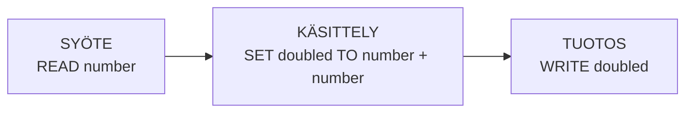

# Itseopiskelu

Kävelet pyykkitupaan. Tänään korissa on tummia vaatteita, joten käynnistät tumman pyykin
ohjelman; jos korissa olisi ollut enimmäkseen valkoisia vaatteita, olisit käynnistänyt
valkopyykin ohjelman. Koneen pyöriessä selaat puhelinta, ja heti kun kone piippaa, lopetat
selaamisen ja ripustat vaatteet kuivumaan. Tässä ei ole mitään outoa — mutta jos kirjoittaisit
tämän toiselle täsmälleen seurattavaksi, kirjoittaisit jo jotakin hyvin lähellä pseudokoodia.
Viikko 6 on tämän kurssin ajattelupuolen yhteenvetoviikko. Viikolla 1 opit, että tietokone on
kirjaimellinen suorittaja, ei ovela arvaaja. Viikot 2 ja 3 opettivat, että suuret ongelmat voidaan
pilkkoa osiin ja kuvata prosesseina. Viikko 4 muistutti, että oikea voi tarkoittaa useampaa kuin
yhtä toimivaa ratkaisua. Viikko 5 nimesi kolme rakenneliikettä, jotka löytyvät jokaisesta
kuvatusta prosessista — järjestys, ehto ja toisto. Tällä viikolla kaikki tämä tiivistyy yhdeksi
hieman täsmällisemmäksi esitystavaksi nimeltä pseudokoodi.
Kurssin keskeinen kysymys on edelleen sama, johon olet vastannut viikosta 1 asti:
Miten puhun tietokoneelle niin, että se ymmärtää, mitä haluan sen tekevän?
Tämän viikon keskeinen viesti, jonka sinun pitäisi osata toistaa takaisin oppituntiin 18
mennessä, kuuluu näin:

### Pseudokoodi on silta tavallisen kielen ja oikean koodin välillä: tarpeeksi

### täsmällinen, jotta tietokone voisi periaatteessa seurata sitä, mutta tarpeeksi

luettava, jotta sen voi jakaa myös ei-ohjelmoijalle.

Silta-ajatus on koko viikon ydin. Toisella rannalla on tavallinen kieli, jolla viikot 1–5 elivät.
Vastakkaisella rannalla on oikea koodi, joka tulee viikolla 7. Pseudokoodi on niiden välinen
silta. Rakennat tämän sillan kirjoittamalla tällä viikolla muutamia lyhyitä
pseudokoodikuvauksia tutuista prosesseista ja lukemalla niitä rivi riviltä paperilla
seurantataulukon avulla, jotta voit todistaa niiden toimivan niin kuin odotit.
AT2 osuu tälle viikolle. Se palautetaan oppitunnin 18 tienoilla. Tehtävä pyytää sinua
kirjoittamaan lyhyen pseudokoodin valitsemallesi pienelle tehtävälle, tekemään sille
kuivaharjoittelun seurantataulukon avulla yhdellä tavallisella syötteellä ja yhdellä hankalalla
syötteellä sekä kirjoittamaan viiden lauseen pohdinnan siitä, mitä seurantataulukko paljasti.
Oppituntien 16, 17 ja 18 työ on täsmälleen se materiaali, jota AT2 sinulta pyytää. Säilytä siis
kaikki paperisi.
Ajattele näin: tavallinen kieli on hyvä, kun haluat ihmisen ymmärtävän ajatuksesi.
Pseudokoodi on hyvä, kun haluat sekä ihmisen että tulevan ohjelmakoodin olevan
mahdollisimman lähellä toisiaan.

## Oppituntikohtainen lukemisto

## Oppitunti 16 - Pseudokoodi: tavallisesta kielestä täsmällisempään muotoon

### Tavallisesta kielestä pseudokoodiin

Tässä on tuttu prosessi tavallisella kielellä. Teet kupin teetä, ja tänään saatat ottaa sokeria tai
olla ottamatta.
Täytät vedenkeittimen ja laitat sen päälle. Odotat, että se naksahtaa. Laitat teepussin
mukiin ja kaadat kuuman veden. Annetaan hautua kolme minuuttia. Jos käytät
sokeria, lisäät yhden lusikallisen ja sekoitat. Sitten tee on valmis.
Lue tämä kerran ääneen. Ihmisystäväsi ymmärtää sen. Tietokone ei ymmärrä — “odota, että se
naksahtaa” (kuinka kauan? miten tietokone huomaa naksahduksen?) ja “jos käytät sokeria”
(mistä se tietää?) ovat molemmat kohteliaita aukkoja, jotka toimivat vain siksi, että lukija on
ihminen.
Sama prosessi pseudokoodina:

```pseudocode
READ takesSugar
SET kettleOn TO YES
WHILE kettleHasNotClicked DO
wait
ENDWHILE
SET bagInMug TO YES
WRITE "pour hot water"
WRITE "wait three minutes"
IF takesSugar = YES THEN
WRITE "add one spoon of sugar"
WRITE "stir"
ENDIF
WRITE "tea is ready"
```

Kun laitat nämä vierekkäin, mikä muuttuu? Tavallinen kieli on lyhyempää ja ystävällisempää.
Pseudokoodi on pidempää, mutta jokainen rivi kertoo yhden asian, jonka suorittajan pitää
tehdä, ja jokainen tavallisen kielen kohtelias aukko (naksahdus, sokeri) on nyt nimetty
kysymys ( , ), johon on selkeä vastaus. `kettleHasNotClicked takesSugar`
Pseudokoodi erottaa myös toisistaan sen, mitä käyttäjältä kysytään ( ) ja sen, mitä `READ`
käyttäjälle näytetään ( ). Tavallinen kieli sulautti nämä yhteen. Huomaa myös, että `WRITE`
viikon 5 tutut rakenteet ja ovat yhä mukana: niille on vain annettu yhteinen muoto `IF WHILE`
ja lopetusavainsanat ( , ), jotta lukija näkee yhdellä vilkaisulla, mistä lohko `ENDIF ENDWHILE`
alkaa ja mihin se päättyy.
Pseudokoodi ei ole uusi kieli, joka pitäisi opetella ulkoa. Se on samaa asiaa, jota kirjoitit jo
viikolla 5, mutta muutamalla yhteisesti sovitulla sanalla ja vakiomuodolla, jotta vieras lukija
lukee sen samalla tavalla kuin sinä.

### Pieni joukko avainsanoja

Tällä kurssilla käytetään pientä, kiinteää pseudokoodin avainsanajoukkoa. Kaikki nämä
ajatukset tulivat jo vastaan tavallisella kielellä viikolla 5. Avainsanat kirjoitetaan aina
SUURAAKKOSIN, jotta ne erottuvat nopeasti. Kaikki muu — muuttujien nimet, arvot ja viestit
— on omaa kieltäsi. `SET passwordLength TO 7`
Sijoitus. Laita arvo nimettyyn säiliöön . Tämän rivin jälkeen `7 passwordLength`
on .

```
passwordLength 7
READ password
```

Syöte. Ota käyttäjän kirjoittama arvo ja laita se nimettyyn säiliöön .

```
password
WRITE "your password is strong"
```

Tuotos. Näytä tämä viesti käyttäjälle.

```pseudocode
IF length >= 8 THEN
WRITE "long enough"
ELSE
WRITE "too short"
ENDIF
```

Ehto. Jos testi on tosi, suorita ensimmäinen lohko. Muuten suorita toinen lohko. kertoo, `ENDIF`
mihin ehtorakenne päättyy.

```pseudocode
WHILE inboxIsNotEmpty DO
WRITE "process one message"
ENDWHILE
```

Toisto, jossa testi tarkistetaan ennen jokaista kierrosta. Heti kun testi ei enää ole tosi,
toisto loppuu.

```pseudocode
FOR each folder IN backupList DO
WRITE "back up the folder"
ENDFOR
```

Toisto valmiiksi tunnetun listan yli. Suorittaja tekee sisällä olevan vaiheen kerran jokaista
listan kohtaa varten.
Näitä muotoja on kuusi. Käsittele tätä kohtaa ikään kuin muistikorttina — palaat siihen
oppitunneilla 17 ja 18.

### Järjestys, ehto, toisto — vanhat tutut uudessa muodossa

Katso yllä olevaa teepseudokoodia uudestaan. Rivirakenne, joka etenee vain ylhäältä alas ( `SET`
, sitten , sitten -rivit), on järjestystä. Lohko,

```pseudocode
kettleOn TO YES SET bagInMug TO YES WRITE
```

joka alkaa , on ehto. Lohko, joka alkaa

```
IF takesSugar = YES THEN WHILE
```

, on toisto. Täsmälleen samat kolme rakennuspalikkaa kuin viikolla `kettleHasNotClicked DO`
5.
Pseudokoodi ei tuo mukaan neljättä suurta liikettä. Se vain antaa näille kolmelle yhteisen
kirjallisen muodon.

### Miksi pseudokoodi on luotettavampi jakaa kuin tavallinen proosateksti?

Jos sinä ja parisi kirjoittaisitte saman teekuvauksen tavallisella kielellä, kaksi ystävällistä
lukijaa voisi päätyä hieman eri käsitykseen siitä, mitä sokerivaiheessa tarkalleen tapahtuu.
Pseudokoodi sulkee näitä aukkoja. “Jos käytät sokeria” muuttuu muotoon “onko muuttujan
arvo juuri nyt ?” Tämän voi lukea vain yhdellä tavalla. `takesSugar YES`
Pseudokoodin tarkoitus ei ole tehdä kirjoittamisesta helpompaa — usein se tekee siitä
vaikeampaa. Sen tarkoitus on tehdä väärinlukemisesta vaikeampaa. Kun annat sen vieraalle
lukijalle, vieras saa näkyviin juuri sen prosessin, jonka tarkoitit.
Pysähdy hetkeksi: Valitse yksi lyhyt prosessi, jonka teet joka aamu (puhelimen
lataaminen, hampaiden pesu, bussisovelluksen tarkistaminen). Missä kohdassa
tavallinen kielesi olisi liian kohteliasta — missä se jättäisi aukon, johon
kirjaimellinen suorittaja kompastuisi? Nimeä yksi tällainen aukko kirjallisesti ennen
kuin jatkat.
Pysähdy hetkeksi: Yllä oleva teepseudokoodi on 12 riviä pitkä. Jos poistaisit siitä
- ja -rivit, olisiko merkitys yhä selvä? Miksi luulet, että kurssi `ENDIF ENDWHILE`
käyttää niitä silti?

## Oppitunti 17 - Syöte, käsittely, tuotos ja muuttujan idea

### Syöte → käsittely → tuotos

Lähes jokaisessa pseudokoodissa, jonka koskaan kirjoitat, on sama kolmen osan perusmuoto.
Jotakin tulee sisään ulkopuolelta (käyttäjä kirjoittaa salasanan, anturi ilmoittaa lämpötilan,
tiedostolista annetaan käsittelyyn). Jotakin tapahtuu keskellä (tehdään testi, lasketaan
summa, käydään lista läpi). Jotakin menee ulos (näytetään viesti, palautetaan tulos,
kirjoitetaan tiedosto).
Pienin mahdollinen esimerkki näyttää tältä: lue käyttäjältä luku, tuplaa se, kirjoita tulos ulos.

```pseudocode
READ number
SET doubled TO number + number
WRITE doubled
```

Kolme riviä, yksi kutakin rungon osaa varten. Syöte on . Käsittely on `READ SET ... TO number`
. Tuotos on . `+ number WRITE`
Lähes kaikki, mitä kirjoitat tämän kurssin loppuun asti, on jokin muunnelma tästä rakenteesta
— yleensä keskiosa on pidempi, joskus syötteitä tai tuotoksia on useita, mutta nämä kolme
osaa ovat silti näkyvissä.
Piirrettynä kolmena laatikkona runko näyttää tältä:



### Mikä muuttuja on?

Muuttuja on nimetty säiliö yhdelle arvolle, joka voi vaihtua pseudokoodin suorituksen aikana.
Arkinen vertaus, joka auttaa eniten, on nimilappu purkin kyljessä. Kuvittele purkki hyllylle.
Purkin kyljessä lukee (tai , tai ). Purkin sisällä olevassa `passwordLength takesSugar total`
lapussa lukee tämänhetkinen arvo. Voit pyyhkiä luvun pois ja kirjoittaa tilalle uuden — juuri
tätä tekee rivi . Mutta purkin nimi ei muutu. Muuttujan nimi `SET passwordLength TO 8`
pysyy samana niin kauan kuin pseudokoodi on käynnissä.
Katso yhtä yksinkertaista riviä, jonka olet jo nähnyt: `SET passwordLength TO 7`
Tämä rivi luo purkin nimeltä (tai avaa sen, jos se on jo olemassa) ja laittaa `passwordLength`
sisään arvon . Seuraavista riveistä lähtien aina kun pseudokoodi käyttää nimeä `7`
, se tarkoittaa: purkin sisällä juuri nyt olevaa arvoa — ja `passwordLength passwordLength`
tällä hetkellä se on . `7`
Jos myöhempi rivi sanoo , vanha arvo pyyhkiytyy pois ja tilalle `SET passwordLength TO 8 7`
tulee . Purkin nimi on silti yhä . `8 passwordLength`
Viikolla 6 muuttujasi sisältävät vain kolmenlaisia asioita: luvun, kyllä/ei-arvon tai lyhyen
tekstin.

### Muuttujan nimen pitäisi kertoa, mitä se sisältää

Vertaa näitä kahta riviä:

```pseudocode
SET x TO 7
SET passwordLength TO 7
```

Tietokoneelle ne tekevät täsmälleen saman asian: laittavat arvon nimettyyn säiliöön. `7`
Seuraavalle ihmiselle, joka lukee tekstin, ne ovat aivan eri tasoa. Ensimmäinen rivi on arvoitus.
Toinen kertoo heti, mihin liittyy. `7`
Nimeä muuttujat sen mukaan, mitä ne sisältävät, älä sen mukaan, mikä tuntuu sillä
hetkellä nopealta.

### Ammatillinen esimerkki — salasanan vahvuuden tarkistus

```pseudocode
READ password
SET length TO numberOfCharactersIn(password)
SET hasDigit TO doesPasswordContainADigit(password)
IF length >= 8 AND hasDigit = YES THEN
SET isStrong TO YES
ELSE
SET isStrong TO NO
ENDIF
IF isStrong = YES THEN
WRITE "password is strong"
ELSE
WRITE "password is too weak"
ENDIF
```

Käy läpi rungon kolme osaa.
• Syöte: ensimmäinen rivi ( ) `READ password`
• Käsittely: rivit 2–8
• Tuotos: toinen , joka näyttää käyttäjälle viestin `IF`
Huomaa myös neljä muuttujaa: , , , . Huomaa lisäksi, että `password length hasDigit isStrong`
ja ovat apumuuttujia, jotka pitävät testin luettavana. `length hasDigit`
Pysähdy hetkeksi: Valitse yksi hyvä ja yksi huono muuttujanimi omista
muistiinpanoistasi. Kirjoita auki, mitä kumpikin muuttuja oikeasti säilyttää.

## Oppitunti 18 - Pseudokoodin testaaminen: kuivaharjoittelu ja virheiden löytäminen

### Mitä kuivaharjoittelu on?

Kuivaharjoittelu tarkoittaa sitä, että käyt läpi pseudokoodin käsin, rivi riviltä, paperilla ja
kuvittelet olevasi tietokone. Et saa hypätä eteenpäin tai arvata puuttuvia kohtia. Juuri tämä
kurinalaisuus paljastaa virheet.

### Seurantataulukko

Seurantataulukko on pieni ruudukko, jonka piirrät pseudokoodin viereen. Yksi sarake
jokaista muuttujaa varten, yksi tuotosta varten ja yksi rivi jokaista suoritettua riviä varten.

```pseudocode
SET total TO 0
SET counter TO 1
WHILE counter <= 3 DO
SET total TO total + counter
SET counter TO counter + 1
ENDWHILE
WRITE total
```

Odotettu tuotos: . `6`
Rivi counter total Tuotos
1 — 0
2 1 0
3 1 0 (testi: 1 <= 3,
kyllä)
4 1 1
5 2 1
3 2 1 (testi: 2 <= 3,
kyllä)
4 2 3
5 3 3
3 3 3 (testi: 3 <= 3,
kyllä)
4 3 6
Rivi counter total Tuotos
5 4 6
3 4 6 (testi: 4 <= 3, ei)
7 4 6 6
Todellinen tuotos on , joten pseudokoodi toimii tällä syötteellä. `6`

### Virheen löytäminen

Kun muutat ehtorivin muotoon , kolmas kierros jää tekemättä ja

```pseudocode
WHILE counter < 3 DO
```

todellinen tuotos muuttuu arvoksi . Tästä näet, että kyseessä on off-by-one-virhe — ehto on `3`
yhden vertailun verran pielessä.

### Reunatapaukset paperilla

Paras jäljitettävä syöte ei aina ole helppo tapaus. Reunatapaukset, kuten tyhjä syöte, arvo , `0`
negatiivinen luku tai täsmälleen raja-arvon mittainen salasana, paljastavat virheitä hyvin
tehokkaasti.

### AT2:sta

AT2 pyytää juuri tätä: lyhyt pseudokoodi, kuivaharjoittelu yhdellä tavallisella ja yhdellä
hankalalla syötteellä sekä lyhyt pohdinta siitä, mitä jäljitys näytti.
Pysähdy hetkeksi: Mikä on ensimmäinen kohta, jossa odotettu ja todellinen tuotos
eroavat toisistaan? Aloita virheen etsintä siitä.
