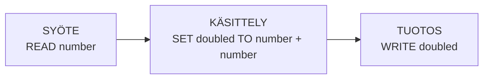

# Oppitunti 17 — Syöte, käsittely, tuotos ja muuttujan idea

### Syöte → käsittely → tuotos

Lähes jokaisessa pseudokoodissa, jonka koskaan kirjoitat, on sama kolmen osan perusmuoto.
Jotakin tulee sisään ulkopuolelta (käyttäjä kirjoittaa salasanan, anturi ilmoittaa lämpötilan,
tiedostolista annetaan käsittelyyn). Jotakin tapahtuu keskellä (tehdään testi, lasketaan
summa, käydään lista läpi). Jotakin menee ulos (näytetään viesti, palautetaan tulos,
kirjoitetaan tiedosto).
Pienin mahdollinen esimerkki näyttää tältä: lue käyttäjältä luku, tuplaa se, kirjoita tulos ulos.

```pseudocode
READ number
SET doubled TO number + number
WRITE doubled
```

Kolme riviä, yksi kutakin rungon osaa varten. Syöte on . Käsittely on `READ SET ... TO number`
. Tuotos on . `+ number WRITE`
Lähes kaikki, mitä kirjoitat tämän kurssin loppuun asti, on jokin muunnelma tästä rakenteesta
— yleensä keskiosa on pidempi, joskus syötteitä tai tuotoksia on useita, mutta nämä kolme
osaa ovat silti näkyvissä.
Piirrettynä kolmena laatikkona runko näyttää tältä:



Ajattele näin: syöte vastaa kysymykseen “mitä tietoa aluksi tarvitaan?” Käsittely vastaa
kysymykseen “mitä tiedolle tehdään?” Tuotos vastaa kysymykseen “mitä käyttäjä lopuksi
näkee tai saa?”

### Mikä muuttuja on?

Muuttuja on nimetty säiliö yhdelle arvolle, joka voi vaihtua pseudokoodin suorituksen aikana.
Arkinen vertaus, joka auttaa eniten, on nimilappu purkin kyljessä. Kuvittele purkki hyllylle.
Purkin kyljessä lukee (tai , tai ). Purkin sisällä olevassa `passwordLength takesSugar total`
lapussa lukee tämänhetkinen arvo. Voit pyyhkiä luvun pois ja kirjoittaa tilalle uuden — juuri
tätä tekee rivi . Mutta purkin nimi ei muutu. Muuttujan nimi `SET passwordLength TO 8`
pysyy samana niin kauan kuin pseudokoodi on käynnissä.
Katso yhtä yksinkertaista riviä, jonka olet jo nähnyt: `SET passwordLength TO 7`
Tämä rivi luo purkin nimeltä (tai avaa sen, jos se on jo olemassa) ja laittaa `passwordLength`
sisään arvon . Seuraavista riveistä lähtien aina kun pseudokoodi käyttää nimeä `7`
, se tarkoittaa: purkin sisällä juuri nyt olevaa arvoa — ja `passwordLength passwordLength`
tällä hetkellä se on . `7`
Jos myöhempi rivi sanoo , vanha arvo pyyhkiytyy pois ja tilalle `SET passwordLength TO 8 7`
tulee . Purkin nimi on silti yhä . `8 passwordLength`
Viikolla 6 muuttujasi sisältävät vain kolmenlaisia asioita:
• luvun ( , ) `7 42`
• kyllä/ei-arvon ( , ) `YES NO`
• lyhyen tekstin ( ) `"hunter2"`
Tällä viikolla et tarvitse listoja, olioita tai muuta monimutkaisempaa.

### Muuttujan nimen pitäisi kertoa, mitä se sisältää

Vertaa näitä kahta riviä:

```pseudocode
SET x TO 7
SET passwordLength TO 7
```

Tietokoneelle ne tekevät täsmälleen saman asian: laittavat arvon nimettyyn säiliöön. `7`
Seuraavalle ihmiselle, joka lukee tekstin — parillesi, opettajalle tai sinulle itsellesi kolmen
viikon päästä — ne ovat aivan eri tasoa. Ensimmäinen rivi on arvoitus: mikä on ? Toinen rivi `x`
kertoo heti, mihin liittyy. `7`
Nimeä muuttujat sen mukaan, mitä ne sisältävät, älä sen mukaan, mikä tuntuu sillä
hetkellä nopealta. Hyvä nimi on halvin tapa parantaa luettavuutta. Huono nimi on kallis virhe,
jonka jätät tulevalle itsellesi.
Yksinkertainen sääntö: jos vieras lukija voisi lukea rivin ääneen ja arvata, mitä siihen on
tallennettu, nimi on riittävän hyvä.
Huonoja nimiä tässä tilanteessa ovat esimerkiksi: , , , . `x tmp n data2`
Parempia nimiä ovat esimerkiksi: , , , ,

```
passwordLength isStrong takesSugar totalCost
```

. `unreadCount`

### Ammatillinen esimerkki — salasanan vahvuuden tarkistus

Tässä on tyypillinen työelämähenkinen tehtävä: käyttäjä kirjoittaa salasanan, ja pseudokoodi
päättää, onko se tarpeeksi vahva.

```pseudocode
READ password
SET length TO numberOfCharactersIn(password)
SET hasDigit TO doesPasswordContainADigit(password)
IF length >= 8 AND hasDigit = YES THEN
SET isStrong TO YES
ELSE
SET isStrong TO NO
ENDIF
IF isStrong = YES THEN
WRITE "password is strong"
ELSE
WRITE "password is too weak"
ENDIF
```

Käy läpi rungon kolme osaa.
• Syöte: ensimmäinen rivi ( ) `READ password`
• Käsittely: rivit 2–8 (laske pituus, tarkista sisältääkö numeron, päätä ) `isStrong`
• Tuotos: toinen , joka näyttää käyttäjälle viestin `IF`
Huomaa myös neljä muuttujaa, joista jokaisen nimi kertoo, mitä se sisältää: , , `password length`
, . Yksikään niistä ei ole . `hasDigit isStrong x`
Huomaa lisäksi, että ja ovat apumuuttujia — ne ovat olemassa siksi, että `length hasDigit`
rivin 4 testi pysyy luettavana. Voisit puristaa kaiken yhteen valtavaan -riviin, mutta yllä `IF`
oleva versio on seuraavalle lukijalle paljon helpompi. Pseudokoodi palkitsee siitä, että olet
ystävällinen seuraavalle lukijalle.
Pysähdy hetkeksi: Valitse yksi kolmesta parhaasta muuttujanimestäsi tähän
mennessä ja yksi huonoimmista. Kirjoita kummastakin yhdellä lauseella, mitä arvoa
sen oli tarkoitus säilyttää. Jos huonon nimen selityslause on pidempi kuin hyvän, sait
juuri itse todistettua, miksi hyvä nimi on parempi.
Pysähdy hetkeksi: Katso yllä olevaa salasanan vahvuusesimerkkiä. Jos käyttäjä
kirjoittaa 9-merkkisen salasanan, jossa ei ole yhtään numeroa, mitä
seurantataulukko tuottaisi? Kävele esimerkki läpi paperilla ennen kuin jatkat.
