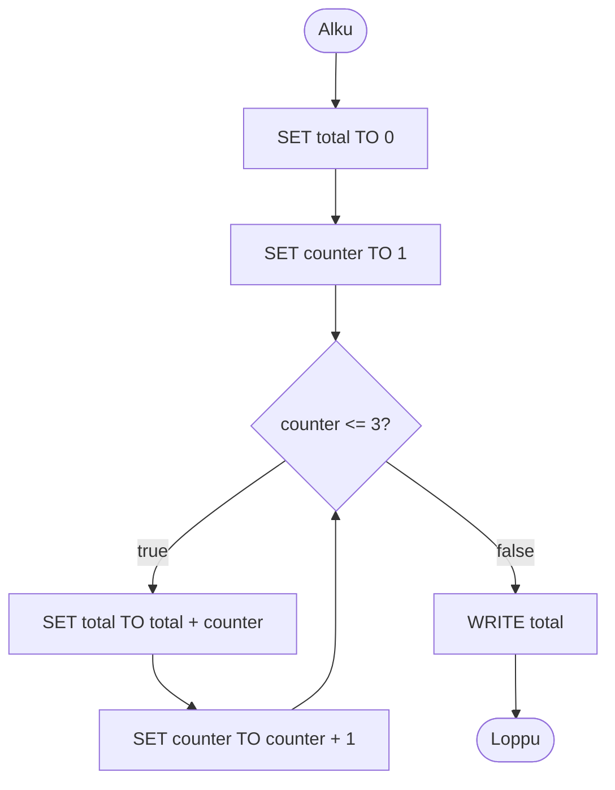

# Oppitunti 18 — Pseudokoodin testaaminen: kuivaharjoittelu ja virheiden löytäminen

### Mitä kuivaharjoittelu on?

Kuivaharjoittelu tarkoittaa sitä, että käyt läpi pseudokoodin käsin, rivi riviltä, paperilla ja
kuvittelet olevasi tietokone. Viikolla 1 tutustuit kirjaimelliseen robottiin: suorittajaan, jolla ei ole
maalaisjärkeä, joka tekee vain täsmälleen sen, mitä sivulla sanotaan. Kuivaharjoittelu on sitä,
että esität itse tuota kirjaimellista robottia omalle pseudokoodillesi.
Et saa hypätä eteenpäin. Et saa olettaa. Et saa “nähdä mitä se varmaan tarkoittaa”. Luet rivin 1,
teet täsmälleen sen mitä siinä käsketään, kirjoitat ylös tuloksen — ja vasta sitten siirryt riviin
2. Kurinalaisuus on koko jutun pointti.
Kuivaharjoittelu paperilla löytää virheitä, joita pelkkä uudelleenlukeminen ei löydä, koska
pelkkä lukeminen antaa silmiesi silottaa juuri sen kohdan, jota tietokone ei silottaisi.

### Seurantataulukko

Seurantataulukko on pieni ruudukko, jonka piirrät pseudokoodin viereen kuivaharjoittelun
aikana. Yksi sarake jokaista muuttujaa varten. Yksi sarake lopussa tuotosta varten. Yksi
taulukon rivi jokaista suoritettua pseudokoodiriviä varten. Jokainen taulukon rivi näyttää, mitä
muuttujissa on sen jälkeen, kun kyseinen rivi on suoritettu.
Tässä on valmis esimerkki. Kuvitellaan, että pseudokoodin tarkoitus on laskea luvut 1, 2 ja 3
yhteen ja kirjoittaa summa ulos.

```pseudocode
SET total TO 0
SET counter TO 1
WHILE counter <= 3 DO
SET total TO total + counter
SET counter TO counter + 1
ENDWHILE
WRITE total
```

Odotettu tuotos (päätetään ennen jäljittämistä): . `6`
Sama pseudokoodi vuokaaviona — hyödyllinen etenkin sen näkemiseen, missä toisto palaa
takaisin ehtoon:



Seurantataulukko:
Rivi counter total Tuotos
1 — 0
2 1 0
3 1 0 (testi: 1 <= 3,
kyllä)
4 1 1
5 2 1
3 2 1 (testi: 2 <= 3,
kyllä)
4 2 3
5 3 3
3 3 3 (testi: 3 <= 3,
kyllä)
4 3 6
5 4 6
3 4 6 (testi: 4 <= 3, ei —
poistu toistosta)
7 4 6 6
Todellinen tuotos: . Odotettu tuotos: . Tälle syötteelle pseudokoodi toimii oikein. `6 6`
Huomaa rytmi. Aina kun muuttujan arvo muuttuu, kirjoitat uuden arvon sen sarakkeeseen.
Aina kun tarkistaa testinsä, kirjoitat testin tuloksen ylös. Aina kun jotakin kirjoitetaan `WHILE`
ulos, se menee tuotos-sarakkeeseen. Taulukon lopussa todellinen tuotos tuijottaa sinua
suoraan, ja voit verrata sitä odotettuun tuotokseen rivi riviltä.

### Virheen löytäminen

Katso nyt lähes samaa pseudokoodia, mutta yhdellä pienellä muutoksella:

```pseudocode
SET total TO 0
SET counter TO 1
WHILE counter < 3 DO <-- changed
SET total TO total + counter
SET counter TO counter + 1
ENDWHILE
WRITE total
```

Odotettu tuotos on edelleen (yritämme yhä laskea yhteen 1, 2 ja 3). Jäljitetään se: `6`
Rivi counter total Tuotos
1 — 0
2 1 0
3 1 0 (testi: 1 < 3, kyllä)
4 1 1
5 2 1
3 2 1 (testi: 2 < 3, kyllä)
4 2 3
5 3 3
3 3 3 (testi: 3 < 3, ei —
poistu toistosta)
7 3 3 3
Todellinen tuotos on . Odotettu tuotos on . Ne eivät täsmää. Seurantataulukko löysi juuri `3 6`
virheen.
Missä virhe on? Katso niitä rivejä, joissa arvot lakkasivat käyttäytymästä odotetusti. Kolmatta
kierrosta ei koskaan tapahtunut — rivin 3 testi muuttui epätodeksi yhden kierroksen liian
aikaisin. Virhe on rivillä 3: pitäisi olla .

```
counter < 3 counter <= 3
```

Tämä on yksi yleisimmistä virheistä sekä pseudokoodissa että oikeassa ohjelmakoodissa, ja sillä
on yleiskielinen nimi: off-by-one-virhe. Ehto oli yhden vertailun verran pielessä. Korjaa rivi,
tee jäljitys uudestaan alusta ja todellinen tuotos vastaa taas odotettua.
Pseudokoodin virhe on pieni, täsmällinen vika — väärä vertailu, puuttuva alustus, väärä haara,
sekava muuttujanimi. Virheen nimeäminen on jo puolet sen korjaamisesta.

### Reunatapaukset paperilla

Seurantataulukko huomaa sen, minkä silmä jättää huomaamatta, ja silmä jättää eniten
huomaamatta rajoilla. Paras jäljitettävä syöte ei usein ole se mukava keskialueen tapaus vaan
hankala tapaus.
Reunatapaus (termi, jonka tapasit jo viikolla 1) on syöte, joka asettuu pseudokoodin odotusten
rajalle. Yllä olevassa summalaskuesimerkissä kysymyksiä ovat esimerkiksi:
• mitä tapahtuu, jos on ? `N 0`
• mitä tapahtuu, jos on ? `N 1`
• mitä tapahtuu, jos on negatiivinen? `N`
Tai salasanan vahvuustarkistuksessa:
• mitä tapahtuu, jos salasana on tyhjä?
• mitä tapahtuu, jos se on täsmälleen 8 merkkiä pitkä, kun sääntö sanoo “vähintään 8”?
• mitä tapahtuu, jos siinä on 8 merkkiä mutta ne kaikki ovat numeroita?
Jokainen näistä on reunatapaus, ja juuri niissä suurin osa oikeista virheistä piilee. Oppitunnin
18 kurinalainen tapa on jäljittää vähintään yksi tavallinen syöte ja vähintään yksi reunatapaus
joka kerta.

### AT2:sta

Juuri tässä kohtaa myös AT2 tulee mukaan. AT2 palautetaan tämän viikon oppitunnin 18
tienoilla. Se pyytää sinua kirjoittamaan lyhyen pseudokoodin valitsemallesi pienelle tehtävälle
(arkiselle prosessille tai pienelle ammatilliselle tilanteelle, kuten helpdesk-vastausten
lajittelulle, salasanan vahvuuden tarkistukselle tai päivittäiselle varmuuskopioinnille),
tekemään sille kuivaharjoittelun seurantataulukon avulla yhdellä tavallisella ja yhdellä
hankalalla syötteellä sekä kirjoittamaan viiden lauseen pohdinnan siitä, mitä jäljitys paljasti.
AT2:n ja tämän kohdan välissä ei tule uusia työkaluja. Ei uusia merkintätapoja. Kaikki, mitä
AT2 pyytää, löytyy tästä itseopiskelumateriaalista ja opiskelijatehtävistä. Säilytä siis
pseudokoodisi ja seurantataulukkosi — ne ovat juuri sitä materiaalia, jonka AT2 tarvitsee.
Pysähdy hetkeksi: Katso yllä olevaa off-by-one-virhettä. Jos olisit vain lukenut
pseudokoodin uudelleen, olisitko varmasti huomannut virheen toisella lukukerralla?
Vastaa itsellesi rehellisesti. Kysy sitten: mikä oli erilaista siinä, että luit koodia

seurantataulukon kanssa?

Vinkki: jos et tiedä, mistä virheen etsintä kannattaa aloittaa, aloita ensimmäisestä kohdasta,
jossa odotettu ja todellinen tuotos eroavat toisistaan. Virhe löytyy usein ennen sitä tai juuri
siitä kohdasta.
