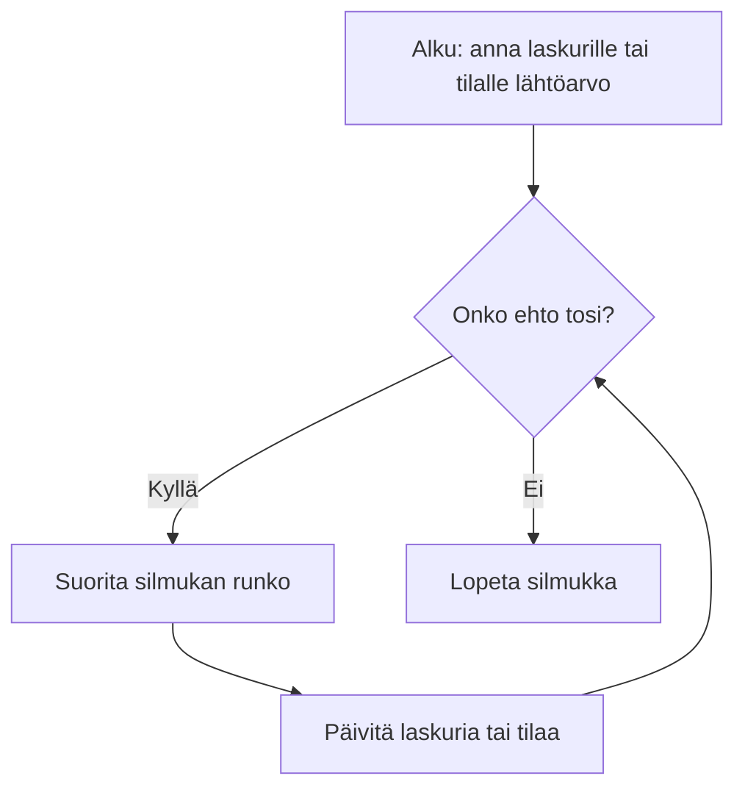

# Silmukka sulkeutuu — ensimmäinen oikea ohjelmasi

## Johdanto

Olet saapunut kurssin viimeiselle viikolle. Kahdeksan viikkoa sitten ensimmäisellä oppitunnilla esitettiin yksi kysymys, ja olet siitä lähtien rakentanut vastausta siihen:

**Miten puhun tietokoneelle niin, että se ymmärtää, mitä haluan sen tekevän?**

Seitsemän viikon ajan vastaus on rakentunut pala kerrallaan. Viikolla 1 tietokone oli kirjaimellinen ohjeiden noudattaja. Viikolla 2 opit pilkkomaan tehtävän pienempiin osiin. Viikoilla 3 ja 4 nimesit ohjelmallisen ajattelun peruspalikoita: syöte, käsittely, tuloste; järjestys, vaihtoehto ja toisto. Viikko 5 toi mukaan täsmälliset ehdot. Viikolla 6 kirjoitit pseudokoodia — silloin ohjeesi eivät olleet enää vain huolellisia, vaan ne alkoivat näyttää oikealta koodilta. Viikolla 7 ylitit lopulta sillan JavaScriptiin ja C#:iin: tulostus, muuttujat ja `if/else`.

Tällä viikolla vastaus muuttuu konkreettiseksi. Kirjoitat pienen ohjelman valitsemallasi kielellä — JavaScriptillä tai C#:lla — ja suoritat sen oikealla koneella. Valitset ohjelman aiheen omasta viikon 6 pseudokoodistasi. Suoritat ohjelman kahdella eri alkuarvolla. Rikot sen, joko tarkoituksella tai vahingossa, luet virheilmoituksen ja korjaat yhden rivin. Oppitunnilla 24 pidät kahden minuutin suullisen esityksen: mitä ohjelma tekee, miten se toimii, mikä meni pieleen ja miten korjasit sen. Tämä on **AT3**.

**Tämän viikon keskeinen viesti:** Kurssi sulkee silmukan. Otat itse viikolla 6 kirjoittamasi pseudokoodin, käännät sen JavaScriptiksi tai C#:ksi, suoritat sen, löydät yhden bugin, korjaat sen ja selität, miten ohjelma toimii. Ohjelmointi ei ole enää mysteeri.

Molemmat kielet ovat tällä viikolla yhtä tärkeitä, kuten viikolla 7. Jokainen esimerkki näytetään sekä JavaScriptillä että C#:lla rinnakkain. Lue ensin oman kielesi sarake, mutta vilkaise myös toista. Koodin muoto on melkein sama, ja sen huomaaminen on iso osa tämän viikon ideaa.

**Ajattele näin:** Et ole opettelemassa kahta täysin erilaista maailmaa. Opettelet yhtä ajattelutapaa, joka kirjoitetaan kahdella hieman eri syntaksilla.

---

## Oppitunti 22 — Silmukat koodissa

## Miksi silmukoita tarvitaan?

Viikolla 5 kirjoitit ensimmäiset “toista, kunnes” -tyyppiset lauseesi, esimerkiksi: **TOISTA … KUNNES salasana on tarpeeksi pitkä**. Viikolla 6 kirjoitit pseudokoodiin samankaltaisia silmukoita: **WHILE password is too short DO …**, **FOR each item in the list DO …**. Ne olivat jo silmukoita. Puuttui vain tietokone, joka osaa lukea ne.

**Silmukka** on virallinen nimi sille “toista, kunnes” -ajatukselle, jota pseudokoodisi jo käytti. Nyt toistamisen tekee ihmisen sijaan tietokone. Ajattelu on sama. Tällä viikolla muuttuu syntaksi eli se tarkka kirjoitusmuoto, jonka JavaScript ja C# ymmärtävät.

Tietokone tarvitsee silmukkaa varten kolme asiaa:

1. **Mistä aloitan?**
2. **Milloin lopetan?**
3. **Mitä muutetaan jokaisen toiston välissä?**

Silmukka on kohta, jossa nämä kolme vastausta ovat siististi yhdessä lohkossa.

**Mermaid-kaavio**



**Ajattele näin:** Silmukka on kuin liikenneympyrä. Siinä kierretään niin kauan kuin ehto käskee jatkaa. Kun ehto ei enää pidä paikkaansa, poistutaan ympyrästä.

**Pysähdy hetkeksi:** Etsi yksi viikolla 6 kirjoittamasi pseudokoodisivu, jossa käytit sanoja **WHILE**, **REPEAT** tai **FOR each**. Lue se. Kirjoita omin sanoin, mikä siinä toistuu ja mikä saa toiston loppumaan. Nämä kaksi vastausta ovat juuri ne asiat, joita `for`- tai `while`-silmukka tarvitsee.

---

## `for`-silmukan muoto

Tämän viikon hyödyllisin silmukka on **for-silmukka**. Käytä sitä silloin, kun tiedät etukäteen, montako kertaa haluat suorittaa silmukan rungon. Esimerkiksi: “tulosta numerot 1–5” tai “sano hei kolme kertaa”.

Tässä on sama yksinkertainen laskuri molemmilla kielillä.

### JavaScript

```javascript
for (let i = 1; i <= 5; i++) {
  console.log(i);
}
```

### C#

```csharp
for (int i = 1; i <= 5; i++) {
    Console.WriteLine(i);
}
```

Molemmat ohjelmat tulostavat:

```text
1
2
3
4
5
```

Koodikatkelmat ovat lähes samanlaiset. Molemmissa käytetään sanaa `for`, kolmea pientä osaa sulkeiden sisällä, puolipisteitä niiden välissä ja aaltosulkeisiin kirjoitettua runkoa. Pintatason erot ovat samoja kuin viikolla 7: `let` verrattuna `int`-sanaan sekä `console.log` verrattuna `Console.WriteLine`-komentoon.

---

## Laskuri, ehto, runko ja päivitys

`for`-silmukan sulkeiden sisällä on kolme pientä osaa. Kun mukaan lasketaan aaltosulkeissa oleva lohko, `for`-silmukassa on neljä nimettyä osaa:

**Laskuri** — pieni muuttuja, jota kutsutaan usein nimellä `i`. Se pitää kirjaa siitä, kuinka pitkälle silmukka on edennyt. Yllä olevassa esimerkissä laskuri alkaa arvosta `1`.

**Ehto** — kyllä/ei-testi, joka tarkistetaan ennen jokaista toistoa. Niin kauan kuin ehto on tosi, silmukka suorittaa rungon vielä kerran. Yllä oleva ehto on `i <= 5`, eli “niin kauan kuin laskuri on 5 tai pienempi, jatka”.

**Runko** — aaltosulkeiden sisällä oleva lohko. Kaikki, mitä kirjoitat tänne, tapahtuu kerran jokaisella toistolla. Yllä runko on vain `console.log(i);` tai `Console.WriteLine(i);`, joten jokainen toisto tulostaa laskurin nykyisen arvon.

**Päivitys** — se, mikä muuttuu jokaisen toiston välissä. Tavallisesti se lisää laskuriin yhden. Yllä päivitys on `i++`, joka tarkoittaa lyhyesti: “kasvata `i`:tä yhdellä”.

Lue silmukka kerran ääneen:

> “Laskuri alkaa arvosta 1. Ehto: niin kauan kuin laskuri on 5 tai pienempi. Runko: tulosta laskuri. Päivitys: lisää laskuriin yksi.”

Molemmissa kielissä silmukan voi lukea juuri tässä järjestyksessä.

Jos laskuri ei koskaan muutu — esimerkiksi jos unohdat `i++`-kohdan — ehto pysyy ikuisesti totena eikä silmukka koskaan pysähdy. Tätä bugia kutsutaan **päättymättömäksi silmukaksi**. Nimeämme sen kohta tarkemmin.

**Vinkki:** Kun tarkistat silmukan, kysy aina neljä asiaa: mistä laskuri alkaa, mikä on ehto, mitä runko tekee ja miten laskuria päivitetään?

---

## `while`-silmukan muoto

`for` on silmukka, jota käytät silloin, kun tiedät toistojen määrän. **while-silmukkaa** käytät silloin, kun tiedät lopetusehdon, mutta et tarkkaa toistojen määrää. Esimerkiksi: “kysy salasanaa, kunnes se on tarpeeksi pitkä” tai “jatka niin kauan kuin kupissa on vielä teetä”.

`while`-silmukan muoto on vielä yksinkertaisempi kuin `for`-silmukan: sulkeissa on ehto ja aaltosulkeissa runko.

### JavaScript

```javascript
let count = 0;

while (count < 3) {
  console.log("Hei");
  count = count + 1;
}
```

### C#

```csharp
int count = 0;

while (count < 3) {
    Console.WriteLine("Hei");
    count = count + 1;
}
```

Molemmat ohjelmat tulostavat:

```text
Hei
Hei
Hei
```

Lue `while`-silmukka tavallisena suomena:

> “Niin kauan kuin `count` on pienempi kuin 3, tulosta Hei ja lisää sitten `count`-muuttujaan yksi.”

Huomaa, että laskuri `count`, ehto `count < 3`, runko `console.log("Hei")` tai `Console.WriteLine("Hei")` ja päivitys `count = count + 1` ovat edelleen mukana. Ne vain sijaitsevat eri kohdissa kuin `for`-silmukassa. `while`-silmukka on tavallaan `for`-silmukka, jonka neljä osaa on sijoitettu eri tavalla luettavuuden vuoksi.

Tässä on pieni vaihtokauppa: `while` on joustavampi, mutta sinun täytyy itse muistaa päivittää laskuri silmukan rungossa. `for`-silmukassa päivitys on sulkeissa, missä sitä on vaikeampi unohtaa. Suurin osa tämän viikon ohjelmista toimii helpommin `for`-silmukkana. Käytä `while`-silmukkaa silloin, kun “kunnes” tuntuu luonnollisemmalta kuin “toista N kertaa”.

---

## Kun silmukka jatkuu ikuisesti

**Päättymätön silmukka** on silmukka, jonka ehto ei koskaan muutu epätodeksi. Silloin silmukan runko jatkaa suorittamista eikä ohjelma lopu. Tämä tapahtuu useimmiten silloin, kun päivitysvaihe unohtuu.

### JavaScript

```javascript
let count = 0;

while (count < 3) {
  console.log("Hei");
  // puuttuu: count = count + 1;
}
```

### C#

```csharp
int count = 0;

while (count < 3) {
    Console.WriteLine("Hei");
    // puuttuu: count = count + 1;
}
```

Selaimen konsolissa näet tulosteen jatkuvan, kunnes sivu jumittuu. .NET Fiddlessä ohjelman suoritus aikakatkaistaan muutaman sekunnin jälkeen, ja saatat nähdä viestin tyyliin “The process was terminated”. Kumpikaan ei ole vaarallista. Sulje välilehti tarvittaessa. Korjaus on sama molemmissa kielissä: varmista, että jokin silmukan rungossa muuttaa arvoa, jota ehto tarkistaa.

Jos ohjelma näyttää ensimmäisellä suorituskerralla jumittuvan, todennäköisin syy on juuri tämä: silmukan laskuri ei päivity.

**Pysähdy hetkeksi:** Katso yllä olevaa `for`-silmukkaa, jossa laskuri kulkee arvosta 1 arvoon 5. Mitä tapahtuisi, jos vaihtaisit kohdan `i++` muotoon `i--`? Ennusta tulos ilman suorittamista. Seuraa sitten mielessäsi: muuttuuko ehto `i <= 5` koskaan epätodeksi? Jos ei, millainen bugi se on?

---

## Oppitunti 23 — Pseudokoodista pieneksi ohjelmaksi

Tämä on rakentamispäivä. Uutta käsitettä ei tule. Käännät yhden osan omasta viikko 6:n pseudokoodistasi rivi riviltä JavaScriptiksi tai C#:ksi. Ajattelutyö on jo tehty. Työ on enimmäkseen muotojen vaihtamista.

---

## Valitse yksi osa viikon 6 pseudokoodistasi

Avaa viikon 6 muistiinpanosi. Valitse yksi katkelma: ikärajan tarkistus, salasanan pituuden tarkistus, pisteistä palautteeksi -ohjelma, laskuri tai tervehdys. Sopiva koko on noin 6–20 riviä. Jos suosikkisi on tätä isompi, valitse siitä yksi osa, joka tekee yhden selkeän työn alusta loppuun.

Jos et löydä viikon 6 pseudokoodia tai olet kadottanut sivun, valitse jokin näistä varamalleista ja sovita arvot omaan tilanteeseesi:

**Ikärajan tarkistus.** Aseta ikä. Jos se on 18 tai enemmän, tulosta “sallittu”. Muuten tulosta “ei sallittu”.

**Salasanan pituuden tarkistus.** Aseta salasana. Jos se on vähintään 8 merkkiä pitkä, tulosta “tarpeeksi vahva”. Muuten tulosta “liian lyhyt”.

**Pisteistä palautteeksi.** Aseta pistemäärä. Jos se on 80 tai enemmän, tulosta “hienoa työtä”. Jos se on 50 tai enemmän, tulosta “läpäisit”. Muuten tulosta “yritä uudelleen”.

**Yksinkertainen laskuri.** Tulosta numerot 1–5 `for`-silmukalla.

**Tervehdys nimellä.** Aseta nimi. Käytä `for`-silmukkaa ja tulosta “Hei, NIMI” kolme kertaa.

**Vinkki:** Valitse mieluummin pieni ohjelma, jonka ymmärrät kokonaan, kuin iso ohjelma, josta osaat selittää vain osan. AT3:ssa tärkeää on, että pystyt selittämään oman ohjelmasi.

---

## Käännöstaulukko

Useimmilla pseudokoodiriveillä on yksi selkeä muoto JavaScriptissä ja C#:ssa. Kun opit tämän pienen taulukon, oppitunti 23 muuttuu melkein mekaaniseksi.

| Pseudokoodin malli | JavaScript | C# |
|---|---|---|
| `WRITE "Hei"` | `console.log("Hei");` | `Console.WriteLine("Hei");` |
| `SET x TO 5` | `let x = 5;` | `int x = 5;` |
| `SET name TO "Aino"` | `let name = "Aino";` | `string name = "Aino";` |
| `IF x >= 18 THEN … ELSE …` | `if (x >= 18) { … } else { … }` | `if (x >= 18) { … } else { … }` |
| `REPEAT N TIMES` | `for (let i = 0; i < N; i++) { … }` | `for (int i = 0; i < N; i++) { … }` |
| `WHILE x < 3 DO …` | `while (x < 3) { … }` | `while (x < 3) { … }` |
| `INCREASE x BY 1` | `x = x + 1;` tai `x++;` | `x = x + 1;` tai `x++;` |
| `IF x EQUALS 5 THEN …` | `if (x === 5) { … }` tai `if (x == 5) { … }` | `if (x == 5) { … }` |

Tämä riittää kääntämään kaiken, mitä kirjoitit viikolla 6. Rakenne oli jo olemassa. Taulukko antaa sille vain oikeat pintasanat valitussa ohjelmointikielessä.

**Vinkki:** Pseudokoodissa saa olla englanninkielisiä avainsanoja, vaikka selitys on suomeksi. Tärkeää on, että ymmärrät rivin tarkoituksen ja osaat kääntää sen oikeaksi koodiksi.

---

## Kaksi läpikäytyä esimerkkiä rinnakkain

### Ikärajan tarkistus

Viikon 6 pseudokoodi:

> Aseta iäksi 17. Jos ikä on 18 tai enemmän, tulosta “sallittu”. Muuten tulosta “ei sallittu”.

### JavaScript

```javascript
let age = 17;

if (age >= 18) {
  console.log("sallittu");
} else {
  console.log("ei sallittu");
}
```

### C#

```csharp
int age = 17;

if (age >= 18) {
    Console.WriteLine("sallittu");
} else {
    Console.WriteLine("ei sallittu");
}
```

Molemmat tulostavat:

```text
ei sallittu
```

Muuta `17` arvoksi `19`, niin molemmat tulostavat:

```text
sallittu
```

Nämä kaksi koodikatkelmaa vastaavat toisiaan rivi riviltä.

---

### Tervehdys nimellä: silmukka ja muuttuja

Viikon 6 pseudokoodi:

> Toista 3 kertaa: tulosta “Hei, nimi”.

### JavaScript

```javascript
let name = "Aino";

for (let i = 0; i < 3; i++) {
  console.log("Hei, " + name);
}
```

### C#

```csharp
string name = "Aino";

for (int i = 0; i < 3; i++) {
    Console.WriteLine("Hei, " + name);
}
```

Molemmat tulostavat:

```text
Hei, Aino
Hei, Aino
Hei, Aino
```

Tekstin ja muuttujan välissä oleva `+` toimii molemmissa kielissä samalla tavalla. Tässä sen tehtävä on **yhdistäminen** eli **konkatenaatio**: se liimaa tekstinpätkiä yhdeksi tekstiksi.

**Esimerkki:**  
`"Hei, " + name` muuttuu ohjelmassa tekstiksi `"Hei, Aino"`.

Yksi tavallinen yhden merkin ansa kannattaa huomata jo nyt ennen oppitunnin 24 virheilmoitusten lukemista: merkkijonon pituus kirjoitetaan JavaScriptissä `name.length`, pienellä `l`-kirjaimella, mutta C#:ssa `name.Length`, isolla `L`-kirjaimella. Niiden sekoittaminen on juuri sellainen kirjoitusvirhe, joka tuottaa huomenna luettavia virheilmoituksia.

---

## Tallenna, suorita ja katso tuloste

### JavaScript — selaimen konsolissa

Avaa mikä tahansa verkkosivu. Paina:

- Mac: `Cmd + Opt + J`
- Windows/Linux: `Ctrl + Shift + J`

Liitä koodisi konsoliin, paina Enter ja lue tuloste. Tallenna sama koodi tavalliseksi tekstitiedostoksi, jonka tiedostopääte on `.js`. Se on AT3:n lähdekooditiedostosi.

### C# — verkossa toimivassa .NET-suorittimessa

Avaa `dotnetfiddle.net`. Valitse yläreunasta **Console**. Liitä koodisi `Main`-metodin sisään. Paina **Run** ja lue tuloste. Tallenna sama koodi tavalliseksi tekstitiedostoksi, jonka tiedostopääte on `.cs`. Se on AT3:n lähdekooditiedostosi.

Ota kuvakaappaus suorituksesta niin, että tuloste näkyy. Tämä kuvakaappaus on yksi AT3:n palautettavista osista.

**Pysähdy hetkeksi:** Katso ohjelmaa, jonka juuri kirjoitit tai olet kirjoittamassa. Lue se kerran rivi riviltä ääneen tavallisena suomena. Jos pystyt sanomaan, mitä jokainen rivi tekee ilman käännöstaulukkoa, olet valmis esittelemään sen kahdessa minuutissa oppitunnilla 24. Jos kompastut johonkin riviin, juuri se rivi kannattaa lukea uudelleen ennen esitystä.

---

## Kun ruutu on tyhjä tai ohjelma on hiljaa

Jos suoritat ohjelman eikä mitään tapahdu, tarkista ensin tylsät syyt:

**Painoitko oikeasti Run / Enter?** Tämä on yleisin syy.

**Liititkö vain osan ohjelmasta?** Erityisesti .NET Fiddlessä koodin pitää olla `Main`-metodin sisällä.

**Onko tulostusrivillä kirjoitusvirhe?** JavaScriptissä `console.Log` isolla `L`:llä on virhe. C#:ssa `Console.Writeline` pienellä `l`:llä ei ole olemassa — oikea muoto on `Console.WriteLine`.

**Pysähtyikö ohjelma aiemmin virheeseen?** Vieritä ylöspäin. Tyhjän kohdan yläpuolella oleva punainen viesti on ongelma. Oppitunti 24 opettaa lukemaan näitä viestejä.

Jos mikään näistä ei ole syy, lisää ohjelman alkuun testitulostus:

### JavaScript

```javascript
console.log("pääsin tänne");
```

### C#

```csharp
Console.WriteLine("pääsin tänne");
```

Jos “pääsin tänne” tulostuu, ohjelma käynnistyy. Puuttuva tuloste on silloin jossakin alempana.

**Pysähdy hetkeksi:** Vertaa kääntämääsi ohjelmaa alkuperäiseen viikon 6 pseudokoodiin. Laita ne vierekkäin. Ympyröi jokaiselta riviltä kohdat, jotka ovat kirjaimellisesti samoja: muuttujien nimet, numerot ja sanat kuten `if`. Ympyröiden määrä voi yllättää. Loput ovat syntaksia; ympyrät ovat sitä ajattelua, jota kurssi on harjoittanut viikosta 1 lähtien.

---

## Oppitunti 24 — Testaa, korjaa yksi bugi ja esittele

Tällä oppitunnilla tapahtuu kolme asiaa, ja kaikki riippuvat siitä, että ohjelma saadaan suoritettua. Testaat ohjelman kahdella alkuarvolla. Luet yhden oikean virheilmoituksen ja korjaat yhden rivin. Esittelet koko tarinan kahdessa minuutissa.

---

## Käsin testaaminen

Tällä viikolla **testaaminen** tarkoittaa yhtä tarkkaa asiaa: suorita ohjelma vähintään kahdella eri alkuarvolla ja tarkista, että tuloste on järkevä molemmilla kerroilla. Et tarvitse automaattista testityökalua, testikehystä tai erityissanastoa. Muutat vain yhden numeron tai merkkijonon ohjelman alussa ja painat **Run**.

Yllä olevassa ikärajaohjelmassa kaksi arvoa voivat olla `age = 17` ja `age = 19`. Ensimmäisen pitäisi tulostaa `ei sallittu`. Toisen pitäisi tulostaa `sallittu`. Jos molemmat suoritukset vastaavat ennustettasi, ohjelma läpäisee käsin tehdyn testin. Jos toinen tulostaa väärän viestin, löysit juuri bugin.

### JavaScript — muuta yksi rivi suoritusten välissä

```javascript
let age = 17;   // suorita kerran arvolla 17, muuta sitten arvoksi 19 ja suorita uudelleen
```

### C# — muuta yksi rivi suoritusten välissä

```csharp
int age = 17;   // suorita kerran arvolla 17, muuta sitten arvoksi 19 ja suorita uudelleen
```

AT3:a varten suoritat oman ohjelmasi kahdella eri arvolla ja tallennat molemmat tulosteet. Yksi kuvakaappaus, jossa molemmat suoritukset näkyvät, riittää. Myös kaksi erillistä kuvakaappausta käy.

**Vinkki:** Kirjoita ennen suorittamista paperille tai kommenttiin, mitä odotat ohjelman tulostavan. Silloin huomaat helpommin, jos tuloste on väärä.

---

## Oikean virheilmoituksen lukeminen

Kun tietokone ei ole tyytyväinen, se tulostaa virheilmoituksen. Ensimmäisellä kerralla se voi näyttää pelottavalta: pitkältä ja tekniseltä. Tämän viikon yksinkertaisissa bugeissa viesti osoittaa kuitenkin yleensä suoraan riville, jota pitää muuttaa.

Tavallinen JavaScript-virhe:

```text
Uncaught ReferenceError: scre is not defined
    at <anonymous>:3:15
```

Ja sen C#-serkku:

```text
error CS0103: The name 'scre' does not exist in the current context
```

Molemmat viestit tarkoittavat samaa:

> En tiedä, mikä `scre` on.

Syy on lähes aina kirjoitusvirhe. Olet jossain ohjelman alussa määritellyt muuttujan `score`, mutta myöhemmin kirjoittanut `scre`, josta puuttuu `o`. Korjaus: etsi `scre`, lisää puuttuva `o` ja suorita ohjelma uudelleen.

Tämän kurssin tasolla **debuggaus** tarkoittaa tätä: luet, mitä tietokone kertoo, etsit rivin, johon se viittaa, muutat yhden pienen asian ja suoritat ohjelman uudelleen.

Voit kohdata myös kaksi muuta virhemuotoa:

JavaScriptissä `=` merkin käyttäminen `===`-vertailun sijaan ei aina tuota virheilmoitusta, vaan hiljaisen väärän vastauksen. Löydät sen testaamalla kahdella arvolla ja huomaamalla, että toinen tulos on väärä.

C#:ssa puuttuva puolipiste tulostaa usein virheen:

```text
error CS1002: ; expected
```

Viestissä kerrotaan myös rivinumero. Lisää `;` kyseisen rivin loppuun, tallenna ja suorita ohjelma uudelleen.

**Pysähdy hetkeksi:** Valitse yksi oppitunnilla 23 kirjoittamasi ohjelma. Älä muuta ohjelman logiikkaa, mutta kirjoita tarkoituksella yhden muuttujan nimi väärin jossain ohjelman keskellä. Suorita ohjelma. Lue virheilmoitus. Ennusta ennen korjaamista, mihin sanaan ohjelmassasi viesti viittaa. Korjaa sitten sana ja suorita uudelleen. Kun teet tämän ensimmäisen kerran, virheilmoitusten mysteeri alkaa kadota.

---

## Yksi pieni korjaus, yksi uusi suoritus

Tällä kurssilla **debuggaus** tarkoittaa konsolin virheilmoituksen lukemista ja yhden pienen korjauksen tekemistä. Se ei tarkoita erillistä debugger-työkalua eikä ohjelman pysäyttämistä rivi riviltä. Mitään erityistä ohjelmistoa ei tarvitse asentaa. Et opettele testikehystä.

Koko silmukka on tämä:

1. Suorita ohjelma.
2. Näe virheilmoitus tai odottamaton tuloste.
3. Lue viesti tai vertaa odotettua ja todellista tulostetta rivi riviltä.
4. Etsi vastuussa oleva rivi.
5. Muuta yksi pieni asia.
6. Suorita ohjelma uudelleen.

AT3:ssa sinun täytyy tehdä tämä vähintään kerran. Bugi voi olla kirjoitusvirhe, puuttuva puolipiste C#:ssa, `=` merkin käyttäminen `==`-vertailun sijaan, puuttuva `}` tai jokin muu vastaava. Kaikki käyvät. Jos ohjelmasi toimi ensimmäisellä yrittämällä, aiheuta bugi tarkoituksella: riko yksi asia, lue viesti ja korjaa se takaisin.

---

## Kahden minuutin esitys

Oppitunnilla 24 pidät luokalle kahden minuutin suullisen esityksen ohjelmastasi. Kaksi minuuttia on lyhyt aika — noin 200 puhuttua sanaa. Esityksessä on neljä osaa, noin 30 sekuntia kutakin:

### 1. Mitä ohjelma tekee?

Sano yksi tai kaksi lausetta tavallisella suomella.

> “Ohjelmani ottaa salasanan ja tulostaa joko ‘tarpeeksi vahva’ tai ‘liian lyhyt’ sen mukaan, kuinka pitkä salasana on.”

### 2. Miten ohjelma tekee sen?

Käy rakenne läpi.

> “Alussa asetan muuttujan nimeltä `password`. Sen jälkeen on `if/else`: jos salasanan pituus on 8 tai enemmän, ohjelma tulostaa ‘tarpeeksi vahva’, muuten ‘liian lyhyt’.”

Jos ohjelmassasi on silmukka, nimeä sen neljä osaa: laskuri, ehto, runko ja päivitys.

### 3. Mikä meni pieleen?

Nimeä yksi bugi, jonka löysit.

> “Ensimmäisellä suorituskerralla olin kirjoittanut `password.length` pienellä l-kirjaimella, mutta koodini oli C#:aa, jossa sen pitää olla isolla L-kirjaimella: `password.Length`. Siksi sain CS0103-virheen.”

### 4. Miten korjasit sen?

Sano yksi lause.

> “Vaihdoin pienellä kirjoitetun l-kirjaimen isoksi L-kirjaimeksi sillä yhdellä rivillä ja suoritin ohjelman uudelleen.”

Siinä on kahden minuutin esityksesi. Et tarvitse dioja. Et lue käsikirjoitusta sanasta sanaan. Koodin ei tarvitse olla eleganttia. Seisot oman ohjelmasi vieressä ja selität sen omin sanoin.

**Käytännön vinkki:** Harjoittele kerran kotona puhelimen ajastimella. Jos olet valmis 45 sekunnissa, jokin neljästä osasta jää todennäköisesti liian ohueksi. Jos ylität kaksi minuuttia, luet luultavasti koodia rivi riviltä. Lyhennä sitä ja puhu enemmän siitä, mitä ohjelma tekee.

**Pysähdy hetkeksi:** Avaa ohjelmasi näytölle nyt. Kokeile neljä osaa ääneen, ajastimen kanssa jos mahdollista. Ensimmäinen yritys on todennäköisesti liian lyhyt tai liian pitkä. Toinen yritys on melkein aina lähempänä sopivaa. Esitys ei ole ulkoa muistamisen testi. Se testaa, pystytkö seisomaan oman työsi takana ja selittämään sen.

---

## Vertailu luokkakaverin kanssa

Jos oppitunnilla 24 jää aikaa esitysten jälkeen, etsi luokkakaveri, joka käytti toista ohjelmointikieltä. Lukekaa toistenne ohjelmat. Kirjoita 3–5 lausetta tavallisella suomella eroista:

- C#:ssa puolipisteitä on kaikkialla, JavaScriptissä ne ovat usein valinnaisia.
- C#:ssa käytetään `Console.WriteLine`, JavaScriptissä `console.log`.
- C#:ssa muuttujan tyyppi kirjoitetaan näkyviin, kuten `int` tai `string`, kun taas JavaScriptissä käytetään usein `let`.
- C#:n metodien nimet alkavat usein isolla kirjaimella, kuten `WriteLine`.

Kirjoita myös yksi asia, joka on sama:

> Silmukka ja `if/else` näyttävät melkein samalta molemmissa kielissä.

Tuo viimeinen havainto on koko syy siihen, miksi olet nähnyt molemmat kielet rinnakkain.

---

## Miten AT3 arvioidaan?

AT3 arvioidaan asteikolla **hyväksytty / vielä täydennettävä**. Numeroarvosanaa ei anneta, eikä mukana ole pitkää arviointirubriikkia. On vain lyhyt tarkistuslista.

## Palautat seuraavat asiat:

**Lähdekoodi**  
Tiedosto muodossa `.js` tai `.cs`, tai selkeä koodilohko, jossa on oikea kielimerkintä.

**Kuvakaappaus ohjelman suorituksesta**  
Tulosteessa pitää näkyä vähintään yksi odotettu tulos.

**3–5 virkkeen kirjallinen reflektio**  
Nimeä yksi bugi, jonka löysit, ja yksi korjaus, jonka teit.

**Kahden minuutin suullinen esitys oppitunnilla 24**  
Esityksen pitää kattaa neljä osaa: mitä ohjelma tekee, miten se toimii, mikä meni pieleen ja miten korjasit sen.

## Opettaja tarkistaa neljä asiaa:

1. Ohjelma toimii, tai epäonnistunut yrityksesi on dokumentoitu virheilmoituksen kanssa.
2. Osaat sanoa tavallisella suomella, mitä ohjelma tekee.
3. Yksi bugi ja siihen tehty korjaus on dokumentoitu.
4. Kahden minuutin esitys on pidetty.

Jos jokin näistä neljästä puuttuu, työ on **vielä täydennettävä**. Opettaja kertoo, mikä kohta pitää korjata. “Vielä täydennettävä” ei ole häpeä. Se tarkoittaa vain, että jäljellä on yksi pieni asia.

---

## Yhteenveto — keskeisen kysymyksen silmukka sulkeutuu

Kahdeksan viikkoa sitten tämä kurssi alkoi yhdellä kysymyksellä. Olet vastannut siihen osissa joka viikko sen jälkeen. Nyt voit vastata siihen kokonaisena, omin sanoin, toimiva ohjelma käsissäsi.

Tässä kysymys vielä kerran — samassa muodossa kuin viikolla 1:

**Miten puhun tietokoneelle niin, että se ymmärtää, mitä haluan sen tekevän?**

Tällä viikolla vastaat siihen tekemällä sen. Otat itse viikolla 6 kirjoittamasi pseudokoodin ja käännät sen JavaScriptiksi tai C#:ksi. Määrittelet muuttujan. Kirjoitat `if/else`-rakenteen. Kirjoitat `for`-silmukan. Painat **Run**. Jos tietokone ei ole tyytyväinen, se tulostaa virheilmoituksen, joka osoittaa riville, jossa jokin meni väärin. Korjaat sen yhden rivin. Sitten nouset luokan eteen ja kerrot kahdessa minuutissa, mitä ohjelmasi tekee ja miten korjasit asian, joka meni pieleen.

Tällä tasolla se on ohjelmointia. Ei taikuutta. Ei mysteeri. Pieni, huolellinen ohjetiedosto, joka tekee täsmälleen sen, mitä käskit sen tehdä.

Kaikki, mitä muu koulutuksesi lisää tämän päälle — uusia kieliä, isompia projekteja, kirjastoja, sovelluskehyksiä ja tiimityötä — rakentuu saman asian päälle: kirjaimellinen tietokone seuraa kirjoittamiasi ohjeita ja kertoo tekstinä, jos se ei pysty tulkitsemaan jotakin.

Ohjelmointi ei ole enää mysteeri.

Säilytä AT3-lähdekooditiedostosi. Avaa se uudelleen kuuden kuukauden päästä. Se näyttää pieneltä. Juuri se on tarkoitus — sinä kirjoitit sen.

**Tervetuloa keskeisen kysymyksen toiselle puolelle.**
