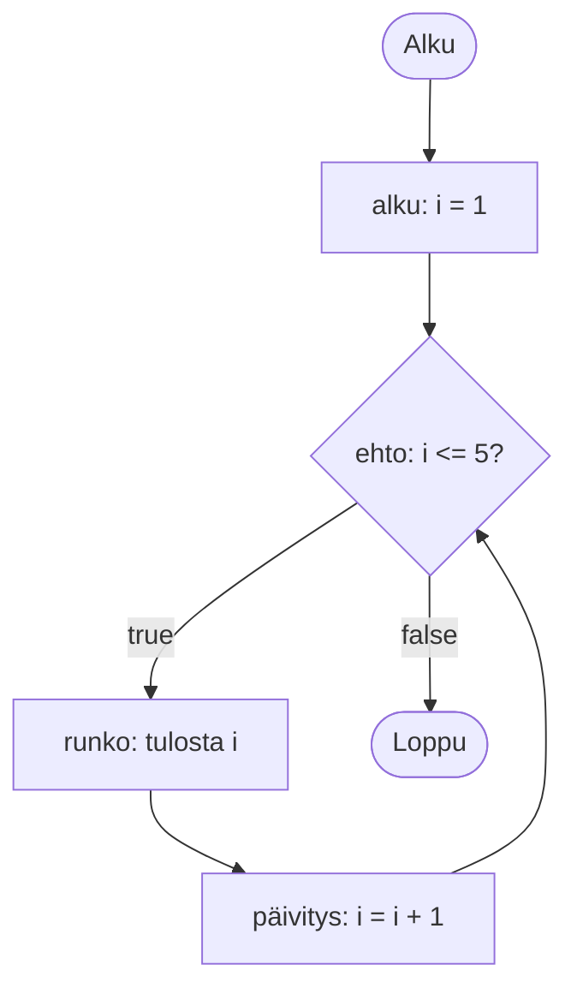

# Oppitunti 22 — Silmukat koodissa

### Miksi silmukoita tarvitaan?

Viikolla 5 kirjoitit ensimmäiset toista kunnes -lauseesi ( `TOISTA … KUNNES salasana on`
), ja viikolla 6 kirjoitit samat ajatukset pseudokoodissa - ja `riittävän pitkä WHILE FOR each`
-muotoina. Ne olivat jo silmukoita. Ainoa puuttuva asia oli tietokone, joka pystyisi lukemaan
ne.
Silmukka on muodollinen nimi sille toista-kunnes -ajatukselle, jota pseudokoodisi jo käytti —
nyt vain tietokone tekee toistamisen, ei ihminen. Ajattelu on sama. Tällä viikolla muuttuu
syntaksi: JavaScript ja C# hyväksyvät pienen joukon tarkkoja silmukkamuotoja, joissa on
nimetyt osat.
Tietokone tarvitsee silmukkaa varten kolme vastausta:
• mistä aloitetaan?
• milloin lopetetaan?
• mitä muutetaan jokaisen kierroksen välillä?
Silmukka on paikka, jossa nämä kolme vastausta elävät samassa siistissä rakenteessa.



Pysähdy hetkeksi: Etsi yksi viikon 6 pseudokoodisivu, jossa käytit , `WHILE REPEAT`
tai -rakennetta. Kirjoita ylös omin sanoin: mikä siinä toistuu, ja mikä saa `FOR each`
toiston loppumaan? Nämä kaksi vastausta ovat täsmälleen se, mitä - tai - `for while`
silmukka tarvitsee. `for`

### -silmukan muoto

Tämän viikon hyödyllisin silmukka on . Käytä sitä silloin, kun tiedät etukäteen, montako `for`
kertaa silmukan rungon halutaan toistuvan — esimerkiksi “tulosta numerot 1–5” tai “sano hei
kolme kertaa”.
Tässä sama yksinkertainen laskurisilmukka molemmilla kielillä.
JavaScript

```javascript
for (let i = 1; i <= 5; i++) {
console.log(i);
}
```

C

```csharp
for (int i = 1; i <= 5; i++) {
Console.WriteLine(i);
}
```

Molemmat ohjelmat tulostavat:

```
1
2
3
4
5
```

Koodit ovat lähes identtiset. Molemmat käyttävät sanaa , kolmea pientä osaa sulkeissa `for`
puolipisteillä erotettuina sekä aaltosuluilla rajattua runkoa. Pintatasolla erot ovat samat kuin
jo viikolla 7: vs. ja vs. . `let int console.log Console.WriteLine`

### Laskuri, ehto, runko, päivitys

-silmukassa on neljä nimettävää osaa: `for`
• Laskuri — pieni muuttuja, yleensä , joka kertoo missä kohdassa silmukka menee. `i`
Esimerkissämme se alkaa arvosta . `1`
• Ehto — kyllä/ei-testi, joka tarkistetaan ennen jokaista kierrosta. Niin kauan kuin ehto
on tosi, runko suoritetaan uudelleen. Esimerkissämme ehto on . `i <= 5`
• Runko — aaltosulkeiden sisällä oleva koodi. Se tapahtuu kerran joka kierroksella.
Esimerkissämme runko vain tulostaa nykyisen laskurin arvon.
• Päivitys — se, mikä muuttuu joka kierroksen jälkeen. Tavallisesti laskuri kasvaa
yhdellä. Esimerkissämme tarkoittaa: lisää :hin yksi. `i++ i`
Lue silmukka ääneen näin:
Laskuri alkaa arvosta 1. Ehto: niin kauan kuin laskuri on enintään 5. Runko: tulosta
laskurin arvo. Päivitys: lisää laskuriin yksi.
Jos laskuri ei koskaan muutu — jos esimerkiksi unohtaisit -osan — ehto pysyy totena `i++`
ikuisesti eikä silmukka lopu koskaan. Tätä kutsutaan äärettömäksi silmukaksi. `while`

### -silmukan muoto

-silmukkaa käytät silloin, kun tiedät etukäteen kierrosten määrän. -silmukkaa käytät `for while`
silloin, kun tiedät lopetusehdon mutta et tarkkaa kierrosmäärää — esimerkiksi “jatka
kysymistä, kunnes salasana on tarpeeksi pitkä” tai “jatka, niin kauan kuin kupissa on vielä
teetä”.
Muoto on vielä yksinkertaisempi kuin -silmukassa: ehto sulkeisiin, runko aaltosulkuihin. `for`
JavaScript

```javascript
let count = 0;
while (count < 3) {
console.log("Hello");
count = count + 1;
}
```

C

```csharp
int count = 0;
while (count < 3) {
Console.WriteLine("Hello");
count = count + 1;
}
```

Molemmat tulostavat:

```
Hello
Hello
Hello
```

Lue -silmukka näin: “niin kauan kuin on pienempi kuin 3, tulosta ja lisää `while count Hello`
sitten :iin yksi”. `count`
Huomaa, että myös -rakenteessa ovat mukana samat neljä ajatusta kuin -rakenteessa `while for`
— laskuri, ehto, runko ja päivitys — mutta ne on jaettu eri paikkoihin. pakkaa osat yhteen `for`
riviin. levittää ne näkyvämmin. `while`
Pieni vaihtokauppa: on joustavampi, mutta sinun täytyy muistaa kirjoittaa päivitys itse `while`
rungon sisälle. -rakenteessa päivitys on silmukan otsikossa, joten sitä on vaikeampi `for`
unohtaa.

### Kun silmukka ei lopu koskaan

Ääretön silmukka on silmukka, jonka ehto ei koskaan muutu epätodeksi. Tällöin runko
jatkaa ikuisesti. Yleisin syy on se, että päivitys unohtuu.

```javascript
let count = 0;
while (count < 3) {
console.log("Hello");
// puuttuu: count = count + 1;
}
int count = 0;
while (count < 3) {
Console.WriteLine("Hello");
// puuttuu: count = count + 1;
}
```

Selaimen konsolissa tulostetta valuu ruudulle, kunnes sivu alkaa jumiutua. .NET Fiddlessä
suoritus yleensä keskeytyy hetken kuluttua viestillä kuten “The process was terminated”.
Kumpikaan ei ole vaarallista. Ratkaisu on sama molemmilla kielillä: varmista, että rungon
sisällä tapahtuu jotakin sellaista, joka muuttaa ehtoa testaavan arvon.
Pysähdy hetkeksi: Mitä tapahtuisi, jos vaihtaisit yllä olevassa -silmukassa `for`
päivityksen muotoon ? Ennusta ensin ilman ajamista. Muuttuuko ehto

```
i++ i-- i <= 5
```

koskaan epätodeksi? Jos ei, minkä tyyppinen virhe tämä on?
